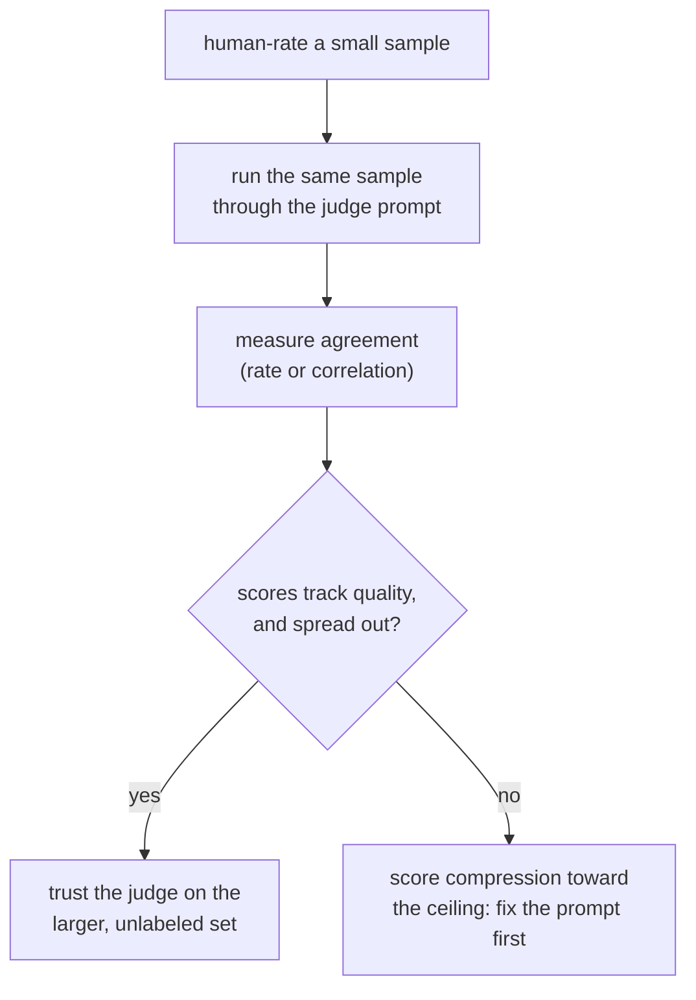

# 第 5 课：裁判提示词的设计与校准

**使命关联:** 第 3 阶段涉及的，是第 1、2 阶段为开放式文本所铺垫的那件工具：固定答案的指标和 n-gram 重叠，在这里都不能很好地反映质量，所以由 LLM 裁判来填补这个空缺，但前提是它的提示词和校准都经过检查，而不是想当然。
**主要来源:** [论文：“Judging LLM-as-a-Judge with MT-Bench and Chatbot Arena”，Zheng 等，2023](https://arxiv.org/abs/2306.05685)
**前置知识:** [第 4 课](0004-code-execution-metrics.md)、[数据污染](../GLOSSARY.md)

## 热身

1. ▢ 为什么功能正确性能避开精确匹配、F1 和 BLEU/ROUGE 在代码上的失败模式？

检查

它让生成的代码对测试用例执行，检查它的实际行为，而不是把它的文本与参考解答作比较。代码在文本上有特别多种不同的写法都是正确的，所以文本比较类的指标，会惩罚那个正确却写法不同的解答。

2. ▢ 第 4 课的哪条决策原则，决定了哪类指标适合给定的任务？

检查

让指标与任务中“正确”的含义相匹配：当正确性是行为上的、可以检查时，就执行输出；当正确性是一个小的固定答案集合时，用精确匹配或 F1；对于表面重叠只与质量松散相关的开放式文本，把 BLEU/ROUGE 用作粗略的初筛。

## 要点

### 为什么会有 LLM 裁判

开放式生成，包括聊天回复、长篇答案、创意或说明性的文字，恰恰是第 3 课的 BLEU 和 ROUGE 与质量相关性很弱、第 4 课的功能正确性又无从执行的地方。**LLM-as-judge** 让一个能力强的模型直接给输出评分或比较，在这类文本上，它与人类偏好的相关性，比 n-gram 重叠好得多。不过这个优势不是自动具备的：在相信裁判的分数之前，要先检查它的提示词，以及它与人类评分员的实测一致性，这就是本课的主题。

### 设计裁判提示词

几个具体的选择，把评分一致的裁判提示词和不一致的区分开来：

- **明确的标准，而不是含糊的要求**。“哪个回答更好？”会让裁判自己发明评分细则，而且每次调用都不一样。写明对任务重要的维度（正确性、完整性、语气，哪个适用用哪个），就让每一次评判都用同一把尺子。
- **有参考答案时，提供参考答案**。有参考答案作指导的评分，让裁判有可以对照的东西，而不是凭空评判，这对数学或多步推理这类任务尤其重要，因为没有正确的东西可供核对时，错误的答案也可能读起来流畅而有说服力。
- **先推理，再打分**。让裁判先解释它的推理，再给出评分，比只要一个光秃秃的数字，产生的分数更一致，因为这迫使评判有理有据，而不是直接冒出一个结果，就像让人解释他的评分，往往会让评分本身更加慎重一样。
- **结构化、可解析的输出**。强制的量表（比如 1 到 10 分）或强制的成对选择（A、B 或平局），比自由形式的散文评分更容易汇总和审计，也正是它让许多被评判的样本，能变成一个汇总的数字。

### 校准：裁判的分数在不同样本之间是否含义相同

裁判是**经过校准的**，指的是它的分数持续地反映真实的质量：一个样本上的 8 分（满分 10 分），应当反映与另一个样本上的 8 分大致相同的质量水平，并且裁判的相对排名，应当与人类评分员会给出的意见一致。裁判可能以一种特定而常见的方式失败：**分数向上限压缩**，也就是不管真实的质量差异如何，裁判几乎把所有东西都打成 8 分或 9 分，这抹掉了评测本该抓住的那些区别。分数的分布不像真实质量那样拉开的裁判，度量的不是质量，而是它自己的宽松程度。

校准不能想当然，而要检查，就像第 1 课坚持要求检查留出集的诚实性，而不是想当然一样。检查的办法：让裁判去评一小批人类已经评过分的样本，度量一致性，无论用简单的一致率，还是相关性统计量，然后再在更大的、未标注的评测集上信任这个裁判，而评测恰恰需要它来评这个集合。

## 练习

1. ▢ 为什么在有参考答案时，把它提供给裁判模型，往往比完全没有参考答案的评判，更能提高评分的准确性？

检查

没有参考答案时，裁判除了自己对合理性的判断，没有别的东西可以用来核对回答，而流畅却错误的答案，尤其在数学或多步推理上，没有正确的东西可供对照时，可能读起来很有说服力。参考答案给裁判提供了一个锚点，能抓住凭空评判时本会漏过去的错误。

2. ▢ 为什么让裁判先解释它的推理，再给出数字分数，往往比只要一个光秃秃的分数，产生更一致的评分？

检查

先产生推理，迫使评判有理有据，而不是从一时的印象中直接冒出来，这往往让得出的分数更慎重、更少任意性，就像让人解释他的评分，会对评分本身产生的效果一样。

3. ▢ 某团队的裁判模型给几乎每个回答都打 8 分或 9 分（满分 10 分），其中有几个，人类评分员独立地评为平庸。这描述的是什么校准失败，为什么它对之后的上线与否判断很重要？

提示

想一想分数本该起什么作用：把不同的质量水平区分开来。

检查

这是分数向上限压缩：裁判的分数不再像真实的质量差异那样拉开，所以它的评分不再能区分真正好的回答和平庸的回答。这对上线与否的判断很重要，因为被压缩的分数范围，可能让一次改动看起来像是改进，或让退步变得看不见，而实际上只是裁判已经不再区分不同的质量水平。

4. ▢ 在完整的、未标注的评测集上信任裁判之前，有什么具体的办法，来检查它是否经过校准？

检查

让裁判去评一小批人类已经评过分的样本，度量裁判的分数或排名与人类评分的吻合程度，然后再把裁判用于更大的、没有人类评分可供核对的那个集合。

5. ▢ 关于设计良好的裁判提示词，下列哪项说法是对的？

    - a) 它应该只问一个含糊的问题（“哪个更好？”），以免具体的标准让裁判产生偏向
    - b) 它应该写明明确的评分标准，有参考答案时包含参考答案，并要求在打分之前先推理
    - c) 裁判从不需要参考答案，因为它总能不靠外力分辨正确答案和错误答案
    - d) 只要裁判模型的能力足够强，校准就有保证

检查

**b)** 这些选择中的每一项，都是本课展示的能提高一致性和准确性的做法。（a）错误：含糊的要求会让裁判每次都自己发明不同的评分细则。（c）错误：流畅却错误的答案，尤其在推理任务上，当没有东西可供核对时，可能骗过裁判。（d）错误：不管底层模型能力多强，校准都必须对照人类评分来度量。

## 实战练习

- [ ] 找一个或写一个你所评测任务的裁判提示词，对照本课的四个设计要点来检查它：明确的标准、有参考答案时提供参考答案、先推理再打分，以及结构化的输出。
- [ ] 自己手工评一小批样本（10 到 20 个），让同样的样本过一遍你的裁判提示词，度量两者一致的频率。
- [ ] 明天：看一看你的裁判在一批已评分样本上的分数分布，检查它是像你预期的真实质量差异那样拉开，还是向某一端压缩。

## 延伸阅读

- [论文：“Judging LLM-as-a-Judge with MT-Bench and Chatbot Arena”，Zheng 等，2023](https://arxiv.org/abs/2306.05685)
- [文档：“Define success criteria and build evaluations”，Claude Platform Docs](https://platform.claude.com/docs/en/test-and-evaluate/develop-tests)
- [资源](../RESOURCES.md)

---

没学明白？请重读顶部的主要来源，因为本课是对它的压缩，而理解正是在压缩中流失的。如果有哪个术语觉得含糊，可以查看[术语表](../GLOSSARY.md)。

如果问题出在课程本身，而不是学习材料，那就是一个缺陷：[提交 issue](https://github.com/TokenCemetery/teach/issues)。
