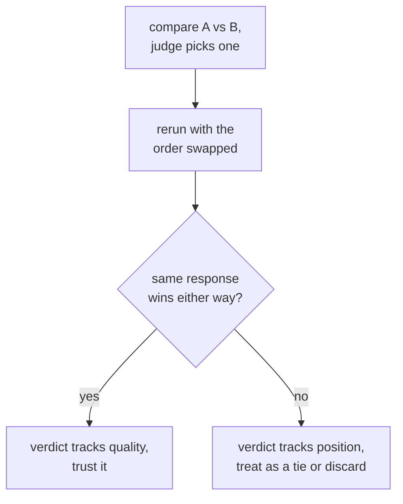

# Lección 6. Sesgo del juez y acuerdo con humanos

**Vínculo con la misión:** Esta es la lección que cierra la etapa 3: un prompt de juez puede estar bien diseñado (lección 5) y aun así engañar de formas específicas y conocidas, y defender el veredicto de un juez significa comprobar esos sesgos y medir el acuerdo con el juicio humano en lugar de dar por hecho que el juez tiene razón.
**Fuente principal:** [Paper: "Judging LLM-as-a-Judge with MT-Bench and Chatbot Arena", Zheng et al., 2023](https://arxiv.org/abs/2306.05685)
**Requisitos previos:** [Lección 5](0005-judge-prompt-design-and-calibration.md), [Contaminación de datos](../GLOSSARY.md)

## Calentamiento

1. ▢ ¿Qué significa que un juez esté calibrado, y qué fallo específico describió la lección 5 como compresión de las puntuaciones?

Comprobación

Las puntuaciones de un juez calibrado siguen la calidad real de forma consistente entre ejemplos. La compresión de las puntuaciones hacia el techo es un fallo en el que el juez califica casi todo alto sin importar las diferencias reales de calidad, y borra las distinciones que una eval existe para detectar.

2. ▢ ¿Por qué darle a un juez una respuesta de referencia, cuando la hay, tiende a mejorar la exactitud de su calificación?

Comprobación

Sin una referencia, una respuesta fluida pero errónea puede leerse convincente, sobre todo en tareas de matemáticas o razonamiento. Una referencia le da al juez algo correcto con qué contrastar la respuesta, en lugar de juzgar en el vacío.

## Qué debes saber

### Sesgo de posición: favorecer dónde se ubica una respuesta, no lo que dice

Cuando un juez compara dos respuestas lado a lado (calificación pareada), puede favorecer de forma sistemática la que aparece primero, o en algunos modelos la segunda, en el prompt, con independencia de la calidad real. Es el **sesgo de posición**, y significa que una sola llamada pareada no puede tomarse al pie de la letra: el veredicto podría reflejar dónde se colocó una respuesta en lugar de lo que decía. La comprobación es directa: ejecutar la misma comparación dos veces, con el orden de las dos respuestas intercambiado, y ver si el veredicto es consistente. Si el juez elige la respuesta que aparece primero sin importar cuál sea, el veredicto no es fiable y debe tratarse como un empate o descartarse en lugar de creérselo.

### Sesgo de verbosidad: favorecer la longitud sobre la corrección

Un fallo distinto e igual de común es el **sesgo de verbosidad**: un juez tiende a preferir una respuesta más larga aunque la longitud extra no aporte nada, frente a una respuesta más corta que es igual de correcta y completa, o más. Esto premia el relleno y penaliza la concisión, que es justo lo contrario de lo que conviene en la mayoría de las tareas reales. Mitigarlo significa instruir al juez de forma explícita para que no premie la longitud por sí sola, diseñar criterios que nombren la completitud y la corrección, y no la longitud, como lo que hay que calificar, o comprobar, después de los hechos, si las preferencias del juez se correlacionan de forma sospechosamente buena con la longitud de la respuesta a lo largo de muchas comparaciones.

### Medir el acuerdo con el juicio humano

La comprobación de calibración de la lección 5 comparó las puntuaciones de un juez con calificaciones humanas sobre una muestra pequeña. La misma idea, aplicada a comparaciones pareadas, es medir el **acuerdo**: la fracción de comparaciones en que la elección del juez coincide con lo que habría elegido un evaluador humano (o la mayoría de varios). El número con el que comparar esto no es un techo perfecto del 100%, ya que los evaluadores humanos tampoco coinciden entre sí el 100% de las veces. La comparación correcta es el acuerdo entre juez y humano frente al acuerdo entre humanos: un juez cuya tasa de acuerdo con los humanos es cercana a la frecuencia con que los humanos coinciden entre sí lo está haciendo aproximadamente tan bien como lo haría otro evaluador humano, que es una vara significativa que superar. Un juez medido solo contra un estándar perfecto supuesto está sometido a un estándar que nada alcanza.

## Práctica

1. ▢ A un juez se le pide comparar la respuesta A con la respuesta B y elige A. El equipo vuelve a ejecutar la misma comparación con el orden intercambiado (B primero, A segundo), y el juez ahora vuelve a elegir la respuesta que se colocó primero. ¿Qué revela esto, y qué debería hacer el equipo con el veredicto de esta comparación?

Comprobación

Revela sesgo de posición: la elección del juez sigue cuál respuesta vino primero en el prompt, no cuál era realmente mejor. El equipo no debería fiarse del veredicto original como evidencia de calidad; una comparación que cambia con el orden debe tratarse como un empate o descartarse en lugar de contarse como una preferencia real.

2. ▢ ¿Por qué un juez preferiría una respuesta más larga aunque una más corta sea igual de correcta y completa? Nombra una forma de mitigarlo.

Comprobación

Sesgo de verbosidad: la longitud en sí se correlaciona con la preferencia del juez más que la calidad real, y premia el relleno sobre la concisión. Las mitigaciones incluyen instruir al juez de forma explícita para que no favorezca la longitud, escribir criterios de calificación que nombren la corrección y la completitud en lugar de la longitud, o comprobar después de los hechos si las preferencias del juez se correlacionan de forma sospechosamente buena con la longitud de la respuesta a lo largo de muchas comparaciones.

3. ▢ Un equipo mide el acuerdo de su juez con evaluadores humanos en un 82%. ¿Es suficiente para confiar en el juez? ¿Qué número adicional necesitan antes de responder eso?

Pista

Piensa con qué debería compararse la tasa de acuerdo del juez, además de una puntuación perfecta.

Comprobación

El 82% por sí solo no dice lo suficiente. Necesitan la tasa de acuerdo entre humanos sobre las mismas comparaciones, ya que los evaluadores humanos tampoco coinciden entre sí el 100% de las veces. Si los evaluadores humanos coinciden entre sí alrededor del 80 al 85% de las veces, un acuerdo del 82% entre juez y humano lo está haciendo aproximadamente tan bien como lo haría otro evaluador humano, una vara significativa que superar. Medido solo contra un techo perfecto del 100%, ese mismo 82% parecería una carencia que no es.

4. ▢ Un equipo compara una respuesta de 300 palabras (A) con una de 80 palabras (B), ambas correctas y completas, en una sola llamada pareada al juez, y el juez elige A. ¿Qué dos cosas de esta lección deberían comprobar antes de fiarse de ese veredicto?

Comprobación

El sesgo de posición, volviendo a ejecutar la comparación con el orden de las respuestas intercambiado y comprobando si el veredicto se mantiene. El sesgo de verbosidad, considerando si el juez favoreció a A simplemente por ser más larga y no por ser más correcta o completa, sobre todo porque se describe a B como igual de correcta y completa pese a ser mucho más corta.

5. ▢ ¿Qué afirmación es cierta sobre comprobar el sesgo de posición en los veredictos pareados de un juez LLM?

    - a) El sesgo de posición solo afecta a los jueces que califican código, no prosa
    - b) Volver a ejecutar una comparación con el orden de las respuestas intercambiado y comprobar que el veredicto sea consistente es una forma directa de detectarlo
    - c) Un juez que explica su razonamiento antes de elegir es automáticamente inmune al sesgo de posición
    - d) El sesgo de posición se elimina usando una escala numérica de 1 a 10 en lugar de una elección pareada

Comprobación

**b)** Intercambiar el orden y comprobar que la elección sea consistente es exactamente la prueba directa que describe esta lección. (a) es falsa: nada limita el sesgo de posición a la calificación de código. (c) es falsa: el razonamiento antes de una puntuación ayuda a la calibración (lección 5) pero por sí solo no descarta que el veredicto siga la posición. (d) es falsa: el sesgo de posición es específicamente un fenómeno de las comparaciones pareadas; cambiar a otro formato de salida cambia el modo de fallo que se prueba, no este directamente, y una escala numérica tiene sus propios problemas de calibración de la lección 5.

## Prácticas en el mundo real

- [ ] Para una configuración de juez pareado que uses o planees usar, vuelve a ejecutar un puñado de comparaciones con el orden de las respuestas intercambiado y comprueba con qué frecuencia cambia el veredicto.
- [ ] Toma un conjunto de comparaciones juzgadas y comprueba si la respuesta preferida por el juez es más larga que la alternativa con más frecuencia de la que predeciría el azar.
- [ ] Mañana: si tienes comparaciones calificadas por humanos disponibles, calcula la tasa de acuerdo de tu juez con esos humanos y estima por separado con qué frecuencia coincidieron los humanos entre sí, antes de decidir si el juez supera esa vara.

## Para profundizar

- [Paper: "Judging LLM-as-a-Judge with MT-Bench and Chatbot Arena", Zheng et al., 2023](https://arxiv.org/abs/2306.05685)
- [Docs: "Define success criteria and build evaluations", Claude Platform Docs](https://platform.claude.com/docs/en/test-and-evaluate/develop-tests)
- [Recursos](../RESOURCES.md)

---

¿No termina de quedar claro? Vuelve a leer la fuente primaria de arriba, ya que esta lección la comprime y en la compresión es donde se escapa la comprensión. Consulta el [glosario](../GLOSSARY.md) por si algún término te resultó resbaladizo.

Si lo poco claro es la propia lección y no el material, eso es un defecto: [abre un issue](https://github.com/TokenCemetery/teach/issues).
