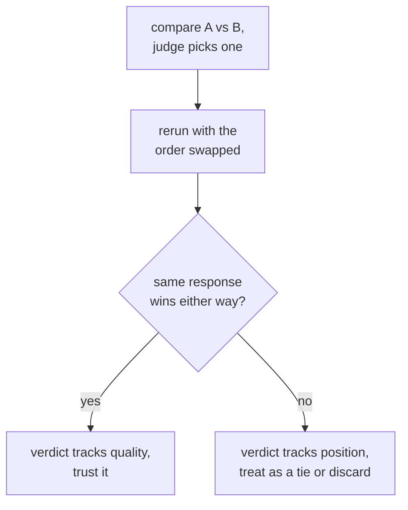

# Leçon 6. Biais du juge et accord avec les humains

**Lien avec la mission :** C'est le point d'orgue de l'étape 3 : un prompt de juge peut être bien conçu (leçon 5) et pourtant induire en erreur de manières précises et connues, et défendre le verdict d'un juge suppose de rechercher ces biais et de mesurer l'accord avec le jugement humain plutôt que de supposer que le juge a raison.
**Source primaire :** [Article : "Judging LLM-as-a-Judge with MT-Bench and Chatbot Arena", Zheng et al., 2023](https://arxiv.org/abs/2306.05685)
**Prérequis :** [Leçon 5](0005-judge-prompt-design-and-calibration.md), [Contamination des données](../GLOSSARY.md)

## Échauffement

1. ▢ Que signifie, pour un juge, être calibré, et quelle défaillance précise la leçon 5 a-t-elle décrite comme compression des scores ?

Vérifier

Les scores d'un juge calibré suivent la qualité réelle de façon cohérente d'un exemple à l'autre. La compression des scores vers le plafond est une défaillance où le juge note presque tout haut quelles que soient les vraies différences de qualité, effaçant les distinctions qu'une eval existe pour repérer.

2. ▢ Pourquoi donner à un juge une réponse de référence, quand il y en a une, tend-il à améliorer la précision de sa notation ?

Vérifier

Sans référence, une réponse fluide mais fausse peut paraître convaincante, surtout sur des tâches de mathématiques ou de raisonnement. Une référence donne au juge quelque chose de correct à quoi comparer la réponse, au lieu de juger dans le vide.

## À savoir

### Biais de position : favoriser l'emplacement d'une réponse, pas ce qu'elle dit

Quand un juge compare deux réponses côte à côte (notation par paires), il peut systématiquement favoriser celle qui apparaît en premier, ou chez certains modèles en second, dans le prompt, indépendamment de la qualité réelle. C'est le **biais de position**, et il signifie qu'un seul appel par paires ne peut pas être pris au pied de la lettre : le verdict peut refléter l'endroit où une réponse a été placée plutôt que ce qu'elle disait. La vérification est directe : lancer deux fois la même comparaison, en inversant l'ordre des deux réponses, et voir si le verdict est cohérent. Si le juge choisit la réponse qui vient en premier, quelle qu'elle soit, le verdict n'est pas fiable et doit être traité comme une égalité ou écarté plutôt que cru.

### Biais de verbosité : favoriser la longueur plutôt que la justesse

Une autre défaillance, tout aussi courante, est le **biais de verbosité** : un juge tend à préférer une réponse plus longue même quand la longueur supplémentaire n'apporte rien, à une réponse plus courte tout aussi juste et complète, voire davantage. Cela récompense le remplissage et pénalise la concision, ce qui est exactement à l'envers pour la plupart des tâches réelles. L'atténuer passe soit par une consigne explicite au juge de ne pas récompenser la longueur en soi, soit par des critères qui nomment l'exhaustivité et la justesse plutôt que la longueur comme ce qu'il faut noter, soit par la vérification, après coup, que les préférences du juge ne corrèlent pas de façon suspecte avec la longueur des réponses sur de nombreuses comparaisons.

### Mesurer l'accord avec le jugement humain

La vérification de calibration de la leçon 5 comparait les scores d'un juge à des notes humaines sur un petit échantillon. La même idée, appliquée à des comparaisons par paires, consiste à mesurer l'**accord** : la fraction des comparaisons où le choix du juge coïncide avec ce qu'un annotateur humain (ou la majorité de plusieurs) aurait choisi. Le chiffre auquel le comparer n'est pas un plafond parfait de 100 %, puisque les annotateurs humains ne sont pas non plus d'accord entre eux 100 % du temps. La bonne comparaison est l'accord juge-humain face à l'accord humain-humain : un juge dont le taux d'accord avec les humains est proche de la fréquence à laquelle les humains s'accordent entre eux fait à peu près aussi bien qu'un autre annotateur humain, ce qui est une barre significative à franchir. Un juge mesuré seulement face à un étalon parfait supposé est tenu à un étalon qu'aucun ne satisfait.

## Pratique

1. ▢ On demande à un juge de comparer la réponse A à la réponse B et il choisit A. L'équipe relance ensuite la même comparaison avec l'ordre inversé (B en premier, A en second), et le juge choisit de nouveau la réponse placée en premier. Que cela révèle-t-il, et que doit faire l'équipe du verdict de cette comparaison ?

Vérifier

Cela révèle un biais de position : le choix du juge suit la réponse qui est venue en premier dans le prompt, pas celle qui était réellement meilleure. L'équipe ne doit pas faire confiance au verdict initial comme preuve de qualité ; une comparaison qui bascule avec l'ordre doit être traitée comme une égalité ou écartée plutôt que comptée comme une vraie préférence.

2. ▢ Pourquoi un juge préférerait-il une réponse plus longue alors qu'une réponse plus courte est tout aussi juste et complète, et citez une façon de l'atténuer ?

Vérifier

Biais de verbosité : la longueur elle-même corrèle davantage avec la préférence du juge que la qualité réelle, ce qui récompense le remplissage au détriment de la concision. Les atténuations comprennent une consigne explicite au juge de ne pas favoriser la longueur, des critères de notation qui nomment la justesse et l'exhaustivité plutôt que la longueur, ou la vérification après coup que les préférences du juge ne corrèlent pas de façon suspecte avec la longueur des réponses sur de nombreuses comparaisons.

3. ▢ Une équipe mesure l'accord de son juge avec des annotateurs humains à 82 %. Est-ce suffisant pour faire confiance au juge ? De quel chiffre supplémentaire a-t-elle besoin pour répondre ?

Indice

Pensez à ce à quoi le taux d'accord du juge devrait être comparé, en dehors d'un score parfait.

Vérifier

82 % seul n'en dit pas assez. Il faut le taux d'accord humain-humain sur les mêmes comparaisons, puisque les annotateurs humains ne sont pas non plus d'accord entre eux 100 % du temps. Si les annotateurs humains s'accordent entre eux environ 80 à 85 % du temps, un accord juge-humain de 82 % fait à peu près aussi bien qu'un autre annotateur humain, une barre significative à franchir. Mesuré seulement face à un plafond parfait de 100 %, le même 82 % ressemblerait à un manque qui n'en est pas un.

4. ▢ Une équipe compare une réponse de 300 mots (A) à une réponse de 80 mots (B), toutes deux justes et complètes, dans un seul appel de juge par paires, et le juge choisit A. Quelles deux choses de cette leçon doit-elle vérifier avant de faire confiance à ce verdict ?

Vérifier

Le biais de position, en relançant la comparaison avec l'ordre des réponses inversé et en vérifiant si le verdict tient. Le biais de verbosité, en se demandant si le juge a favorisé A simplement parce qu'elle est plus longue plutôt que plus juste ou plus complète, d'autant que B est décrite comme tout aussi juste et complète bien que beaucoup plus courte.

5. ▢ Laquelle de ces affirmations est vraie de la vérification du biais de position dans les verdicts par paires d'un juge LLM ?

    - a) Le biais de position ne touche que les juges qui notent du code, pas de la prose
    - b) Relancer une comparaison avec l'ordre des réponses inversé et vérifier que le verdict est cohérent est un moyen direct de le détecter
    - c) Un juge qui explique son raisonnement avant de choisir est automatiquement immunisé contre le biais de position
    - d) Le biais de position est éliminé en utilisant une échelle numérique de 1 à 10 plutôt qu'un choix par paires

Vérifier

**b)** Inverser l'ordre et vérifier que le choix est cohérent est exactement le test direct que cette leçon décrit. (a) est faux : rien ne limite le biais de position à la notation de code. (c) est faux : le raisonnement avant un score aide la calibration (leçon 5) mais n'écarte pas à lui seul que le verdict suive la position. (d) est faux : le biais de position est spécifiquement un phénomène de comparaison par paires ; passer à un autre format de sortie change le mode de défaillance testé, pas celui-ci directement, et une échelle numérique a ses propres problèmes de calibration vus à la leçon 5.

## Exercices en situation réelle

- [ ] Pour un dispositif de juge par paires que vous utilisez ou prévoyez d'utiliser, relancez une poignée de comparaisons avec l'ordre des réponses inversé et vérifiez à quelle fréquence le verdict bascule.
- [ ] Prenez un ensemble de comparaisons jugées et vérifiez si la réponse préférée du juge est plus longue que l'alternative plus souvent que le hasard ne le prédirait.
- [ ] Demain : si vous disposez de comparaisons notées par des humains, calculez le taux d'accord de votre juge avec ces humains, et estimez séparément à quelle fréquence les humains se sont accordés entre eux, avant de décider si le juge franchit cette barre.

## Pour aller plus loin

- [Article : "Judging LLM-as-a-Judge with MT-Bench and Chatbot Arena", Zheng et al., 2023](https://arxiv.org/abs/2306.05685)
- [Doc : "Define success criteria and build evaluations", Claude Platform Docs](https://platform.claude.com/docs/en/test-and-evaluate/develop-tests)
- [Ressources](../RESOURCES.md)

---

Ça ne passe pas ? Relisez la source primaire en haut de page, car cette leçon la condense et c'est dans la condensation que la compréhension s'échappe. Consultez le [glossaire](../GLOSSARY.md) pour tout terme qui vous a paru glissant.

Si c'est la leçon elle-même qui n'est pas claire plutôt que la matière, c'est un défaut : [ouvrez une issue](https://github.com/TokenCemetery/teach/issues).
