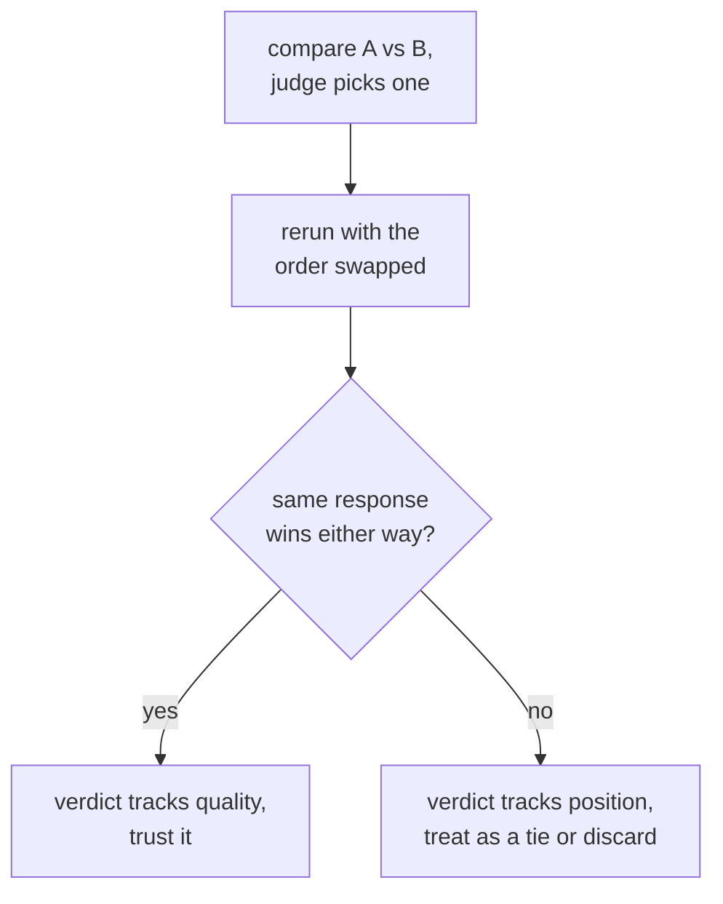

# पाठ 6. Judge Bias और Human Agreement

**मिशन से संबंध:** यह चरण 3 का समापन है: judge prompt अच्छी तरह डिज़ाइन किया हुआ (पाठ 5) हो सकता है और फिर भी ख़ास, जाने-पहचाने तरीक़ों से भटका सकता है, और judge के फ़ैसले का बचाव करने का मतलब है यह मानने के बजाय कि judge सही है, उन biases की जाँच करना और मानव निर्णय के सामने सहमति मापना।
**मुख्य स्रोत:** [पेपर: "Judging LLM-as-a-Judge with MT-Bench and Chatbot Arena", Zheng et al., 2023](https://arxiv.org/abs/2306.05685)
**पूर्व-आवश्यकताएँ:** [पाठ 5](0005-judge-prompt-design-and-calibration.md), [Data contamination](../GLOSSARY.md)

## वार्म-अप

1. ▢ Judge के calibrated होने का क्या मतलब है, और पाठ 5 ने score compression को कौन-सी ख़ास विफलता बताया था?

जाँचें

Calibrated judge के scores examples भर में असली गुणवत्ता का लगातार पीछा करते हैं। छत की ओर score compression ऐसी विफलता है जहाँ judge असली गुणवत्ता के फ़र्क़ की परवाह किए बिना लगभग हर चीज़ को ऊँचा rate करता है, और उन भेदों को मिटा देता है जिन्हें पकड़ने के लिए eval होता है।

2. ▢ जब reference उत्तर उपलब्ध हो, तो judge को देना उसकी grading की सटीकता क्यों सुधारता है?

जाँचें

Reference के बिना, धाराप्रवाह पर ग़लत उत्तर क़ायल करने वाला लग सकता है, ख़ास तौर पर math या reasoning tasks में। Reference judge को response जाँचने के लिए कोई सही चीज़ देता है, शून्य में निर्णय देने के बजाय।

## यह जानें

### Position bias: response कहाँ बैठा है उसे पसंद करना, वह क्या कहता है उसे नहीं

जब judge दो responses की आमने-सामने तुलना करता है (pairwise grading), तो वह व्यवस्थित रूप से उसे पसंद कर सकता है जो prompt में पहले आता है, या कुछ models में दूसरे, असली गुणवत्ता से स्वतंत्र। यह **position bias** है, और इसका मतलब है कि एक अकेली pairwise call को जस का तस नहीं माना जा सकता: फ़ैसला शायद इसे दर्शाए कि response कहाँ रखा गया, इसे नहीं कि उसने क्या कहा। जाँच सीधी है: वही तुलना दो बार चलाएँ, दोनों responses का क्रम पलटकर, और देखें कि फ़ैसला एकसार रहता है या नहीं। अगर judge जो भी response पहले आए उसी को चुनता है, चाहे वह कोई भी हो, तो फ़ैसला अविश्वसनीय है और उस पर भरोसा करने के बजाय उसे बराबरी मानना या छोड़ देना चाहिए।

### Verbosity bias: correctness से ज़्यादा लंबाई को पसंद करना

एक अलग, उतनी ही आम विफलता है **verbosity bias**: judge लंबे response को पसंद करता है, तब भी जब अतिरिक्त लंबाई कुछ नहीं जोड़ती, उस छोटे response के मुक़ाबले जो उतना ही, या ज़्यादा, सही और पूरा है। यह फ़ालतू भराव को इनाम देता है और संक्षिप्तता को दंडित करता है, जो ज़्यादातर असली tasks के लिए ठीक उलटा है। इसे घटाने का मतलब है या तो judge को साफ़ निर्देश देना कि अकेली लंबाई को इनाम न दे, ऐसी कसौटियाँ बनाना जो grade करने के लिए लंबाई के बजाय completeness और correctness का नाम लें, या बाद में जाँचना कि कई तुलनाओं में judge की पसंद response की लंबाई से संदिग्ध रूप से अच्छी तरह correlate करती है या नहीं।

### मानव निर्णय से सहमति मापना

पाठ 5 की calibration जाँच ने छोटे नमूने पर judge के scores की तुलना मानव ratings से की थी। यही विचार pairwise तुलनाओं पर लगाने से **agreement** मापना बनता है: तुलनाओं का वह हिस्सा जहाँ judge का चुनाव उससे मेल खाता है जो कोई मानव rater (या कई का बहुमत) चुनता। जिस संख्या से इसकी तुलना करनी है वह पूर्ण 100% की छत नहीं है, क्योंकि मानव raters भी आपस में 100% बार सहमत नहीं होते। सही तुलना है judge-बनाम-human सहमति को human-बनाम-human सहमति के सामने रखना: जिस judge की मनुष्यों से सहमति दर उतनी ही है जितनी बार मनुष्य आपस में सहमत होते हैं, वह उतना ही अच्छा कर रहा है जितना दूसरा मानव rater करता, जो पार करने लायक सार्थक कसौटी है। जो judge सिर्फ़ मान लिए गए पूर्ण मानक के सामने मापा जाता है, उसे ऐसे मानक पर परखा जा रहा है जिस पर कोई खरा नहीं उतरता।

## अभ्यास

1. ▢ एक judge से response A की तुलना response B से करने को कहा जाता है और वह A चुनता है। फिर टीम वही तुलना क्रम पलटकर दोबारा चलाती है (B पहले, A दूसरे), और judge इस बार भी जो response पहले रखा गया उसी को चुनता है। यह क्या बताता है, और टीम को इस तुलना के फ़ैसले का क्या करना चाहिए?

जाँचें

यह position bias बताता है: judge का चुनाव इसका पीछा करता है कि prompt में कौन-सा response पहले आया, इसका नहीं कि असल में कौन बेहतर था। टीम को मूल फ़ैसले पर गुणवत्ता के प्रमाण के रूप में भरोसा नहीं करना चाहिए; जो तुलना क्रम बदलने पर पलट जाए उसे असली पसंद गिनने के बजाय बराबरी मानना या छोड़ देना चाहिए।

2. ▢ Judge लंबा response क्यों पसंद करेगा जबकि छोटा response उतना ही सही और पूरा है, और इसे घटाने का एक तरीक़ा बताएँ?

जाँचें

Verbosity bias: लंबाई ख़ुद judge की पसंद से असली गुणवत्ता के मुक़ाबले ज़्यादा correlate करती है, जो संक्षिप्तता के बजाय फ़ालतू भराव को इनाम देती है। घटाने के तरीक़ों में शामिल हैं judge को साफ़ निर्देश देना कि लंबाई को तरजीह न दे, grading कसौटियाँ ऐसी लिखना जो लंबाई के बजाय correctness और completeness का नाम लें, या बाद में जाँचना कि कई तुलनाओं में judge की पसंद response की लंबाई से संदिग्ध रूप से अच्छी तरह correlate करती है या नहीं।

3. ▢ एक टीम अपने judge की मानव raters से सहमति 82% मापती है। क्या judge पर भरोसा करने के लिए यह काफ़ी है? इसका जवाब देने से पहले उन्हें कौन-सी अतिरिक्त संख्या चाहिए?

संकेत

सोचें कि judge की सहमति दर की तुलना पूर्ण score के अलावा किससे होनी चाहिए।

जाँचें

अकेला 82% काफ़ी नहीं बताता। उन्हें उन्हीं तुलनाओं पर human-बनाम-human सहमति दर चाहिए, क्योंकि मानव raters भी आपस में 100% बार सहमत नहीं होते। अगर मानव raters आपस में लगभग 80 से 85% बार सहमत होते हैं, तो 82% की judge-human सहमति उतना ही अच्छा कर रही है जितना दूसरा मानव rater करता, जो पार करने लायक सार्थक कसौटी है। सिर्फ़ पूर्ण 100% की छत के सामने मापने पर वही 82% ऐसी कमी लगता जो वह है नहीं।

4. ▢ एक टीम एक ही pairwise judge call में 300 शब्दों के response (A) की तुलना 80 शब्दों के response (B) से करती है, दोनों सही और पूरे हैं, और judge A चुनता है। उस फ़ैसले पर भरोसा करने से पहले उन्हें इस पाठ की कौन-सी दो चीज़ें जाँचनी चाहिए?

जाँचें

Position bias, तुलना को responses का क्रम पलटकर दोबारा चलाकर और जाँचकर कि फ़ैसला टिकता है या नहीं। Verbosity bias, यह देखकर कि क्या judge ने A को सिर्फ़ इसलिए चुना कि वह लंबा है, न कि इसलिए कि वह ज़्यादा सही या पूरा है, ख़ास तौर पर इसलिए कि B को बहुत छोटा होने के बावजूद उतना ही सही और पूरा बताया गया है।

5. ▢ LLM judge के pairwise फ़ैसलों में position bias की जाँच के बारे में कौन-सा दावा सही है?

    - a) Position bias सिर्फ़ code grade करने वाले judges को प्रभावित करता है, गद्य को नहीं
    - b) तुलना को response का क्रम पलटकर दोबारा चलाना और एकसार फ़ैसले की जाँच करना इसे पकड़ने का सीधा तरीक़ा है
    - c) जो judge चुनने से पहले अपनी reasoning समझाता है वह position bias से अपने-आप मुक्त है
    - d) Pairwise चुनाव के बजाय संख्यात्मक 1-से-10 scale इस्तेमाल करने से position bias ख़त्म हो जाता है

जाँचें

**b)** क्रम बदलना और एकसार चुनाव जाँचना ठीक वही सीधा test है जो यह पाठ बताता है। (a) ग़लत है: position bias को code grading तक सीमित करने वाली कोई बात नहीं है। (c) ग़लत है: score से पहले reasoning calibration में मदद करती है (पाठ 5) पर अपने-आप इस संभावना को नहीं हटाती कि फ़ैसला स्थिति का पीछा करे। (d) ग़लत है: position bias ख़ास तौर पर pairwise-तुलना की परिघटना है; दूसरे output format पर जाने से जाँची जा रही विफलता का तरीक़ा बदलता है, यह वाला सीधे नहीं, और संख्यात्मक scale की अपनी calibration की चिंताएँ पाठ 5 में हैं।

## असली दुनिया का अभ्यास

- [ ] जो pairwise judge setup आप इस्तेमाल करते हैं या करने की योजना है, उसके लिए मुट्ठी-भर तुलनाएँ response का क्रम पलटकर दोबारा चलाएँ और जाँचें कि फ़ैसला कितनी बार पलटता है।
- [ ] Judged तुलनाओं का एक सेट लें और जाँचें कि judge का पसंदीदा response वैकल्पिक से लंबा संयोग की भविष्यवाणी से ज़्यादा बार है या नहीं।
- [ ] कल: अगर आपके पास मानव-rate की गई तुलनाएँ उपलब्ध हैं, तो उन मनुष्यों से अपने judge की सहमति दर निकालें, और अलग से अनुमान लगाएँ कि मनुष्य आपस में कितनी बार सहमत हुए, यह तय करने से पहले कि judge वह कसौटी पार करता है या नहीं।

## आगे बढ़ने के लिए

- [पेपर: "Judging LLM-as-a-Judge with MT-Bench and Chatbot Arena", Zheng et al., 2023](https://arxiv.org/abs/2306.05685)
- [दस्तावेज़: "Define success criteria and build evaluations", Claude Platform Docs](https://platform.claude.com/docs/en/test-and-evaluate/develop-tests)
- [संसाधन](../RESOURCES.md)

---

बात नहीं बन रही? ऊपर दिए primary source को दोबारा पढ़ें, क्योंकि यह पाठ उसे संक्षिप्त करता है और समझ संक्षेप में ही रिसती है। जो शब्द फिसलन भरा लगे, उसके लिए [शब्दावली](../GLOSSARY.md) देखें।

अगर दिक़्क़त सामग्री की नहीं बल्कि पाठ की ही है, तो वह एक खोट है: [issue खोलें](https://github.com/TokenCemetery/teach/issues)।
