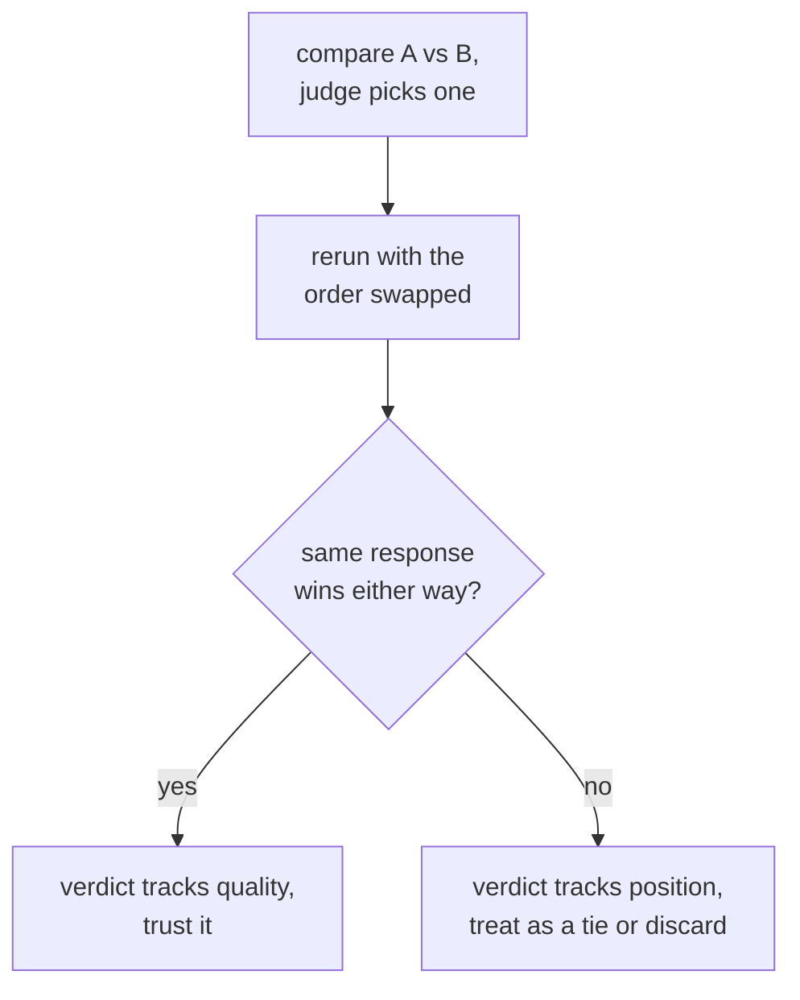

# Lição 6. Viés do juiz e concordância com humanos

**Ligação com a missão:** Este é o ponto culminante da etapa 3: um prompt de juiz pode ser bem projetado (lição 5) e ainda assim enganar de maneiras específicas e conhecidas, e defender o veredito de um juiz significa verificar esses vieses e medir a concordância contra o julgamento humano, em vez de presumir que o juiz está certo.
**Fonte principal:** [Artigo científico: "Judging LLM-as-a-Judge with MT-Bench and Chatbot Arena", Zheng et al., 2023](https://arxiv.org/abs/2306.05685)
**Pré-requisitos:** [Lição 5](0005-judge-prompt-design-and-calibration.md), [Contaminação de dados](../GLOSSARY.md)

## Aquecimento

1. ▢ O que significa um juiz estar calibrado, e que falha específica a lição 5 descreveu como compressão da pontuação?

Verificação

As pontuações de um juiz calibrado acompanham a qualidade real de forma consistente entre os exemplos. A compressão da pontuação em direção ao teto é uma falha em que o juiz avalia quase tudo com notas altas, independentemente das diferenças reais de qualidade, apagando as distinções que um eval existe para pegar.

2. ▢ Por que dar a um juiz uma resposta de referência, quando disponível, tende a melhorar a acurácia da sua avaliação?

Verificação

Sem uma referência, uma resposta fluente porém errada pode soar convincente, especialmente em tarefas de matemática ou raciocínio. Uma referência dá ao juiz algo correto contra o que conferir a resposta, em vez de julgar no vácuo.

## Saiba isto

### Viés de posição: favorecer onde a resposta está, e não o que ela diz

Quando um juiz compara duas respostas lado a lado (avaliação pairwise), ele pode favorecer sistematicamente a que aparece primeiro, ou, em alguns modelos, a segunda, no prompt, independentemente da qualidade real. Esse é o **viés de posição**, e significa que uma única chamada pairwise não pode ser aceita pelo valor de face: o veredito pode refletir onde a resposta foi colocada, e não o que ela dizia. A verificação é direta: execute a mesma comparação duas vezes, com a ordem das duas respostas trocada, e veja se o veredito é consistente. Se o juiz escolhe a resposta que vem primeiro, seja ela qual for, o veredito não é confiável e deve ser tratado como empate ou descartado, em vez de aceito.

### Viés de verbosidade: favorecer o comprimento em vez da correção

Uma falha separada, igualmente comum, é o **viés de verbosidade**: um juiz tende a preferir uma resposta mais longa, mesmo quando o comprimento extra não acrescenta nada, a uma resposta mais curta que é igualmente correta e completa, ou mais. Isso premia o enchimento e pune a concisão, o que é exatamente o contrário do que se quer na maioria das tarefas reais. Mitigá-lo significa instruir o juiz explicitamente a não premiar o comprimento por si só, projetar critérios que nomeiem a completude e a correção, e não o comprimento, como o que avaliar, ou verificar, depois do fato, se as preferências do juiz se correlacionam de modo suspeitamente bom com o comprimento da resposta ao longo de muitas comparações.

### Medindo a concordância com o julgamento humano

A verificação de calibração da lição 5 comparou as pontuações de um juiz com avaliações humanas em uma pequena amostra. A mesma ideia, aplicada a comparações pairwise, é medir a **concordância**: a fração das comparações em que a escolha do juiz coincide com o que um avaliador humano (ou a maioria de vários) teria escolhido. O número com o qual comparar isso não é um teto perfeito de 100%, já que avaliadores humanos também não concordam entre si 100% das vezes. A comparação certa é a concordância juiz-humano contra a concordância humano-humano: um juiz cuja taxa de concordância com humanos é próxima de com que frequência os humanos concordam entre si está se saindo mais ou menos tão bem quanto outro avaliador humano se sairia, o que é um patamar significativo a superar. Um juiz medido apenas contra um padrão perfeito presumido está sendo cobrado por um padrão que nada atinge.

## Prática

1. ▢ Pede-se a um juiz que compare a resposta A com a resposta B, e ele escolhe A. A equipe então reexecuta a mesma comparação com a ordem trocada (B primeiro, A em segundo), e o juiz agora escolhe de novo a resposta que foi colocada primeiro. O que isso revela, e o que a equipe deve fazer com o veredito dessa comparação?

Verificação

Revela viés de posição: a escolha do juiz acompanha qual resposta veio primeiro no prompt, e não qual era de fato melhor. A equipe não deve confiar no veredito original como evidência de qualidade; uma comparação que se inverte com a ordem deve ser tratada como empate ou descartada, em vez de contada como uma preferência real.

2. ▢ Por que um juiz preferiria uma resposta mais longa mesmo quando uma resposta mais curta é igualmente correta e completa, e cite uma forma de mitigar isso?

Verificação

Viés de verbosidade: o próprio comprimento se correlaciona mais com a preferência do juiz do que a qualidade real, premiando o enchimento em vez da concisão. As mitigações incluem instruir o juiz explicitamente a não favorecer o comprimento, escrever critérios de avaliação que nomeiem a correção e a completude, e não o comprimento, ou verificar depois do fato se as preferências do juiz se correlacionam de modo suspeitamente bom com o comprimento da resposta ao longo de muitas comparações.

3. ▢ Uma equipe mede a concordância do seu juiz com avaliadores humanos em 82%. Isso basta para confiar no juiz? De que número adicional ela precisa antes de responder?

Dica

Pense em com o que a taxa de concordância do juiz deve ser comparada, além de uma pontuação perfeita.

Verificação

82% sozinho não diz o bastante. Ela precisa da taxa de concordância humano-humano nas mesmas comparações, já que avaliadores humanos também não concordam entre si 100% das vezes. Se os avaliadores humanos concordam entre si em torno de 80 a 85% das vezes, uma concordância juiz-humano de 82% está se saindo mais ou menos tão bem quanto outro avaliador humano se sairia, um patamar significativo a superar. Medidos apenas contra um teto perfeito de 100%, os mesmos 82% pareceriam uma deficiência que não é.

4. ▢ Uma equipe compara uma resposta de 300 palavras (A) com uma de 80 palavras (B), ambas corretas e completas, em uma única chamada pairwise de juiz, e o juiz escolhe A. Que duas coisas desta lição ela deve verificar antes de confiar nesse veredito?

Verificação

Viés de posição, reexecutando a comparação com a ordem das respostas trocada e verificando se o veredito se mantém. Viés de verbosidade, considerando se o juiz favoreceu A simplesmente por ser mais longa, e não por ser mais correta ou completa, especialmente porque B é descrita como igualmente correta e completa apesar de muito mais curta.

5. ▢ Qual afirmação é verdadeira sobre verificar o viés de posição nos vereditos pairwise de um juiz LLM?

    - a) O viés de posição só afeta juízes que avaliam código, não prosa
    - b) Reexecutar uma comparação com a ordem das respostas trocada e verificar se o veredito é consistente é uma forma direta de detectá-lo
    - c) Um juiz que explica seu raciocínio antes de escolher fica automaticamente imune ao viés de posição
    - d) O viés de posição é eliminado usando uma escala numérica de 1 a 10 em vez de uma escolha pairwise

Verificação

**b)** Trocar a ordem e verificar se a escolha é consistente é exatamente o teste direto que esta lição descreve. (a) é falsa: nada limita o viés de posição à avaliação de código. (c) é falsa: raciocinar antes de uma pontuação ajuda na calibração (lição 5), mas por si só não descarta que o veredito acompanhe a posição. (d) é falsa: o viés de posição é especificamente um fenômeno de comparação pairwise; mudar para outro formato de saída muda o modo de falha sendo testado, e não este diretamente, e uma escala numérica tem suas próprias preocupações de calibração, da lição 5.

## Prática no mundo real

- [ ] Para uma configuração de juiz pairwise que você usa ou planeja usar, reexecute algumas comparações com a ordem das respostas trocada e verifique com que frequência o veredito se inverte.
- [ ] Pegue um conjunto de comparações julgadas e verifique se a resposta preferida pelo juiz é mais longa que a alternativa com mais frequência do que o acaso preveria.
- [ ] Amanhã: se você tiver comparações avaliadas por humanos disponíveis, calcule a taxa de concordância do seu juiz com esses humanos e estime separadamente com que frequência os humanos concordaram entre si, antes de decidir se o juiz supera esse patamar.

## Para ir além

- [Artigo científico: "Judging LLM-as-a-Judge with MT-Bench and Chatbot Arena", Zheng et al., 2023](https://arxiv.org/abs/2306.05685)
- [Docs: "Define success criteria and build evaluations", Claude Platform Docs](https://platform.claude.com/docs/en/test-and-evaluate/develop-tests)
- [Recursos](../RESOURCES.md)

---

Não ficou claro? Releia a fonte principal no topo, já que esta lição a comprime e é na compressão que o entendimento escapa. Consulte o [glossário](../GLOSSARY.md) para qualquer termo que pareceu escorregadio.

Se o problema é a lição em si, e não o material, isso é um defeito: [abra uma issue](https://github.com/TokenCemetery/teach/issues).
