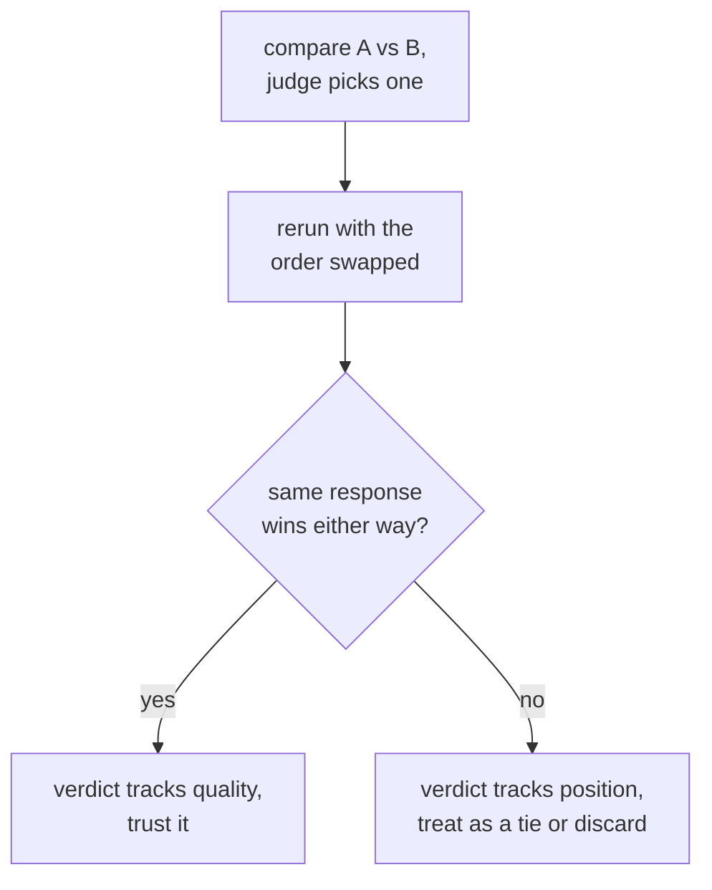

# Урок 6. Смещения судьи и согласие с людьми

**Связь с целью курса:** Это итог этапа 3: промпт судьи может быть хорошо спроектирован (урок 5) и всё равно вводить в заблуждение известными конкретными способами, а защита вердикта судьи означает проверку этих смещений и измерение согласия с человеческой оценкой, а не допущение, что судья прав.
**Первоисточник:** [Научная статья: "Judging LLM-as-a-Judge with MT-Bench and Chatbot Arena", Zheng et al., 2023](https://arxiv.org/abs/2306.05685)
**Предварительные требования:** [Урок 5](0005-judge-prompt-design-and-calibration.md), [Загрязнение данных](../GLOSSARY.md)

## Разминка

1. ▢ Что значит, что судья откалиброван, и какой конкретный сбой урок 5 описал как сжатие оценок?

Проверка

Оценки откалиброванного судьи последовательно отслеживают реальное качество на разных примерах. Сжатие оценок к потолку это сбой, при котором судья высоко оценивает почти всё независимо от реальных различий в качестве, стирая различия, ради которых эвал и существует.

2. ▢ Почему эталонный ответ для судьи, когда он доступен, как правило, повышает точность его оценки?

Проверка

Без эталона гладкий, но неверный ответ может выглядеть убедительно, особенно в задачах по математике или на рассуждение. Эталон даёт судье что-то верное, с чем сверить ответ, вместо суждения в вакууме.

## Что нужно знать

### Смещение по позиции: предпочтение места ответа, а не его содержания

Когда судья сравнивает два ответа рядом (парная оценка), он может систематически отдавать предпочтение тому, который стоит первым, а у некоторых моделей вторым, в промпте, независимо от фактического качества. Это **смещение по позиции**, и оно означает, что единичному парному вызову нельзя верить на слово: вердикт может отражать то, где ответ стоял, а не то, что он говорил. Проверка прямая: прогоните то же сравнение дважды, поменяв порядок двух ответов, и посмотрите, последователен ли вердикт. Если судья выбирает тот ответ, что стоит первым, независимо от того, какой это ответ, вердикт ненадёжен, и его следует считать ничьей или отбросить, а не доверять ему.

### Смещение по многословию: предпочтение длины перед корректностью

Отдельный и не менее распространённый сбой это **смещение по многословию**: судья склонен предпочитать более длинный ответ, даже когда лишняя длина ничего не добавляет, более короткому ответу, который не менее, а то и более верен и полон. Это вознаграждает раздувание и наказывает лаконичность, что для большинства реальных задач ровно наоборот. Смягчить это можно, либо прямо указав судье не вознаграждать длину саму по себе, либо построив критерии так, чтобы оцениваться были полнота и корректность, а не длина, либо проверив постфактум, не коррелируют ли предпочтения судьи подозрительно хорошо с длиной ответа по многим сравнениям.

### Измерение согласия с человеческой оценкой

Проверка калибровки в уроке 5 сравнивала оценки судьи с человеческими на небольшой выборке. Та же идея, применённая к парным сравнениям, это измерение **согласия**: доли сравнений, в которых выбор судьи совпадает с тем, что выбрал бы асессор-человек (или большинство нескольких). Число, с которым это сравнивают, не идеальный потолок в 100%, поскольку асессоры-люди тоже не соглашаются друг с другом в 100% случаев. Верное сравнение это согласие судьи с человеком относительно согласия человека с человеком: судья, чья доля согласия с людьми близка к тому, как часто люди соглашаются между собой, справляется примерно так же, как справился бы ещё один асессор-человек, а это значимая планка. Судью, которого меряют лишь относительно предполагаемого идеального стандарта, оценивают по стандарту, которому не соответствует ничто.

## Практика

1. ▢ Судью просят сравнить ответ A с ответом B, и он выбирает A. Затем команда повторяет то же сравнение с обратным порядком (B первым, A вторым), и судья снова выбирает тот ответ, что стоит первым. Что это показывает и что команде делать с вердиктом этого сравнения?

Проверка

Это показывает смещение по позиции: выбор судьи следует за тем, какой ответ стоял первым в промпте, а не за тем, какой на самом деле лучше. Команде не стоит доверять исходному вердикту как свидетельству качества; сравнение, которое переворачивается вместе с порядком, следует считать ничьей или отбросить, а не засчитывать как настоящее предпочтение.

2. ▢ Почему судья может предпочесть более длинный ответ, даже когда более короткий столь же верен и полон, и назовите один способ это смягчить.

Проверка

Смещение по многословию: сама длина коррелирует с предпочтением судьи сильнее, чем фактическое качество, и вознаграждает раздувание вместо лаконичности. Способы смягчить: прямо указать судье не отдавать предпочтение длине, написать критерии оценки, где названы корректность и полнота, а не длина, или проверить постфактум, не коррелируют ли предпочтения судьи подозрительно хорошо с длиной ответа по многим сравнениям.

3. ▢ Команда измеряет согласие своего судьи с асессорами-людьми и получает 82%. Достаточно ли этого, чтобы доверять судье? Какое дополнительное число им нужно, прежде чем ответить?

Подсказка

Подумайте, с чем, кроме идеальной оценки, нужно сравнивать долю согласия судьи.

Проверка

Одних 82% недостаточно. Нужна доля согласия между людьми на тех же сравнениях, поскольку асессоры-люди тоже не соглашаются друг с другом в 100% случаев. Если асессоры-люди соглашаются между собой примерно в 80-85% случаев, согласие судьи с человеком в 82% справляется примерно так же, как справился бы ещё один асессор-человек, а это значимая планка. Если мерить только относительно идеального потолка в 100%, те же 82% выглядели бы недобором, которым не являются.

4. ▢ Команда сравнивает ответ на 300 слов (A) с ответом на 80 слов (B), оба верны и полны, одним парным вызовом судьи, и судья выбирает A. Какие две вещи из этого урока им стоит проверить, прежде чем доверять этому вердикту?

Проверка

Смещение по позиции: повторить сравнение с обратным порядком ответов и проверить, сохраняется ли вердикт. Смещение по многословию: подумать, не предпочёл ли судья A просто за то, что он длиннее, а не за то, что он вернее или полнее, особенно потому что B описан как столь же верный и полный, несмотря на то, что намного короче.

5. ▢ Какое утверждение верно для проверки парных вердиктов LLM-судьи на смещение по позиции?

    - a) Смещение по позиции затрагивает только судей, оценивающих код, а не прозу
    - b) Повторить сравнение с обратным порядком ответов и проверить последовательность вердикта это прямой способ его обнаружить
    - c) Судья, объясняющий рассуждение перед выбором, автоматически застрахован от смещения по позиции
    - d) Смещение по позиции устраняется, если вместо парного выбора использовать числовую шкалу от 1 до 10

Проверка

**b)** Смена порядка и проверка последовательности выбора это в точности тот прямой тест, который описывает урок. Вариант (a) неверен: ничто не ограничивает смещение по позиции оценкой кода. Вариант (c) неверен: рассуждение перед оценкой помогает калибровке (урок 5), но само по себе не исключает, что вердикт следует за позицией. Вариант (d) неверен: смещение по позиции это именно феномен парного сравнения; переход на другой формат вывода меняет проверяемый вид сбоя, а не этот напрямую, и у числовой шкалы свои вопросы калибровки из урока 5.

## Практика в реальной работе

- [ ] Для парной настройки судьи, которую вы используете или планируете использовать, повторите несколько сравнений с обратным порядком ответов и проверьте, как часто вердикт переворачивается.
- [ ] Возьмите набор оценённых сравнений и проверьте, чаще ли предпочтённый судьёй ответ длиннее альтернативы, чем предсказал бы случай.
- [ ] Завтра: если у вас есть сравнения, оценённые людьми, вычислите долю согласия вашего судьи с этими людьми и отдельно оцените, как часто люди соглашались между собой, прежде чем решать, преодолевает ли судья эту планку.

## Что почитать дальше

- [Научная статья: "Judging LLM-as-a-Judge with MT-Bench and Chatbot Arena", Zheng et al., 2023](https://arxiv.org/abs/2306.05685)
- [Документация: "Define success criteria and build evaluations", Claude Platform Docs](https://platform.claude.com/docs/en/test-and-evaluate/develop-tests)
- [Ресурсы](../RESOURCES.md)

---

Не доходит? Перечитайте первоисточник в начале: этот урок его сжимает, а при сжатии понимание как раз и теряется. Загляните в [глоссарий](../GLOSSARY.md), если какой-то термин показался скользким.

Если неясен сам урок, а не материал, это дефект: [откройте issue](https://github.com/TokenCemetery/teach/issues).
