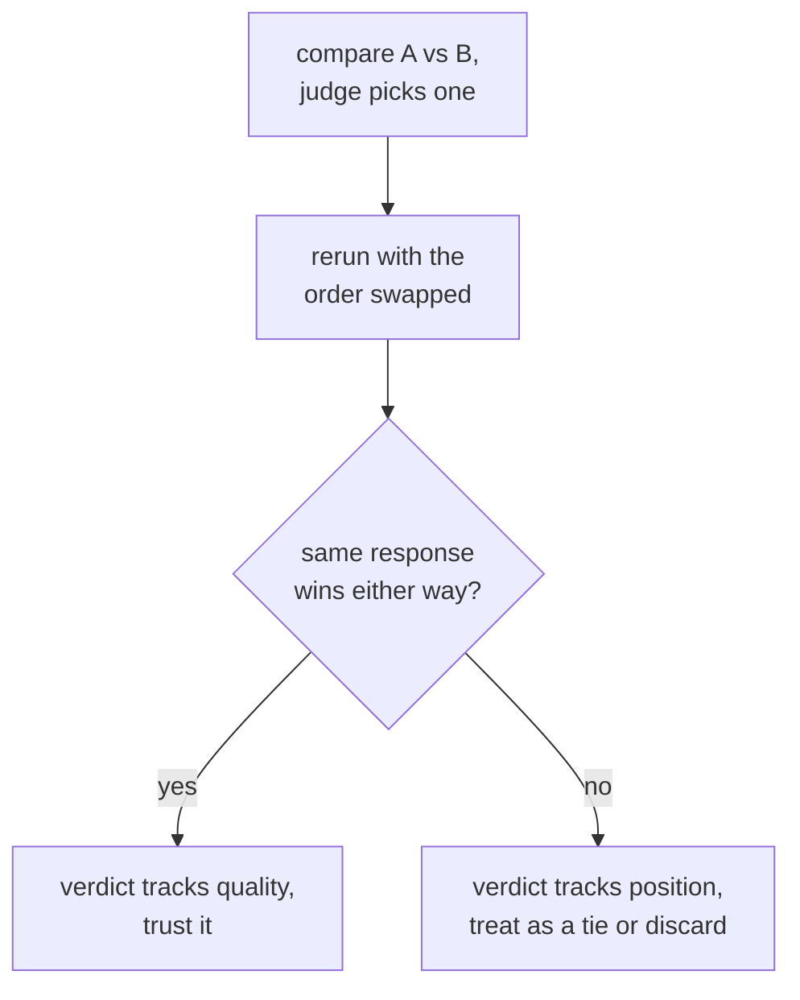

# 第 6 课：裁判偏差与人类一致性

**使命关联:** 这是第 3 阶段的收官：裁判提示词可以设计得很好（第 5 课），却仍然会以特定的、已知的方式误导，而为裁判的裁定辩护，意味着要检查这些偏差，并对照人类的判断来度量一致性，而不是假定裁判是对的。
**主要来源:** [论文：“Judging LLM-as-a-Judge with MT-Bench and Chatbot Arena”，Zheng 等，2023](https://arxiv.org/abs/2306.05685)
**前置知识:** [第 5 课](0005-judge-prompt-design-and-calibration.md)、[数据污染](../GLOSSARY.md)

## 热身

1. ▢ 裁判得到校准是什么意思，第 5 课把哪种具体的失败称为分数压缩？

检查

经过校准的裁判，其分数在不同样本之间持续地反映真实的质量。分数向上限压缩是一种失败：不管真实的质量差异如何，裁判几乎给所有东西都打高分，抹掉了评测本该抓住的那些区别。

2. ▢ 为什么在有参考答案时，把它提供给裁判，往往能提高它评分的准确性？

检查

没有参考答案时，流畅却错误的答案可能读起来很有说服力，数学或推理任务尤其如此。参考答案给裁判提供了可以用来核对回答的正确东西，而不是凭空评判。

## 要点

### 位置偏差：偏向回答所处的位置，而不是它所说的内容

当裁判并排比较两个回答（成对评分）时，它可能系统性地偏向在提示词中出现在前面（在某些模型中是后面）的那一个，与实际质量无关。这就是**位置偏差**，它意味着单次成对调用的结果不能照单全收：裁定可能反映的是回答被放在哪里，而不是它说了什么。检查的办法很直接：把同一个比较运行两次，把两个回答的顺序对调，看裁定是否一致。如果裁判不管是哪一个，都选在前面的那个回答，那么这个裁定就不可靠，应当视作平局或丢弃，而不是加以信任。

### 冗长偏差：偏向长度，而不是正确性

另一种同样常见的独立失败是**冗长偏差**：裁判往往更喜欢更长的回答，即便多出来的篇幅毫无增益，而放弃同样正确、或更正确更完整的较短回答。这是在奖励注水、惩罚简洁，对大多数真实任务来说恰好是反的。缓解的办法，要么是明确指示裁判不要仅仅因为长度就给予奖励，要么是把评分标准设计成点名完整性和正确性，而不是长度，要么是事后检查，在许多次比较中，裁判的偏好是否与回答长度的相关性高得可疑。

### 度量与人类判断的一致性

第 5 课的校准检查，是在一小批样本上，把裁判的分数与人类评分作比较。把同样的思路用于成对比较，就是度量**一致性**：裁判的选择，与某位人类评分员（或几位的多数意见）本会做出的选择一致的比较所占的比例。用来对照的数字，不是完美的 100% 上限，因为人类评分员之间也不会百分之百一致。正确的比较，是把裁判与人类的一致性，对照人类与人类的一致性：裁判与人类的一致率，若接近人类彼此一致的频率，就说明它做得大致与另一位人类评分员相当，这是一条有意义的、值得跨过的基准线。只对照一个假定完美的标准来度量裁判，就是用没有任何东西能达到的标准来要求它。

## 练习

1. ▢ 让裁判比较回答 A 与回答 B，它选了 A。团队随后把顺序对调（B 在前，A 在后）重跑同一个比较，裁判这次又选了放在前面的那个回答。这说明了什么，团队该如何处理这次比较的裁定？

检查

这说明存在位置偏差：裁判的选择取决于哪个回答在提示词中排在前面，而不是哪个回答实际上更好。团队不应把最初的裁定当作质量的证据；随顺序翻转的比较，应当视作平局或丢弃，而不是算作真实的偏好。

2. ▢ 为什么在较短的回答同样正确、完整时，裁判仍会偏好更长的回答？请说出一种缓解的办法。

检查

这是冗长偏差：长度本身与裁判的偏好之间的相关性，比实际质量更强，奖励了注水而不是简洁。缓解办法包括：明确指示裁判不要偏向长度，写出点名正确性和完整性而不是长度的评分标准，或者事后检查，在许多次比较中，裁判的偏好是否与回答长度的相关性高得可疑。

3. ▢ 某团队测得裁判与人类评分员的一致率为 82%。这足以信任这个裁判吗？在回答之前，他们还需要什么数字？

提示

想一想，除了满分之外，裁判的一致率还应该与什么作比较。

检查

单有 82% 说明不了什么。他们需要在同样的比较上，人类与人类之间的一致率，因为人类评分员之间也不会百分之百一致。如果人类评分员彼此一致的频率在 80% 到 85% 左右，那么 82% 的裁判与人类一致性，就说明它做得大致与另一位人类评分员相当，这是一条有意义的、值得跨过的基准线。只对照完美的 100% 上限来度量，同样的 82% 会显得像是一种并不存在的差距。

4. ▢ 某团队在单次成对裁判调用中，比较一个 300 字的回答（A）和一个 80 字的回答（B），两者都正确、完整，裁判选了 A。在相信这个裁定之前，他们应该检查本课的哪两件事？

检查

位置偏差：把回答的顺序对调后重跑比较，检查裁定是否依然成立。冗长偏差：考虑裁判是否仅仅因为 A 更长而偏向它，而不是因为它更正确或更完整，尤其是 B 被描述为同样正确、完整，只是短得多。

5. ▢ 关于检查 LLM 裁判的成对裁定是否存在位置偏差，下列哪项说法是对的？

    - a) 位置偏差只影响给代码评分的裁判，不影响给散文评分的裁判
    - b) 把回答顺序对调后重跑比较，检查裁定是否一致，是检测它的直接办法
    - c) 先解释推理再做选择的裁判，自动不受位置偏差的影响
    - d) 改用 1 到 10 分的数值量表，而不是成对选择，就能消除位置偏差

检查

**b)** 对调顺序并检查选择是否一致，正是本课所描述的直接检验。（a）错误：位置偏差并不局限于给代码评分。（c）错误：先推理再打分有助于校准（第 5 课），但本身并不能排除裁定取决于位置。（d）错误：位置偏差特指成对比较中的现象；改换输出格式，改变的是被测试的失败模式，并没有直接解决这一个，而且数值量表有第 5 课讲过的它自己的校准问题。

## 实战练习

- [ ] 对你使用或打算使用的成对裁判设置，把几个比较的回答顺序对调后重跑，检查裁定翻转的频率有多高。
- [ ] 取一批已评判的比较，检查裁判偏好的回答比另一个更长的频率，是否高于偶然所能预测的程度。
- [ ] 明天：如果你有人类评过分的比较，计算你的裁判与这些人类的一致率，并另外估计这些人类彼此一致的频率，再决定裁判是否跨过了这条基准线。

## 延伸阅读

- [论文：“Judging LLM-as-a-Judge with MT-Bench and Chatbot Arena”，Zheng 等，2023](https://arxiv.org/abs/2306.05685)
- [文档：“Define success criteria and build evaluations”，Claude Platform Docs](https://platform.claude.com/docs/en/test-and-evaluate/develop-tests)
- [资源](../RESOURCES.md)

---

没学明白？请重读顶部的主要来源，因为本课是对它的压缩，而理解正是在压缩中流失的。如果有哪个术语觉得含糊，可以查看[术语表](../GLOSSARY.md)。

如果问题出在课程本身，而不是学习材料，那就是一个缺陷：[提交 issue](https://github.com/TokenCemetery/teach/issues)。
