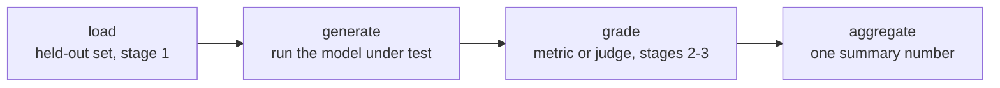

# Lección 7. Frameworks de evaluación y cómo construir un harness

**Vínculo con la misión:** Las etapas 1 a 3 diseñaron qué medir, cómo reservar los datos y cómo puntuarlos; la etapa 4 es donde ese diseño se convierte en un pipeline ejecutable que produce el mismo número de la misma manera cada vez, en lugar de un script de una sola vez que nadie puede volver a ejecutar.
**Fuente principal:** [Repo: openai/evals, OpenAI](https://github.com/openai/evals)
**Requisitos previos:** [Lección 6](0006-judge-bias-and-human-agreement.md), [Contaminación de datos](../GLOSSARY.md)

## Calentamiento

1. ▢ ¿Cómo compruebas si un juez pareado muestra sesgo de posición?

Comprobación

Vuelve a ejecutar la misma comparación con el orden de las dos respuestas intercambiado y comprueba si el veredicto es consistente. Si el juez elige la respuesta que viene primero sin importar cuál sea, el veredicto no es fiable.

2. ▢ ¿Con qué vara hay que comparar el acuerdo de un juez con evaluadores humanos?

Comprobación

Con el acuerdo entre humanos sobre las mismas comparaciones, no con un techo perfecto del 100%, ya que los evaluadores humanos tampoco coinciden entre sí cada vez.

## Qué debes saber

### Por qué un harness y no un script de una sola vez

Cada decisión de diseño de las etapas 1 a 3, qué datos se reservan, qué métrica o juez califica una respuesta, cómo se agrega una puntuación, solo importa si se aplica de la misma manera cada vez que se ejecuta una eval. Un **harness** formaliza ese pipeline en código reutilizable y auditable, de modo que una nueva ejecución seis meses después sobre un nuevo checkpoint del modelo aplica exactamente el mismo conjunto held-out y la misma lógica de calificación que la primera, en lugar de reconstruirlos de memoria o desde la celda a medio recordar de un notebook. El harness es lo que convierte un análisis de una sola vez en una medición repetible.

### Cuatro etapas, en todo harness

Sin importar qué framework lo construya, un harness de eval se divide en las mismas cuatro etapas: **cargar** el conjunto de eval held-out (la disciplina de la etapa 1 sobre qué contiene y por qué es fiable); **generar**, ejecutando el modelo bajo prueba contra cada ejemplo para producir sus salidas; **calificar**, aplicando la métrica o el juez elegidos (etapas 2 y 3) a cada salida; y **agregar**, convirtiendo las puntuaciones por ejemplo en un único número resumen, una media, una tasa de aciertos, lo que pida la misión. Nombrar estas etapas de forma explícita importa porque cada una puede socavar por sí sola el número final: una etapa de carga contaminada produce un número que no significa nada sin importar lo cuidadosa que sea la calificación, una etapa de generación rota (el modelo equivocado, una respuesta truncada) produce basura que ninguna métrica puede rescatar, una etapa de calificación mal calibrada (la compresión de puntuaciones de la lección 5, los sesgos de la lección 6) corrompe salidas que por lo demás son buenas, y una etapa de agregación que esconde la varianza detrás de una única media puede hacer que un resultado poco fiable parezca sólido.

### Dos frameworks consolidados, dos trabajos distintos

**openai/evals** está pensado para definir una eval propia como código: una función de completación envuelve el modelo bajo prueba, una especificación de eval nombra el conjunto de datos y la lógica de calificación, y un registro de evals existentes muestra la forma que toma una que funciona. Encaja con una tarea específica de la misión para la que nadie ha construido aún una eval. **lm-evaluation-harness** (EleutherAI), en cambio, ejecuta un modelo contra una gran biblioteca de benchmarks estandarizados ya construidos mediante configuraciones declarativas de tareas, sin escribir desde cero una función de completación ni la lógica de calificación. Encaja con reutilizar un benchmark existente, sobre todo cuando importa más la comparabilidad con los números publicados en ese mismo benchmark que adaptar la eval a una misión concreta.

La elección sigue el mismo principio que la elección de una métrica (lección 4): ajustar la herramienta a lo que la tarea realmente necesita. Una capacidad completamente nueva sin un benchmark existente necesita una eval propia como código. Una capacidad que un benchmark estandarizado ya mide bien necesita el harness construido para ejecutar ese benchmark, no una reimplementación artesanal de él.

## Práctica

1. ▢ Un equipo evalúa cada nuevo checkpoint del modelo haciendo que alguien ejecute a mano un script, retoque algunos parámetros a mano y lea la salida. Seis meses después, otra persona intenta reproducir un resultado pasado y obtiene un número distinto. ¿Qué arregla realmente construir un harness, frente a este proceso ad hoc?

Comprobación

Un harness formaliza el pipeline (qué datos held-out, qué lógica de calificación, cómo se agregan las puntuaciones) en código que se ejecuta de la misma manera cada vez, de modo que una nueva ejecución meses después por una persona distinta aplica el proceso idéntico en lugar de reconstruirlo de memoria, que es justo de donde vino el fallo de reproducibilidad en este escenario.

2. ▢ Nombra las cuatro etapas que tiene todo harness de eval y da una forma en que cada etapa podría socavar el número final aunque las otras tres estén bien hechas.

Comprobación

Cargar: un conjunto de eval contaminado o que no es held-out (etapa 1) vuelve el número carente de sentido sin importar la calidad de la calificación. Generar: ejecutar la versión equivocada del modelo o truncar las salidas produce basura que ninguna métrica puede arreglar. Calificar: una métrica o un juez mal calibrados (lecciones 3-6) corrompen la puntuación de salidas por lo demás correctas. Agregar: colapsar las puntuaciones por ejemplo en una única media puede esconder una varianza alta o unos pocos fallos catastróficos detrás de un número que parece sólido.

3. ▢ Un equipo quiere evaluar una capacidad genuinamente nueva a la que apunta su modelo, una que ningún benchmark público mide hoy. ¿Deberían recurrir a openai/evals o a lm-evaluation-harness, y por qué?

Comprobación

openai/evals, ya que está pensado para definir una eval propia como código, una función de completación más una especificación de calificación, cuando ningún benchmark existente cubre la tarea. lm-evaluation-harness está pensado para ejecutar benchmarks estandarizados ya existentes mediante configuraciones declarativas, lo que no ayuda cuando la capacidad que se mide todavía no tiene un benchmark así.

4. ▢ Un equipo quiere comparar el rendimiento de su modelo en un benchmark público muy conocido con los números publicados de otros modelos. ¿Deberían recurrir a openai/evals o a lm-evaluation-harness, y por qué?

Comprobación

lm-evaluation-harness, ya que ejecuta un modelo contra configuraciones de tareas de benchmarks estandarizados y ya construidos, del modo en que se produjeron los demás números reportados en ese mismo benchmark, lo que hace significativa la comparación. Reimplementar a mano el mismo benchmark en openai/evals arriesga diferencias sutiles de implementación que rompen la comparabilidad con los resultados publicados.

5. ▢ ¿Qué afirmación es cierta sobre la forma de cuatro etapas (cargar, generar, calificar, agregar) que tiene un harness de eval?

    - a) Solo importa la etapa de calificación; cargar, generar y agregar son detalles de implementación sin efecto sobre la fiabilidad
    - b) Cada etapa puede socavar por sí sola el número final, así que un resultado fiable exige que las cuatro sean sólidas, no solo la lógica de calificación
    - c) Las cuatro etapas solo se aplican a evals con LLM-as-judge, no a evals con métricas específicas de la tarea
    - d) La agregación es innecesaria si la etapa de calificación produce una única puntuación por ejemplo

Comprobación

**b)** Cada etapa es un lugar donde la confianza puede romperse, con independencia de las demás, como mostraron los ejemplos resueltos de esta lección. (a) es falsa: una etapa de carga contaminada o una etapa de generación rota arruina el resultado sin importar la calidad de la calificación. (c) es falsa: las mismas cuatro etapas se aplican tanto si la calificación usa coincidencia exacta, corrección funcional o un juez LLM. (d) es falsa: la agregación todavía tiene que convertir muchas puntuaciones por ejemplo en el único número resumen que una eval realmente reporta, y cómo se haga (una media frente a algo que reporte la varianza) afecta cuánto se puede confiar en ese número resumen.

## Prácticas en el mundo real

- [ ] Para una eval que ejecutes o planees ejecutar, escribe sus cuatro etapas de forma explícita (qué se carga, qué genera las salidas, qué las califica, cómo se agregan) aunque hoy viva en un único script.
- [ ] Mira una eval existente del registro de openai/evals o una configuración de tarea de lm-evaluation-harness e identifica sus etapas de cargar, generar, calificar y agregar en el código o la configuración reales.
- [ ] Mañana: decide, para una capacidad que quieras evaluar, si un benchmark estandarizado ya la cubre lo bastante bien para reutilizarlo o si necesita una eval propia construida desde cero.

## Para profundizar

- [Repo: openai/evals, OpenAI](https://github.com/openai/evals)
- [Repo: lm-evaluation-harness, EleutherAI](https://github.com/EleutherAI/lm-evaluation-harness)
- [Recursos](../RESOURCES.md)

---

¿No termina de quedar claro? Vuelve a leer la fuente primaria de arriba, ya que esta lección la comprime y en la compresión es donde se escapa la comprensión. Consulta el [glosario](../GLOSSARY.md) por si algún término te resultó resbaladizo.

Si lo poco claro es la propia lección y no el material, eso es un defecto: [abre un issue](https://github.com/TokenCemetery/teach/issues).
