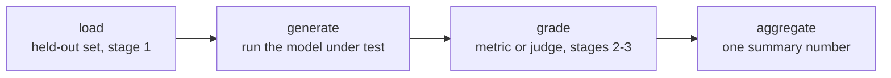

# Leçon 7. Frameworks d'eval et construction d'un harness

**Lien avec la mission :** Les étapes 1 à 3 ont conçu quoi mesurer, comment garder des données held-out et comment les noter ; l'étape 4 est celle où cette conception devient un pipeline exécutable qui produit le même chiffre de la même façon à chaque fois, plutôt qu'un script jetable que personne ne peut relancer.
**Source primaire :** [Dépôt : openai/evals, OpenAI](https://github.com/openai/evals)
**Prérequis :** [Leçon 6](0006-judge-bias-and-human-agreement.md), [Contamination des données](../GLOSSARY.md)

## Échauffement

1. ▢ Comment testez-vous si un juge par paires présente un biais de position ?

Vérifier

Relancez la même comparaison en inversant l'ordre des deux réponses et vérifiez que le verdict est cohérent. Si le juge choisit la réponse qui vient en premier, quelle qu'elle soit, le verdict n'est pas fiable.

2. ▢ Quelle est la bonne barre à laquelle comparer l'accord d'un juge avec des annotateurs humains ?

Vérifier

L'accord humain-humain sur les mêmes comparaisons, pas un plafond parfait de 100 %, puisque les annotateurs humains ne sont pas non plus d'accord entre eux à chaque fois.

## À savoir

### Pourquoi un harness, et pas un script jetable

Chaque décision de conception des étapes 1 à 3, quelles données sont held-out, quelle métrique ou quel juge note une réponse, comment un score est agrégé, ne compte que si elle est appliquée de la même façon chaque fois qu'une eval s'exécute. Un **harness** formalise ce pipeline en code réutilisable et auditable, de sorte qu'une réexécution six mois plus tard sur un nouveau checkpoint de modèle applique exactement le même jeu held-out et la même logique de notation que la première exécution, au lieu de les reconstituer de mémoire ou à partir d'une cellule de notebook à moitié oubliée. Le harness est ce qui transforme une analyse ponctuelle en mesure répétable.

### Quatre étapes, dans tout harness

Quel que soit le framework qui le construit, un harness d'eval se décompose en quatre mêmes étapes : **charger** le jeu d'eval held-out (la discipline de l'étape 1 sur ce qu'il contient et pourquoi il est digne de confiance) ; **générer**, en exécutant le modèle testé sur chaque exemple pour produire ses sorties ; **noter**, en appliquant la métrique ou le juge choisi (étapes 2 et 3) à chaque sortie ; et **agréger**, en transformant les scores par exemple en un chiffre de synthèse, une moyenne, un taux de réussite, selon ce que demande la mission. Nommer ces étapes explicitement est important parce que chacune peut compromettre le chiffre final indépendamment : une étape de chargement contaminée produit un chiffre qui ne veut rien dire quel que soit le soin apporté à la notation, une étape de génération défaillante (mauvais modèle, réponse tronquée) produit des déchets qu'aucune métrique ne peut sauver, une étape de notation mal calibrée (la compression des scores de la leçon 5, les biais de la leçon 6) fausse des sorties pourtant bonnes, et une étape d'agrégation qui cache la variance derrière une moyenne unique peut faire paraître solide un résultat peu fiable.

### Deux frameworks établis, deux usages différents

**openai/evals** est conçu pour définir une eval sur mesure sous forme de code : une fonction de complétion enveloppe le modèle testé, une spécification d'eval nomme le jeu de données et la logique de notation, et un registre d'evals existantes montre la forme que prend une eval qui fonctionne. Il convient à une tâche propre à la mission pour laquelle personne n'a encore construit d'eval. **lm-evaluation-harness** (EleutherAI) exécute au contraire un modèle sur une vaste bibliothèque de benchmarks standardisés prêts à l'emploi, via des configurations de tâches déclaratives, sans écrire de fonction de complétion ni de logique de notation de zéro. Il convient à la réutilisation d'un benchmark existant, surtout quand la comparabilité avec les chiffres publiés sur ce même benchmark compte plus que l'adaptation de l'eval à une mission précise.

Le choix suit le même principe que celui d'une métrique (leçon 4) : adapter l'outil à ce dont la tâche a réellement besoin. Une capacité entièrement nouvelle sans benchmark existant demande une eval-as-code sur mesure. Une capacité qu'un benchmark standardisé mesure déjà bien demande le harness conçu pour exécuter ce benchmark, pas une réimplémentation artisanale.

## Pratique

1. ▢ Une équipe évalue chaque nouveau checkpoint de modèle en faisant lancer un script à la main par quelqu'un, qui ajuste quelques paramètres à la main et lit la sortie. Six mois plus tard, une autre personne tente de reproduire un ancien résultat et obtient un chiffre différent. Que corrige réellement la construction d'un harness, par opposition à ce processus ad hoc ?

Vérifier

Un harness formalise le pipeline (quelles données held-out, quelle logique de notation, comment les scores s'agrègent) en code qui s'exécute de la même façon à chaque fois, de sorte qu'une réexécution des mois plus tard par une autre personne applique le processus identique au lieu de le reconstituer de mémoire, ce qui est exactement l'origine de l'échec de reproductibilité dans ce scénario.

2. ▢ Nommez les quatre étapes de tout harness d'eval, et donnez une façon dont chaque étape pourrait compromettre le chiffre final même si les trois autres sont bien faites.

Vérifier

Chargement : un jeu d'eval contaminé ou non held-out (étape 1) rend le chiffre sans signification quelle que soit la qualité de la notation. Génération : exécuter la mauvaise version du modèle ou tronquer les sorties produit des déchets qu'aucune métrique ne peut réparer. Notation : une métrique ou un juge mal calibré (leçons 3 à 6) fausse la notation de sorties pourtant correctes. Agrégation : écraser les scores par exemple en une seule moyenne peut cacher une forte variance ou quelques échecs catastrophiques derrière un chiffre qui a l'air solide.

3. ▢ Une équipe veut évaluer une capacité réellement nouvelle que vise son modèle, qu'aucun benchmark public ne mesure actuellement. Doit-elle choisir openai/evals ou lm-evaluation-harness, et pourquoi ?

Vérifier

openai/evals, puisqu'il est conçu pour définir une eval sur mesure sous forme de code, une fonction de complétion plus une spécification de notation, quand aucun benchmark existant ne couvre la tâche. lm-evaluation-harness est conçu pour exécuter des benchmarks standardisés préexistants via des configurations déclaratives, ce qui n'aide pas quand la capacité mesurée n'a pas encore de tel benchmark.

4. ▢ Une équipe veut comparer les performances de son modèle sur un benchmark public bien connu aux chiffres publiés d'autres modèles. Doit-elle choisir openai/evals ou lm-evaluation-harness, et pourquoi ?

Vérifier

lm-evaluation-harness, puisqu'il exécute un modèle sur des configurations de tâches de benchmark standardisées et prêtes à l'emploi, de la façon dont les autres chiffres rapportés sur ce même benchmark ont été produits, ce qui rend la comparaison significative. Réécrire à la main le même benchmark dans openai/evals risque des différences d'implémentation subtiles qui brisent la comparabilité avec les résultats publiés.

5. ▢ Laquelle de ces affirmations est vraie de la forme en quatre étapes (chargement, génération, notation, agrégation) d'un harness d'eval ?

    - a) Seule l'étape de notation compte ; le chargement, la génération et l'agrégation sont des détails d'implémentation sans effet sur la fiabilité
    - b) Chaque étape peut compromettre indépendamment le chiffre final, donc un résultat digne de confiance exige que les quatre soient solides, pas seulement la logique de notation
    - c) Les quatre étapes ne s'appliquent qu'aux evals LLM-as-judge, pas aux evals à métrique propre à la tâche
    - d) L'agrégation est inutile si l'étape de notation produit un seul score par exemple

Vérifier

**b)** Chaque étape est un endroit où la confiance peut se rompre, indépendamment des autres, comme l'ont montré les exemples de cette leçon. (a) est faux : une étape de chargement contaminée ou une étape de génération défaillante ruine le résultat quelle que soit la qualité de la notation. (c) est faux : les mêmes quatre étapes s'appliquent que la notation utilise l'exact match, la correction fonctionnelle ou un juge LLM. (d) est faux : l'agrégation doit encore transformer de nombreux scores par exemple en l'unique chiffre de synthèse qu'une eval rapporte, et la manière de le faire (une moyenne ou quelque chose qui rapporte la variance) influe sur la confiance qu'on peut accorder à ce chiffre.

## Exercices en situation réelle

- [ ] Pour une eval que vous exécutez ou prévoyez d'exécuter, écrivez explicitement ses quatre étapes (ce qui est chargé, ce qui génère les sorties, ce qui les note, comment elles s'agrègent) même si elle vit aujourd'hui dans un seul script.
- [ ] Examinez une eval existante du registre d'openai/evals ou une configuration de tâche de lm-evaluation-harness, et repérez ses étapes de chargement, de génération, de notation et d'agrégation dans le code ou la configuration réels.
- [ ] Demain : décidez, pour une capacité que vous voulez évaluer, si un benchmark standardisé la couvre déjà assez bien pour être réutilisé, ou si elle demande une eval sur mesure construite de zéro.

## Pour aller plus loin

- [Dépôt : openai/evals, OpenAI](https://github.com/openai/evals)
- [Dépôt : lm-evaluation-harness, EleutherAI](https://github.com/EleutherAI/lm-evaluation-harness)
- [Ressources](../RESOURCES.md)

---

Ça ne passe pas ? Relisez la source primaire en haut de page, car cette leçon la condense et c'est dans la condensation que la compréhension s'échappe. Consultez le [glossaire](../GLOSSARY.md) pour tout terme qui vous a paru glissant.

Si c'est la leçon elle-même qui n'est pas claire plutôt que la matière, c'est un défaut : [ouvrez une issue](https://github.com/TokenCemetery/teach/issues).
