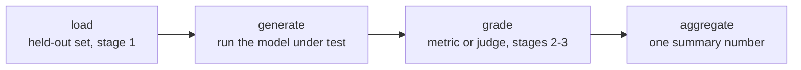

# पाठ 7. Eval Frameworks और Harness बनाना

**मिशन से संबंध:** चरण 1 से 3 ने डिज़ाइन किया कि क्या मापना है, data को held out कैसे रखना है, और उसे score कैसे करना है; चरण 4 वह जगह है जहाँ वह डिज़ाइन चलने लायक pipeline बनता है जो हर बार एक ही संख्या एक ही तरह पैदा करे, ऐसी एक-बार की script नहीं जिसे कोई दोबारा न चला सके।
**मुख्य स्रोत:** [Repo: openai/evals, OpenAI](https://github.com/openai/evals)
**पूर्व-आवश्यकताएँ:** [पाठ 6](0006-judge-bias-and-human-agreement.md), [Data contamination](../GLOSSARY.md)

## वार्म-अप

1. ▢ आप कैसे परखते हैं कि कोई pairwise judge position bias दिखा रहा है?

जाँचें

वही तुलना दोनों responses का क्रम पलटकर दोबारा चलाएँ और जाँचें कि फ़ैसला एकसार है या नहीं। अगर judge जो भी response पहले आए उसी को चुनता है, चाहे वह कोई भी हो, तो फ़ैसला अविश्वसनीय है।

2. ▢ Judge की मानव raters से सहमति की तुलना किस कसौटी से करनी सही है?

जाँचें

उन्हीं तुलनाओं पर human-बनाम-human सहमति, पूर्ण 100% की छत नहीं, क्योंकि मानव raters भी हर बार आपस में सहमत नहीं होते।

## यह जानें

### Harness क्यों, एक-बार की script क्यों नहीं

चरण 1 से 3 का हर डिज़ाइन फ़ैसला, यानी कौन-सा data held out है, कौन-सी metric या judge response को grade करता है, score कैसे aggregate होता है, तभी मायने रखता है जब वह eval के हर बार चलने पर एक ही तरह लागू हो। **Harness** उस pipeline को दोबारा इस्तेमाल होने लायक, जाँचे जा सकने वाले code में बदल देता है, ताकि छह महीने बाद नए model checkpoint पर दोबारा चलाने पर वही held-out सेट और grading का तर्क लगे जो पहले run में लगा था, उसे याददाश्त या आधे-याद notebook cell से दोबारा बनाने के बजाय। Harness ही एक-बार के विश्लेषण को दोहराए जा सकने वाले माप में बदलता है।

### हर harness में चार चरण

कोई भी framework उसे बनाए, eval harness उन्हीं चार चरणों में बँटता है: held-out eval सेट **load** करना (चरण 1 का अनुशासन कि उसमें क्या है और वह भरोसेमंद क्यों है); **generate**, यानी परखे जा रहे model को हर example पर चलाकर उसके outputs पैदा करना; **grade**, यानी चुनी हुई metric या judge (चरण 2 और 3) को हर output पर लगाना; और **aggregate**, यानी हर-example के scores को एक सारांश संख्या में बदलना, औसत, pass दर, जो भी मिशन को चाहिए। इन चरणों का साफ़ नाम लेना इसलिए मायने रखता है कि हर एक अंतिम संख्या को स्वतंत्र रूप से कमज़ोर कर सकता है: contaminated load चरण ऐसी संख्या देता है जिसका कोई मतलब नहीं, grading कितनी भी सावधानी से हो; टूटा हुआ generation चरण (ग़लत model, कटा हुआ response) ऐसा कचरा देता है जिसे कोई metric नहीं बचा सकती; miscalibrated grading चरण (पाठ 5 का score compression, पाठ 6 के biases) वरना अच्छे outputs को बिगाड़ देता है; और ऐसा aggregation चरण जो variance को एक अकेले औसत के पीछे छिपा दे, अविश्वसनीय नतीजे को ठोस दिखा सकता है।

### दो स्थापित frameworks, दो अलग काम

**openai/evals** custom eval को code के रूप में परिभाषित करने के लिए बना है: एक completion function परखे जा रहे model को लपेटता है, eval spec dataset और grading का तर्क बताता है, और मौजूदा evals की registry दिखाती है कि चलने वाला eval किस आकार का होता है। यह ऐसे मिशन-विशिष्ट task पर ठीक बैठता है जिसके लिए अभी किसी ने eval नहीं बनाया। **lm-evaluation-harness** (EleutherAI) इसके बजाय model को घोषणात्मक task configs के ज़रिए पहले से बने, मानकीकृत benchmarks की बड़ी library पर चलाता है, completion function या grading का तर्क शून्य से लिखे बिना। यह मौजूदा benchmark को दोबारा इस्तेमाल करने पर ठीक बैठता है, ख़ास तौर पर जब उसी benchmark पर प्रकाशित संख्याओं से तुलनीयता eval को किसी ख़ास मिशन के हिसाब से ढालने से ज़्यादा मायने रखती हो।

चुनाव उसी सिद्धांत पर चलता है जिस पर metric चुनना (पाठ 4): औज़ार को उससे मिलाएँ जो task को असल में चाहिए। बिल्कुल नई क्षमता, जिसके लिए कोई मौजूदा benchmark नहीं है, को custom eval-as-code चाहिए। जिस क्षमता को मानकीकृत benchmark पहले से अच्छी तरह मापता है, उसे वह harness चाहिए जो उस benchmark को चलाने के लिए बना है, उसका हाथ से दोबारा लागू किया हुआ रूप नहीं।

## अभ्यास

1. ▢ एक टीम हर नए model checkpoint को ऐसे परखती है कि कोई व्यक्ति हाथ से script चलाता है, कुछ parameters हाथ से बदलता है, और output पढ़ता है। छह महीने बाद, कोई दूसरा व्यक्ति पुराना नतीजा दोबारा बनाने की कोशिश करता है और अलग संख्या पाता है। इस तदर्थ प्रक्रिया के मुक़ाबले harness बनाना असल में क्या ठीक करता है?

जाँचें

Harness pipeline (कौन-सा held-out data, कौन-सा grading तर्क, scores कैसे aggregate हों) को ऐसे code में बदलता है जो हर बार एक ही तरह चलता है, ताकि महीनों बाद किसी दूसरे व्यक्ति के दोबारा चलाने पर वही प्रक्रिया लगे, उसे याददाश्त से दोबारा बनाने के बजाय, और इस परिदृश्य में reproducibility की विफलता ठीक वहीं से आई थी।

2. ▢ हर eval harness के चार चरणों के नाम बताएँ, और हर चरण के लिए एक तरीक़ा बताएँ जिससे वह अंतिम संख्या को कमज़ोर कर सकता है, भले बाक़ी तीन अच्छी तरह किए गए हों।

जाँचें

Load: contaminated या non-held-out eval सेट (चरण 1) संख्या को बेमतलब बना देता है, grading की गुणवत्ता कुछ भी हो। Generate: ग़लत model version चलाना या outputs को truncate करना ऐसा कचरा पैदा करता है जिसे कोई metric ठीक नहीं कर सकती। Grade: miscalibrated metric या judge (पाठ 3-6) वरना ठीक outputs का scoring बिगाड़ देता है। Aggregate: हर-example के scores को एक अकेले औसत में समेटना ऊँचे variance या कुछ भारी विफलताओं को ऐसी संख्या के पीछे छिपा सकता है जो ठोस दिखती है।

3. ▢ एक टीम अपने model के निशाने वाली सचमुच नई क्षमता परखना चाहती है, जिसे अभी कोई public benchmark नहीं मापता। उन्हें openai/evals की ओर जाना चाहिए या lm-evaluation-harness की, और क्यों?

जाँचें

openai/evals, क्योंकि वह custom eval को code के रूप में परिभाषित करने के लिए बना है, एक completion function और एक grading spec, जब कोई मौजूदा benchmark उस task को ढकता न हो। lm-evaluation-harness पहले से मौजूद, मानकीकृत benchmarks को घोषणात्मक configs से चलाने के लिए बना है, जो तब मदद नहीं करता जब मापी जा रही क्षमता का अभी ऐसा कोई benchmark ही नहीं है।

4. ▢ एक टीम अपने model का प्रदर्शन किसी जाने-माने public benchmark पर दूसरे models की प्रकाशित संख्याओं से तुलना करना चाहती है। उन्हें openai/evals की ओर जाना चाहिए या lm-evaluation-harness की, और क्यों?

जाँचें

lm-evaluation-harness, क्योंकि वह model को मानकीकृत, पहले से बने benchmark task configs पर उसी तरह चलाता है जैसे उसी benchmark पर बताई गई दूसरी संख्याएँ बनी थीं, जिससे तुलना सार्थक बनती है। उसी benchmark को openai/evals में हाथ से बनाने पर कार्यान्वयन के सूक्ष्म अंतर का जोखिम है, जो प्रकाशित नतीजों से तुलनीयता तोड़ देता है।

5. ▢ Eval harness के चार-चरण वाले ढाँचे (load, generate, grade, aggregate) के बारे में कौन-सा दावा सही है?

    - a) सिर्फ़ grading चरण मायने रखता है; load, generate और aggregate कार्यान्वयन के ब्योरे हैं जिनका भरोसेमंद होने पर कोई असर नहीं
    - b) हर चरण स्वतंत्र रूप से अंतिम संख्या को कमज़ोर कर सकता है, इसलिए भरोसेमंद नतीजे के लिए चारों का ठीक होना ज़रूरी है, सिर्फ़ grading तर्क का नहीं
    - c) चारों चरण सिर्फ़ LLM-as-judge evals पर लागू होते हैं, task-specific-metric evals पर नहीं
    - d) अगर grading चरण हर example के लिए एक अकेला score देता है तो aggregation की ज़रूरत नहीं

जाँचें

**b)** हर चरण वह जगह है जहाँ भरोसा बाक़ियों से स्वतंत्र रूप से टूट सकता है, जैसा इस पाठ के हल किए उदाहरणों ने दिखाया। (a) ग़लत है: contaminated load चरण या टूटा generation चरण grading की गुणवत्ता की परवाह किए बिना नतीजा बिगाड़ देता है। (c) ग़लत है: grading में exact match, functional correctness या LLM judge, जो भी इस्तेमाल हो, वही चार चरण लागू होते हैं। (d) ग़लत है: aggregation को फिर भी कई हर-example scores को वह एक सारांश संख्या बनाना है जो eval असल में बताता है, और यह कैसे किया जाता है (औसत बनाम variance बताने वाली कोई चीज़) इस पर असर डालता है कि सारांश संख्या पर कितना भरोसा किया जा सकता है।

## असली दुनिया का अभ्यास

- [ ] जो eval आप चलाते हैं या चलाने की योजना है, उसके चार चरण साफ़ लिखें (क्या load होता है, outputs कौन पैदा करता है, उन्हें कौन grade करता है, वे कैसे aggregate होते हैं), भले वह अभी एक ही script में रहता हो।
- [ ] openai/evals registry या lm-evaluation-harness task config का एक मौजूदा eval देखें, और असल code या config में उसके load, generate, grade और aggregate चरण पहचानें।
- [ ] कल: जिस क्षमता को आप परखना चाहते हैं, उसके लिए तय करें कि क्या कोई मानकीकृत benchmark उसे दोबारा इस्तेमाल करने लायक अच्छी तरह ढकता है, या उसके लिए शून्य से बना custom eval चाहिए।

## आगे बढ़ने के लिए

- [Repo: openai/evals, OpenAI](https://github.com/openai/evals)
- [Repo: lm-evaluation-harness, EleutherAI](https://github.com/EleutherAI/lm-evaluation-harness)
- [संसाधन](../RESOURCES.md)

---

बात नहीं बन रही? ऊपर दिए primary source को दोबारा पढ़ें, क्योंकि यह पाठ उसे संक्षिप्त करता है और समझ संक्षेप में ही रिसती है। जो शब्द फिसलन भरा लगे, उसके लिए [शब्दावली](../GLOSSARY.md) देखें।

अगर दिक़्क़त सामग्री की नहीं बल्कि पाठ की ही है, तो वह एक खोट है: [issue खोलें](https://github.com/TokenCemetery/teach/issues)।
