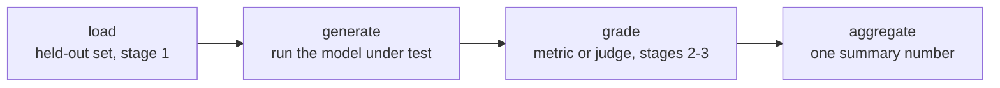

# Lição 7. Frameworks de eval e construção de um harness

**Ligação com a missão:** As etapas 1 a 3 projetaram o que medir, como manter os dados held-out e como pontuá-los; a etapa 4 é onde esse design se torna um pipeline executável que produz o mesmo número do mesmo jeito sempre, em vez de um script avulso que ninguém consegue reexecutar.
**Fonte principal:** [Repositório: openai/evals, OpenAI](https://github.com/openai/evals)
**Pré-requisitos:** [Lição 6](0006-judge-bias-and-human-agreement.md), [Contaminação de dados](../GLOSSARY.md)

## Aquecimento

1. ▢ Como você testa se um juiz pairwise está exibindo viés de posição?

Verificação

Reexecute a mesma comparação com a ordem das duas respostas trocada e verifique se o veredito é consistente. Se o juiz escolhe a resposta que vem primeiro, seja ela qual for, o veredito não é confiável.

2. ▢ Qual é o patamar certo com que comparar a concordância de um juiz com avaliadores humanos?

Verificação

A concordância humano-humano nas mesmas comparações, e não um teto perfeito de 100%, já que avaliadores humanos também não concordam entre si todas as vezes.

## Saiba isto

### Por que um harness, e não um script avulso

Toda decisão de design das etapas 1 a 3, quais dados são held-out, qual métrica ou juiz avalia uma resposta, como uma pontuação é agregada, só importa se for aplicada do mesmo jeito toda vez que um eval é executado. Um **harness** formaliza esse pipeline em código reutilizável e auditável, de modo que uma nova execução seis meses depois, sobre um novo checkpoint do modelo, aplique exatamente o mesmo conjunto held-out e a mesma lógica de avaliação da primeira execução, em vez de reconstruí-los de memória ou de uma célula de notebook lembrada pela metade. O harness é o que transforma uma análise pontual em uma medição repetível.

### Quatro etapas, em todo harness

Seja qual for o framework que o construa, um harness de eval se divide nas mesmas quatro etapas: **carregar** o conjunto de eval held-out (a disciplina da etapa 1 sobre o que há nele e por que é confiável); **gerar**, executando o modelo sob teste contra cada exemplo para produzir suas saídas; **avaliar**, aplicando a métrica ou o juiz escolhido (etapas 2 e 3) a cada saída; e **agregar**, transformando as pontuações por exemplo em um número-resumo, uma média, uma taxa de aprovação, o que a missão pedir. Nomear essas etapas explicitamente importa porque cada uma pode minar o número final de forma independente: uma etapa de carga contaminada produz um número que não significa nada, por mais cuidadosa que seja a avaliação; uma etapa de geração quebrada (o modelo errado, uma resposta truncada) produz lixo que nenhuma métrica salva; uma etapa de avaliação mal calibrada (a compressão da pontuação da lição 5, os vieses da lição 6) corrompe saídas que de outro modo seriam boas; e uma etapa de agregação que esconde a variância atrás de uma única média pode fazer um resultado pouco confiável parecer sólido.

### Dois frameworks consolidados, dois trabalhos diferentes

O **openai/evals** foi feito para definir um eval customizado como código: uma função de completion embrulha o modelo sob teste, uma especificação de eval nomeia o dataset e a lógica de avaliação, e um registro de evals existentes mostra o formato que um eval funcional assume. Serve a uma tarefa específica da missão para a qual ninguém construiu um eval ainda. O **lm-evaluation-harness** (EleutherAI), em vez disso, executa um modelo contra uma grande biblioteca de benchmarks padronizados e prontos por meio de configurações declarativas de tarefa, sem escrever do zero uma função de completion nem a lógica de avaliação. Serve a reaproveitar um benchmark existente, especialmente quando a comparabilidade com números publicados nesse mesmo benchmark importa mais do que ajustar o eval a uma missão específica.

A escolha segue o mesmo princípio da escolha de uma métrica (lição 4): casar a ferramenta com o que a tarefa de fato precisa. Uma capacidade nova, sem benchmark existente, precisa de um eval-as-code customizado. Uma capacidade que um benchmark padronizado já mede bem precisa do harness feito para executar esse benchmark, e não de uma reimplementação artesanal dele.

## Prática

1. ▢ Uma equipe avalia cada novo checkpoint do modelo pedindo a alguém que execute um script manualmente, ajuste alguns parâmetros à mão e leia a saída. Seis meses depois, outra pessoa tenta reproduzir um resultado passado e obtém um número diferente. O que construir um harness, em oposição a esse processo improvisado, de fato resolve?

Verificação

Um harness formaliza o pipeline (quais dados held-out, qual lógica de avaliação, como as pontuações se agregam) em código que roda do mesmo jeito toda vez, de modo que uma nova execução meses depois, por uma pessoa diferente, aplique o processo idêntico em vez de reconstruí-lo de memória, que é exatamente de onde veio a falha de reprodutibilidade neste cenário.

2. ▢ Nomeie as quatro etapas que todo harness de eval tem e dê uma forma como cada etapa poderia minar o número final mesmo que as outras três estejam bem feitas.

Verificação

Carregar: um conjunto de eval contaminado ou que não é held-out (etapa 1) torna o número sem sentido, seja qual for a qualidade da avaliação. Gerar: executar a versão errada do modelo ou truncar as saídas produz lixo que nenhuma métrica conserta. Avaliar: uma métrica ou juiz mal calibrado (lições 3 a 6) corrompe a pontuação de saídas que de outro modo estariam boas. Agregar: reduzir as pontuações por exemplo a uma única média pode esconder alta variância ou algumas falhas catastróficas atrás de um número que parece sólido.

3. ▢ Uma equipe quer avaliar uma capacidade genuinamente nova que seu modelo visa, uma que nenhum benchmark público mede hoje. Ela deve recorrer ao openai/evals ou ao lm-evaluation-harness, e por quê?

Verificação

openai/evals, já que foi feito para definir um eval customizado como código, uma função de completion mais uma especificação de avaliação, quando nenhum benchmark existente cobre a tarefa. O lm-evaluation-harness foi feito para executar benchmarks padronizados já existentes por meio de configurações declarativas, o que não ajuda quando a capacidade medida ainda não tem um benchmark assim.

4. ▢ Uma equipe quer comparar o desempenho do seu modelo em um benchmark público conhecido com números publicados de outros modelos. Ela deve recorrer ao openai/evals ou ao lm-evaluation-harness, e por quê?

Verificação

lm-evaluation-harness, já que ele executa um modelo contra configurações de tarefa de benchmark padronizadas e prontas, do jeito como os outros números reportados nesse mesmo benchmark foram produzidos, o que torna a comparação significativa. Reimplementar o mesmo benchmark à mão no openai/evals arrisca diferenças sutis de implementação que quebram a comparabilidade com os resultados publicados.

5. ▢ Qual afirmação é verdadeira sobre o formato de quatro etapas (carregar, gerar, avaliar, agregar) que um harness de eval tem?

    - a) Só a etapa de avaliação importa; carregar, gerar e agregar são detalhes de implementação sem efeito sobre a confiabilidade
    - b) Cada etapa pode minar o número final de forma independente, então um resultado confiável exige que as quatro estejam sólidas, e não apenas a lógica de avaliação
    - c) As quatro etapas só se aplicam a evals com LLM-as-judge, não a evals com métricas específicas da tarefa
    - d) A agregação é desnecessária se a etapa de avaliação produz uma única pontuação por exemplo

Verificação

**b)** Toda etapa é um lugar onde a confiança pode se quebrar, independentemente das outras, como os exemplos resolvidos desta lição mostraram. (a) é falsa: uma etapa de carga contaminada ou uma etapa de geração quebrada arruína o resultado, seja qual for a qualidade da avaliação. (c) é falsa: as mesmas quatro etapas se aplicam quer a avaliação use exact match, correção funcional ou um juiz LLM. (d) é falsa: a agregação ainda precisa transformar muitas pontuações por exemplo no único número-resumo que um eval de fato reporta, e como isso é feito (uma média contra algo que reporta a variância) afeta o quanto o número-resumo merece confiança.

## Prática no mundo real

- [ ] Para um eval que você executa ou planeja executar, escreva explicitamente suas quatro etapas (o que é carregado, o que gera as saídas, o que as avalia, como elas se agregam), mesmo que hoje ele viva em um único script.
- [ ] Olhe um eval existente no registro do openai/evals ou uma configuração de tarefa do lm-evaluation-harness e identifique suas etapas de carregar, gerar, avaliar e agregar no código ou na configuração reais.
- [ ] Amanhã: decida, para uma capacidade que você quer avaliar, se um benchmark padronizado já a cobre bem o bastante para ser reaproveitado, ou se ela precisa de um eval customizado construído do zero.

## Para ir além

- [Repositório: openai/evals, OpenAI](https://github.com/openai/evals)
- [Repositório: lm-evaluation-harness, EleutherAI](https://github.com/EleutherAI/lm-evaluation-harness)
- [Recursos](../RESOURCES.md)

---

Não ficou claro? Releia a fonte principal no topo, já que esta lição a comprime e é na compressão que o entendimento escapa. Consulte o [glossário](../GLOSSARY.md) para qualquer termo que pareceu escorregadio.

Se o problema é a lição em si, e não o material, isso é um defeito: [abra uma issue](https://github.com/TokenCemetery/teach/issues).
