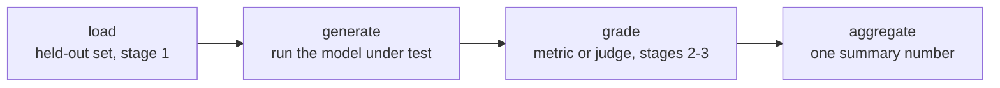

# Урок 7. Фреймворки для эвалов и построение обвязки

**Связь с целью курса:** Этапы с 1 по 3 спроектировали, что измерять, как откладывать данные и как оценивать; этап 4 это место, где этот дизайн становится работающим конвейером, дающим одно и то же число одним и тем же способом каждый раз, а не одноразовым скриптом, который никто не может перезапустить.
**Первоисточник:** [Репозиторий: openai/evals, OpenAI](https://github.com/openai/evals)
**Предварительные требования:** [Урок 6](0006-judge-bias-and-human-agreement.md), [Загрязнение данных](../GLOSSARY.md)

## Разминка

1. ▢ Как проверить, проявляет ли парный судья смещение по позиции?

Проверка

Повторите то же сравнение, поменяв порядок двух ответов, и проверьте, последователен ли вердикт. Если судья выбирает тот ответ, что стоит первым, независимо от того, какой это ответ, вердикт ненадёжен.

2. ▢ С чем верно сравнивать согласие судьи с асессорами-людьми?

Проверка

С согласием между людьми на тех же сравнениях, а не с идеальным потолком в 100%, поскольку асессоры-люди тоже не соглашаются друг с другом каждый раз.

## Что нужно знать

### Зачем обвязка, а не одноразовый скрипт

Каждое проектное решение этапов с 1 по 3 (какие данные отложены, какая метрика или судья оценивает ответ, как агрегируется оценка) важно, только если применяется одинаково при каждом запуске эвала. **Обвязка** оформляет этот конвейер в переиспользуемый, поддающийся аудиту код, так что повторный запуск полгода спустя на новом чекпоинте модели применяет в точности тот же набор отложенных данных и ту же логику оценки, что и первый запуск, а не восстанавливается по памяти или по наполовину забытой ячейке ноутбука. Обвязка превращает однократный анализ в повторяемое измерение.

### Четыре этапа в любой обвязке

Какой бы фреймворк её ни строил, обвязка эвала распадается на одни и те же четыре этапа: **загрузка** набора отложенных данных (дисциплина этапа 1 о том, что в нём и почему ему можно доверять); **генерация**, то есть прогон тестируемой модели по каждому примеру для получения её выводов; **оценка**, то есть применение выбранной метрики или судьи (этапы 2 и 3) к каждому выводу; и **агрегация**, то есть превращение оценок по примерам в одно итоговое число, среднее, долю прошедших, что требуется курсу. Явно называть эти этапы важно, потому что каждый из них может подорвать итоговое число независимо: загрязнённый этап загрузки даёт число, которое ничего не значит, как бы аккуратно ни была устроена оценка; сломанный этап генерации (не та модель, обрезанный ответ) даёт мусор, который не спасёт никакая метрика; неоткалиброванный этап оценки (сжатие оценок из урока 5, смещения из урока 6) искажает оценку в остальном хороших выводов; а этап агрегации, прячущий разброс за единственным средним, может сделать ненадёжный результат похожим на надёжный.

### Два устоявшихся фреймворка, две разные задачи

**openai/evals** создан для описания собственного эвала как кода: функция завершения оборачивает любую тестируемую модель, спецификация эвала называет набор данных и логику оценки, а реестр готовых эвалов показывает форму работающего. Он подходит для специфичной для курса задачи, для которой никто ещё не построил эвал. **lm-evaluation-harness** (EleutherAI) же прогоняет модель по большой библиотеке готовых стандартизированных бенчмарков через декларативные конфигурации задач, без написания функции завершения и логики оценки с нуля. Он подходит для переиспользования готового бенчмарка, особенно когда сопоставимость с опубликованными числами на том же бенчмарке важнее подгонки эвала под конкретную цель курса.

Выбор следует тому же принципу, что и выбор метрики (урок 4): подбирайте инструмент под то, что задаче действительно нужно. Совершенно новой способности без готового бенчмарка нужен собственный эвал как код. Способности, которую стандартизированный бенчмарк уже хорошо измеряет, нужна обвязка, созданная для запуска этого бенчмарка, а не самодельная его реализация заново.

## Практика

1. ▢ Команда оценивает каждый новый чекпоинт модели так: кто-то вручную запускает скрипт, правит несколько параметров руками и читает вывод. Полгода спустя другой человек пытается воспроизвести прошлый результат и получает другое число. Что на самом деле исправляет построение обвязки по сравнению с этим ситуативным процессом?

Проверка

Обвязка оформляет конвейер (какие отложенные данные, какая логика оценки, как агрегируются оценки) в код, который выполняется одинаково каждый раз, поэтому повторный запуск спустя месяцы другим человеком применяет тот же процесс, а не восстанавливает его по памяти, а именно здесь и возник сбой воспроизводимости в этом сценарии.

2. ▢ Назовите четыре этапа любой обвязки эвала и для каждого приведите один способ, которым он мог бы подорвать итоговое число, даже если остальные три сделаны хорошо.

Проверка

Загрузка: загрязнённый или не отложенный набор для эвала (этап 1) обесценивает число независимо от качества оценки. Генерация: запуск не той версии модели или обрезка выводов даёт мусор, который никакая метрика не исправит. Оценка: неоткалиброванная метрика или судья (уроки 3-6) искажает оценку в остальном нормальных выводов. Агрегация: сворачивание оценок по примерам в единственное среднее может спрятать большой разброс или несколько катастрофических сбоев за числом, которое выглядит надёжно.

3. ▢ Команда хочет оценить по-настоящему новую способность, на которую нацелена её модель и которую пока не измеряет ни один публичный бенчмарк. Что им взять, openai/evals или lm-evaluation-harness, и почему?

Проверка

openai/evals, поскольку он создан для описания собственного эвала как кода, функции завершения плюс спецификации оценки, когда ни один готовый бенчмарк не покрывает задачу. lm-evaluation-harness создан для запуска готовых стандартизированных бенчмарков через декларативные конфигурации, и это не помогает, когда у измеряемой способности такого бенчмарка пока нет.

4. ▢ Команда хочет сравнить результат своей модели на известном публичном бенчмарке с опубликованными числами других моделей. Что им взять, openai/evals или lm-evaluation-harness, и почему?

Проверка

lm-evaluation-harness, поскольку он прогоняет модель по стандартизированным готовым конфигурациям задач бенчмарка так же, как получены другие сообщаемые числа на том же бенчмарке, и сравнение получается осмысленным. Если вручную воспроизводить тот же бенчмарк в openai/evals, есть риск тонких отличий реализации, которые ломают сопоставимость с опубликованными результатами.

5. ▢ Какое утверждение верно для четырёхэтапной формы (загрузка, генерация, оценка, агрегация) обвязки эвала?

    - a) Важен только этап оценки; загрузка, генерация и агрегация это детали реализации, не влияющие на надёжность
    - b) Каждый этап может подорвать итоговое число независимо, поэтому надёжный результат требует, чтобы все четыре были в порядке, а не только логика оценки
    - c) Четыре этапа применимы только к эвалам с LLM-судьёй, а не к эвалам с метрикой под конкретную задачу
    - d) Агрегация не нужна, если этап оценки даёт одну оценку на пример

Проверка

**b)** Каждый этап это место, где доверие может сломаться независимо от остальных, как показали разобранные в уроке примеры. Вариант (a) неверен: загрязнённый этап загрузки или сломанный этап генерации портит результат независимо от качества оценки. Вариант (c) неверен: одни и те же четыре этапа применимы, используется ли для оценки точное совпадение, функциональная корректность или LLM-судья. Вариант (d) неверен: агрегация всё равно должна превратить много оценок по примерам в то единственное итоговое число, которое эвал на самом деле сообщает, а то, как это сделано (среднее или нечто, сообщающее разброс), влияет на то, насколько итоговому числу можно доверять.

## Практика в реальной работе

- [ ] Для эвала, который вы запускаете или планируете запускать, явно запишите его четыре этапа (что загружается, что генерирует выводы, что их оценивает, как они агрегируются), даже если сейчас он живёт в одном скрипте.
- [ ] Посмотрите на один существующий эвал из реестра openai/evals или конфигурацию задачи lm-evaluation-harness и найдите в самом коде или конфигурации его этапы загрузки, генерации, оценки и агрегации.
- [ ] Завтра: для способности, которую вы хотите оценить, решите, покрывает ли её стандартизированный бенчмарк достаточно хорошо, чтобы переиспользовать, или нужен собственный эвал с нуля.

## Что почитать дальше

- [Репозиторий: openai/evals, OpenAI](https://github.com/openai/evals)
- [Репозиторий: lm-evaluation-harness, EleutherAI](https://github.com/EleutherAI/lm-evaluation-harness)
- [Ресурсы](../RESOURCES.md)

---

Не доходит? Перечитайте первоисточник в начале: этот урок его сжимает, а при сжатии понимание как раз и теряется. Загляните в [глоссарий](../GLOSSARY.md), если какой-то термин показался скользким.

Если неясен сам урок, а не материал, это дефект: [откройте issue](https://github.com/TokenCemetery/teach/issues).
