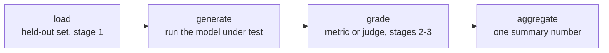

# 第 7 课：评测框架与搭建评测运行框架

**使命关联:** 第 1 到第 3 阶段设计了要度量什么、如何留出数据、如何给它打分；第 4 阶段则是让这套设计变成一条可运行的流水线，每次都用同样的方式产出同一个数字，而不是一个没人能重跑的一次性脚本。
**主要来源:** [仓库：openai/evals，OpenAI](https://github.com/openai/evals)
**前置知识:** [第 6 课](0006-judge-bias-and-human-agreement.md)、[数据污染](../GLOSSARY.md)

## 热身

1. ▢ 如何测试成对裁判是否存在位置偏差？

检查

把同一个比较重跑一遍，把两个回答的顺序对调，检查裁定是否一致。如果裁判不管是哪一个，都选在前面的那个回答，那么这个裁定就不可靠。

2. ▢ 用来对照裁判与人类评分员一致性的正确基准线是什么？

检查

是在同样的比较上，人类与人类之间的一致性，而不是完美的 100% 上限，因为人类评分员也不会每次都彼此一致。

## 要点

### 为什么要用运行框架，而不是一次性的脚本

第 1 到第 3 阶段的每一个设计决定，包括哪些数据是留出的、用哪个指标或裁判给回答打分、分数如何汇总，只有在每次运行评测时都以同样的方式应用，才有意义。**运行框架**（harness）把这条流水线固化成可复用、可审计的代码，这样六个月后，对新的模型检查点重跑，用的是与第一次运行完全相同的留出集和评分逻辑，而不是凭记忆，或者某个记不太清的 notebook 单元格重新拼凑出来。运行框架正是把一次性的分析，变成可重复的度量的东西。

### 每个运行框架都有的四个阶段

不管用哪个框架来搭，评测运行框架都分成同样的四个阶段：**加载**留出的评测集（第 1 阶段关于里面有什么、为什么可信的纪律）；**生成**，让被测的模型对每个样本运行，产出它的输出；**评分**，对每个输出应用选定的指标或裁判（第 2、3 阶段）；以及**汇总**，把逐样本的分数变成一个汇总的数字，可以是均值、通过率，使命需要什么就是什么。明确指出这些阶段很重要，因为每一个都可能独立地破坏最终的数字：被污染的加载阶段，产出的数字毫无意义，不管评分多么仔细；出了问题的生成阶段（用错了模型，回答被截断）产出的是任何指标都救不回来的垃圾；没有校准好的评分阶段（第 5 课的分数压缩、第 6 课的偏差）会把本来很好的输出评错分；而把方差藏在单一均值后面的汇总阶段，会让一个不可靠的结果看起来很扎实。

### 两个成熟的框架，两项不同的工作

**openai/evals** 是为把自建的评测定义为代码而建的：一个补全函数包装被测的无论哪个模型，一份评测规格指明数据集和评分逻辑，并有一个现成评测的注册表，展示了一个能工作的评测是什么样子。它适合还没有人为之建过评测的、使命专属的任务。**lm-evaluation-harness**（EleutherAI）则是通过声明式的任务配置，让模型跑一大批预先构建的标准化基准，而不必从头编写补全函数或评分逻辑。它适合复用现有的基准，尤其是当与已发表的、同一基准上的数字具有可比性，比为某个具体的使命量身定制评测更重要的时候。

这个选择遵循的原则，与选择指标（第 4 课）相同：让工具与任务真正的需求相匹配。一个没有现成基准的全新能力，需要自建的评测即代码。一个标准化基准已经度量得很好的能力，需要的是为运行那个基准而建的运行框架，而不是手工重新实现它。

## 练习

1. ▢ 某团队评测每个新的模型检查点的做法，是让某个人手动运行一个脚本，手工调几个参数，再读输出。六个月后，另一个人试图复现过去的结果，却得到了不同的数字。与这种临时的做法相比，搭建运行框架究竟解决了什么？

检查

运行框架把流水线（用哪些留出数据、什么评分逻辑、分数如何汇总）固化成每次都以同样方式运行的代码，这样几个月后由另一个人重跑，用的是完全相同的流程，而不是凭记忆重新拼凑，而这个场景中可复现性的失败，恰恰就出在这里。

2. ▢ 说出每个评测运行框架都有的四个阶段，并各举一个例子，说明即使另外三个阶段都做得很好，这个阶段也可能破坏最终的数字。

检查

加载：被污染的、或不是留出的评测集（第 1 阶段），不管评分质量如何，都会让这个数字毫无意义。生成：运行了错误的模型版本或截断了输出，产出的是任何指标都修不好的垃圾。评分：没有校准好的指标或裁判（第 3 至 6 课），会把本来没问题的输出评错分。汇总：把逐样本的分数压成单一的均值，可能把高方差或少数几次灾难性的失败，藏在一个看起来很扎实的数字后面。

3. ▢ 某团队想评测其模型所针对的一项真正全新的能力，目前没有任何公开基准度量它。他们应该选用 openai/evals 还是 lm-evaluation-harness，为什么？

检查

openai/evals，因为它是为在没有现成基准涵盖该任务时，把自建的评测定义为代码（一个补全函数加一份评分规格）而建的。lm-evaluation-harness 是为通过声明式配置运行现有的标准化基准而建的，当被度量的能力还没有这样的基准时，它帮不上忙。

4. ▢ 某团队想把自己模型在某个著名公开基准上的表现，与其他模型已发表的数字作比较。他们应该选用 openai/evals 还是 lm-evaluation-harness，为什么？

检查

lm-evaluation-harness，因为它让模型跑的是标准化的、预先构建的基准任务配置，和该基准上其他已报告数字的产生方式一致，使比较有意义。在 openai/evals 里手工重写同一个基准，有可能产生细微的实现差异，破坏与已发表结果的可比性。

5. ▢ 关于评测运行框架的四阶段结构（加载、生成、评分、汇总），下列哪项说法是对的？

    - a) 只有评分阶段重要；加载、生成和汇总是实现细节，对可信度没有影响
    - b) 每个阶段都可能独立地破坏最终的数字，所以一个可信的结果要求四个阶段都可靠，而不只是评分逻辑
    - c) 这四个阶段只适用于 LLM-as-judge 评测，不适用于针对具体任务的指标评测
    - d) 如果评分阶段为每个样本产出单一的分数，就不需要汇总

检查

**b)** 每个阶段都是信任可能崩塌的地方，彼此独立，正如本课的算例所展示的。（a）错误：被污染的加载阶段或出了问题的生成阶段，不管评分质量如何，都会毁掉结果。（c）错误：无论评分用的是精确匹配、功能正确性还是 LLM 裁判，同样是这四个阶段。（d）错误：汇总仍然要把许多逐样本的分数，变成评测真正报告的那个汇总数字，而它的做法（只给均值，还是同时报告方差），会影响这个汇总数字有多可信。

## 实战练习

- [ ] 对于你运行或打算运行的一个评测，把它的四个阶段明确写下来（加载了什么、什么产出输出、什么给输出打分、如何汇总），即使它目前写在同一个脚本里。
- [ ] 看一看 openai/evals 注册表中的一个现有评测，或 lm-evaluation-harness 的一个任务配置，在实际的代码或配置中，找出它的加载、生成、评分和汇总阶段。
- [ ] 明天：针对你想评测的某项能力，判断是已有的标准化基准已经足够好、可以复用，还是需要从零开始构建自建的评测。

## 延伸阅读

- [仓库：openai/evals，OpenAI](https://github.com/openai/evals)
- [仓库：lm-evaluation-harness，EleutherAI](https://github.com/EleutherAI/lm-evaluation-harness)
- [资源](../RESOURCES.md)

---

没学明白？请重读顶部的主要来源，因为本课是对它的压缩，而理解正是在压缩中流失的。如果有哪个术语觉得含糊，可以查看[术语表](../GLOSSARY.md)。

如果问题出在课程本身，而不是学习材料，那就是一个缺陷：[提交 issue](https://github.com/TokenCemetery/teach/issues)。
