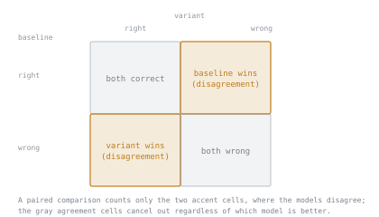

# 第 9 课：统计显著性与噪声

**使命关联:** 第 5 阶段的上线与否判断，好坏取决于是否知道观察到的分数差异是真实的；本课给出回答这一问题的工具，直接建立在第 8 课“单次运行的数字自带噪声”这一点之上。
**主要来源:** [文档：“Define success criteria and build evaluations”，Claude Platform Docs](https://platform.claude.com/docs/en/test-and-evaluate/develop-tests)
**前置知识:** [第 8 课](0008-reproducible-runs.md)、[数据污染](../GLOSSARY.md)

## 热身

1. ▢ 为什么同一套评测在非零温度下运行两次，会得出两个不同的汇总分数，而并没有出任何问题？

检查

在非零温度下采样，使生成具有随机性，所以各次运行之间出现不同的补全，进而出现不同的逐样本分数，是预期之中的。单次运行的数字，是从一个分布中抽取的样本，而不是关于模型的固定事实。

2. ▢ 为了让之后的比较有意义，报告评测分数时应当同时记录什么？

检查

随机种子、生成的温度、模型和框架的版本、评测集的版本，以及在运行了多个样本时，它们之间的离散程度，而不只是均值。

## 要点

### 分数的差异不会自动成为真实的差异

一个新的模型变体，在同一个评测集上得分 76%，而基线是 70%。这六个点的差距看起来像是改进，但第 8 课已经确立，单次运行的分数自带采样产生的噪声。本课要回答的问题是：六个点的差距，是否大于仅凭偶然就能产生的噪声，还是恰恰是同一个模型的两次运行之间，可能彼此呈现的那种波动？

### 样本量决定了该预期多少噪声

对于在 *N* 个样本上的通过/不通过式分数，真实通过率为 *p*，所测得比例的标准误差近似为 `sqrt(p(1−p)/N)`。在 100 个样本上通过率为 0.70，标准误差约为 `sqrt(0.70 × 0.30 / 100) ≈ 0.046`，也就是大约 4.6 个百分点；在同样的 100 个样本上通过率为 0.76，标准误差约为 4.3 个百分点。两个各自带着大约四到五个点噪声的估计之间，六个点的差距，并不明显大于仅凭偶然就能产生的程度；更多的样本会缩小每个标准误差（它随 `sqrt(N)` 下降），使估计更精确，也使真实的差异更容易与噪声区分开。

### 成对比较是更锋利的工具

像上面的估计那样，把两个分数当作相互独立的比例，就丢掉了实际上可以得到的信息：当同样的评测样本，同时跑过基线和新的变体时，你知道的不只是各自答对了多少，而是具体哪些样本各自答对或答错了。**成对比较**看的是两个模型不一致的样本（一个答对了，另一个没答对），而不是分别看两个原始的通过率。这会抵消同样影响两个模型的样本层面的难度，每个模型都倾向于答对的问题，或每个模型都倾向于答错的问题，对于其中一个模型是否真的比另一个更好，没有任何贡献，而且用同样多的数据，它也比比较两个独立的比例，更容易检测出真实的差异。

### “尚不显著”对上线与否的判断意味着什么

一个并不明显大于噪声的差距，不是没有差异的证据；它是信息还不够、无法判断的证据。诚实的回应，要么是运行更多的样本（缩小标准误差），要么是对不一致的部分做恰当的成对显著性检验，而不是仅仅因为分数在数值上更大，就把它当作改进的证明。

## 练习

1. ▢ 基线模型在 100 个评测样本中通过 70 个；新的变体在 100 个中通过 76 个。计算每个比例的近似标准误差，并说明这六个点的差距看起来是否明显大于合并后的噪声。

提示

对每个比例分别使用 `sqrt(p(1−p)/N)`，其中 N = 100。

检查

基线：`sqrt(0.70 × 0.30 / 100) ≈ 0.046`，约 4.6 个点。新的变体：`sqrt(0.76 × 0.24 / 100) ≈ 0.043`，约 4.3 个点。每个估计各自带着大约四到五个点的噪声，所以六个点的差距，并不明显大于这样合并起来的噪声仅凭偶然就能产生的程度；单凭 100 个样本，它是有提示意义的，但不是定论。

2. ▢ 为什么使用更大的评测集（更多的样本），会让真实的分数差异更容易与噪声区分开？

检查

比例的标准误差随 `sqrt(N)` 下降，所以更大的 N 会缩小每个估计中的噪声。一个对照 100 个样本的噪声显得含糊的差距，当对照比如 1,000 个样本来度量时，就可能变得明显大于噪声，而底层的真实差异并没有任何改变。

3. ▢ 同样的 100 个评测样本，同时跑过基线和新的变体。为什么看每个模型具体答对或答错了哪些样本（成对比较），比只把 70% 和 76% 这两个原始的通过率当作相互独立的数字来比较，更有力？

检查

比较原始通过率，是把每个分数当作来自互不相关的样本，丢掉了两者用的是同样的样本这一事实。成对比较则看的是两个模型不一致的地方，抵消了同样影响两者的样本层面的难度（每个模型都答对的问题，或每个模型都答错的问题，说明不了哪个模型更好），这使得用比独立比例比较更少的数据，就能检测出真实的差异。

4. ▢ 某团队观察到两个模型变体之间有一个分数差距，结果发现它并不明显大于估计的噪声。诚实的结论是什么，有哪两种办法能得到更清楚的答案？

检查

诚实的结论是，还没有足够的信息来说明这个差异是否真实，而不是说没有差异。弄清楚的两种办法：对更多的样本运行评测，这会缩小每个估计的标准误差；或者对两个变体不一致的那些具体样本，做恰当的成对显著性检验，而不是把两个原始通过率当作相互独立的数字来比较。

5. ▢ 关于判断评测分数的差异是否真实，下列哪项说法是对的？

    - a) 不管样本量如何，两个分数之间的任何正差距，都算作改进的证据
    - b) 差距应当对照样本量凭偶然就可能产生的噪声来判断，而成对比较比把分数当作相互独立的，更有效地利用了数据
    - c) 统计显著性只对针对具体任务的指标重要，对 LLM-as-judge 的分数不重要
    - d) 更大的评测集永远不会改变某个给定差距看起来是否显著

检查

**b)** 噪声与样本量的推理，以及成对比较的优势，正是本课所讲的内容。（a）错误：小于估计噪声的差距，不是可靠的证据，不管它是正还是负。（c）错误：同样的统计推理适用于任何汇总分数，不管它是怎么评的分。（d）错误：标准误差随 `sqrt(N)` 缩小，所以更大的评测集可以把含糊的差距变成清楚的差距。

## 实战练习

- [ ] 对于你观察到的两个模型变体之间的某个分数差异，用本课的公式估计每个比例的标准误差，并检查这个差距是否明显大于合并后的噪声。
- [ ] 如果你有两个变体在同一个评测集上的逐样本结果，看一看它们不一致的那些样本并数一数，作为成对比较的第一步。
- [ ] 明天：对于你关心的某个评测，判断它目前的样本量是否大到足以检测出，对上线与否的决定真正重要的那种改进幅度。

## 延伸阅读

- [文档：“Define success criteria and build evaluations”，Claude Platform Docs](https://platform.claude.com/docs/en/test-and-evaluate/develop-tests)
- [资源](../RESOURCES.md)

---

没学明白？请重读顶部的主要来源，因为本课是对它的压缩，而理解正是在压缩中流失的。如果有哪个术语觉得含糊，可以查看[术语表](../GLOSSARY.md)。

如果问题出在课程本身，而不是学习材料，那就是一个缺陷：[提交 issue](https://github.com/TokenCemetery/teach/issues)。
