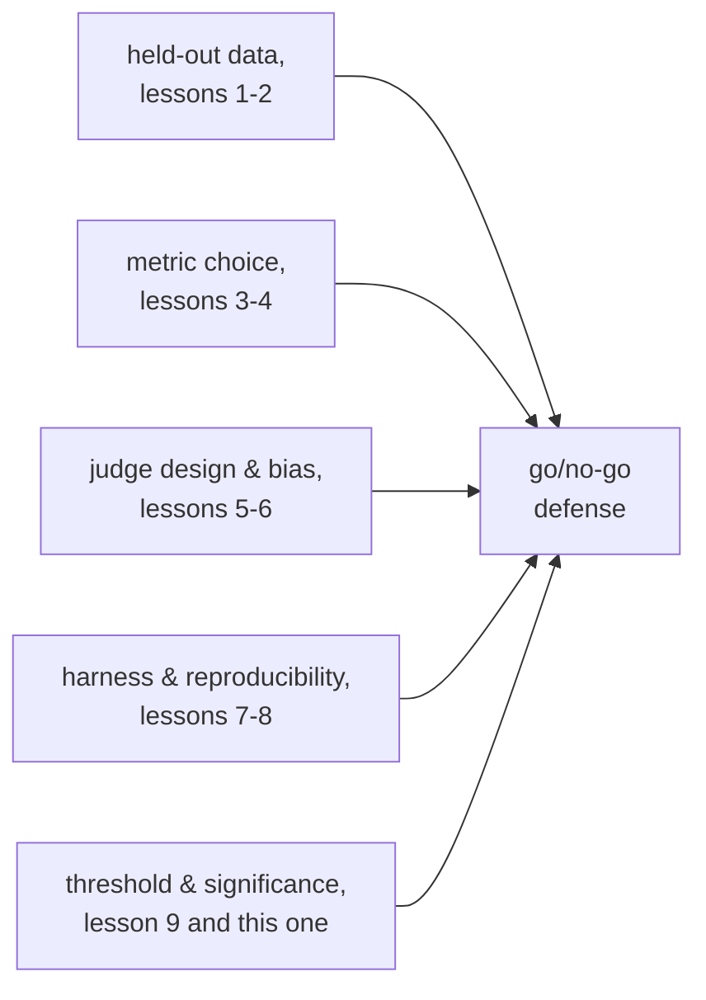

# Lección 10. Defender la decisión de go/no-go

**Vínculo con la misión:** Esta lección cierra la etapa 5, la decisión de lanzar o no lanzar que las etapas 6 a 13 amplían después: demostrar que un cambio en un modelo ayudó termina en una decisión de lanzar o no lanzar, y defender esa decisión significa nombrar un umbral fijado antes de ver el resultado y citar cada elección previa, desde los datos held-out hasta la significancia estadística, que hace fiable el número que la sustenta.
**Fuente principal:** [Docs: "Define success criteria and build evaluations", Claude Platform Docs](https://platform.claude.com/docs/en/test-and-evaluate/develop-tests)
**Requisitos previos:** [Lección 9](0009-statistical-significance-vs-noise.md), [Contaminación de datos](../GLOSSARY.md)

## Calentamiento

1. ▢ Un modelo de línea base aprueba 70 de 100 ejemplos de eval; una nueva variante aprueba 76 de 100. ¿Es la brecha de seis puntos claramente mayor que el ruido, según el error estándar de cada proporción?

Comprobación

No claramente. El error estándar de cada proporción es de unos 4 a 5 puntos con N = 100, así que una brecha de seis puntos no es obviamente mayor que el ruido combinado; es sugerente, no concluyente, solo con este tamaño de muestra.

2. ▢ ¿Qué debería registrarse junto con una puntuación de eval reportada para que una comparación posterior sea significativa?

Comprobación

La semilla aleatoria, la temperatura de generación, las versiones del modelo y del framework, la versión del conjunto de eval y, cuando se ejecutaron varias muestras, la dispersión entre ellas, no solo su media.

## Qué debes saber

### Un umbral fijado después de ver el resultado no es un umbral

Un **umbral de regresión** nombra, por adelantado, cuánto se permite que baje una métrica, o cuánto debe mejorar, para que un cambio se lance. Fijarlo antes de que se ejecute la eval importa tanto como tener uno: un umbral elegido después de ver el número puede doblarse libremente hacia la respuesta que alguien quería, el mismo fallo que describió la lección 1 para un conjunto de eval ajustado una y otra vez hasta que deja de medir algo real. Un umbral decidido por adelantado, ligado a lo que el producto realmente necesita (cuánto le costaría a los usuarios una regresión en esta métrica, cuánta mejora importaría), es el único tipo que se puede defender con honestidad más tarde.

### Un umbral tiene que respetar el piso de ruido

La lección 9 mostró que el error estándar de una puntuación depende del tamaño de la muestra; un umbral más estrecho que ese piso de ruido no es un umbral de verdad, es una moneda al aire disfrazada de decisión. Exigir "ninguna regresión mayor de 1 punto" en una métrica cuyo error estándar es de 4 puntos con el tamaño de muestra actual significa que la eval en realidad no puede distinguir una regresión de 1 punto del ruido ordinario, así que el umbral no puede hacerse cumplir con honestidad sin aflojarlo hasta algo que la eval pueda resolver o sin aumentar el tamaño de la muestra hasta que pueda.

### Un resultado no concluyente no es una respuesta por defecto

Cuando una diferencia observada cae dentro del ruido (lección 9), la conclusión honesta es que todavía no hay suficiente evidencia, no "lánzalo, ya que no es claramente peor" ni "bloquéalo, ya que no es claramente mejor". Ambas tratan la ausencia de evidencia como evidencia de algo, lo cual no es. La respuesta correcta a un resultado no concluyente es reunir más datos, más ejemplos de eval, más muestras, lo que diga la matemática de la lección 9 que afinaría la estimación, no elegir la opción por defecto que resulte más cómoda.

### Qué tiene que citar una defensa completa

Una decisión de go/no-go se defiende, y no solo se reporta, cuando nombra: la métrica y por qué encaja con la tarea (lecciones 3 y 4); por qué el conjunto held-out es honesto frente a la contaminación (lecciones 1 y 2); si se usó un juez LLM, el diseño de su prompt y sus comprobaciones medidas de calibración y sesgo (lecciones 5 y 6); el harness que produjo el número y lo que se registró para hacerlo reproducible (lecciones 7 y 8); y el argumento estadístico de que la diferencia observada supera un umbral fijado por adelantado y es claramente mayor que el ruido que el tamaño de la muestra podría producir (lección 9 y esta lección). Una decisión que solo enuncia un número de titular, sin nada de esto, es una intuición con decimales; es precisamente el resultado que la misión se propuso evitar.

## Práctica

1. ▢ Un equipo fija su umbral de regresión ("no se permite más de 1 punto de regresión") solo después de ver que su nuevo modelo puntuó exactamente 1.2 puntos por debajo de la línea base. ¿Qué tiene de malo este umbral, sin importar si 1.2 puntos son una regresión real?

Comprobación

El umbral se eligió después de ver el resultado, lo que significa que puede doblarse, y en este caso plausiblemente se dobló, para justificar la respuesta que ya se quería. Un umbral solo defiende una decisión cuando se fijó por adelantado, ligado a lo que el producto realmente necesita, y no se ajustó con carácter retroactivo para encajar con el número observado.

2. ▢ La métrica de un equipo tiene un error estándar de unos 4 puntos con su tamaño de muestra actual, y quieren hacer cumplir un umbral de "no más de 1 punto de regresión". ¿Qué tiene de malo defender una decisión de go/no-go contra este umbral tal como se mide hoy?

Pista

Compara el tamaño del umbral con el tamaño del ruido que la eval realmente puede resolver.

Comprobación

La eval no puede distinguir de forma fiable una regresión de 1 punto del ruido de muestreo ordinario cuando el error estándar es de 4 puntos; una diferencia medida de 1 punto en cualquier dirección cae bien dentro de lo que el azar por sí solo podría producir. El umbral necesita aflojarse hasta algo que el tamaño de muestra actual pueda resolver realmente, o el tamaño de la muestra necesita crecer hasta que una diferencia de 1 punto se distinga del ruido.

3. ▢ Una eval muestra una diferencia de puntuación que cae dentro del ruido estimado: ni claramente una mejora, ni claramente una regresión. Un compañero argumenta "lancémoslo, ya que no es claramente peor". ¿Cuál es el problema de ese razonamiento?

Comprobación

Un resultado no concluyente es evidencia de no tener todavía suficientes datos, no evidencia de que nada cambió. Tratar "no claramente peor" como licencia para lanzar es tratar la ausencia de evidencia como evidencia de seguridad, lo que el razonamiento del piso de ruido no respalda; lo honesto es reunir más evidencia (una muestra mayor, más ejecuciones) en lugar de optar por defecto por lanzar o por bloquear.

4. ▢ Enumera lo que necesita citar una defensa completa de un go/no-go, tomando una cosa de cada una de las etapas anteriores de este espacio de trabajo.

Comprobación

La métrica elegida y por qué encaja con la tarea (etapa 2). Por qué el conjunto de eval held-out es honesto frente a la contaminación (etapa 1). Si un juez LLM calificó el resultado, el diseño de su prompt y sus comprobaciones medidas de calibración y sesgo (etapa 3). El harness que produjo el número y lo que se registró para la reproducibilidad (etapa 4). El argumento estadístico de que la diferencia supera un umbral preregistrado y es claramente mayor que el ruido que permite el tamaño de la muestra (etapa 5, esta lección y la lección 9).

5. ▢ ¿Qué afirmación es cierta sobre un umbral de regresión defendible?

    - a) Debería fijarse después de ver el resultado de la eval, para reflejar lo que realmente ocurrió
    - b) Debería fijarse antes de que se ejecute la eval y no ser más estrecho que el piso de ruido que el tamaño de la muestra puede resolver
    - c) Un umbral más laxo siempre es más defendible que uno más estricto, sin importar lo que necesite el producto
    - d) Un resultado no concluyente debería resolverse por defecto con el resultado (lanzar o bloquear) que resulte más cómodo para el equipo

Comprobación

**b)** Ambas condiciones, fijarse por adelantado y respetar el piso de ruido, son lo que vuelve a un umbral exigible en lugar de decorativo. (a) es falsa: un umbral posterior al hecho puede doblarse para encajar con el resultado que apareciera. (c) es falsa: el umbral correcto refleja lo que el producto realmente necesita, no una preferencia general por la laxitud. (d) es falsa: un resultado no concluyente pide más evidencia, no una respuesta por defecto elegida por comodidad.

## Prácticas en el mundo real

- [ ] Para un cambio de modelo que estés evaluando o planees evaluar, escribe el umbral de regresión antes de ejecutar la eval y contrástalo con el piso de ruido estimado del tamaño de muestra actual, según la lección 9.
- [ ] Redacta una defensa completa de go/no-go para un resultado pasado o hipotético, citando de forma explícita la elección de la métrica, la honestidad del conjunto held-out, las comprobaciones de calibración del juez, el registro de reproducibilidad del harness y el argumento estadístico, una línea cada uno.
- [ ] Mañana: vuelve a la misión de este espacio de trabajo en `README.md` y confirma, con tus propias palabras, que ahora puedes hacer lo que describe: demostrar que un cambio en un modelo ayudó, manteniendo los datos held-out con honestidad y defendiendo el número frente a la contaminación.

## Para profundizar

- [Docs: "Define success criteria and build evaluations", Claude Platform Docs](https://platform.claude.com/docs/en/test-and-evaluate/develop-tests)
- [Paper: "Judging LLM-as-a-Judge with MT-Bench and Chatbot Arena", Zheng et al., 2023](https://arxiv.org/abs/2306.05685)
- [Recursos](../RESOURCES.md)

---

¿No termina de quedar claro? Vuelve a leer la fuente primaria de arriba, ya que esta lección la comprime y en la compresión es donde se escapa la comprensión. Consulta el [glosario](../GLOSSARY.md) por si algún término te resultó resbaladizo.

Si lo poco claro es la propia lección y no el material, eso es un defecto: [abre un issue](https://github.com/TokenCemetery/teach/issues).
