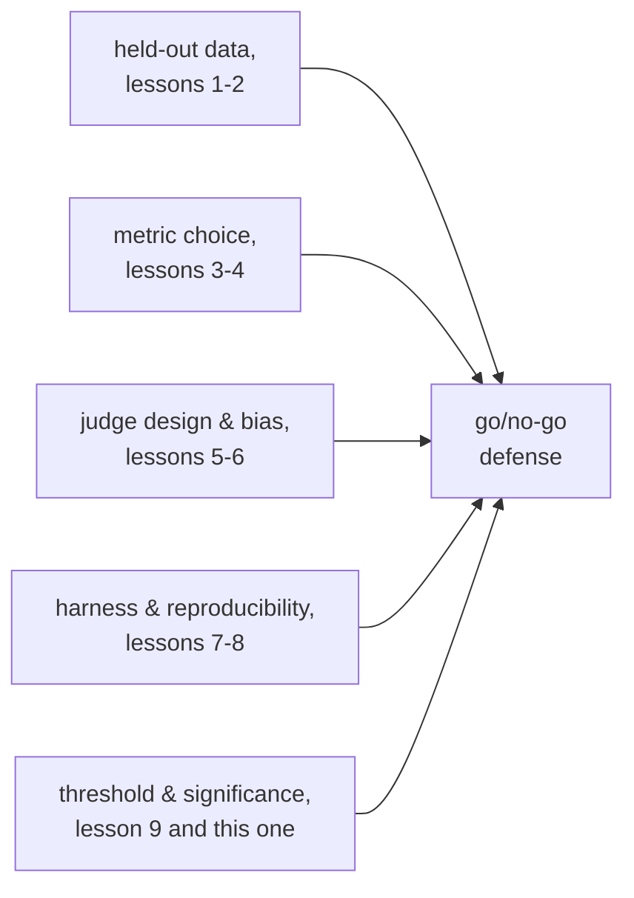

# Leçon 10. Défendre le go/no-go

**Lien avec la mission :** C'est la dernière leçon de la mission : prouver qu'une modification de modèle a aidé aboutit à une décision de livrer ou non, et défendre cette décision suppose de nommer un seuil fixé avant que le résultat soit connu et de citer chaque choix en amont, des données held-out à la significativité statistique, qui rend digne de confiance le chiffre qui la sous-tend.
**Source primaire :** [Doc : "Define success criteria and build evaluations", Claude Platform Docs](https://platform.claude.com/docs/en/test-and-evaluate/develop-tests)
**Prérequis :** [Leçon 9](0009-statistical-significance-vs-noise.md), [Contamination des données](../GLOSSARY.md)

## Échauffement

1. ▢ Un modèle de baseline réussit 70 exemples d'eval sur 100 ; une nouvelle variante en réussit 76 sur 100. L'écart de six points est-il nettement plus grand que le bruit, d'après l'erreur standard de chaque proportion ?

Vérifier

Pas nettement. L'erreur standard de chaque proportion est d'environ 4 à 5 points à N = 100, donc un écart de six points n'est pas manifestement plus grand que le bruit combiné ; il est évocateur, pas concluant, sur cette seule taille d'échantillon.

2. ▢ Que faut-il journaliser avec un score d'eval rapporté pour qu'une comparaison ultérieure ait un sens ?

Vérifier

Le seed aléatoire, la température de génération, les versions du modèle et du framework, la version du jeu d'eval et, quand plusieurs échantillons ont été exécutés, la dispersion entre eux, pas seulement leur moyenne.

## À savoir

### Un seuil fixé après avoir vu le résultat n'est pas un seuil

Un **seuil de régression** nomme, à l'avance, de combien une métrique a le droit de baisser, ou de combien elle doit s'améliorer, pour qu'un changement soit livré. Le fixer avant l'exécution de l'eval compte autant que d'en avoir un : un seuil choisi après avoir vu le chiffre est libre de s'infléchir vers la réponse que quelqu'un voulait, la même défaillance que la leçon 1 a décrite pour un jeu d'eval sur lequel on règle à répétition jusqu'à ce qu'il ne mesure plus rien de réel. Un seuil décidé à l'avance, lié à ce dont le produit a réellement besoin (combien coûterait aux utilisateurs une régression sur cette métrique, combien d'amélioration compterait), est le seul qu'on puisse honnêtement défendre ensuite.

### Un seuil doit respecter le plancher de bruit

La leçon 9 a montré que l'erreur standard d'un score dépend de la taille d'échantillon ; un seuil plus serré que ce plancher de bruit n'est pas un vrai seuil, c'est un pile ou face déguisé en décision. Exiger « pas de régression de plus de 1 point » sur une métrique dont l'erreur standard est de 4 points à la taille d'échantillon actuelle signifie que l'eval ne sait pas réellement distinguer une régression de 1 point du bruit ordinaire, donc le seuil ne peut pas être appliqué honnêtement sans soit l'assouplir jusqu'à quelque chose que l'eval sait résoudre, soit augmenter la taille d'échantillon jusqu'à ce qu'elle le sache.

### Un résultat non concluant n'est pas une réponse par défaut

Quand une différence observée tombe dans le bruit (leçon 9), la conclusion honnête est qu'il n'y a pas encore assez de preuves, pas « livrons, puisque ce n'est pas nettement pire » et pas « bloquons, puisque ce n'est pas nettement meilleur ». Les deux traitent une absence de preuve comme une preuve de quelque chose, ce qu'elle n'est pas. La bonne réponse à un résultat non concluant est de collecter plus de données, plus d'exemples d'eval, plus d'échantillons, selon ce que le calcul de la leçon 9 dit de resserrer l'estimation, et non de choisir la valeur par défaut qui se trouve être la plus commode.

### Ce qu'une défense complète doit citer

Un go/no-go est défendu, et pas seulement rapporté, quand il nomme : la métrique et pourquoi elle convient à la tâche (leçons 3 et 4) ; pourquoi le jeu held-out est honnête face à la contamination (leçons 1 et 2) ; si un juge LLM a été utilisé, la conception de son prompt et ses contrôles mesurés de calibration et de biais (leçons 5 et 6) ; le harness qui a produit le chiffre et ce qui a été journalisé pour le rendre reproductible (leçons 7 et 8) ; et l'argument statistique selon lequel la différence observée franchit un seuil fixé à l'avance et est nettement plus grande que le bruit que la taille d'échantillon pourrait produire (leçon 9 et cette leçon). Une décision qui n'énonce qu'un chiffre phare, sans rien de tout cela, est une impression avec des décimales ; c'est précisément le résultat que la mission voulait éviter.

## Pratique

1. ▢ Une équipe fixe son seuil de régression (« pas plus de 1 point de régression autorisé ») seulement après avoir vu que son nouveau modèle a obtenu exactement 1,2 point de moins que la baseline. Qu'est-ce qui cloche dans ce seuil, que 1,2 point soit ou non une vraie régression ?

Vérifier

Le seuil a été choisi après avoir vu le résultat, ce qui signifie qu'il peut être, et ici l'a plausiblement été, infléchi pour justifier la réponse déjà voulue. Un seuil ne défend une décision que s'il a été fixé à l'avance, lié à ce dont le produit a réellement besoin, et non ajusté rétroactivement au chiffre observé.

2. ▢ La métrique d'une équipe a une erreur standard d'environ 4 points à sa taille d'échantillon actuelle, et elle veut appliquer un seuil de « pas plus de 1 point de régression ». Qu'est-ce qui cloche à défendre un go/no-go face à ce seuil tel qu'il est actuellement mesuré ?

Indice

Comparez la taille du seuil à la taille du bruit que l'eval sait réellement résoudre.

Vérifier

L'eval ne sait pas distinguer de façon fiable une régression de 1 point du bruit d'échantillonnage ordinaire quand l'erreur standard est de 4 points ; une différence mesurée de 1 point dans un sens ou dans l'autre est bien dans ce que le seul hasard pourrait produire. Le seuil doit être assoupli jusqu'à quelque chose que la taille d'échantillon actuelle sait réellement résoudre, ou la taille d'échantillon doit croître jusqu'à ce qu'une différence de 1 point devienne distinguable du bruit.

3. ▢ Une eval montre un écart de score qui tombe dans le bruit estimé : ni nettement une amélioration, ni nettement une régression. Un collègue soutient « livrons, puisque ce n'est pas nettement pire ». Quel est le problème de ce raisonnement ?

Vérifier

Un résultat non concluant est la preuve qu'on n'a pas encore assez de données, pas la preuve que rien n'a changé. Traiter « pas nettement pire » comme un feu vert pour livrer revient à traiter une absence de preuve comme une preuve d'innocuité, ce que le raisonnement sur le plancher de bruit n'étaye pas ; le bon réflexe est de collecter plus de preuves (un échantillon plus grand, plus d'exécutions) plutôt que de pencher par défaut vers livrer ou bloquer.

4. ▢ Listez ce qu'une défense complète d'un go/no-go doit citer, en prenant un élément dans chacune des étapes précédentes de cet espace de travail.

Vérifier

La métrique choisie et pourquoi elle convient à la tâche (étape 2). Pourquoi le jeu d'eval held-out est honnête face à la contamination (étape 1). Si un juge LLM a noté le résultat, la conception de son prompt et ses contrôles mesurés de calibration et de biais (étape 3). Le harness qui a produit le chiffre et ce qui a été journalisé pour la reproductibilité (étape 4). L'argument statistique selon lequel la différence franchit un seuil préenregistré et est nettement plus grande que le bruit que permet la taille d'échantillon (étape 5, cette leçon et la leçon 9).

5. ▢ Laquelle de ces affirmations est vraie d'un seuil de régression défendable ?

    - a) Il devrait être fixé après avoir vu le résultat de l'eval, pour refléter ce qui s'est réellement passé
    - b) Il devrait être fixé avant l'exécution de l'eval et pas plus serré que le plancher de bruit que la taille d'échantillon sait résoudre
    - c) Un seuil plus laxiste est toujours plus défendable qu'un seuil plus strict, quoi que le produit demande
    - d) Un résultat non concluant devrait pencher par défaut vers le résultat (livrer ou bloquer) le plus commode pour l'équipe

Vérifier

**b)** Les deux conditions, fixé à l'avance et respectant le plancher de bruit, sont ce qui rend un seuil applicable plutôt que décoratif. (a) est faux : un seuil a posteriori peut être infléchi pour coller à n'importe quel résultat apparu. (c) est faux : le bon seuil reflète ce dont le produit a réellement besoin, pas une préférence généralisée pour le laxisme. (d) est faux : un résultat non concluant appelle plus de preuves, pas une réponse par défaut choisie par commodité.

## Exercices en situation réelle

- [ ] Pour une modification de modèle que vous évaluez ou prévoyez d'évaluer, écrivez le seuil de régression avant d'exécuter l'eval, et confrontez-le au plancher de bruit estimé de la taille d'échantillon actuelle selon la leçon 9.
- [ ] Rédigez une défense complète d'un go/no-go pour un résultat passé ou hypothétique, en citant explicitement le choix de la métrique, l'honnêteté du jeu held-out, les éventuels contrôles de calibration du juge, la journalisation de reproductibilité du harness et l'argument statistique, une ligne chacun.
- [ ] Demain : relisez la mission de cet espace de travail dans `README.md` et confirmez, avec vos propres mots, que vous savez maintenant faire ce qu'elle décrit : prouver qu'une modification de modèle a aidé, en gardant honnêtement les données held-out et en défendant le chiffre face à la contamination.

## Pour aller plus loin

- [Doc : "Define success criteria and build evaluations", Claude Platform Docs](https://platform.claude.com/docs/en/test-and-evaluate/develop-tests)
- [Article : "Judging LLM-as-a-Judge with MT-Bench and Chatbot Arena", Zheng et al., 2023](https://arxiv.org/abs/2306.05685)
- [Ressources](../RESOURCES.md)

---

Ça ne passe pas ? Relisez la source primaire en haut de page, car cette leçon la condense et c'est dans la condensation que la compréhension s'échappe. Consultez le [glossaire](../GLOSSARY.md) pour tout terme qui vous a paru glissant.

Si c'est la leçon elle-même qui n'est pas claire plutôt que la matière, c'est un défaut : [ouvrez une issue](https://github.com/TokenCemetery/teach/issues).
