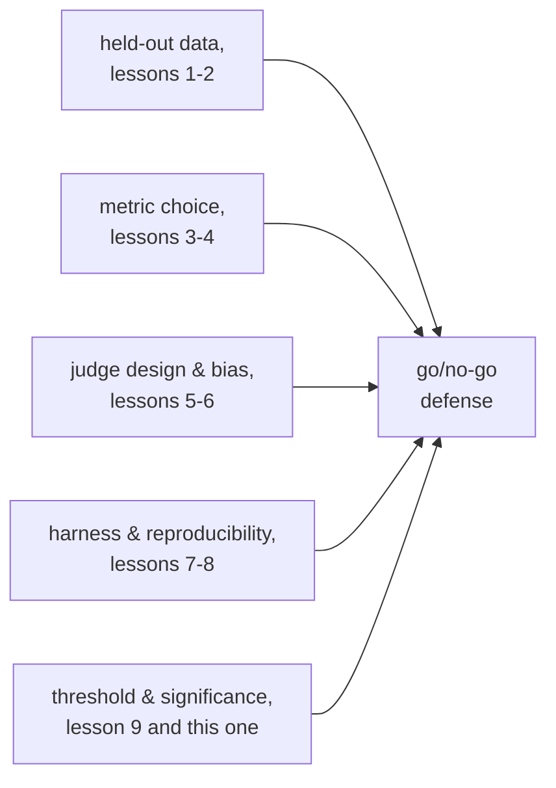

# पाठ 10. Go/No-Go Call का बचाव

**मिशन से संबंध:** यह पाठ चरण 5 पूरा करता है, यानी ship या don't-ship का फ़ैसला, जिसे चरण 6 से 13 आगे बढ़ाते हैं: यह साबित करना कि model में बदलाव काम आया, ship करो या मत करो वाले फ़ैसले पर ख़त्म होता है, और उस फ़ैसले का बचाव करने का मतलब है नतीजा देखने से पहले तय किया गया threshold बताना और उसके पीछे की संख्या को भरोसेमंद बनाने वाला हर पिछला चुनाव cite करना, held-out data से लेकर statistical significance तक।
**मुख्य स्रोत:** [दस्तावेज़: "Define success criteria and build evaluations", Claude Platform Docs](https://platform.claude.com/docs/en/test-and-evaluate/develop-tests)
**पूर्व-आवश्यकताएँ:** [पाठ 9](0009-statistical-significance-vs-noise.md), [Data contamination](../GLOSSARY.md)

## वार्म-अप

1. ▢ एक baseline model 100 eval examples में से 70 पास करता है; नया variant 100 में से 76 पास करता है। क्या हर अनुपात की standard error के आधार पर छह अंक का फ़ासला noise से साफ़ तौर पर बड़ा है?

जाँचें

साफ़ तौर पर नहीं। N = 100 पर हर अनुपात की standard error लगभग 4 से 5 अंक है, इसलिए छह अंक का फ़ासला संयुक्त noise से स्पष्ट रूप से बड़ा नहीं; अकेले इस sample size पर यह संकेत है, निर्णायक नहीं।

2. ▢ बाद की तुलना को सार्थक बनाने के लिए बताए गए eval score के साथ क्या log होना चाहिए?

जाँचें

Random seed, generation temperature, model और framework versions, eval सेट का version, और जब कई samples चलाए गए हों, उनके बीच का फैलाव, सिर्फ़ उनका औसत नहीं।

## यह जानें

### नतीजा देखने के बाद तय किया गया threshold threshold नहीं होता

**Regression threshold** पहले से बताता है कि किसी बदलाव के ship होने के लिए metric को कितना गिरने की इजाज़त है, या कितना सुधरना ज़रूरी है। उसे eval चलने से पहले तय करना उतना ही मायने रखता है जितना उसका होना: संख्या देखने के बाद चुना गया threshold उस जवाब की ओर मुड़ने के लिए आज़ाद है जो कोई चाहता था, वही विफलता जो पाठ 1 ने उस eval सेट के लिए बताई थी जिसके विरुद्ध तब तक बार-बार tune किया जाए जब तक वह कुछ असली मापना बंद न कर दे। पहले से तय किया गया threshold, जो उसी से बँधा हो जो उत्पाद को असल में चाहिए (इस metric पर regression की उपयोगकर्ताओं को क्या क़ीमत पड़ेगी, कितना सुधार मायने रखेगा), अकेली ऐसी क़िस्म है जिसका बाद में ईमानदारी से बचाव हो सकता है।

### Threshold को noise floor का सम्मान करना होगा

पाठ 9 ने दिखाया कि score की standard error sample size पर निर्भर करती है; उस noise floor से ज़्यादा तंग threshold असली threshold नहीं है, वह फ़ैसले का रूप पहना हुआ सिक्के का उछाल है। उस metric पर "1 अंक से बड़ा कोई regression नहीं" माँगना, जिसकी standard error मौजूदा sample size पर 4 अंक है, इसका मतलब है कि eval 1 अंक के regression को सामान्य noise से अलग बता ही नहीं सकता, इसलिए threshold को ईमानदारी से लागू नहीं किया जा सकता, जब तक उसे ऐसी चीज़ तक ढीला न किया जाए जिसे eval सुलझा सके, या sample size को तब तक न बढ़ाया जाए जब तक वह सुलझा न सके।

### अनिर्णायक नतीजा कोई default जवाब नहीं है

जब देखा गया फ़र्क़ noise के भीतर आता है (पाठ 9), तो ईमानदार निष्कर्ष यह है कि अभी प्रमाण काफ़ी नहीं, "ship करो, क्योंकि यह साफ़ तौर पर बुरा नहीं" नहीं, और "रोक दो, क्योंकि यह साफ़ तौर पर बेहतर नहीं" भी नहीं। ये दोनों प्रमाण की ग़ैरमौजूदगी को किसी चीज़ का प्रमाण मान लेते हैं, जो वह नहीं है। अनिर्णायक नतीजे का सही जवाब है और data जुटाना, ज़्यादा eval examples, ज़्यादा samples, जो भी पाठ 9 का गणित कहे कि अनुमान को कसेगा, न कि जो भी default ज़्यादा सुविधाजनक हो उसे चुन लेना।

### पूरा बचाव क्या cite करता है

Go/no-go फ़ैसले का बचाव किया जाता है, सिर्फ़ बताया नहीं जाता, जब वह यह सब नाम देता है: metric और वह task पर क्यों बैठती है (पाठ 3 और 4); held-out सेट contamination के विरुद्ध ईमानदार क्यों है (पाठ 1 और 2); अगर LLM judge इस्तेमाल हुआ, तो उसका prompt डिज़ाइन और उसकी मापी गई calibration तथा bias जाँचें (पाठ 5 और 6); वह harness जिसने संख्या पैदा की और उसे reproducible बनाने के लिए क्या log हुआ (पाठ 7 और 8); और वह सांख्यिकीय तर्क कि देखा गया फ़र्क़ पहले से तय किए threshold को पार करता है और उस noise से साफ़ तौर पर बड़ा है जो sample size पैदा कर सकता है (पाठ 9 और यह पाठ)। जो फ़ैसला सिर्फ़ एक headline संख्या बताता है और इनमें से कुछ नहीं, वह दशमलव वाला एहसास है; यही वह नतीजा है जिसे रोकने के लिए मिशन चला था।

## अभ्यास

1. ▢ एक टीम अपना regression threshold ("1 अंक से ज़्यादा regression की इजाज़त नहीं") यह देखने के बाद ही तय करती है कि उनका नया model baseline से ठीक 1.2 अंक नीचे score कर रहा था। इस threshold में क्या ग़लत है, चाहे 1.2 अंक असली regression हो या नहीं?

जाँचें

Threshold नतीजा देखने के बाद चुना गया था, जिसका मतलब है कि उसे वह जवाब सही ठहराने के लिए मोड़ा जा सकता है, और इस मामले में संभवतः मोड़ा गया, जो पहले से चाहा गया था। Threshold किसी फ़ैसले का बचाव तभी करता है जब वह पहले से तय किया गया हो, उसी से बँधा जो उत्पाद को असल में चाहिए, देखी गई संख्या में फिट करने के लिए बाद में बदला न गया हो।

2. ▢ एक टीम की metric की standard error उनके मौजूदा sample size पर लगभग 4 अंक है, और वे "1 अंक से ज़्यादा regression की इजाज़त नहीं" का threshold लागू करना चाहते हैं। इस threshold के विरुद्ध, जैसा अभी मापा जा रहा है, go/no-go फ़ैसले का बचाव करने में क्या ग़लत है?

संकेत

Threshold के आकार की तुलना उस noise के आकार से करें जिसे eval असल में सुलझा सकता है।

जाँचें

जब standard error 4 अंक हो, तब eval 1 अंक के regression को सामान्य sampling noise से भरोसे के साथ अलग नहीं कर सकता; किसी भी दिशा में मापा गया 1 अंक का फ़र्क़ उससे कहीं भीतर है जो अकेला संयोग पैदा कर सकता है। Threshold को ऐसी चीज़ तक ढीला करना होगा जिसे मौजूदा sample size असल में सुलझा सके, या sample size को तब तक बढ़ाना होगा जब तक 1 अंक का फ़र्क़ noise से अलग पहचाना जा सके।

3. ▢ एक eval ऐसा score का फ़र्क़ दिखाता है जो अनुमानित noise के भीतर आता है: न साफ़ सुधार, न साफ़ regression। एक साथी तर्क देता है "इसे ship कर दो, क्योंकि यह साफ़ तौर पर बुरा नहीं है।" उस तर्क में क्या समस्या है?

जाँचें

अनिर्णायक नतीजा इस बात का प्रमाण है कि अभी data काफ़ी नहीं, इस बात का नहीं कि कुछ बदला नहीं। "साफ़ तौर पर बुरा नहीं" को ship करने की छूट मानना प्रमाण की ग़ैरमौजूदगी को सुरक्षा का प्रमाण मानना है, जिसे noise-floor का तर्क समर्थन नहीं देता; ईमानदार क़दम है और प्रमाण जुटाना (बड़ा sample, ज़्यादा runs), ship या block में से किसी default पर जाने के बजाय।

4. ▢ बताएँ कि पूरे go/no-go बचाव को क्या cite करना चाहिए, इस workspace के पिछले चरणों में से हर एक से एक चीज़ लेते हुए।

जाँचें

चुनी गई metric और वह task पर क्यों बैठती है (चरण 2)। Held-out eval सेट contamination के विरुद्ध ईमानदार क्यों है (चरण 1)। अगर नतीजे को LLM judge ने grade किया, तो उसका prompt डिज़ाइन और मापी गई calibration तथा bias जाँचें (चरण 3)। वह harness जिसने संख्या पैदा की और reproducibility के लिए क्या log हुआ (चरण 4)। वह सांख्यिकीय तर्क कि फ़र्क़ पहले से दर्ज threshold को पार करता है और उस noise से साफ़ तौर पर बड़ा है जिसकी sample size इजाज़त देता है (चरण 5, यह पाठ और पाठ 9)।

5. ▢ बचाव-योग्य regression threshold के बारे में कौन-सा दावा सही है?

    - a) उसे eval नतीजा देखने के बाद तय करना चाहिए, ताकि जो असल में हुआ उसे दर्शाए
    - b) उसे eval चलने से पहले तय करना चाहिए और sample size जिस noise floor को सुलझा सकता है उससे ज़्यादा तंग नहीं रखना चाहिए
    - c) ढीला threshold हमेशा सख़्त threshold से ज़्यादा बचाव-योग्य है, उत्पाद को जो भी चाहिए
    - d) अनिर्णायक नतीजे को उस परिणाम (ship या block) पर default करना चाहिए जो टीम के लिए ज़्यादा सुविधाजनक हो

जाँचें

**b)** दोनों शर्तें, पहले से तय होना और noise floor का सम्मान करना, ही threshold को सजावटी के बजाय लागू करने योग्य बनाती हैं। (a) ग़लत है: बाद में तय किया गया threshold जो भी नतीजा आया उसमें फिट करने के लिए मोड़ा जा सकता है। (c) ग़लत है: सही threshold वही दर्शाता है जो उत्पाद को असल में चाहिए, ढील की आम पसंद नहीं। (d) ग़लत है: अनिर्णायक नतीजा और प्रमाण माँगता है, सुविधा के लिए चुना गया कोई default जवाब नहीं।

## असली दुनिया का अभ्यास

- [ ] जिस model बदलाव को आप परख रहे हैं या परखने की योजना है, उसके लिए eval चलाने से पहले regression threshold लिख लें, और उसे पाठ 9 के मौजूदा sample size के अनुमानित noise floor के सामने जाँचें।
- [ ] किसी पिछले या काल्पनिक नतीजे के लिए पूरे go/no-go बचाव का मसौदा बनाएँ, जिसमें metric के चुनाव, held-out सेट की ईमानदारी, judge की calibration जाँचों, harness की reproducibility logging और सांख्यिकीय तर्क को साफ़ cite करें, हर एक के लिए एक पंक्ति।
- [ ] कल: `README.md` में इस workspace का मिशन फिर से देखें और अपने शब्दों में पक्का करें कि अब आप वह कर सकते हैं जो वह बताता है: साबित करना कि model में बदलाव काम आया, data को ईमानदारी से held out रखते हुए और संख्या का contamination के विरुद्ध बचाव करते हुए।

## आगे बढ़ने के लिए

- [दस्तावेज़: "Define success criteria and build evaluations", Claude Platform Docs](https://platform.claude.com/docs/en/test-and-evaluate/develop-tests)
- [पेपर: "Judging LLM-as-a-Judge with MT-Bench and Chatbot Arena", Zheng et al., 2023](https://arxiv.org/abs/2306.05685)
- [संसाधन](../RESOURCES.md)

---

बात नहीं बन रही? ऊपर दिए primary source को दोबारा पढ़ें, क्योंकि यह पाठ उसे संक्षिप्त करता है और समझ संक्षेप में ही रिसती है। जो शब्द फिसलन भरा लगे, उसके लिए [शब्दावली](../GLOSSARY.md) देखें।

अगर दिक़्क़त सामग्री की नहीं बल्कि पाठ की ही है, तो वह एक खोट है: [issue खोलें](https://github.com/TokenCemetery/teach/issues)।
