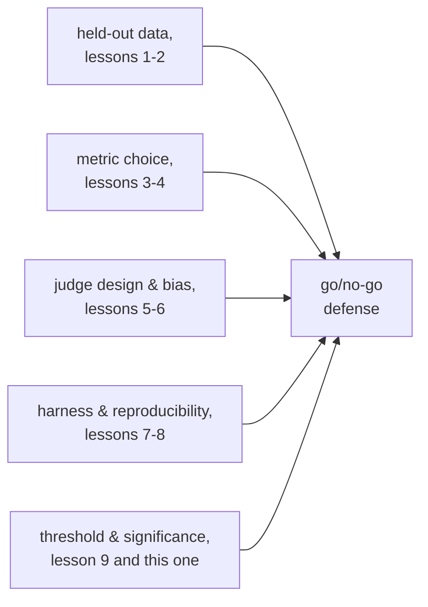

# Lição 10. Defendendo a decisão de go/no-go

**Ligação com a missão:** Esta é a lição final da missão: provar que uma mudança no modelo ajudou termina em uma decisão de lançar ou não lançar, e defender essa decisão significa nomear um limiar definido antes de o resultado ser visto e citar cada escolha anterior, dos dados held-out à significância estatística, que torna confiável o número por trás dela.
**Fonte principal:** [Docs: "Define success criteria and build evaluations", Claude Platform Docs](https://platform.claude.com/docs/en/test-and-evaluate/develop-tests)
**Pré-requisitos:** [Lição 9](0009-statistical-significance-vs-noise.md), [Contaminação de dados](../GLOSSARY.md)

## Aquecimento

1. ▢ Um modelo baseline passa em 70 de 100 exemplos de eval; uma nova variante passa em 76 de 100. A diferença de seis pontos é claramente maior que o ruído, com base no erro padrão de cada proporção?

Verificação

Não claramente. O erro padrão de cada proporção é de cerca de 4 a 5 pontos com N = 100, então uma diferença de seis pontos não é obviamente maior que o ruído combinado; é sugestiva, não conclusiva, só com esse tamanho de amostra.

2. ▢ O que deve ser registrado junto com uma pontuação de eval reportada para tornar significativa uma comparação posterior?

Verificação

A seed aleatória, a temperatura de geração, as versões do modelo e do framework, a versão do conjunto de eval e, quando várias amostras foram executadas, a dispersão entre elas, e não apenas sua média.

## Saiba isto

### Um limiar definido depois de ver o resultado não é um limiar

Um **limiar de regressão** nomeia, de antemão, quanto uma métrica pode cair, ou quanto precisa melhorar, para uma mudança ser lançada. Defini-lo antes de o eval rodar importa tanto quanto ter um: um limiar escolhido depois de ver o número fica livre para se curvar em direção à resposta que alguém queria, a mesma falha que a lição 1 descreveu para um conjunto de eval ajustado repetidamente até deixar de medir qualquer coisa real. Um limiar decidido de antemão, ligado ao que o produto de fato precisa (quanto uma regressão nessa métrica custaria aos usuários, quanta melhoria importaria), é o único tipo que pode ser defendido com honestidade depois.

### Um limiar tem de respeitar o piso de ruído

A lição 9 mostrou que o erro padrão de uma pontuação depende do tamanho da amostra; um limiar mais apertado que esse piso de ruído não é um limiar de verdade, é um cara ou coroa disfarçado de decisão. Exigir "nenhuma regressão maior que 1 ponto" em uma métrica cujo erro padrão é de 4 pontos no tamanho atual de amostra significa que o eval não consegue de fato distinguir uma regressão de 1 ponto do ruído comum, então o limiar não pode ser honestamente imposto sem afrouxá-lo para algo que o eval consiga resolver, ou sem aumentar o tamanho da amostra até que consiga.

### Um resultado inconclusivo não é uma resposta padrão

Quando uma diferença observada cai dentro do ruído (lição 9), a conclusão honesta é que ainda não há evidência suficiente, e não "lance, já que não é claramente pior" nem "bloqueie, já que não é claramente melhor". As duas tratam a ausência de evidência como evidência de alguma coisa, o que ela não é. A resposta correta a um resultado inconclusivo é reunir mais dados, mais exemplos de eval, mais amostras, o que a matemática da lição 9 disser que apertaria a estimativa, e não escolher o padrão que por acaso for mais conveniente.

### O que uma defesa completa precisa citar

Uma decisão de go/no-go é defendida, e não apenas reportada, quando nomeia: a métrica e por que ela se encaixa na tarefa (lições 3 e 4); por que o conjunto held-out é honesto contra a contaminação (lições 1 e 2); se um juiz LLM foi usado, o design do seu prompt e suas verificações medidas de calibração e viés (lições 5 e 6); o harness que produziu o número e o que foi registrado para torná-lo reproduzível (lições 7 e 8); e o argumento estatístico de que a diferença observada supera um limiar definido de antemão e é claramente maior que o ruído que o tamanho da amostra poderia produzir (lição 9 e esta lição). Uma decisão que apenas declara um número de manchete, sem nada disso, é uma impressão com casas decimais; é precisamente o resultado que a missão se propôs a evitar.

## Prática

1. ▢ Uma equipe define seu limiar de regressão ("no máximo 1 ponto de regressão permitido") só depois de ver que seu novo modelo pontuou exatamente 1,2 ponto abaixo da baseline. O que há de errado com esse limiar, independentemente de 1,2 ponto ser ou não uma regressão real?

Verificação

O limiar foi escolhido depois de ver o resultado, o que significa que ele pode ser, e neste caso plausivelmente foi, dobrado para justificar a resposta que já se queria. Um limiar só defende uma decisão quando foi fixado de antemão, ligado ao que o produto de fato precisa, e não ajustado retroativamente para caber no número observado.

2. ▢ A métrica de uma equipe tem um erro padrão de cerca de 4 pontos no tamanho atual de amostra, e ela quer impor um limiar de "no máximo 1 ponto de regressão". O que há de errado em defender uma decisão de go/no-go contra esse limiar como está medido hoje?

Dica

Compare o tamanho do limiar com o tamanho do ruído que o eval de fato consegue resolver.

Verificação

O eval não consegue distinguir com confiança uma regressão de 1 ponto do ruído comum de amostragem quando o erro padrão é de 4 pontos; uma diferença medida de 1 ponto, em qualquer direção, está bem dentro do que o acaso sozinho poderia produzir. O limiar precisa ser afrouxado para algo que o tamanho atual da amostra consiga de fato resolver, ou o tamanho da amostra precisa crescer até que uma diferença de 1 ponto se torne distinguível do ruído.

3. ▢ Um eval mostra uma diferença de pontuação que cai dentro do ruído estimado: nem claramente uma melhoria, nem claramente uma regressão. Um colega argumenta "vamos lançar, já que não é claramente pior". Qual é o problema desse raciocínio?

Verificação

Um resultado inconclusivo é evidência de que ainda não há dados suficientes, e não evidência de que nada mudou. Tratar "não é claramente pior" como licença para lançar é tratar a ausência de evidência como evidência de segurança, o que o raciocínio do piso de ruído não sustenta; o movimento honesto é reunir mais evidência (uma amostra maior, mais execuções), em vez de recorrer por padrão a lançar ou bloquear.

4. ▢ Liste o que uma defesa completa de go/no-go precisa citar, tirando uma coisa de cada uma das etapas anteriores deste workspace.

Verificação

A métrica escolhida e por que ela se encaixa na tarefa (etapa 2). Por que o conjunto de eval held-out é honesto contra a contaminação (etapa 1). Se um juiz LLM avaliou o resultado, o design do seu prompt e suas verificações medidas de calibração e viés (etapa 3). O harness que produziu o número e o que foi registrado para a reprodutibilidade (etapa 4). O argumento estatístico de que a diferença supera um limiar pré-registrado e é claramente maior que o ruído que o tamanho da amostra permite (etapa 5, esta lição e a lição 9).

5. ▢ Qual afirmação é verdadeira sobre um limiar de regressão defensável?

    - a) Deve ser definido depois de ver o resultado do eval, para refletir o que de fato aconteceu
    - b) Deve ser fixado antes de o eval rodar e definido de forma não mais apertada que o piso de ruído que o tamanho da amostra consegue resolver
    - c) Um limiar mais frouxo é sempre mais defensável que um mais rígido, independentemente do que o produto precisa
    - d) Um resultado inconclusivo deve recorrer por padrão ao desfecho (lançar ou bloquear) que for mais conveniente para a equipe

Verificação

**b)** As duas condições, definido de antemão e respeitando o piso de ruído, são o que tornam um limiar aplicável em vez de decorativo. (a) é falsa: um limiar posterior ao fato pode ser dobrado para caber em qualquer resultado que apareceu. (c) é falsa: o limiar certo reflete o que o produto de fato precisa, e não uma preferência geral por frouxidão. (d) é falsa: um resultado inconclusivo pede mais evidência, e não uma resposta padrão escolhida por conveniência.

## Prática no mundo real

- [ ] Para uma mudança no modelo que você está avaliando ou planeja avaliar, escreva o limiar de regressão antes de executar o eval e confira-o contra o piso de ruído estimado do tamanho atual da amostra, da lição 9.
- [ ] Redija uma defesa completa de go/no-go para um resultado passado ou hipotético, citando explicitamente a escolha da métrica, a honestidade do conjunto held-out, quaisquer verificações de calibração do juiz, o registro de reprodutibilidade do harness e o argumento estatístico, uma linha cada.
- [ ] Amanhã: revisite a missão deste workspace em `README.md` e confirme, em suas próprias palavras, que você agora consegue fazer o que ela descreve: provar que uma mudança no modelo ajudou, mantendo os dados held-out com honestidade e defendendo o número contra a contaminação.

## Para ir além

- [Docs: "Define success criteria and build evaluations", Claude Platform Docs](https://platform.claude.com/docs/en/test-and-evaluate/develop-tests)
- [Artigo científico: "Judging LLM-as-a-Judge with MT-Bench and Chatbot Arena", Zheng et al., 2023](https://arxiv.org/abs/2306.05685)
- [Recursos](../RESOURCES.md)

---

Não ficou claro? Releia a fonte principal no topo, já que esta lição a comprime e é na compressão que o entendimento escapa. Consulte o [glossário](../GLOSSARY.md) para qualquer termo que pareceu escorregadio.

Se o problema é a lição em si, e não o material, isso é um defeito: [abra uma issue](https://github.com/TokenCemetery/teach/issues).
