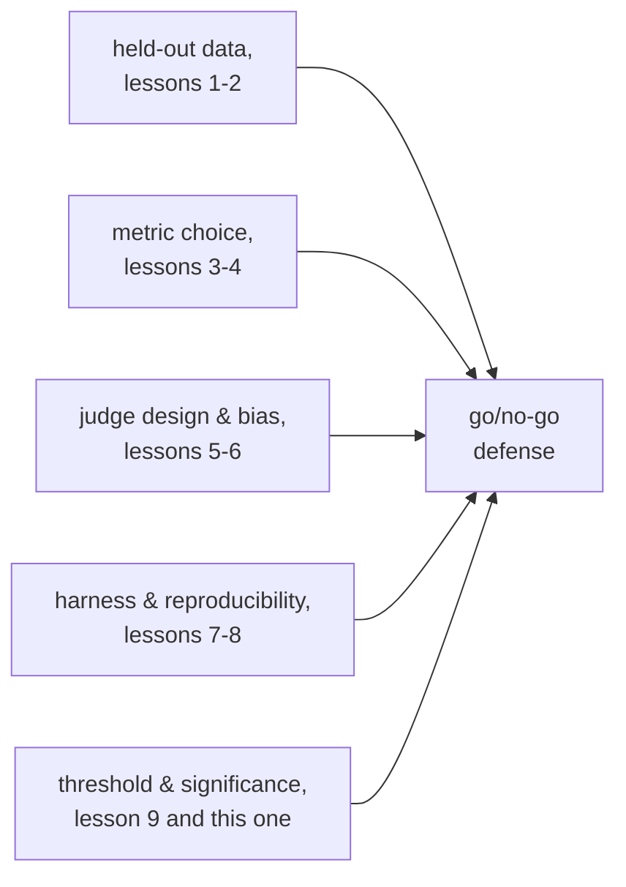

# Урок 10. Защита решения «выпускать или нет»

**Связь с целью курса:** Это заключительный урок цели курса: доказательство того, что изменение модели помогло, заканчивается решением выпускать или не выпускать, а защита этого решения означает назвать порог, установленный до того, как был виден результат, и сослаться на каждый вышестоящий выбор, от отложенных данных до статистической значимости, который делает стоящее за ним число заслуживающим доверия.
**Первоисточник:** [Документация: "Define success criteria and build evaluations", Claude Platform Docs](https://platform.claude.com/docs/en/test-and-evaluate/develop-tests)
**Предварительные требования:** [Урок 9](0009-statistical-significance-vs-noise.md), [Загрязнение данных](../GLOSSARY.md)

## Разминка

1. ▢ Базовая модель проходит 70 из 100 примеров эвала; новый вариант проходит 76 из 100. Явно ли разрыв в шесть пунктов больше шума, исходя из стандартной ошибки каждой доли?

Проверка

Не явно. Стандартная ошибка каждой доли при N = 100 составляет примерно 4-5 пунктов, поэтому разрыв в шесть пунктов заведомо не больше суммарного шума; он наводит на мысль, но не убеждает, если опираться только на этот размер выборки.

2. ▢ Что нужно записывать рядом с сообщённой оценкой эвала, чтобы последующее сравнение имело смысл?

Проверка

Случайное зерно, температуру генерации, версии модели и фреймворка, версию набора для эвала и, если запускали несколько образцов, разброс между ними, а не только их среднее.

## Что нужно знать

### Порог, установленный после того как виден результат, не порог

**Порог регрессии** заранее называет, насколько метрике позволено упасть или насколько она должна вырасти, чтобы изменение выпускалось. Установить его до запуска эвала так же важно, как вообще его иметь: порог, выбранный после того как увидено число, можно свободно подогнать под любой желаемый ответ, это тот же сбой, который урок 1 описал для набора эвала, под который настраивались снова и снова, пока он не перестал что-либо реально измерять. Порог, решённый заранее и привязанный к тому, что действительно нужно продукту (сколько стоила бы пользователям регрессия по этой метрике, какое улучшение имело бы значение), единственный, который можно честно защитить позже.

### Порог должен уважать уровень шума

Урок 9 показал, что стандартная ошибка оценки зависит от размера выборки; порог жёстче этого уровня шума не настоящий порог, это подбрасывание монеты, нарядившееся решением. Требование «регрессия не больше 1 пункта» для метрики, чья стандартная ошибка при текущем размере выборки составляет 4 пункта, означает, что эвал на самом деле не может отличить регрессию в 1 пункт от обычного шума, поэтому порог нельзя честно соблюдать, не ослабив его до того, что эвал способен разрешить, или не увеличив выборку, пока он не сможет.

### Неубедительный результат не ответ по умолчанию

Когда наблюдаемая разница попадает внутрь шума (урок 9), честный вывод в том, что доказательств пока недостаточно, а не «выпускаем, раз явно не хуже» и не «блокируем, раз явно не лучше». Оба вывода принимают отсутствие доказательств за доказательство чего-то, а это не так. Верный ответ на неубедительный результат: собрать больше данных, больше примеров эвала, больше образцов, что бы ни уточнила по расчётам урока 9 оценка, а не выбирать то умолчание, которое окажется удобнее.

### На что должна ссылаться полная защита

Решение «выпускать или нет» защищено, а не просто сообщено, когда называет: метрику и почему она подходит задаче (уроки 3 и 4); почему набор отложенных данных честен относительно загрязнения (уроки 1 и 2); если использовался LLM-судья, дизайн его промпта и измеренные проверки калибровки и смещений (уроки 5 и 6); обвязку, которая дала число, и что записывалось для воспроизводимости (уроки 7 и 8); и статистическое обоснование того, что наблюдаемая разница преодолевает порог, установленный заранее, и явно больше шума, который мог создать размер выборки (урок 9 и этот урок). Решение, где указано одно итоговое число и ничего из этого, это ощущение с десятичными знаками; именно такой исход цель курса и призвана предотвратить.

## Практика

1. ▢ Команда устанавливает порог регрессии («не более 1 пункта регрессии») лишь после того, как увидела, что новая модель набрала ровно на 1,2 пункта ниже базовой. Что не так с этим порогом, независимо от того, настоящая ли регрессия в 1,2 пункта?

Проверка

Порог выбран после того как виден результат, а значит его можно подогнать, и в этом случае, вероятно, подогнали, чтобы оправдать уже желаемый ответ. Порог защищает решение, только когда он зафиксирован заранее, привязан к тому, что действительно нужно продукту, и не подгоняется задним числом под наблюдаемое число.

2. ▢ У метрики команды стандартная ошибка около 4 пунктов при текущем размере выборки, и они хотят соблюдать порог «не более 1 пункта регрессии». Что не так с защитой решения «выпускать или нет» относительно этого порога при нынешнем измерении?

Подсказка

Сравните размер порога с размером шума, который эвал на самом деле способен разрешить.

Проверка

Эвал не может надёжно отличить регрессию в 1 пункт от обычного шума выборки, когда стандартная ошибка составляет 4 пункта; измеренная разница в 1 пункт в любую сторону вполне укладывается в то, что могла создать одна случайность. Порог нужно ослабить до того, что текущий размер выборки на самом деле способен разрешить, или нужно увеличить выборку, пока разница в 1 пункт не станет отличимой от шума.

3. ▢ Эвал показывает разницу оценок, попадающую внутрь оценённого шума: не явное улучшение и не явная регрессия. Коллега говорит: «давайте выпустим, раз явно не хуже». В чём проблема этого рассуждения?

Проверка

Неубедительный результат это свидетельство того, что данных пока недостаточно, а не того, что ничего не изменилось. Считать «явно не хуже» разрешением выпускать значит принимать отсутствие доказательств за доказательство безопасности, чего рассуждение об уровне шума не поддерживает; честный ход: собрать больше доказательств (большая выборка, больше запусков), а не выбирать по умолчанию выпуск или блокировку.

4. ▢ Перечислите, на что должна ссылаться полная защита решения «выпускать или нет», взяв по одному пункту из каждого из предыдущих этапов этой рабочей области.

Проверка

Выбранная метрика и почему она подходит задаче (этап 2). Почему набор отложенных данных честен относительно загрязнения (этап 1). Если результат оценивал LLM-судья, дизайн его промпта и измеренные проверки калибровки и смещений (этап 3). Обвязка, давшая число, и что записывалось для воспроизводимости (этап 4). Статистическое обоснование того, что разница преодолевает заранее зарегистрированный порог и явно больше шума, который допускает размер выборки (этап 5, этот урок и урок 9).

5. ▢ Какое утверждение верно для защитимого порога регрессии?

    - a) Его следует устанавливать после того как виден результат эвала, чтобы он отражал то, что на самом деле произошло
    - b) Его следует фиксировать до запуска эвала и устанавливать не жёстче уровня шума, который способен разрешить размер выборки
    - c) Более мягкий порог всегда защитимее более строгого, независимо от того, что нужно продукту
    - d) На неубедительный результат следует отвечать тем исходом (выпуск или блокировка), который удобнее команде

Проверка

**b)** Оба условия, установка заранее и уважение уровня шума, делают порог исполнимым, а не декоративным. Вариант (a) неверен: порог задним числом можно подогнать под любой появившийся результат. Вариант (c) неверен: верный порог отражает то, что действительно нужно продукту, а не общее предпочтение мягкости. Вариант (d) неверен: неубедительный результат требует больше доказательств, а не ответа по умолчанию, выбранного для удобства.

## Практика в реальной работе

- [ ] Для изменения модели, которое вы оцениваете или планируете оценивать, запишите порог регрессии до запуска эвала и сверьте его с оценённым уровнем шума при текущем размере выборки по уроку 9.
- [ ] Набросайте полную защиту решения «выпускать или нет» для прошлого или гипотетического результата, явно сославшись на выбор метрики, честность набора отложенных данных, любые проверки калибровки судьи, воспроизводимость в логировании обвязки и статистическое обоснование, по одной строке на каждое.
- [ ] Завтра: вернитесь к цели этой рабочей области в `README.md` и подтвердите своими словами, что теперь можете то, что там описано: доказать, что изменение модели помогло, честно отложив данные и защитив число от загрязнения.

## Что почитать дальше

- [Документация: "Define success criteria and build evaluations", Claude Platform Docs](https://platform.claude.com/docs/en/test-and-evaluate/develop-tests)
- [Научная статья: "Judging LLM-as-a-Judge with MT-Bench and Chatbot Arena", Zheng et al., 2023](https://arxiv.org/abs/2306.05685)
- [Ресурсы](../RESOURCES.md)

---

Не доходит? Перечитайте первоисточник в начале: этот урок его сжимает, а при сжатии понимание как раз и теряется. Загляните в [глоссарий](../GLOSSARY.md), если какой-то термин показался скользким.

Если неясен сам урок, а не материал, это дефект: [откройте issue](https://github.com/TokenCemetery/teach/issues).
