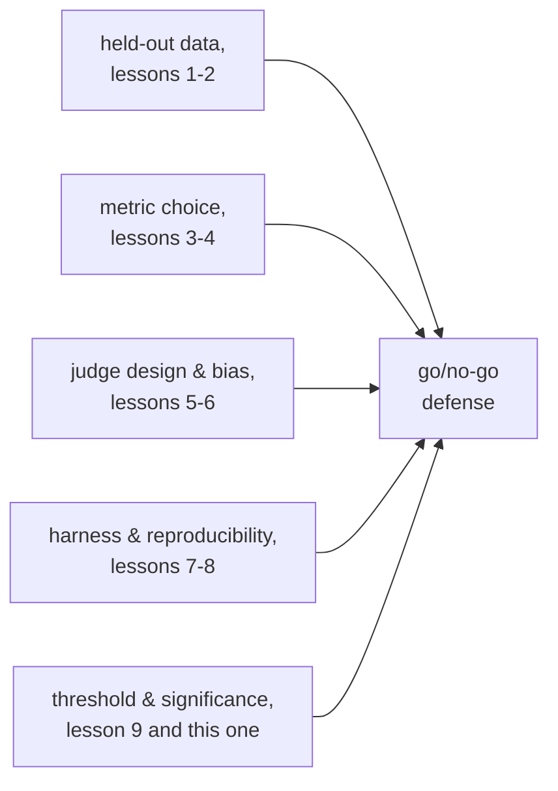

# 第 10 课：为上线与否的决定辩护

**使命关联:** 这是使命的最后一课：证明模型的改动有效，最终落到上线或不上线的判断，而为这个判断辩护，意味着要指出一个在看到结果之前就设定好的阈值，并引用每一个上游的选择，从留出数据到统计显著性，正是它们让这个判断背后的数字可信。
**主要来源:** [文档：“Define success criteria and build evaluations”，Claude Platform Docs](https://platform.claude.com/docs/en/test-and-evaluate/develop-tests)
**前置知识:** [第 9 课](0009-statistical-significance-vs-noise.md)、[数据污染](../GLOSSARY.md)

## 热身

1. ▢ 基线模型在 100 个评测样本中通过 70 个；新的变体在 100 个中通过 76 个。根据每个比例的标准误差，这六个点的差距是否明显大于噪声？

检查

不明显。在 N = 100 时，每个比例的标准误差大约是 4 到 5 个点，所以六个点的差距并不明显大于合并后的噪声；单凭这个样本量，它是有提示意义的，但不是定论。

2. ▢ 为了让之后的比较有意义，报告评测分数时应当同时记录什么？

检查

随机种子、生成的温度、模型和框架的版本、评测集的版本，以及在运行了多个样本时，它们之间的离散程度，而不只是均值。

## 要点

### 看到结果之后才设定的阈值，不算阈值

**退步阈值**预先指明，一个指标允许下降多少，或必须改进多少，改动才能上线。在评测运行之前就设定它，与是否有这个阈值同样重要：看到数字之后才选的阈值，可以随意朝着某人想要的答案弯曲，这和第 1 课所描述的失败是同一种，也就是一个被反复针对着调优的评测集，直到它不再度量任何真实的东西。预先定好、与产品真正的需要挂钩的阈值（这个指标上的退步会让用户付出多大代价，多大的改进才有意义），是唯一能在事后诚实地辩护的那一种。

### 阈值必须尊重噪声下限

第 9 课表明，分数的标准误差取决于样本量；比这个噪声下限还严的阈值，不是真正的阈值，而是装扮成决定的抛硬币。在一个按当前样本量标准误差为 4 个点的指标上，要求“退步不超过 1 个点”，意味着评测实际上无法把 1 个点的退步与普通的噪声区分开，所以这个阈值要想诚实地执行，要么放宽到评测能够分辨的程度，要么增大样本量，直到它能分辨为止。

### 没有定论的结果不是默认的答案

当观察到的差异落在噪声之内（第 9 课），诚实的结论是证据还不够，而不是“上线吧，反正它也不明显更差”，也不是“拦住它，因为它不明显更好”。这两种说法都把没有证据当成了某种证据，而它不是。对没有定论的结果，正确的回应是去收集更多的数据，更多的评测样本、更多的采样，第 9 课的数学说哪个能让估计更精确，就用哪个，而不是挑一个碰巧更方便的默认选项。

### 一份完整的辩护必须引用什么

一个上线与否的判断，只有在指出下面这些内容时，才算得到了辩护，而不只是被报告：指标，以及它为什么适合这个任务（第 3、4 课）；留出集为什么能诚实地抵御污染（第 1、2 课）；如果用了 LLM 裁判，它的提示词设计，以及实测的校准和偏差检查（第 5、6 课）；产出这个数字的运行框架，以及为可复现性而记录了什么（第 7、8 课）；以及统计上的依据，即观察到的差异，越过了预先设定的阈值，并且明显大于样本量可能产生的噪声（第 9 课和本课）。一个只说出头条数字、而没有这些任何一项的判断，只是带着小数点的感觉；这恰恰是使命想要避免的结果。

## 练习

1. ▢ 某团队直到看到新模型的得分恰好比基线低 1.2 个点之后，才设定了他们的退步阈值（“允许的退步不超过 1 个点”）。不管 1.2 个点是不是真正的退步，这个阈值有什么问题？

检查

这个阈值是在看到结果之后才选的，这意味着它可以被扭曲（在这个例子里很可能就是被扭曲了），去为一个事先就想要的答案辩护。阈值只有在事先固定、与产品真正的需要挂钩、而不是事后根据观察到的数字调整时，才能为一个决定辩护。

2. ▢ 某团队的指标，在他们当前的样本量下标准误差约为 4 个点，而他们想执行“退步不超过 1 个点”的阈值。按目前的度量方式，对照这个阈值为上线与否的判断辩护，有什么问题？

提示

把阈值的大小，与评测实际能分辨的噪声的大小作比较。

检查

当标准误差为 4 个点时，评测无法可靠地把 1 个点的退步与普通的采样噪声区分开；无论哪个方向上测得的 1 个点的差异，都完全在仅凭偶然就能产生的范围之内。要么把阈值放宽到当前样本量真正能分辨的程度，要么增大样本量，直到 1 个点的差异能与噪声区分开。

3. ▢ 一个评测显示出一个落在估计噪声之内的分数差异：既不明显是改进，也不明显是退步。一位队友争辩说“上线吧，反正它也不明显更差”。这种推理的问题在哪里？

检查

没有定论的结果，说明的是还没有足够的数据，而不是什么都没有改变的证据。把“不明显更差”当作上线的许可，是把没有证据当成了安全的证据，而噪声下限的推理并不支持这一点；诚实的做法是收集更多的证据（更大的样本、更多次的运行），而不是默认选择上线或拦住。

4. ▢ 列出一份完整的上线与否辩护需要引用什么，从本工作区前面的每个阶段各取一项。

检查

选用的指标，以及它为什么适合这个任务（第 2 阶段）。留出的评测集为什么能诚实地抵御污染（第 1 阶段）。如果由 LLM 裁判给结果评分，它的提示词设计，以及实测的校准和偏差检查（第 3 阶段）。产出这个数字的运行框架，以及为可复现性而记录了什么（第 4 阶段）。统计上的依据：差异越过了预先登记的阈值，并且明显大于样本量所允许的噪声（第 5 阶段，本课和第 9 课）。

5. ▢ 关于经得起辩护的退步阈值，下列哪项说法是对的？

    - a) 它应该在看到评测结果之后再设定，以反映实际发生的情况
    - b) 它应该在评测运行之前就固定下来，并且不比样本量所能分辨的噪声下限更严
    - c) 不管产品需要什么，更宽松的阈值总是比更严格的阈值更经得起辩护
    - d) 没有定论的结果，应当默认选择对团队更方便的那个结果（上线或拦住）

检查

**b)** 这两个条件，即事先设定并尊重噪声下限，正是让阈值能够执行、而不是流于装饰的原因。（a）错误：事后的阈值可以被扭曲，以适应出现的任何结果。（c）错误：正确的阈值反映的是产品真正的需要，而不是一概偏好宽松。（d）错误：没有定论的结果，需要的是更多的证据，而不是为了方便而选定的默认答案。

## 实战练习

- [ ] 对于你正在评测或打算评测的一项模型改动，在运行评测之前先写下退步阈值，并对照第 9 课，用当前样本量估计出的噪声下限来检查它。
- [ ] 为一个过去的或假设的结果起草一份完整的上线与否辩护，明确引用指标的选择、留出集的诚实性、任何裁判的校准检查、运行框架的可复现性记录和统计依据，各占一行。
- [ ] 明天：重读本工作区 `README.md` 中的使命，并用你自己的话确认，你现在能做到它所描述的事：证明模型的改动有效，诚实地留出数据，并为这个数字抵御数据污染辩护。

## 延伸阅读

- [文档：“Define success criteria and build evaluations”，Claude Platform Docs](https://platform.claude.com/docs/en/test-and-evaluate/develop-tests)
- [论文：“Judging LLM-as-a-Judge with MT-Bench and Chatbot Arena”，Zheng 等，2023](https://arxiv.org/abs/2306.05685)
- [资源](../RESOURCES.md)

---

没学明白？请重读顶部的主要来源，因为本课是对它的压缩，而理解正是在压缩中流失的。如果有哪个术语觉得含糊，可以查看[术语表](../GLOSSARY.md)。

如果问题出在课程本身，而不是学习材料，那就是一个缺陷：[提交 issue](https://github.com/TokenCemetery/teach/issues)。
