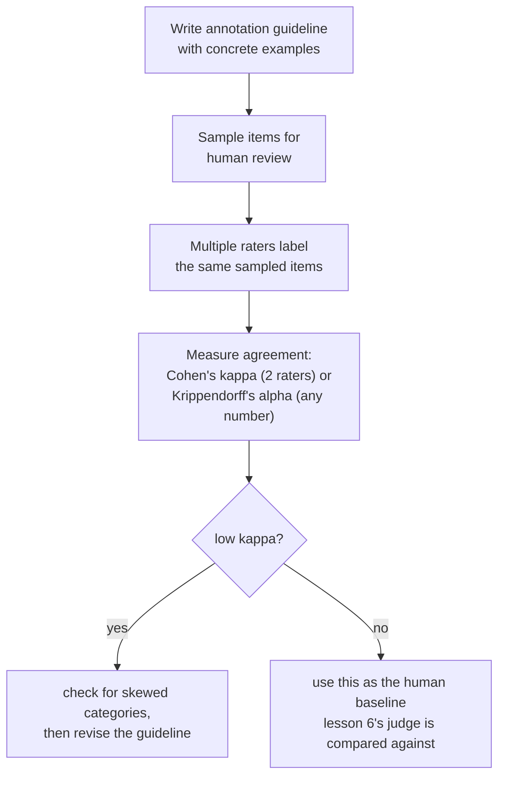

# Lección 11. La evaluación humana como método

**Vínculo con la misión:** La lección 6 comparó los veredictos de un juez LLM con evaluadores humanos, y advirtió que la tasa de acuerdo de un juez hay que leerla frente a la frecuencia con que los humanos coinciden entre sí, no frente a un techo perfecto. Esa lección nunca dijo cómo se produce realmente una calificación humana, ni cómo se mide con precisión, en lugar de estimarlo a ojo, "con qué frecuencia coinciden los humanos entre sí". Esta lección es el método que hay debajo de ambas cosas.
**Fuente principal:** [Article: "Cohen's kappa", Wikipedia](https://en.wikipedia.org/wiki/Cohen%27s_kappa)
**Requisitos previos:** [Lección 6](0006-judge-bias-and-human-agreement.md), [Contaminación de datos](../GLOSSARY.md)

## Calentamiento

1. ▢ Un equipo mide el acuerdo de su juez con evaluadores humanos en un 82%. ¿Es suficiente para confiar en el juez, y qué número adicional necesitan antes de responder eso?

Comprobación

El 82% por sí solo no dice lo suficiente; necesitan la tasa de acuerdo entre humanos sobre las mismas comparaciones, ya que los evaluadores humanos tampoco coinciden entre sí el 100% de las veces. Si los humanos coinciden entre sí alrededor del 80 al 85% de las veces, un acuerdo del 82% entre juez y humano lo está haciendo aproximadamente tan bien como lo haría otro evaluador humano.

2. ▢ ¿Qué es el sesgo de verbosidad, y nombra una forma de mitigarlo?

Comprobación

La tendencia de un juez a preferir una respuesta más larga aunque la longitud extra no aporte nada frente a una más corta igual de correcta o más. Las mitigaciones incluyen instruir al juez de forma explícita para que no premie la longitud, escribir criterios de calificación que nombren la corrección y la completitud en lugar de la longitud, o comprobar si las preferencias del juez se correlacionan de forma sospechosamente buena con la longitud de la respuesta.

## Qué debes saber

### El acuerdo crudo se infla por azar, y más cuantas menos categorías hay

La forma más simple de medir con qué frecuencia coinciden dos evaluadores humanos es la **probabilidad conjunta de acuerdo**, el porcentaje simple de elementos que calificaron de la misma manera. Este número es engañosamente fácil de leer como "qué tan fiables son estos evaluadores", pero no separa el juicio compartido genuino de que dos evaluadores simplemente caigan en la misma respuesta por azar, y ese piso de azar sube rápido a medida que disminuye el número de categorías de calificación: con solo dos o tres opciones, los evaluadores confinados a un conjunto tan pequeño coincidirán mucho entre sí aunque no haya detrás ningún acuerdo real de juicio.

### El kappa de Cohen es lo que le faltaba al acuerdo crudo: una corrección por azar

El **kappa de Cohen** corrige exactamente esto: `κ = (p_o − p_e) / (1 − p_e)`, donde `p_o` es el acuerdo observado, crudo, y `p_e` es el acuerdo que se esperaría que dos evaluadores alcanzaran solo por azar, estimado a partir de con qué frecuencia usó realmente cada evaluador cada categoría. Un kappa de 1 significa acuerdo perfecto; un kappa de 0 significa que los evaluadores no lo hicieron mejor de lo que predeciría el azar, aunque su porcentaje de acuerdo crudo parezca alto; un kappa incluso puede ser negativo, cuando los evaluadores coinciden entre sí menos de lo que produciría el azar por sí solo. Es la versión precisa de la regla de la lección 6, "compara con el acuerdo entre humanos, no con un techo perfecto": el kappa es lo que convierte esa comparación en un número real, corregido por azar, en lugar de una suposición a ojo.

### El propio kappa puede engañar cuando domina una categoría

El kappa no es un arreglo gratuito y universal. Cuando una categoría de calificación es mucho más común que las demás (un defecto raro, una respuesta "aceptable" abrumadoramente típica), se sabe que el kappa subestima de forma sistemática el acuerdo real en la categoría rara, haciéndolo parecer peor que el juicio compartido real de los evaluadores. Es justo el tipo de cosa que conviene comprobar antes de fiarse de un único número de kappa al pie de la letra: un kappa bajo con datos muy sesgados no significa automáticamente que los evaluadores discrepen en la práctica, puede significar que la propia corrección se está moviendo por lo desigual que es la distribución de las categorías. Para el acuerdo entre más de dos evaluadores, o entre calificaciones ordinales o de intervalo en lugar de categorías fijas, el alfa de Krippendorff generaliza la misma idea corregida por azar a esos casos.

### Una guía de anotación es lo que mantiene como algo significativo pedir "el mismo juicio"

Dos evaluadores cuidadosos aún pueden discrepar constantemente si no califican contra el mismo estándar, que es exactamente lo que existe para arreglar una **guía de anotación**: una definición escrita de cada categoría de calificación, con ejemplos concretos de casos límite y cómo se resolvieron, que se entrega a cada evaluador antes de empezar. Una guía que solo nombra las categorías en abstracto ("califica la utilidad de 1 a 5") deja a cada evaluador inventar su propio estándar privado, y el acuerdo bajo que resulta de ello no es un hecho sobre los evaluadores, es un hecho sobre la guía ausente. Medir el acuerdo es también diagnóstico aquí: un acuerdo persistentemente bajo en una categoría concreta es una señal para revisar la definición de esa categoría en la guía, no solo para reclutar mejores evaluadores.

### Una etiqueta humana tiene un costo real, por eso se raciona con muestreo

Cada calificación humana cuesta dinero y tiempo reales: hay que encontrar a un evaluador, formarlo en la guía y pagarle por elemento o por hora, y medir el acuerdo exige pagar por más de un evaluador por elemento, no por uno. Este costo es justo la razón de que la evaluación humana de un conjunto de eval completo rara vez sea el plan; en cambio, un equipo **muestrea** un subconjunto representativo para la revisión humana, dimensionado para detectar una tasa de desacuerdo significativa sin pagar por calificar cada elemento, y usa el acuerdo medido de esa muestra (tanto entre humanos como entre un juez y humanos, como cubrió la lección 6) como el estándar contra el que se contrasta la evaluación automática a gran escala.

## Práctica

1. ▢ Dos evaluadores coinciden en el 90% de los elementos, pero solo hay dos categorías de calificación posibles y una de ellas se usa el 95% de las veces. ¿Debería el equipo fiarse de la cifra del 90% como evidencia sólida de un acuerdo genuino?

Pista

Considera qué tan probable es que dos evaluadores caigan en la misma respuesta puramente por azar, dado lo pocas que son las categorías y lo sesgado de su uso.

Comprobación

No sin comprobar más. Con solo dos categorías y una usada la abrumadora mayoría de las veces, un porcentaje de acuerdo crudo alto puede producirse en gran parte por azar y no por un juicio compartido genuino; hay que calcular el kappa de Cohen, que corrige exactamente esto, antes de tratar el 90% como significativo.

2. ▢ Un equipo calcula el kappa de Cohen en una tarea de anotación de un defecto raro y obtiene un valor bajo, aunque la guía de los evaluadores es detallada y coinciden en la discusión casi siempre que comparan notas. ¿Qué debería comprobar el equipo antes de concluir que los evaluadores discrepan de verdad?

Comprobación

Si la baja prevalencia de la categoría rara está distorsionando el propio cálculo del kappa; se sabe que el kappa subestima el acuerdo específicamente cuando una categoría es mucho más rara que las demás, así que un kappa bajo aquí no significa necesariamente que el juicio real de los evaluadores discrepe tanto como sugiere el número.

3. ▢ A dos evaluadores solo se les dan los nombres de las categorías ("bueno", "malo") sin más orientación, y su tasa de acuerdo es baja. ¿Es esto evidencia de que los evaluadores no son fiables?

Comprobación

No necesariamente. Sin una guía escrita que defina cada categoría con ejemplos concretos y resueltos, los evaluadores quedan a merced de inventar sus propios estándares privados; el acuerdo bajo en esta situación suele ser señal de que la propia guía falta o es inadecuada, no un hecho sobre la fiabilidad de los evaluadores.

4. ▢ ¿Por qué medir el acuerdo entre evaluadores exige pagar por más de una calificación humana por elemento, y cómo se conecta esto con la razón de que los equipos muestreen en lugar de calificar a mano un conjunto de eval completo?

Comprobación

El acuerdo es una comparación entre evaluadores, así que solo puede medirse donde al menos dos evaluadores etiquetaron el mismo elemento; una sola calificación por elemento no da base para calcularlo. Como cada calificación adicional cuesta tiempo y dinero reales, los equipos muestrean un subconjunto representativo para este tipo de revisión con varios evaluadores en lugar de pagar para que cada elemento de un conjunto de eval completo sea calificado por varios humanos.

5. ▢ ¿Qué afirmación describe correctamente la relación entre el acuerdo crudo, el kappa de Cohen y la prevalencia de las categorías?

    - a) El porcentaje de acuerdo crudo y el kappa de Cohen siempre producen la misma conclusión sobre la fiabilidad de los evaluadores
    - b) El acuerdo crudo puede parecer alto en gran parte por azar, sobre todo con pocas categorías; el kappa de Cohen corrige ese nivel de azar, pero se sabe que subestima el acuerdo cuando una categoría es mucho más rara que las demás
    - c) El kappa de Cohen solo se puede usar con exactamente tres o más evaluadores, a diferencia del porcentaje de acuerdo crudo
    - d) Un kappa de Cohen negativo es matemáticamente imposible

Comprobación

**b)** Esa es la limitación precisa y de doble cara que establece esta lección. (a) es falsa: el acuerdo crudo no corrige por azar, que es justo la razón por la que el kappa puede contar una historia distinta. (c) es falsa: el kappa de Cohen está definido específicamente para dos evaluadores; el alfa de Krippendorff es la generalización para más evaluadores. (d) es falsa: el kappa puede ser negativo cuando los evaluadores coinciden menos de lo que produciría el azar por sí solo.

## Prácticas en el mundo real

- [ ] Para una tarea calificada por humanos a la que tengas acceso (o que pudieras montar de forma barata), calcula el porcentaje de acuerdo crudo y el kappa de Cohen entre dos evaluadores sobre la misma muestra, y comprueba cuán lejos están ambos números.
- [ ] Busca o escribe una guía de anotación de una página para una tarea de calificación que te importe, con al menos dos ejemplos concretos de casos límite y cómo deberían resolverse.
- [ ] Mañana: lee completa la sección "Interpreting magnitude" de la fuente primaria y anota qué dice sobre por qué un umbral fijo de kappa (como "por encima de 0.6 es bueno") es más difícil de justificar de lo que parece al principio.

## Para profundizar

- [Article: "Cohen's kappa", Wikipedia](https://en.wikipedia.org/wiki/Cohen%27s_kappa)
- [Article: "Inter-rater reliability", Wikipedia](https://en.wikipedia.org/wiki/Inter-rater_reliability)
- [Recursos](../RESOURCES.md)

---

¿No termina de quedar claro? Vuelve a leer la fuente primaria de arriba, ya que esta lección la comprime y en la compresión es donde se escapa la comprensión. Consulta el [glosario](../GLOSSARY.md) por si algún término te resultó resbaladizo.

Si lo poco claro es la propia lección y no el material, eso es un defecto: [abre un issue](https://github.com/TokenCemetery/teach/issues).
