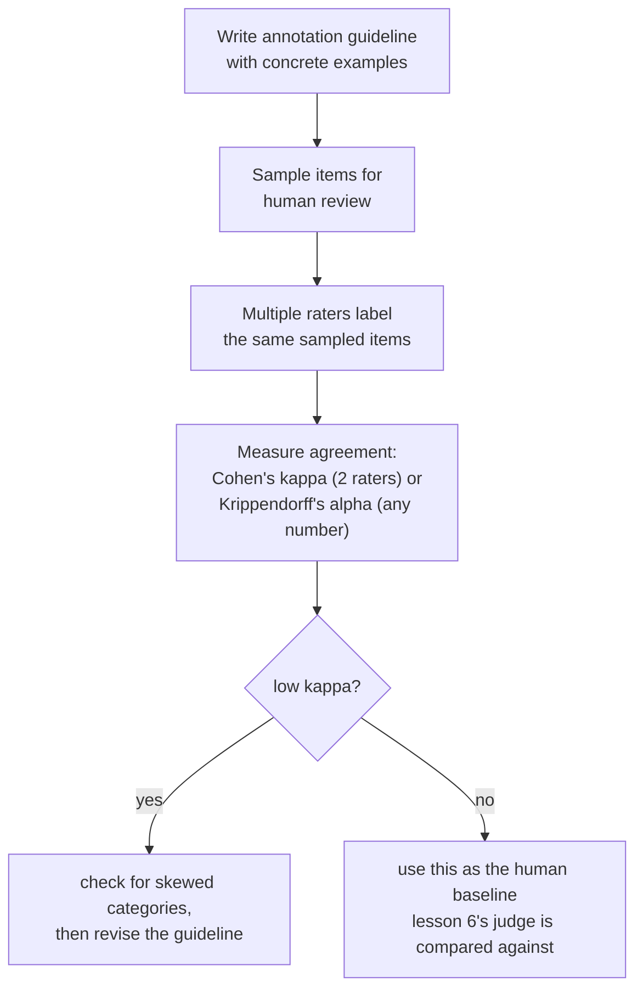

# Leçon 11. L'évaluation humaine comme méthode

**Lien avec la mission :** La leçon 6 a comparé les verdicts d'un juge LLM à ceux d'annotateurs humains, et a averti que le taux d'accord d'un juge doit se lire par rapport à la fréquence à laquelle les humains s'accordent entre eux, et non par rapport à un plafond parfait. Cette leçon n'a jamais dit comment une note humaine est réellement produite, ni comment « la fréquence à laquelle les humains s'accordent entre eux » se mesure précisément au lieu d'être estimée à l'œil. Cette leçon est la méthode qui se trouve sous les deux.
**Source primaire :** [Article : "Cohen's kappa", Wikipedia](https://en.wikipedia.org/wiki/Cohen%27s_kappa)
**Prérequis :** [Leçon 6](0006-judge-bias-and-human-agreement.md), [Contamination des données](../GLOSSARY.md)

## Échauffement

1. ▢ Une équipe mesure l'accord de son juge avec des annotateurs humains à 82 %. Est-ce suffisant pour faire confiance au juge, et de quel chiffre supplémentaire a-t-elle besoin pour répondre ?

Vérifier

82 % seul n'en dit pas assez ; il faut le taux d'accord humain-humain sur les mêmes comparaisons, puisque les annotateurs humains ne sont pas non plus d'accord entre eux 100 % du temps. Si les humains s'accordent entre eux environ 80 à 85 % du temps, un accord juge-humain de 82 % fait à peu près aussi bien qu'un autre annotateur humain.

2. ▢ Qu'est-ce que le biais de verbosité, et citez une façon de l'atténuer ?

Vérifier

La tendance d'un juge à préférer une réponse plus longue même quand la longueur supplémentaire n'apporte rien par rapport à une réponse plus courte tout aussi juste, voire davantage. Les atténuations comprennent une consigne explicite au juge de ne pas récompenser la longueur, des critères de notation qui nomment la justesse et l'exhaustivité plutôt que la longueur, ou la vérification que les préférences du juge ne corrèlent pas de façon suspecte avec la longueur des réponses.

## À savoir

### L'accord brut est gonflé par le hasard, et d'autant plus qu'il y a peu de catégories

La façon la plus simple de mesurer à quelle fréquence deux annotateurs humains s'accordent est la **probabilité conjointe d'accord**, le simple pourcentage d'éléments qu'ils ont notés de la même manière. Ce chiffre est trompeusement facile à lire comme « ces annotateurs sont-ils fiables », mais il ne sépare pas un jugement partagé authentique de deux annotateurs qui tombent simplement par hasard sur la même réponse, et ce plancher de hasard monte vite quand le nombre de catégories de notation diminue : avec seulement deux ou trois options, des annotateurs confinés à un ensemble si petit s'accorderont beaucoup entre eux même sans aucun accord réel de jugement derrière.

### Le kappa de Cohen est ce qui manquait à l'accord brut : une correction du hasard

Le **kappa de Cohen** corrige précisément cela : `κ = (p_o − p_e) / (1 − p_e)`, où `p_o` est l'accord brut observé et `p_e` l'accord que deux annotateurs atteindraient par le seul hasard, estimé d'après la fréquence à laquelle chaque annotateur a réellement utilisé chaque catégorie. Un kappa de 1 signifie un accord parfait ; un kappa de 0 signifie que les annotateurs n'ont pas fait mieux que ce que le hasard prédirait, même si leur pourcentage d'accord brut paraît élevé ; un kappa peut même devenir négatif, quand les annotateurs s'accordent moins que ce que le seul hasard produirait. C'est la version précise de la règle de la leçon 6 « comparer à l'accord humain-humain, pas à un plafond parfait » : le kappa est ce qui fait de cette comparaison un vrai chiffre corrigé du hasard au lieu d'une estimation à l'œil.

### Le kappa lui-même peut induire en erreur quand une catégorie domine

Le kappa n'est pas un remède universel et gratuit. Quand une catégorie de notation est bien plus fréquente que les autres (un défaut rare, une réponse « acceptable » écrasante de banalité), le kappa est connu pour sous-estimer systématiquement l'accord réel sur la catégorie rare, ce qui le fait paraître pire que le jugement réel et partagé des annotateurs. C'est exactement le genre de chose à vérifier avant de croire un kappa isolé sur parole : un kappa bas sur des données fortement déséquilibrées ne signifie pas automatiquement que les annotateurs sont en désaccord en pratique, cela peut signifier que la correction elle-même est bousculée par la répartition inégale des catégories. Pour l'accord entre plus de deux annotateurs, ou sur des notes ordinales ou d'intervalle plutôt qu'en catégories fixes, l'alpha de Krippendorff généralise la même idée de correction du hasard à ces cas.

### Un guide d'annotation est ce qui garde « le même jugement » comme exigence significative

Deux annotateurs soigneux peuvent quand même être constamment en désaccord s'ils ne notent pas selon le même étalon, ce que précisément un **guide d'annotation** existe pour corriger : une définition écrite de chaque catégorie de notation, avec des exemples concrets de cas limites et la manière dont ils ont été tranchés, remise à chaque annotateur avant qu'il commence. Un guide qui ne nomme les catégories qu'en abstrait (« notez l'utilité de 1 à 5 ») laisse chaque annotateur inventer son propre étalon privé, et le faible accord qui en résulte n'est pas un fait sur les annotateurs, c'est un fait sur le guide manquant. La mesure de l'accord est aussi un diagnostic ici : un accord durablement bas sur une catégorie précise est le signe qu'il faut réviser la définition de cette catégorie dans le guide, et pas seulement recruter de meilleurs annotateurs.

### Une étiquette humaine a un vrai coût, c'est pourquoi on la rationne par échantillonnage

Chaque note humaine coûte de l'argent et du temps réels : il faut trouver un annotateur, le former au guide et le payer à l'élément ou à l'heure, et mesurer l'accord demande de payer plus d'un annotateur par élément, pas un seul. Ce coût est précisément la raison pour laquelle l'évaluation humaine d'un jeu d'eval complet est rarement le plan ; à la place, une équipe **échantillonne** un sous-ensemble représentatif pour une relecture humaine, dimensionné pour détecter un taux de désaccord significatif sans payer pour noter chaque élément, et utilise l'accord mesuré sur cet échantillon (entre humains, et entre un juge et des humains, comme l'a vu la leçon 6) comme étalon face auquel l'évaluation automatisée à grande échelle est vérifiée.

## Pratique

1. ▢ Deux annotateurs s'accordent sur 90 % des éléments, mais il n'y a que deux catégories de notation possibles et l'une d'elles est utilisée 95 % du temps. L'équipe doit-elle faire confiance au chiffre de 90 % comme preuve solide d'un accord authentique ?

Indice

Demandez-vous quelle probabilité deux annotateurs auraient de tomber sur la même réponse purement par hasard, vu le peu de catégories et le déséquilibre de leur usage.

Vérifier

Pas sans vérifier davantage. Avec seulement deux catégories dont l'une est utilisée l'écrasante majorité du temps, un pourcentage d'accord brut élevé peut être produit en grande partie par le hasard plutôt que par un jugement partagé authentique ; le kappa de Cohen, qui corrige précisément cela, doit être calculé avant de traiter 90 % comme significatif.

2. ▢ Une équipe calcule le kappa de Cohen sur une tâche d'annotation de défaut rare et obtient une valeur basse, alors que le guide des annotateurs est détaillé et qu'ils s'accordent en discussion presque chaque fois qu'ils comparent leurs notes. Que doit vérifier l'équipe avant de conclure que les annotateurs sont réellement en désaccord ?

Vérifier

Si la faible prévalence de la catégorie rare fausse le calcul du kappa lui-même ; le kappa est connu pour sous-estimer l'accord précisément quand une catégorie est bien plus rare que les autres, donc un kappa bas ici ne signifie pas nécessairement que le jugement réel des annotateurs diverge autant que le chiffre le suggère.

3. ▢ Deux annotateurs ne reçoivent que les noms de catégories (« bon », « mauvais ») sans autre consigne, et leur taux d'accord est bas. Est-ce la preuve que les annotateurs ne sont pas fiables ?

Vérifier

Pas nécessairement. Sans guide écrit qui définit chaque catégorie avec des exemples concrets et tranchés, les annotateurs sont laissés à inventer leurs propres étalons privés ; un faible accord dans cette situation est souvent le signe que le guide lui-même est absent ou inadéquat, et non un fait sur la fiabilité des annotateurs.

4. ▢ Pourquoi mesurer l'accord inter-annotateurs exige-t-il de payer plus d'une note humaine par élément, et en quoi cela se relie-t-il à la raison pour laquelle les équipes échantillonnent plutôt que de noter à la main tout un jeu d'eval ?

Vérifier

L'accord est une comparaison entre annotateurs, donc il ne peut être mesuré que là où au moins deux annotateurs ont étiqueté le même élément ; une seule note par élément ne donne aucune base pour le calculer. Comme chaque note supplémentaire coûte du temps et de l'argent réels, les équipes échantillonnent un sous-ensemble représentatif pour ce type de relecture multi-annotateurs plutôt que de payer pour que chaque élément d'un jeu d'eval complet soit noté par plusieurs humains.

5. ▢ Laquelle de ces affirmations décrit correctement la relation entre accord brut, kappa de Cohen et prévalence des catégories ?

    - a) Le pourcentage d'accord brut et le kappa de Cohen aboutissent toujours à la même conclusion sur la fiabilité des annotateurs
    - b) L'accord brut peut paraître élevé en grande partie à cause du hasard, surtout avec peu de catégories ; le kappa de Cohen corrige ce niveau de hasard, mais il est lui-même connu pour sous-estimer l'accord quand une catégorie est bien plus rare que les autres
    - c) Le kappa de Cohen n'est utilisable qu'avec trois annotateurs ou plus, contrairement au pourcentage d'accord brut
    - d) Un kappa de Cohen négatif est mathématiquement impossible

Vérifier

**b)** C'est la limite précise, à double face, qu'établit cette leçon. (a) est faux : l'accord brut ne corrige pas le hasard, ce qui explique précisément pourquoi le kappa peut raconter une autre histoire. (c) est faux : le kappa de Cohen est défini spécifiquement pour deux annotateurs ; l'alpha de Krippendorff est la généralisation pour plus d'annotateurs. (d) est faux : le kappa peut devenir négatif quand les annotateurs s'accordent moins que ce que le seul hasard produirait.

## Exercices en situation réelle

- [ ] Pour une tâche notée par des humains à laquelle vous avez accès (ou que vous pourriez monter à peu de frais), calculez le pourcentage d'accord brut et le kappa de Cohen entre deux annotateurs sur le même échantillon, et vérifiez l'écart entre les deux chiffres.
- [ ] Trouvez ou écrivez un guide d'annotation d'une page pour une tâche de notation qui vous importe, avec au moins deux exemples concrets de cas limites et la manière dont ils doivent être tranchés.
- [ ] Demain : lisez en entier la section « Interpreting magnitude » de la source primaire, et notez ce qu'elle dit sur la raison pour laquelle un seuil de kappa fixe (comme « au-dessus de 0,6, c'est bon ») est plus difficile à justifier qu'il n'y paraît d'abord.

## Pour aller plus loin

- [Article : "Cohen's kappa", Wikipedia](https://en.wikipedia.org/wiki/Cohen%27s_kappa)
- [Article : "Inter-rater reliability", Wikipedia](https://en.wikipedia.org/wiki/Inter-rater_reliability)
- [Ressources](../RESOURCES.md)

---

Ça ne passe pas ? Relisez la source primaire en haut de page, car cette leçon la condense et c'est dans la condensation que la compréhension s'échappe. Consultez le [glossaire](../GLOSSARY.md) pour tout terme qui vous a paru glissant.

Si c'est la leçon elle-même qui n'est pas claire plutôt que la matière, c'est un défaut : [ouvrez une issue](https://github.com/TokenCemetery/teach/issues).
