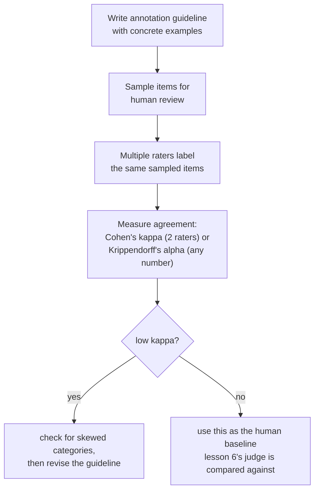

# पाठ 11. Method के रूप में Human Evaluation

**मिशन से संबंध:** पाठ 6 ने LLM judge के फ़ैसलों की तुलना मानव raters से की, और चेताया कि judge की सहमति दर को इस आधार पर पढ़ना चाहिए कि मनुष्य आपस में कितनी बार सहमत होते हैं, पूर्ण छत के सामने नहीं। उस पाठ ने यह कभी नहीं बताया कि मानव rating असल में कैसे बनती है, या "मनुष्य आपस में कितनी बार सहमत होते हैं" को आँख से देखने के बजाय सटीक रूप से कैसे मापा जाता है। यह पाठ उन दोनों के नीचे की विधि है।
**मुख्य स्रोत:** [लेख: "Cohen's kappa", Wikipedia](https://en.wikipedia.org/wiki/Cohen%27s_kappa)
**पूर्व-आवश्यकताएँ:** [पाठ 6](0006-judge-bias-and-human-agreement.md), [Data contamination](../GLOSSARY.md)

## वार्म-अप

1. ▢ एक टीम अपने judge की मानव raters से सहमति 82% मापती है। क्या judge पर भरोसा करने के लिए यह काफ़ी है, और इसका जवाब देने से पहले उन्हें कौन-सी अतिरिक्त संख्या चाहिए?

जाँचें

अकेला 82% काफ़ी नहीं बताता; उन्हें उन्हीं तुलनाओं पर human-बनाम-human सहमति दर चाहिए, क्योंकि मानव raters भी आपस में 100% बार सहमत नहीं होते। अगर मनुष्य आपस में लगभग 80 से 85% बार सहमत होते हैं, तो 82% की judge-human सहमति उतना ही अच्छा कर रही है जितना दूसरा मानव rater करता।

2. ▢ Verbosity bias क्या है, और इसे घटाने का एक तरीक़ा बताएँ?

जाँचें

Judge की यह प्रवृत्ति कि वह लंबा response पसंद करे, तब भी जब अतिरिक्त लंबाई उतने ही या ज़्यादा सही, छोटे response से कुछ नहीं जोड़ती। घटाने के तरीक़ों में शामिल हैं judge को साफ़ निर्देश देना कि लंबाई को इनाम न दे, grading कसौटियाँ ऐसी लिखना जो लंबाई के बजाय correctness और completeness का नाम लें, या जाँचना कि judge की पसंद response की लंबाई से संदिग्ध रूप से अच्छी तरह correlate करती है या नहीं।

## यह जानें

### कच्ची सहमति संयोग से फूल जाती है, और categories जितनी कम हों उतनी ज़्यादा

दो मानव raters कितनी बार सहमत होते हैं, इसे मापने का सबसे सरल तरीक़ा है **सहमति की joint probability**, यानी उन items का सादा प्रतिशत जिन्हें उन्होंने एक ही तरह rate किया। इस संख्या को "ये raters कितने भरोसेमंद हैं" पढ़ लेना भ्रामक रूप से आसान है, पर यह सचमुच की, साझा समझ को उस स्थिति से अलग नहीं करती जिसमें दो raters बस संयोग से एक ही उत्तर पर पहुँच गए, और वह संयोग-का-न्यूनतम स्तर rating categories की संख्या घटने के साथ तेज़ी से चढ़ता है: सिर्फ़ दो या तीन विकल्पों के साथ, उतने छोटे सेट में बँधे raters एक-दूसरे से बहुत सहमत होंगे, भले उसके पीछे समझ की कोई असली सहमति न हो।

### Cohen's kappa वह है जो कच्ची सहमति में छूटा था: संयोग का सुधार

**Cohen's kappa** ठीक इसी का सुधार करता है: `κ = (p_o − p_e) / (1 − p_e)`, जहाँ `p_o` देखी गई, कच्ची सहमति है और `p_e` वह सहमति है जो दो raters से अकेले संयोग से पहुँचने की अपेक्षा की जाती है, जिसका अनुमान इस आधार पर लगता है कि हर rater ने असल में हर category कितनी बार इस्तेमाल की। Kappa 1 का मतलब है पूर्ण सहमति; kappa 0 का मतलब है raters ने संयोग की भविष्यवाणी से बेहतर नहीं किया, भले उनका कच्चा सहमति प्रतिशत ऊँचा दिखे; kappa ऋणात्मक भी हो सकता है, जब raters आपस में उतना भी सहमत न हों जितना अकेला संयोग पैदा करता। यह पाठ 6 के "human-बनाम-human सहमति से तुलना करो, पूर्ण छत से नहीं" नियम का सटीक रूप है: kappa वह चीज़ है जो उस तुलना को आँख के अंदाज़े के बजाय असली, संयोग-सुधारी संख्या बनाती है।

### जब एक category हावी हो तो kappa भी भटका सकता है

Kappa कोई मुफ़्त, सार्वभौमिक इलाज नहीं है। जब कोई एक rating category बाक़ियों से कहीं ज़्यादा आम हो (कोई दुर्लभ दोष, अत्यधिक विशिष्ट "स्वीकार्य" response), तो kappa दुर्लभ category पर असली सहमति को व्यवस्थित रूप से कम आँकने के लिए जाना जाता है, जिससे वह raters की असली, साझा समझ से बुरा दिखता है। ठीक यही वह चीज़ है जिसे एक अकेली kappa संख्या पर जस का तस भरोसा करने से पहले जाँचना चाहिए: बुरी तरह झुके data पर कम kappa का अपने-आप यह मतलब नहीं कि raters व्यवहार में असहमत हैं, उसका मतलब यह हो सकता है कि सुधार ख़ुद इस बात से इधर-उधर हो रहा है कि categories कितनी असमान रूप से बँटी हैं। दो से ज़्यादा raters, या निश्चित categories के बजाय क्रमसूचक या अंतराल ratings पर सहमति के लिए, Krippendorff का alpha उसी संयोग-सुधारी विचार को उन मामलों तक फैलाता है।

### Annotation guideline ही "एक जैसा निर्णय" माँगने को सार्थक बनाए रखती है

दो सावधान raters भी लगातार असहमत हो सकते हैं अगर वे एक ही मानक के सामने rating नहीं कर रहे, और ठीक यही **annotation guideline** ठीक करने के लिए है: हर rating category की लिखित परिभाषा, सीमा-रेखा वाले मामलों के ठोस उदाहरणों और उनके फ़ैसले के तरीक़े के साथ, जो हर rater को काम शुरू करने से पहले दी जाती है। जो guideline सिर्फ़ categories के नाम अमूर्त रूप से बताए ("helpfulness को 1 से 5 में rate करें"), वह हर rater को अपना निजी मानक गढ़ने के लिए छोड़ देती है, और इससे पैदा हुई कम सहमति raters के बारे में कोई तथ्य नहीं, छूटी हुई guideline के बारे में तथ्य है। यहाँ सहमति मापना निदान का काम भी करता है: किसी ख़ास category पर लगातार कम सहमति संकेत है कि उस category की guideline-परिभाषा बदली जाए, सिर्फ़ बेहतर raters भर्ती करना नहीं।

### मानव label की असली क़ीमत है, इसीलिए उसे sampling से राशन में दिया जाता है

हर मानव rating में असली पैसा और असली समय लगता है: rater को खोजना, guideline पर सिखाना, और प्रति item या प्रति घंटे भुगतान करना होता है, और सहमति मापने के लिए ही हर item पर एक नहीं बल्कि एक से ज़्यादा raters को भुगतान करना पड़ता है। यही क़ीमत वह कारण है कि पूरे eval सेट का human evaluation शायद ही कभी योजना होती है; इसके बजाय टीम समीक्षा के लिए प्रतिनिधि उपसमूह को **sample** करती है, जिसका आकार सार्थक असहमति दर पकड़ने लायक हो पर हर item को rate कराने का भुगतान न करना पड़े, और उस नमूने की मापी गई सहमति (मनुष्यों के बीच भी, और judge और मनुष्यों के बीच भी, जैसा पाठ 6 ने कवर किया) को वह मानक बनाती है जिसके सामने पूरे पैमाने के स्वचालित evaluation को जाँचा जाता है।

## अभ्यास

1. ▢ दो raters 90% items पर सहमत हैं, पर सिर्फ़ दो संभावित rating categories हैं और उनमें से एक 95% बार इस्तेमाल होती है। क्या टीम को 90% के आँकड़े पर असली सहमति के ठोस प्रमाण के रूप में भरोसा करना चाहिए?

संकेत

सोचें कि इतनी कम categories होने और उनके इतने झुके हुए इस्तेमाल को देखते हुए, दो raters के महज़ संयोग से एक ही उत्तर पर पहुँचने की कितनी संभावना है।

जाँचें

आगे जाँचे बिना नहीं। सिर्फ़ दो categories के साथ और एक के भारी बहुमत बार इस्तेमाल होने पर, ऊँचा कच्चा सहमति प्रतिशत काफ़ी हद तक संयोग से पैदा हो सकता है, असली साझा समझ से नहीं; Cohen's kappa, जो ठीक इसी का सुधार करता है, 90% को सार्थक मानने से पहले निकालना ज़रूरी है।

2. ▢ एक टीम दुर्लभ-दोष वाले annotation task पर Cohen's kappa निकालती है और कम मान पाती है, जबकि raters की guideline विस्तृत है और नोट मिलाने पर वे लगभग हर बार चर्चा में सहमत होते हैं। raters सचमुच असहमत हैं, इस निष्कर्ष पर पहुँचने से पहले टीम को क्या जाँचना चाहिए?

जाँचें

यह कि क्या दुर्लभ category की कम prevalence ख़ुद kappa की गणना को बिगाड़ रही है; kappa ख़ास तौर पर तब सहमति को कम आँकने के लिए जाना जाता है जब कोई एक category बाक़ियों से बहुत ज़्यादा दुर्लभ हो, इसलिए यहाँ कम kappa का अपने-आप यह मतलब नहीं कि raters की असली समझ उतनी असहमत है जितना संख्या सुझाती है।

3. ▢ दो raters को सिर्फ़ category के नाम ("अच्छा", "बुरा") बिना किसी और मार्गदर्शन के दिए गए हैं, और उनकी सहमति दर कम है। क्या यह इस बात का प्रमाण है कि raters अविश्वसनीय हैं?

जाँचें

ज़रूरी नहीं। हर category को ठोस, सुलझाए गए उदाहरणों के साथ परिभाषित करने वाली लिखित guideline के बिना, raters को अपने निजी मानक गढ़ने पड़ते हैं; इस स्थिति में कम सहमति अक्सर संकेत होती है कि guideline ख़ुद छूटी या अपर्याप्त है, raters की विश्वसनीयता के बारे में कोई तथ्य नहीं।

4. ▢ Inter-rater सहमति मापने के लिए हर item पर एक से ज़्यादा मानव ratings का भुगतान क्यों करना पड़ता है, और यह इससे कैसे जुड़ता है कि टीमें पूरे eval सेट को हाथ से rate करने के बजाय sample क्यों करती हैं?

जाँचें

सहमति raters के बीच की तुलना है, इसलिए उसे वहीं मापा जा सकता है जहाँ कम से कम दो raters ने एक ही item को label किया हो; हर item पर एक अकेली rating उसे निकालने का कोई आधार नहीं देती। चूँकि हर अतिरिक्त rating में असली समय और पैसा लगता है, टीमें इस तरह की बहु-rater समीक्षा के लिए प्रतिनिधि उपसमूह को sample करती हैं, पूरे eval सेट के हर item को कई मनुष्यों से rate कराने का भुगतान करने के बजाय।

5. ▢ कच्ची सहमति, Cohen's kappa और category prevalence के बीच के संबंध का सही वर्णन कौन-सा दावा करता है?

    - a) कच्चा percent agreement और Cohen's kappa rater विश्वसनीयता के बारे में हमेशा एक ही निष्कर्ष देते हैं
    - b) कच्ची सहमति काफ़ी हद तक संयोग की वजह से ऊँची दिख सकती है, ख़ास तौर पर कम categories के साथ; Cohen's kappa उस संयोग-स्तर का सुधार करता है, पर ख़ुद तब सहमति को कम आँकने के लिए जाना जाता है जब कोई एक category बाक़ियों से बहुत दुर्लभ हो
    - c) Cohen's kappa सिर्फ़ ठीक तीन या ज़्यादा raters के साथ इस्तेमाल हो सकता है, कच्चे percent agreement के उलट
    - d) ऋणात्मक Cohen's kappa गणितीय रूप से असंभव है

जाँचें

**b)** यही वह सटीक, दो-तरफ़ा सीमा है जो यह पाठ स्थापित करता है। (a) ग़लत है: कच्ची सहमति संयोग का सुधार नहीं करती, और ठीक इसीलिए kappa अलग कहानी बता सकता है। (c) ग़लत है: Cohen's kappa ख़ास तौर पर दो raters के लिए परिभाषित है; Krippendorff का alpha ज़्यादा raters के लिए सामान्यीकरण है। (d) ग़लत है: जब raters उतना भी सहमत न हों जितना अकेला संयोग पैदा करता, तब kappa ऋणात्मक हो सकता है।

## असली दुनिया का अभ्यास

- [ ] जिस मानव-rate किए गए task तक आपकी पहुँच है (या जिसे सस्ते में खड़ा किया जा सकता है), उसके लिए एक ही नमूने पर दो raters के बीच कच्चा percent agreement और Cohen's kappa निकालें, और जाँचें कि दोनों संख्याएँ कितनी दूर हैं।
- [ ] जिस rating task की आपको परवाह है उसके लिए एक-पृष्ठ की annotation guideline खोजें या लिखें, जिसमें कम से कम दो ठोस सीमा-रेखा वाले उदाहरण और उन्हें कैसे सुलझाया जाना चाहिए, शामिल हों।
- [ ] कल: मुख्य स्रोत का "Interpreting magnitude" खंड पूरा पढ़ें, और लिखें कि वह इस बारे में क्या कहता है कि तय kappa threshold ("0.6 से ऊपर अच्छा है" जैसा) का औचित्य पहली नज़र में लगने से ज़्यादा कठिन क्यों है।

## आगे बढ़ने के लिए

- [लेख: "Cohen's kappa", Wikipedia](https://en.wikipedia.org/wiki/Cohen%27s_kappa)
- [लेख: "Inter-rater reliability", Wikipedia](https://en.wikipedia.org/wiki/Inter-rater_reliability)
- [संसाधन](../RESOURCES.md)

---

बात नहीं बन रही? ऊपर दिए primary source को दोबारा पढ़ें, क्योंकि यह पाठ उसे संक्षिप्त करता है और समझ संक्षेप में ही रिसती है। जो शब्द फिसलन भरा लगे, उसके लिए [शब्दावली](../GLOSSARY.md) देखें।

अगर दिक़्क़त सामग्री की नहीं बल्कि पाठ की ही है, तो वह एक खोट है: [issue खोलें](https://github.com/TokenCemetery/teach/issues)।
