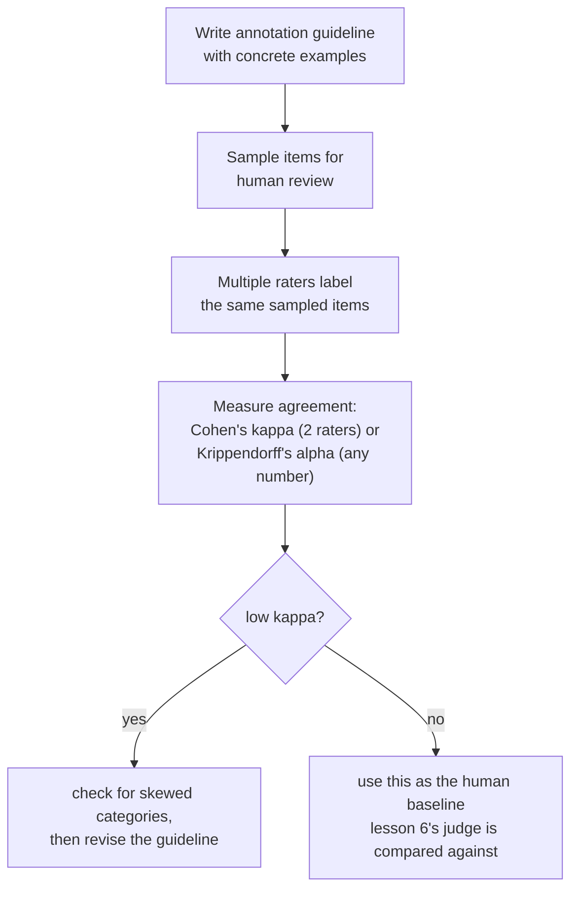

# Lição 11. Avaliação humana como método

**Ligação com a missão:** A lição 6 comparou os vereditos de um juiz LLM com avaliadores humanos e alertou que a taxa de concordância de um juiz precisa ser lida contra a frequência com que os humanos concordam entre si, e não contra um teto perfeito. Essa lição nunca disse como uma avaliação humana é de fato produzida, nem como "com que frequência os humanos concordam entre si" é medido com precisão em vez de estimado a olho. Esta lição é o método por baixo das duas coisas.
**Fonte principal:** [Artigo: "Cohen's kappa", Wikipedia](https://en.wikipedia.org/wiki/Cohen%27s_kappa)
**Pré-requisitos:** [Lição 6](0006-judge-bias-and-human-agreement.md), [Contaminação de dados](../GLOSSARY.md)

## Aquecimento

1. ▢ Uma equipe mede a concordância do seu juiz com avaliadores humanos em 82%. Isso basta para confiar no juiz, e de que número adicional ela precisa antes de responder?

Verificação

82% sozinho não diz o bastante; ela precisa da taxa de concordância humano-humano nas mesmas comparações, já que avaliadores humanos também não concordam entre si 100% das vezes. Se os humanos concordam entre si em torno de 80 a 85% das vezes, uma concordância juiz-humano de 82% está se saindo mais ou menos tão bem quanto outro avaliador humano se sairia.

2. ▢ O que é o viés de verbosidade, e cite uma forma de mitigá-lo.

Verificação

A tendência de um juiz a preferir uma resposta mais longa, mesmo quando o comprimento extra não acrescenta nada em relação a uma resposta mais curta igualmente correta, ou mais. As mitigações incluem instruir o juiz explicitamente a não premiar o comprimento, escrever critérios de avaliação que nomeiem a correção e a completude, e não o comprimento, ou verificar se as preferências do juiz se correlacionam de modo suspeitamente bom com o comprimento da resposta.

## Saiba isto

### A concordância bruta é inflada pelo acaso, e mais inflada quanto menos categorias existem

A forma mais simples de medir com que frequência dois avaliadores humanos concordam é a **probabilidade conjunta de concordância**, a porcentagem simples dos itens que eles avaliaram do mesmo jeito. Esse número é enganosamente fácil de ler como "quão confiáveis são esses avaliadores", mas não separa um julgamento genuíno e compartilhado de dois avaliadores simplesmente caírem na mesma resposta por acaso, e esse piso de acaso sobe rápido conforme o número de categorias de avaliação diminui: com apenas duas ou três opções, avaliadores confinados a um conjunto tão pequeno concordarão bastante entre si mesmo sem nenhuma concordância real de julgamento por trás.

### O kappa de Cohen é o que faltava à concordância bruta: uma correção pelo acaso

O **kappa de Cohen** corrige exatamente isso: `κ = (p_o − p_e) / (1 − p_e)`, em que `p_o` é a concordância observada, bruta, e `p_e` é a concordância que dois avaliadores alcançariam apenas pelo acaso, estimada a partir de com que frequência cada avaliador de fato usou cada categoria. Um kappa de 1 significa concordância perfeita; um kappa de 0 significa que os avaliadores não se saíram melhor do que o acaso preveria, mesmo que sua porcentagem de concordância bruta pareça alta; um kappa pode até ser negativo, quando os avaliadores concordam entre si menos do que o acaso sozinho produziria. Esta é a versão precisa da regra da lição 6, "compare com a concordância humano-humano, e não com um teto perfeito": o kappa é o que faz essa comparação ser um número real, corrigido pelo acaso, em vez de um palpite a olho.

### O próprio kappa pode enganar quando uma categoria domina

O kappa não é uma correção gratuita e universal. Quando uma categoria de avaliação é muito mais comum que as outras (um defeito raro, uma resposta "aceitável" esmagadoramente típica), sabe-se que o kappa subestima sistematicamente a concordância real na categoria rara, fazendo-a parecer pior do que o julgamento real e compartilhado dos avaliadores. É exatamente o tipo de coisa que vale checar antes de confiar em um único número de kappa pelo valor de face: um kappa baixo em dados muito assimétricos não significa automaticamente que os avaliadores discordam na prática, pode significar que a própria correção está sendo empurrada pela distribuição desigual das categorias. Para concordância entre mais de dois avaliadores, ou entre avaliações ordinais ou de intervalo em vez de categorias fixas, o alfa de Krippendorff generaliza a mesma ideia de correção pelo acaso para esses casos.

### Uma diretriz de anotação é o que mantém "o mesmo julgamento" algo significativo de se pedir

Dois avaliadores cuidadosos ainda podem discordar o tempo todo se não estiverem avaliando contra o mesmo padrão, que é exatamente o que uma **diretriz de anotação** existe para resolver: uma definição escrita de cada categoria de avaliação, com exemplos concretos de casos limítrofes e de como foram resolvidos, entregue a cada avaliador antes de começar. Uma diretriz que só nomeia categorias em abstrato ("avalie a utilidade de 1 a 5") deixa cada avaliador inventar seu próprio padrão privado, e a baixa concordância que resulta disso não é um fato sobre os avaliadores, é um fato sobre a diretriz ausente. Medir a concordância também é diagnóstico aqui: uma concordância persistentemente baixa em uma categoria específica é sinal para revisar a definição da diretriz para aquela categoria, e não apenas para recrutar avaliadores melhores.

### Um rótulo humano tem um custo real, e é por isso que é racionado por amostragem

Cada avaliação humana custa dinheiro e tempo de verdade: é preciso encontrar um avaliador, treiná-lo na diretriz e pagá-lo por item ou por hora, e medir a concordância exige pagar por mais de um avaliador por item, e não por um. Esse custo é exatamente o motivo de a avaliação humana de um conjunto de eval completo raramente ser o plano; em vez disso, uma equipe **amostra** um subconjunto representativo para revisão humana, dimensionado para captar uma taxa de discordância significativa sem pagar para avaliar cada item, e usa a concordância medida dessa amostra (tanto entre humanos quanto entre um juiz e humanos, como a lição 6 cobriu) como o padrão contra o qual a avaliação automatizada em escala plena é conferida.

## Prática

1. ▢ Dois avaliadores concordam em 90% dos itens, mas existem apenas duas categorias de avaliação possíveis e uma delas é usada 95% das vezes. A equipe deve confiar nos 90% como forte evidência de concordância genuína?

Dica

Considere quão provável seria dois avaliadores caírem na mesma resposta puramente por acaso, dado quão poucas categorias existem e quão assimétrico é o uso delas.

Verificação

Não sem verificar mais. Com apenas duas categorias e uma usada na esmagadora maioria das vezes, uma alta porcentagem de concordância bruta pode ser produzida em grande parte por acaso, e não por julgamento compartilhado genuíno; o kappa de Cohen, que corrige exatamente isso, precisa ser calculado antes de tratar os 90% como significativos.

2. ▢ Uma equipe calcula o kappa de Cohen em uma tarefa de anotação de defeito raro e obtém um valor baixo, ainda que a diretriz dos avaliadores seja detalhada e eles concordem em discussão quase toda vez que comparam suas anotações. O que a equipe deve verificar antes de concluir que os avaliadores genuinamente discordam?

Verificação

Se a baixa prevalência da categoria rara está distorcendo o próprio cálculo do kappa; sabe-se que o kappa subestima a concordância especificamente quando uma categoria é muito mais rara que as outras, então um kappa baixo aqui não significa necessariamente que o julgamento real dos avaliadores discorda tanto quanto o número sugere.

3. ▢ Dois avaliadores recebem apenas os nomes das categorias ("bom", "ruim"), sem nenhuma orientação adicional, e sua taxa de concordância é baixa. Isso é evidência de que os avaliadores não são confiáveis?

Verificação

Não necessariamente. Sem uma diretriz escrita que defina cada categoria com exemplos concretos e resolvidos, os avaliadores ficam livres para inventar seus próprios padrões privados; a baixa concordância nessa situação é muitas vezes sinal de que a própria diretriz está ausente ou é inadequada, e não um fato sobre a confiabilidade dos avaliadores.

4. ▢ Por que medir a concordância entre avaliadores exige pagar por mais de uma avaliação humana por item, e como isso se liga ao motivo de as equipes amostrarem em vez de avaliar à mão um conjunto de eval inteiro?

Verificação

A concordância é uma comparação entre avaliadores, então só pode ser medida onde pelo menos dois avaliadores rotularam o mesmo item; uma única avaliação por item não dá base para calculá-la. Como cada avaliação adicional custa tempo e dinheiro de verdade, as equipes amostram um subconjunto representativo para esse tipo de revisão com vários avaliadores, em vez de pagar para que cada item de um conjunto de eval completo seja avaliado por vários humanos.

5. ▢ Qual afirmação descreve corretamente a relação entre a concordância bruta, o kappa de Cohen e a prevalência das categorias?

    - a) A concordância percentual bruta e o kappa de Cohen sempre levam à mesma conclusão sobre a confiabilidade dos avaliadores
    - b) A concordância bruta pode parecer alta em grande parte por acaso, especialmente com poucas categorias; o kappa de Cohen corrige esse nível de acaso, mas sabidamente subestima a concordância quando uma categoria é muito mais rara que as outras
    - c) O kappa de Cohen só é utilizável com exatamente três ou mais avaliadores, ao contrário da concordância percentual bruta
    - d) Um kappa de Cohen negativo é matematicamente impossível

Verificação

**b)** Essa é a limitação precisa, de dois lados, que esta lição estabelece. (a) é falsa: a concordância bruta não corrige o acaso, que é exatamente o motivo de o kappa poder contar uma história diferente. (c) é falsa: o kappa de Cohen é definido especificamente para dois avaliadores; o alfa de Krippendorff é a generalização para mais avaliadores. (d) é falsa: o kappa pode ser negativo quando os avaliadores concordam menos do que o acaso sozinho produziria.

## Prática no mundo real

- [ ] Para uma tarefa avaliada por humanos a que você tenha acesso (ou que possa montar a baixo custo), calcule a concordância percentual bruta e o kappa de Cohen entre dois avaliadores na mesma amostra e verifique quão distantes ficam os dois números.
- [ ] Encontre ou escreva uma diretriz de anotação de uma página para uma tarefa de avaliação que importa para você, incluindo pelo menos dois exemplos concretos de casos limítrofes e como devem ser resolvidos.
- [ ] Amanhã: leia por inteiro a seção "Interpreting magnitude" da fonte principal e anote o que ela diz sobre por que um limiar fixo de kappa (como "acima de 0,6 é bom") é mais difícil de justificar do que parece à primeira vista.

## Para ir além

- [Artigo: "Cohen's kappa", Wikipedia](https://en.wikipedia.org/wiki/Cohen%27s_kappa)
- [Artigo: "Inter-rater reliability", Wikipedia](https://en.wikipedia.org/wiki/Inter-rater_reliability)
- [Recursos](../RESOURCES.md)

---

Não ficou claro? Releia a fonte principal no topo, já que esta lição a comprime e é na compressão que o entendimento escapa. Consulte o [glossário](../GLOSSARY.md) para qualquer termo que pareceu escorregadio.

Se o problema é a lição em si, e não o material, isso é um defeito: [abra uma issue](https://github.com/TokenCemetery/teach/issues).
