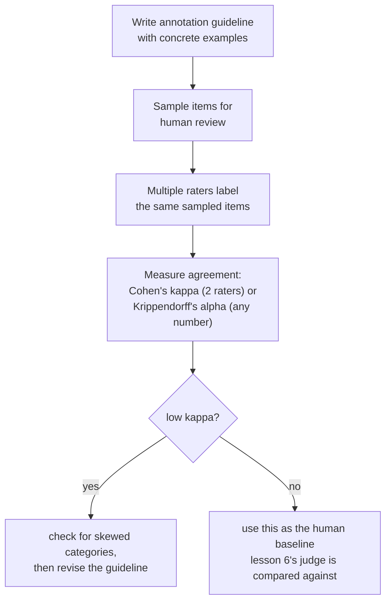

# Урок 11. Оценка людьми как метод

**Связь с целью курса:** Урок 6 сравнивал вердикты LLM-судьи с асессорами-людьми и предупредил, что долю согласия судьи нужно читать относительно того, как часто люди соглашаются между собой, а не относительно идеального потолка. Но он нигде не сказал, как на самом деле возникает человеческая оценка и как «как часто люди соглашаются между собой» измеряется точно, а не прикидывается на глаз. Этот урок это метод, лежащий под обоими.
**Первоисточник:** [Статья: "Cohen's kappa", Wikipedia](https://en.wikipedia.org/wiki/Cohen%27s_kappa)
**Предварительные требования:** [Урок 6](0006-judge-bias-and-human-agreement.md), [Загрязнение данных](../GLOSSARY.md)

## Разминка

1. ▢ Команда измеряет согласие своего судьи с асессорами-людьми и получает 82%. Достаточно ли этого, чтобы доверять судье, и какое дополнительное число им нужно, прежде чем ответить?

Проверка

Одних 82% недостаточно; нужна доля согласия между людьми на тех же сравнениях, поскольку асессоры-люди тоже не соглашаются друг с другом в 100% случаев. Если люди соглашаются между собой примерно в 80-85% случаев, согласие судьи с человеком в 82% справляется примерно так же, как справился бы ещё один асессор-человек.

2. ▢ Что такое смещение по многословию и назовите один способ его смягчить.

Проверка

Склонность судьи предпочитать более длинный ответ, даже когда лишняя длина ничего не добавляет по сравнению с не менее или более верным, но коротким. Способы смягчить: прямо указать судье не вознаграждать длину, написать критерии оценки, где названы корректность и полнота, а не длина, или проверить, не коррелируют ли предпочтения судьи подозрительно хорошо с длиной ответа.

## Что нужно знать

### Сырое согласие раздувается случайностью, и тем сильнее, чем меньше категорий

Простейший способ измерить, как часто два асессора-человека соглашаются, это **совместная вероятность согласия**: обычный процент элементов, которые они оценили одинаково. Это число обманчиво легко прочитать как «насколько надёжны эти асессоры», но оно не отделяет подлинное общее суждение от того, что два асессора просто совпали в ответе случайно, а этот случайный пол быстро растёт по мере уменьшения числа категорий оценки: при двух-трёх вариантах асессоры, ограниченные таким малым набором, будут часто соглашаться друг с другом, даже если за этим вообще нет настоящего согласия суждений.

### Каппа Коэна это то, чего не хватало сырому согласию: поправка на случайность

**Каппа Коэна** поправляет именно это: `κ = (p_o − p_e) / (1 − p_e)`, где `p_o` это наблюдаемое сырое согласие, а `p_e` это согласие, которого два асессора достигли бы от одного лишь случая, оцениваемое по тому, как часто каждый асессор реально использовал каждую категорию. Каппа, равная 1, означает идеальное согласие; каппа, равная 0, означает, что асессоры не справились лучше, чем предсказал бы случай, даже если их сырой процент согласия выглядит высоким; каппа может быть даже отрицательной, когда асессоры соглашаются друг с другом реже, чем дал бы один лишь случай. Это точная версия правила урока 6 «сравнивать с согласием между людьми, а не с идеальным потолком»: каппа делает это сравнение настоящим числом с поправкой на случайность, а не догадкой на глаз.

### Сама каппа может вводить в заблуждение, когда доминирует одна категория

Каппа не бесплатное универсальное решение. Когда одна категория оценки встречается намного чаще остальных (редкий дефект, подавляюще типичный «приемлемый» ответ), каппа, как известно, систематически занижает реальное согласие по редкой категории, из-за чего оно выглядит хуже, чем фактическое общее суждение асессоров. Это ровно то, что стоит проверить, прежде чем верить единственному числу каппы на слово: низкая каппа на сильно перекошенных данных не обязательно означает, что асессоры на практике расходятся, это может означать, что саму поправку сдвигает неравномерность распределения категорий. Для согласия между более чем двумя асессорами или для порядковых и интервальных оценок вместо фиксированных категорий альфа Криппендорфа обобщает ту же идею поправки на случайность на эти случаи.

### Руководство по разметке делает «одно и то же суждение» осмысленным требованием

Два старательных асессора всё равно могут постоянно расходиться, если оценивают не по одному стандарту, и именно это призвано исправить **руководство по разметке**: письменное определение каждой категории оценки, с конкретными примерами пограничных случаев и тем, как они были разрешены, выдаваемое каждому асессору до начала работы. Руководство, которое лишь называет категории в абстрактном виде («оцените полезность от 1 до 5»), оставляет каждому асессору изобретать собственный частный стандарт, а низкое согласие, получающееся в результате, это не факт об асессорах, а факт об отсутствующем руководстве. Измерение согласия и здесь диагностично: устойчиво низкое согласие по конкретной категории сигнал пересмотреть определение этой категории в руководстве, а не просто нанимать асессоров получше.

### У человеческой метки есть реальная цена, поэтому её нормируют выборкой

Каждая человеческая оценка стоит реальных денег и реального времени: асессора нужно найти, обучить по руководству и платить за элемент или за час, а чтобы вообще измерить согласие, нужно платить более чем одному асессору на элемент, а не одному. Именно эта цена и есть причина, почему оценка людьми целого набора эвала редко входит в план; вместо этого команда делает **выборку**: репрезентативное подмножество отдаётся на оценку людям, размером, достаточным, чтобы поймать значимую долю расхождений, не платя за оценку каждого элемента, и измеренное на этой выборке согласие (и между людьми, и между судьёй и людьми, как в уроке 6) служит стандартом, по которому проверяется полномасштабная автоматическая оценка.

## Практика

1. ▢ Два асессора согласны по 90% элементов, но возможных категорий оценки только две, и одна из них используется в 95% случаев. Стоит ли команде доверять цифре в 90% как сильному свидетельству подлинного согласия?

Подсказка

Подумайте, насколько вероятно, что два асессора совпадут в ответе чисто случайно, учитывая, как мало категорий и как перекошено их использование.

Проверка

Не проверив дальше, нет. При всего двух категориях, одна из которых используется в подавляющем большинстве случаев, высокий сырой процент согласия может возникнуть в основном случайно, а не из подлинного общего суждения; каппу Коэна, которая поправляет именно это, нужно вычислить, прежде чем считать 90% значимыми.

2. ▢ Команда вычисляет каппу Коэна на задаче разметки редкого дефекта и получает низкое значение, хотя руководство асессоров подробное, и при сравнении заметок они почти всегда приходят к согласию. Что команде стоит проверить, прежде чем заключить, что асессоры действительно расходятся?

Проверка

Не искажает ли расчёт каппы сама низкая распространённость редкой категории; каппа, как известно, занижает согласие именно тогда, когда одна категория намного реже остальных, поэтому низкая каппа здесь не обязательно означает, что фактическое суждение асессоров расходится так сильно, как намекает число.

3. ▢ Двум асессорам дали только названия категорий («хорошо», «плохо») без дальнейших указаний, и их доля согласия низка. Свидетельство ли это, что асессоры ненадёжны?

Проверка

Не обязательно. Без письменного руководства, определяющего каждую категорию конкретными разобранными примерами, асессоры вынуждены изобретать собственные частные стандарты; низкое согласие в такой ситуации нередко признак того, что самого руководства нет или оно неадекватно, а не факт о надёжности асессоров.

4. ▢ Почему для измерения согласия между асессорами нужно платить за более чем одну человеческую оценку на элемент и как это связано с тем, почему команды делают выборку, а не размечают вручную весь набор для эвала?

Проверка

Согласие это сравнение между асессорами, поэтому его можно измерить только там, где как минимум два асессора разметили один и тот же элемент; одна оценка на элемент не даёт основы для его вычисления. Поскольку каждая дополнительная оценка стоит реального времени и денег, команды делают выборку репрезентативного подмножества для такой многоасессорной проверки, а не платят за то, чтобы каждый элемент полного набора для эвала оценили несколько людей.

5. ▢ Какое утверждение верно описывает связь между сырым согласием, каппой Коэна и распространённостью категорий?

    - a) Сырой процент согласия и каппа Коэна всегда приводят к одному и тому же выводу о надёжности асессоров
    - b) Сырое согласие может выглядеть высоким в основном из-за случайности, особенно при малом числе категорий; каппа Коэна поправляет этот случайный уровень, но сама, как известно, занижает согласие, когда одна категория намного реже остальных
    - c) Каппа Коэна применима только к трём или более асессорам, в отличие от сырого процента согласия
    - d) Отрицательная каппа Коэна математически невозможна

Проверка

**b)** Это точное двустороннее ограничение, которое устанавливает урок. Вариант (a) неверен: сырое согласие не поправляет на случайность, поэтому каппа и может рассказать другую историю. Вариант (c) неверен: каппа Коэна определена именно для двух асессоров; альфа Криппендорфа это обобщение для большего числа. Вариант (d) неверен: каппа может быть отрицательной, когда асессоры соглашаются реже, чем дал бы один лишь случай.

## Практика в реальной работе

- [ ] Для задачи с человеческой разметкой, к которой у вас есть доступ (или которую можно дёшево организовать), вычислите сырой процент согласия и каппу Коэна между двумя асессорами на одной и той же выборке и проверьте, насколько эти два числа различаются.
- [ ] Найдите или напишите одностраничное руководство по разметке для задачи оценки, которая вам важна, включив минимум два конкретных пограничных примера и то, как их следует разрешать.
- [ ] Завтра: прочитайте целиком раздел первоисточника «Interpreting magnitude» и отметьте, что он говорит о том, почему фиксированный порог каппы (вроде «выше 0,6 это хорошо») обосновать труднее, чем кажется сначала.

## Что почитать дальше

- [Статья: "Cohen's kappa", Wikipedia](https://en.wikipedia.org/wiki/Cohen%27s_kappa)
- [Статья: "Inter-rater reliability", Wikipedia](https://en.wikipedia.org/wiki/Inter-rater_reliability)
- [Ресурсы](../RESOURCES.md)

---

Не доходит? Перечитайте первоисточник в начале: этот урок его сжимает, а при сжатии понимание как раз и теряется. Загляните в [глоссарий](../GLOSSARY.md), если какой-то термин показался скользким.

Если неясен сам урок, а не материал, это дефект: [откройте issue](https://github.com/TokenCemetery/teach/issues).
