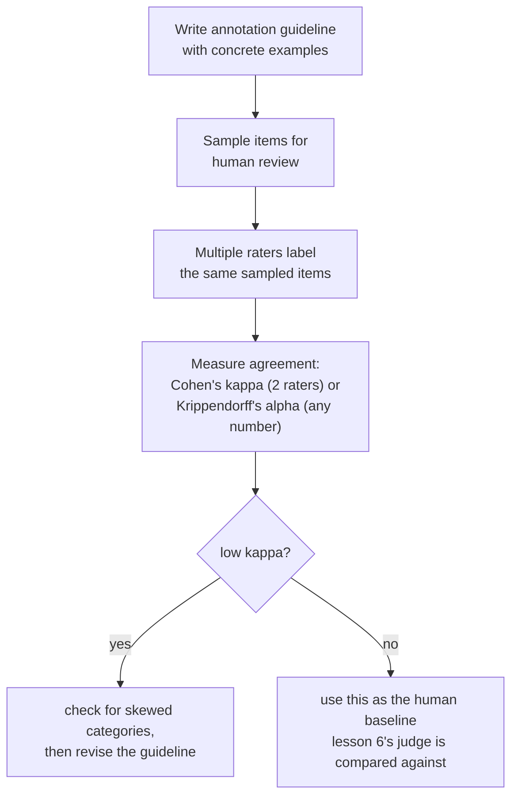

# 第 11 课：作为一种方法的人工评测

**使命关联:** 第 6 课把 LLM 裁判的裁定与人类评分员作了比较，并警告说，裁判的一致率要对照人类彼此一致的频率来解读，而不是对照完美的上限。但那一课没有说人工评分究竟是怎样产生的，也没有说“人类彼此一致的频率”怎样被精确地度量，而不是目测。本课讲的，就是这两者背后的方法。
**主要来源:** [文章：“Cohen's kappa”，Wikipedia](https://en.wikipedia.org/wiki/Cohen%27s_kappa)
**前置知识:** [第 6 课](0006-judge-bias-and-human-agreement.md)、[数据污染](../GLOSSARY.md)

## 热身

1. ▢ 某团队测得裁判与人类评分员的一致率为 82%。这足以信任这个裁判吗？在回答之前，他们还需要什么数字？

检查

单有 82% 说明不了什么；他们需要在同样的比较上，人类与人类之间的一致率，因为人类评分员之间也不会百分之百一致。如果人类彼此一致的频率在 80% 到 85% 左右，那么 82% 的裁判与人类一致性，就说明它做得大致与另一位人类评分员相当。

2. ▢ 什么是冗长偏差？请说出一种缓解的办法。

检查

裁判倾向于偏好更长的回答，即便多出来的篇幅，相比同样正确或更正确的较短回答毫无增益。缓解办法包括：明确指示裁判不要奖励长度，写出点名正确性和完整性而不是长度的评分标准，或者检查裁判的偏好是否与回答长度的相关性高得可疑。

## 要点

### 原始一致率被偶然性抬高，而且类别越少，抬得越高

度量两位人类评分员多常一致，最简单的办法是**联合一致概率**，也就是他们对同一项给出相同评价的百分比。这个数字很容易被误读成“这些评分员有多可靠”，但它分不清真正共有的判断，与两位评分员只是凭偶然落在同一个答案上，而且随着评分类别数的减少，这个偶然的下限会迅速升高：只有两三个选项时，被限制在这么小的集合里的评分员，即使背后根本没有真正一致的判断，也会彼此一致很多次。

### 科恩 kappa 补上了原始一致率所缺的东西：对偶然的校正

**科恩 kappa** 校正的正是这一点：`κ = (p_o − p_e) / (1 − p_e)`，其中 `p_o` 是观察到的原始一致率，`p_e` 是两位评分员仅凭偶然预计会达到的一致率，由每位评分员实际使用每个类别的频率估算出来。kappa 为 1 表示完全一致；kappa 为 0 表示评分员并不比偶然所预测的更好，即使他们的原始一致百分比看起来很高；当评分员彼此一致的程度，比仅凭偶然所产生的还低时，kappa 甚至可以为负。这是第 6 课“对照人与人之间的一致性，而不是完美上限”这条规则的精确版本：kappa 让这一比较成为一个经过偶然校正的真实数字，而不是目测的猜测。

### 当某个类别占主导时，kappa 本身也可能误导

kappa 不是一个免费的、通用的补救。当某个评分类别比其他类别常见得多时（罕见的缺陷，压倒性地常见的“可接受”回答），已知 kappa 会系统性地低估在罕见类别上的真实一致性，使它看起来比评分员实际共有的判断更差。在相信某个 kappa 数字之前，这正是值得检查的情形：在严重偏斜的数据上 kappa 偏低，并不自动意味着评分员在实践中意见不一，它可能意味着校正本身，被类别分布的不均衡推来推去。对于多于两位评分员，或是有序、等距的评分而不是固定类别的情形，Krippendorff's alpha 把同样的偶然校正思路推广到了这些情形。

### 标注指南让“同样的判断”成为一件有意义的事

两位认真的评分员，如果不是对照同一个标准来评分，仍然可能一直意见不一，这正是**标注指南**要解决的问题：对每个评分类别的书面定义，附有边界情形的具体示例以及它们是如何裁定的，在每位评分员开始之前发给他们。一份只是抽象地列出类别的指南（“给有用性打 1 到 5 分”），会让每位评分员自己去发明各自私下的标准，由此造成的低一致性，不是评分员的问题，而是缺少指南的问题。度量一致性在这里也有诊断作用：在某个具体类别上持续偏低的一致性，说明该修订指南对这个类别的定义，而不只是去招募更好的评分员。

### 人工标签有真实的成本，这就是要靠抽样来配给的原因

每一条人工评分都要花真金白银和真实的时间：要找到评分员，按指南培训他们，并按条或按小时付费，而且要度量一致性，就需要为每一项付费请不止一位评分员，而不是一位。正是这个成本，使得对完整评测集做人工评测很少成为计划；相反，团队会**抽样**一个有代表性的子集来做人工复核，样本量要能抓住有意义的不一致率，又不必为每一项都付费评分，然后把这个样本上度量出的一致性（人与人之间的，以及第 6 课讲过的裁判与人类之间的），作为全量自动评测所要对照检查的标准。

## 练习

1. ▢ 两位评分员在 90% 的项目上意见一致，但只有两个可能的评分类别，其中一个被使用了 95% 的时间。团队应该把 90% 这个数字当作真正一致的有力证据吗？

提示

考虑到类别如此之少、使用又如此偏斜，想一想两位评分员纯粹凭偶然落在同一个答案上的可能性有多大。

检查

不能，要先进一步检查。只有两个类别，其中一个在压倒性多数的时间里被使用，那么很高的原始一致百分比，可能在很大程度上是偶然造成的，而不是真正共有的判断；要先计算科恩 kappa，它校正的正是这一点，才能把 90% 当作有意义的数字。

2. ▢ 某团队在一个罕见缺陷的标注任务上计算科恩 kappa，得到一个很低的值，尽管评分员的指南很详细，而且他们每次对照笔记时，几乎都能在讨论中达成一致。在断定评分员真的意见不一之前，团队应该检查什么？

检查

要检查这个罕见类别的低出现率，是否扭曲了 kappa 的计算本身；已知 kappa 恰恰在某个类别比其他类别罕见得多时，会低估一致性，所以这里偏低的 kappa，并不一定意味着评分员实际的判断，像这个数字所暗示的那样意见不一。

3. ▢ 两位评分员只拿到类别名称（“好”“差”），没有任何进一步的指导，他们的一致率很低。这能证明评分员不可靠吗？

检查

不一定。没有书面指南，给每个类别配上具体的、已裁定的示例来定义，评分员只能自己发明各自私下的标准；这种情形下的低一致性，往往说明指南本身缺失或不足，而不是评分员的可靠性有问题。

4. ▢ 为什么度量评分员间的一致性，需要为每一项付费请不止一位人类评分，这与团队为什么选择抽样、而不是手工给整个评测集评分，有什么联系？

检查

一致性是评分员之间的比较，所以只有在至少两位评分员给同一项做了标注时，才能度量；每项只有一条评分，就没有计算它的依据。由于每多一条评分，都要花真实的时间和金钱，所以团队会抽取一个有代表性的子集来做这种多评分员复核，而不是为完整评测集中的每一项，都付费请多位人类来评分。

5. ▢ 下列哪项说法正确地描述了原始一致率、科恩 kappa 与类别出现率之间的关系？

    - a) 原始百分比一致率和科恩 kappa，对评分员的可靠性总是得出同样的结论
    - b) 原始一致率可能在很大程度上因为偶然而显得很高，类别少时尤其如此；科恩 kappa 校正了这个偶然水平，但已知它本身在某个类别比其他类别罕见得多时，会低估一致性
    - c) 与原始百分比一致率不同，科恩 kappa 只能用于恰好三位或更多评分员
    - d) 科恩 kappa 为负，在数学上是不可能的

检查

**b)** 这正是本课所确立的、精确的双面局限。（a）错误：原始一致率不校正偶然，这恰恰是 kappa 可能讲出不同故事的原因。（c）错误：科恩 kappa 是专门为两位评分员定义的；Krippendorff's alpha 才是针对更多评分员的推广。（d）错误：当评分员的一致程度低于仅凭偶然所产生的时，kappa 可以为负。

## 实战练习

- [ ] 对于你能接触到（或可以低成本搭建）的一个由人评分的任务，在同一批样本上，计算两位评分员之间的原始百分比一致率和科恩 kappa，并检查这两个数字相差多远。
- [ ] 为你关心的一个评分任务，找一份或写一份一页纸的标注指南，其中至少包含两个具体的边界示例，以及它们应当如何裁定。
- [ ] 明天：完整阅读主要来源中的“Interpreting magnitude”一节，并记下它是怎么说明，为什么固定的 kappa 阈值（比如“高于 0.6 就算好”），比乍看之下更难以证明其合理性。

## 延伸阅读

- [文章：“Cohen's kappa”，Wikipedia](https://en.wikipedia.org/wiki/Cohen%27s_kappa)
- [文章：“Inter-rater reliability”，Wikipedia](https://en.wikipedia.org/wiki/Inter-rater_reliability)
- [资源](../RESOURCES.md)

---

没学明白？请重读顶部的主要来源，因为本课是对它的压缩，而理解正是在压缩中流失的。如果有哪个术语觉得含糊，可以查看[术语表](../GLOSSARY.md)。

如果问题出在课程本身，而不是学习材料，那就是一个缺陷：[提交 issue](https://github.com/TokenCemetery/teach/issues)。
