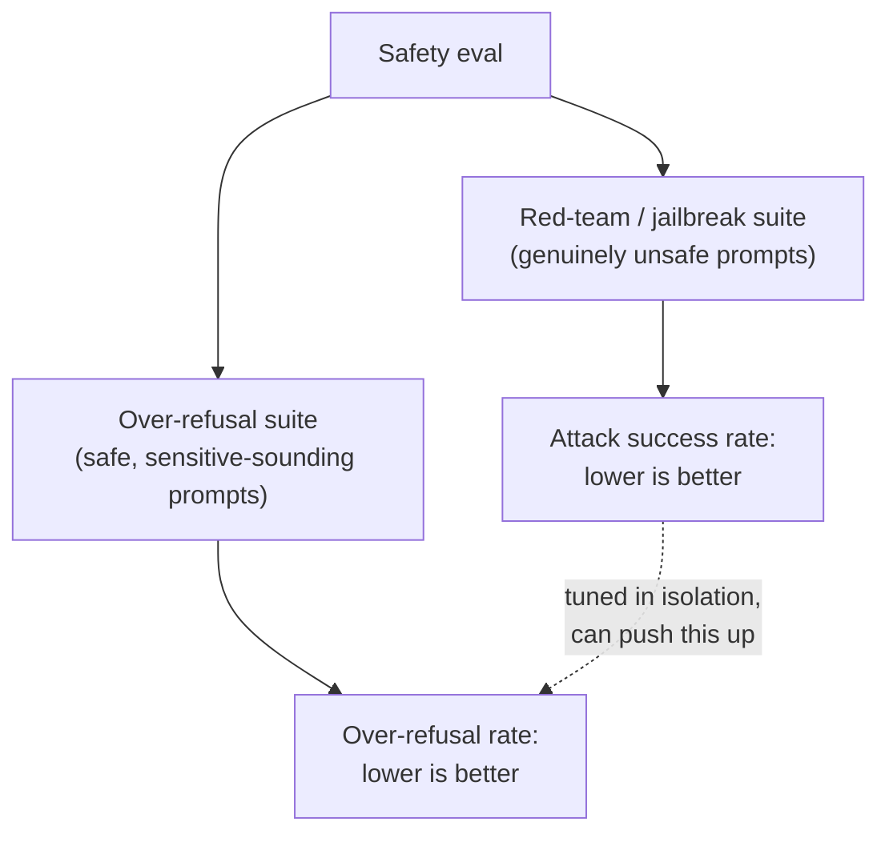

# Lección 12. Evaluación de seguridad y red-teaming

**Vínculo con la misión:** La lección 11 dio a este espacio de trabajo una forma precisa de medir el acuerdo humano en lugar de estimarlo a ojo. La evaluación de seguridad necesita la misma disciplina, pero los dos números que tiene que mantener en tensión, detectar peticiones genuinamente inseguras y no detectar por error las seguras, no son del tipo que una única cifra de exactitud pueda capturar en absoluto.
**Fuente principal:** [Paper: "HarmBench: A Standardized Evaluation Framework for Automated Red Teaming and Robust Refusal", Mazeika et al., 2024](https://arxiv.org/abs/2402.04249)
**Requisitos previos:** [Lección 6](0006-judge-bias-and-human-agreement.md), [Lección 11](0011-human-evaluation-as-a-method.md)

## Calentamiento

1. ▢ ¿Por qué el porcentaje de acuerdo crudo entre dos evaluadores puede engañar, sobre todo con solo dos o tres categorías de calificación?

Comprobación

El acuerdo crudo no separa el juicio compartido genuino del acuerdo que ocurre por azar, y con pocas categorías el acuerdo por azar por sí solo puede ser alto; el kappa de Cohen corrige esto comparando el acuerdo observado con el acuerdo que predeciría el azar por sí solo.

2. ▢ ¿Por qué medir el acuerdo entre evaluadores exige más de una calificación humana por elemento?

Comprobación

El acuerdo es una comparación entre evaluadores, así que solo puede medirse donde al menos dos evaluadores etiquetaron el mismo elemento; una sola calificación por elemento no da base para calcularlo.

## Qué debes saber

### Red-teaming: intentar a propósito que un modelo falle

El **red-teaming** es la práctica de construir de forma deliberada entradas diseñadas para que un modelo produzca una salida insegura, ya sea por un probador humano que explora a mano o por un método automático que genera prompts adversarios de forma sistemática. El propio planteamiento de HarmBench es específico sobre la carencia previa del campo: existían métodos automáticos de red-teaming, pero no había una forma estandarizada de evaluarlos y compararlos con rigor, que es exactamente lo que ofrece un framework estandarizado como HarmBench, una forma compartida de medir qué tan bien tiene éxito un método de ataque dado contra un modelo dado y sus defensas, a través de muchos ataques y muchos objetivos a la vez y no con una sonda ad hoc cada vez.

### La tasa de éxito de un jailbreak es solo la mitad del cuadro de seguridad

Un **jailbreak** es un ataque con éxito: una entrada que consigue que un modelo produzca una salida que su entrenamiento de seguridad pretendía evitar. La métrica natural es una **tasa de éxito de ataque**, con qué frecuencia los prompts de un método de red-teaming dado superan las defensas de un modelo, y bajar este número (hacer que un modelo rechace más) es la respuesta obvia ante uno alto. Pero rechazar más no es gratis: un modelo ajustado de forma agresiva hacia rechazar todo lo que se parezca a un ataque corre el riesgo de rechazar peticiones que nunca fueron inseguras, simplemente porque usan un lenguaje similar o mencionan un tema sensible. Medir solo la tasa de éxito de ataque no puede detectar esto, ya que solo mira prompts genuinamente inseguros; un modelo podría llevar ese número casi a cero mientras rechaza en silencio una gran fracción de peticiones legítimas, y una eval solo de red-teaming reportaría un éxito total.

### El sobrerrechazo necesita su propio conjunto de prueba, no una extensión del de jailbreak

**XSTest** existe específicamente para medir este otro lado: un conjunto de pruebas con prompts que son seguros pero están escritos para parecerse a prompts inseguros (con una redacción similar, o tocando un tema de apariencia sensible sin ser realmente dañino). La **tasa de sobrerrechazo** medida contra un conjunto así es un número distinto de la tasa de éxito de ataque, que comprueba un modo de fallo genuinamente diferente, rechazar algo que debió responderse, en lugar de responder algo que debió rechazarse. El propio planteamiento del paper nombra directamente la tensión de fondo: la inocuidad empuja a un modelo a rechazar, la utilidad lo empuja a cumplir, y un modelo que resuelve mal esta tensión puede ser seguro según una medida y a la vez inútilmente cauteloso según la otra.

### Una eval de seguridad reporta ambos números, o no es una eval de seguridad

La tasa de rechazo en un conjunto genuinamente inseguro y la tasa de sobrerrechazo en un conjunto genuinamente seguro pero de apariencia amenazante tienen que reportarse juntas, igual que la lección 6 exigió reportar la tasa de acuerdo de un juez frente a una línea base humana en lugar de un porcentaje a secas. Un único número de tasa de rechazo, sin saber contra qué conjunto se midió, no puede interpretarse: una tasa de rechazo baja en un conjunto inseguro es mala, pero una tasa de rechazo baja en prompts al estilo XSTest es exactamente lo que debería tener un modelo bien equilibrado. Un ajuste de seguridad que solo sigue uno de los dos números puede ceder el otro en silencio, y nada en la métrica reportada lo mostraría.

## Práctica

1. ▢ Un equipo hace fine-tuning de un modelo hasta que su tasa de éxito de ataque contra un conjunto de red-teaming baja casi a cero, y reporta esto como prueba de que el modelo es seguro. ¿Qué ha dejado de comprobar esta afirmación?

Pista

Considera qué tipo de prompts contiene realmente un conjunto de red-teaming y, por tanto, de qué no puede informarte.

Comprobación

No ha comprobado el sobrerrechazo en absoluto, ya que un conjunto de red-teaming solo contiene prompts genuinamente inseguros; un modelo podría rechazar esos de forma consistente y a la vez rechazar una gran fracción de peticiones seguras y legítimas que solo se parecen a las inseguras, y la métrica de tasa de éxito de ataque por sí sola nunca lo sacaría a la luz.

2. ▢ ¿Cuál es el modo de fallo específico que XSTest está diseñado para detectar, y en qué se diferencia de un jailbreak?

Comprobación

XSTest detecta el sobrerrechazo: un modelo que rechaza un prompt que en realidad es seguro, porque usa un lenguaje o unos temas similares a los de un prompt inseguro. Un jailbreak es el fallo opuesto, un prompt genuinamente inseguro que supera las defensas del modelo y produce una salida insegura. Los dos son modos de fallo distintos que necesitan conjuntos de prueba distintos.

3. ▢ ¿Por qué el abstract de HarmBench describe el estado previo del campo como carente de un "standardized evaluation framework", aunque ya existían métodos automáticos de red-teaming?

Comprobación

Existían métodos para generar ataques, pero sin un framework estandarizado no había una forma rigurosa y comparable de evaluar y comparar distintos métodos de red-teaming contra distintos modelos y defensas; la contribución de HarmBench es específicamente ese estándar de evaluación compartido, no la idea de la generación automática de ataques en sí.

4. ▢ Un informe de seguridad indica solo "tasa de rechazo: 94%" sin mencionar contra qué conjunto de prompts se midió. ¿Por qué es imposible interpretar este número por sí solo?

Comprobación

Porque una tasa de rechazo alta es buena en un conjunto de prompts inseguros (detectar amenazas genuinas) pero mala en un conjunto seguro pero de apariencia sensible como XSTest (rechazar peticiones legítimas); sin saber qué conjunto produjo el número, no hay manera de saber si el 94% refleja una seguridad sólida o una mala calibración del sobrerrechazo.

5. ▢ ¿Qué afirmación describe correctamente cómo se relacionan entre sí la tasa de éxito de ataque y la tasa de sobrerrechazo?

    - a) Miden el mismo modo de fallo desde dos ángulos distintos, así que reportar una basta
    - b) La tasa de éxito de ataque mide si los prompts inseguros superan las defensas de un modelo; la tasa de sobrerrechazo mide si los prompts seguros de apariencia sensible se rechazan sin necesidad; ajustar para mejorar una de forma aislada puede empeorar la otra en silencio
    - c) Un modelo con una tasa de éxito de ataque del 0% está probado como seguro sin importar su tasa de sobrerrechazo
    - d) El sobrerrechazo se mide con el mismo conjunto de prompts de red-teaming que la tasa de éxito de ataque, solo que puntuado de otra manera

Comprobación

**b)** Esa es la relación precisa y de doble cara que establece esta lección. (a) es falsa: son modos de fallo genuinamente distintos que requieren conjuntos de prueba distintos. (c) es falsa: una tasa de éxito de ataque del 0% no dice nada sobre si el modelo sobrerrechaza peticiones seguras. (d) es falsa: XSTest es un conjunto separado de prompts seguros de apariencia amenazante, distinto de un conjunto de red-teaming genuinamente inseguro.

## Prácticas en el mundo real

- [ ] Para un modelo o una API a la que tengas acceso, comprueba si su documentación de seguridad reporta tanto una métrica del estilo de la tasa de rechazo como una del estilo del sobrerrechazo, o solo una de las dos.
- [ ] Escribe cinco prompts genuinamente seguros pero con un lenguaje que podría parecerse superficialmente a una petición insegura (mencionando un tema sensible sin ser realmente dañino) y comprueba cómo responde a cada uno un modelo al que tengas acceso.
- [ ] Mañana: lee la sección del paper de HarmBench sobre qué propiedades identifica como "deseables" en una evaluación de red-teaming y anota cuáles de esas propiedades no daría una simple sesión manual de red-teaming de una sola vez.

## Para profundizar

- [Paper: "HarmBench: A Standardized Evaluation Framework for Automated Red Teaming and Robust Refusal", Mazeika et al., 2024](https://arxiv.org/abs/2402.04249)
- [Paper: "XSTest: A Test Suite for Identifying Exaggerated Safety Behaviours in Large Language Models", Röttger et al., 2023](https://arxiv.org/abs/2308.01263)
- [Recursos](../RESOURCES.md)

---

¿No termina de quedar claro? Vuelve a leer la fuente primaria de arriba, ya que esta lección la comprime y en la compresión es donde se escapa la comprensión. Consulta el [glosario](../GLOSSARY.md) por si algún término te resultó resbaladizo.

Si lo poco claro es la propia lección y no el material, eso es un defecto: [abre un issue](https://github.com/TokenCemetery/teach/issues).
