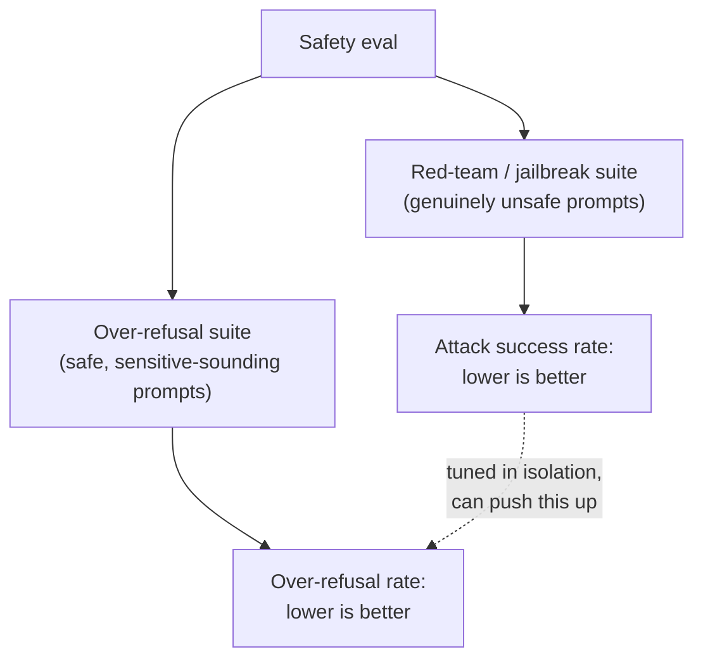

# Leçon 12. Évaluation de la sécurité et red-teaming

**Lien avec la mission :** La leçon 11 a donné à cet espace de travail une façon précise de mesurer l'accord humain au lieu de l'estimer à l'œil. L'évaluation de la sécurité demande la même discipline, mais les deux chiffres qu'elle doit tenir en tension, attraper les requêtes réellement dangereuses sans attraper par erreur les requêtes sûres, ne sont pas du genre qu'un seul chiffre d'exactitude peut capturer.
**Source primaire :** [Article : "HarmBench: A Standardized Evaluation Framework for Automated Red Teaming and Robust Refusal", Mazeika et al., 2024](https://arxiv.org/abs/2402.04249)
**Prérequis :** [Leçon 6](0006-judge-bias-and-human-agreement.md), [Leçon 11](0011-human-evaluation-as-a-method.md)

## Échauffement

1. ▢ Pourquoi le pourcentage d'accord brut entre deux annotateurs peut-il être trompeur, surtout avec seulement deux ou trois catégories de notation ?

Vérifier

L'accord brut ne sépare pas un jugement partagé authentique d'un accord dû au hasard, et avec peu de catégories, l'accord dû au seul hasard peut être élevé ; le kappa de Cohen corrige cela en comparant l'accord observé à l'accord que le seul hasard prédirait.

2. ▢ Pourquoi mesurer l'accord inter-annotateurs exige-t-il plus d'une note humaine par élément ?

Vérifier

L'accord est une comparaison entre annotateurs, donc il ne peut être mesuré que là où au moins deux annotateurs ont étiqueté le même élément ; une seule note par élément ne donne aucune base pour le calculer.

## À savoir

### Red-teaming : essayer délibérément de faire échouer un modèle

Le **red-teaming** est la pratique qui consiste à construire délibérément des entrées conçues pour faire produire au modèle une sortie dangereuse, que ce soit par un testeur humain qui sonde à la main ou par une méthode automatisée qui génère systématiquement des prompts adverses. Le cadrage de HarmBench lui-même est précis sur le manque antérieur du domaine : des méthodes de red-teaming automatisé existaient, mais il n'existait aucune manière standardisée de les évaluer et de les comparer rigoureusement, et c'est exactement ce qu'apporte un framework standardisé comme HarmBench, une façon partagée de mesurer dans quelle mesure une méthode d'attaque donnée réussit contre un modèle donné et ses défenses, sur de nombreuses attaques et de nombreuses cibles à la fois plutôt qu'une sonde ad hoc à la fois.

### Le taux de réussite d'un jailbreak n'est que la moitié du tableau de la sécurité

Un **jailbreak** est une attaque réussie : une entrée qui amène un modèle à produire une sortie que son entraînement à la sécurité était censé empêcher. La métrique naturelle est un **taux de réussite des attaques**, la fréquence à laquelle les prompts d'une méthode de red-teaming donnée franchissent les défenses d'un modèle, et faire baisser ce chiffre (faire refuser davantage le modèle) est la réponse évidente à un chiffre élevé. Mais refuser davantage n'est pas gratuit : un modèle réglé agressivement pour refuser tout ce qui ressemble à une attaque risque de refuser des requêtes qui n'ont jamais été dangereuses, simplement parce qu'elles emploient un langage proche ou évoquent un sujet sensible. Mesurer le seul taux de réussite des attaques ne peut pas détecter cela, puisqu'il ne regarde que des prompts réellement dangereux ; un modèle pourrait amener ce chiffre près de zéro tout en refusant discrètement une grande fraction de requêtes légitimes, et une eval de red-teaming seul annoncerait un succès total.

### Le sur-refus demande son propre jeu de test, pas une extension de celui des jailbreaks

**XSTest** existe précisément pour mesurer cet autre versant : une suite de test de prompts sûrs mais rédigés pour ressembler à des prompts dangereux (par une formulation proche, ou en touchant un sujet à la tonalité sensible sans être réellement nuisible). Le **taux de sur-refus** mesuré sur une telle suite est un chiffre différent du taux de réussite des attaques, qui vérifie un mode de défaillance réellement différent, refuser quelque chose qui aurait dû recevoir une réponse, plutôt que répondre à quelque chose qui aurait dû être refusé. Le cadrage du papier nomme directement la tension sous-jacente : l'innocuité pousse un modèle à refuser, l'utilité le pousse à obéir, et un modèle qui résout mal cette tension peut être sûr selon une mesure tout en étant inutilement prudent selon l'autre.

### Une eval de sécurité rapporte les deux chiffres, ou ce n'est pas une eval de sécurité

Le taux de refus sur un jeu réellement dangereux et le taux de sur-refus sur un jeu réellement sûr mais à la tonalité inquiétante doivent être rapportés ensemble, comme la leçon 6 exigeait de rapporter l'accord d'un juge face à une baseline humaine plutôt qu'un pourcentage nu. Un seul chiffre de taux de refus, sans savoir sur quel jeu il a été mesuré, ne peut pas être interprété : un faible taux de refus sur un jeu dangereux est mauvais, mais un faible taux de refus sur des prompts de type XSTest est exactement ce que doit avoir un modèle bien équilibré. Un réglage de sécurité qui ne suit qu'un des deux chiffres peut sacrifier silencieusement l'autre, et rien dans la métrique rapportée ne le montrerait.

## Pratique

1. ▢ Une équipe fine-tune un modèle jusqu'à ce que son taux de réussite des attaques face à une suite de red-teaming tombe près de zéro, et rapporte cela comme preuve que le modèle est sûr. Qu'est-ce que cette affirmation n'a pas vérifié ?

Indice

Demandez-vous quel type de prompts une suite de red-teaming contient réellement, et donc ce qu'elle ne peut pas vous dire.

Vérifier

Elle n'a pas du tout vérifié le sur-refus, puisqu'une suite de red-teaming ne contient que des prompts réellement dangereux ; un modèle pourrait les refuser de façon constante tout en refusant aussi une grande fraction de requêtes sûres et légitimes qui ressemblent simplement à des requêtes dangereuses, et la seule métrique du taux de réussite des attaques ne le ferait jamais apparaître.

2. ▢ Quel est le mode de défaillance précis que XSTest est conçu pour détecter, et en quoi diffère-t-il d'un jailbreak ?

Vérifier

XSTest détecte le sur-refus : un modèle qui refuse un prompt en réalité sûr, parce qu'il emploie un langage ou des sujets proches d'un prompt dangereux. Un jailbreak est la défaillance inverse, un prompt réellement dangereux qui franchit les défenses du modèle et produit une sortie dangereuse. Les deux sont des modes de défaillance différents qui demandent des jeux de test différents.

3. ▢ Pourquoi l'abstract de HarmBench décrit-il l'état antérieur du domaine comme dépourvu de « standardized evaluation framework », alors que des méthodes de red-teaming automatisé existaient déjà ?

Vérifier

Des méthodes de génération d'attaques existaient, mais sans framework standardisé il n'y avait aucune façon rigoureuse et comparable d'évaluer et de comparer différentes méthodes de red-teaming face à différents modèles et défenses ; l'apport de HarmBench est précisément cet étalon d'évaluation partagé, pas l'idée de génération automatique d'attaques elle-même.

4. ▢ Un rapport de sécurité n'indique que « taux de refus : 94 % » sans mentionner sur quel jeu de prompts il a été mesuré. Pourquoi ce chiffre est-il impossible à interpréter seul ?

Vérifier

Parce qu'un taux de refus élevé est bon sur un jeu de prompts dangereux (il attrape de vraies menaces) mais mauvais sur un jeu sûr mais à la tonalité sensible comme XSTest (il refuse des requêtes légitimes) ; sans savoir quel jeu a produit le chiffre, il n'y a aucun moyen de dire si 94 % reflète une forte sécurité ou une mauvaise calibration du sur-refus.

5. ▢ Laquelle de ces affirmations décrit correctement le lien entre taux de réussite des attaques et taux de sur-refus ?

    - a) Ils mesurent le même mode de défaillance sous deux angles différents, donc en rapporter un suffit
    - b) Le taux de réussite des attaques mesure si des prompts dangereux franchissent les défenses d'un modèle ; le taux de sur-refus mesure si des prompts sûrs à la tonalité sensible sont refusés inutilement ; régler pour améliorer l'un isolément peut dégrader silencieusement l'autre
    - c) Un modèle avec un taux de réussite des attaques de 0 % est prouvé sûr quel que soit son taux de sur-refus
    - d) Le sur-refus se mesure avec le même jeu de prompts de red-teaming que le taux de réussite des attaques, simplement noté autrement

Vérifier

**b)** C'est le lien précis, à double face, qu'établit cette leçon. (a) est faux : ce sont des modes de défaillance réellement différents qui demandent des jeux de test différents. (c) est faux : un taux de réussite des attaques de 0 % ne dit rien de savoir si le modèle sur-refuse des requêtes sûres. (d) est faux : XSTest est une suite distincte de prompts sûrs mais à la tonalité inquiétante, différente d'un jeu de red-teaming réellement dangereux.

## Exercices en situation réelle

- [ ] Pour un modèle ou une API auxquels vous avez accès, vérifiez si sa documentation de sécurité rapporte à la fois une métrique de type taux de refus et une métrique de type sur-refus, ou seulement l'une des deux.
- [ ] Écrivez cinq prompts réellement sûrs mais dont le langage pourrait ressembler superficiellement à une requête dangereuse (évoquer un sujet sensible sans être réellement nuisible), et vérifiez comment un modèle auquel vous avez accès répond à chacun.
- [ ] Demain : lisez la section du papier HarmBench sur les propriétés qu'il identifie comme « desirable » pour une évaluation de red-teaming, et notez lesquelles de ces propriétés une simple session de red-teaming manuel ponctuelle ne fournirait pas.

## Pour aller plus loin

- [Article : "HarmBench: A Standardized Evaluation Framework for Automated Red Teaming and Robust Refusal", Mazeika et al., 2024](https://arxiv.org/abs/2402.04249)
- [Article : "XSTest: A Test Suite for Identifying Exaggerated Safety Behaviours in Large Language Models", Röttger et al., 2023](https://arxiv.org/abs/2308.01263)
- [Ressources](../RESOURCES.md)

---

Ça ne passe pas ? Relisez la source primaire en haut de page, car cette leçon la condense et c'est dans la condensation que la compréhension s'échappe. Consultez le [glossaire](../GLOSSARY.md) pour tout terme qui vous a paru glissant.

Si c'est la leçon elle-même qui n'est pas claire plutôt que la matière, c'est un défaut : [ouvrez une issue](https://github.com/TokenCemetery/teach/issues).
