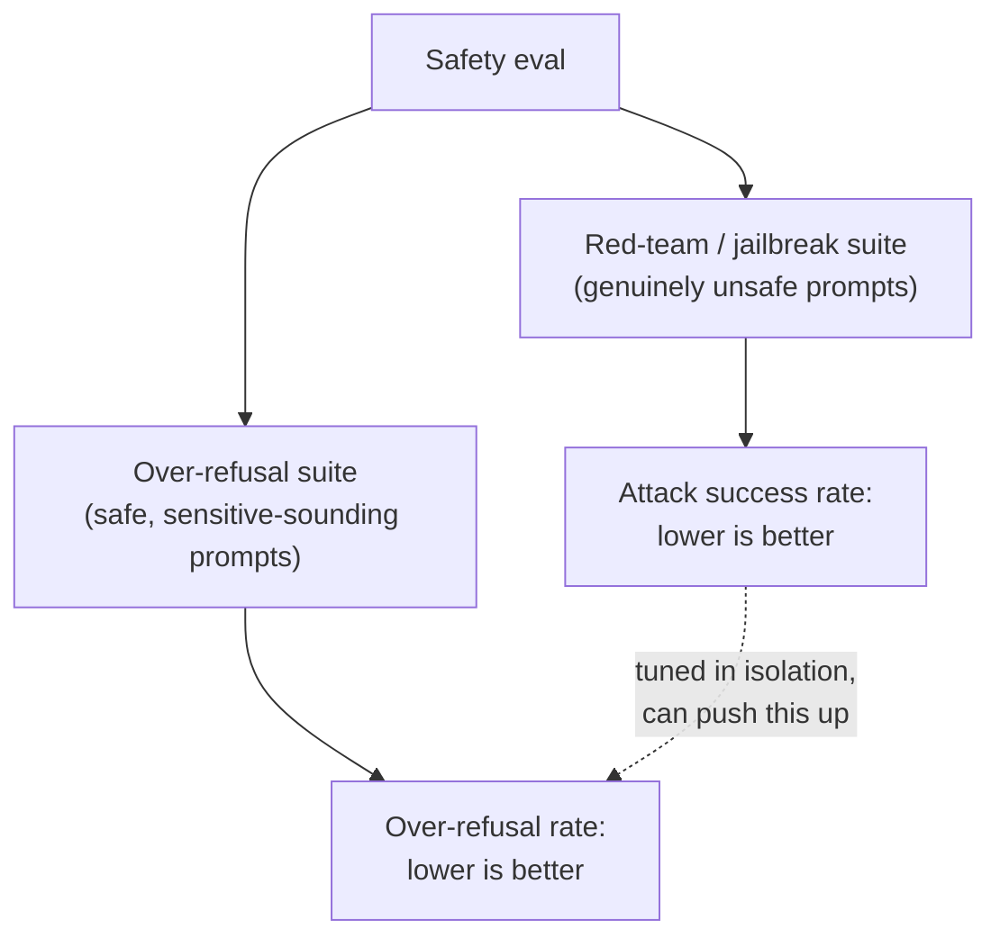

# पाठ 12. Safety और Red-Teaming Evaluation

**मिशन से संबंध:** पाठ 11 ने इस workspace को मानव सहमति को आँख से देखने के बजाय सटीक रूप से मापने का तरीक़ा दिया। Safety evaluation को वही अनुशासन चाहिए, पर जिन दो संख्याओं को उसे आपस में तनाव में रखना है, यानी सचमुच असुरक्षित अनुरोधों को पकड़ना और ग़लती से सुरक्षित अनुरोधों को न पकड़ना, उन्हें कोई एक accuracy आँकड़ा पकड़ ही नहीं सकता।
**मुख्य स्रोत:** [पेपर: "HarmBench: A Standardized Evaluation Framework for Automated Red Teaming and Robust Refusal", Mazeika et al., 2024](https://arxiv.org/abs/2402.04249)
**पूर्व-आवश्यकताएँ:** [पाठ 6](0006-judge-bias-and-human-agreement.md), [पाठ 11](0011-human-evaluation-as-a-method.md)

## वार्म-अप

1. ▢ दो raters के बीच कच्चा percent agreement भ्रामक क्यों हो सकता है, ख़ास तौर पर सिर्फ़ दो या तीन rating categories के साथ?

जाँचें

कच्ची सहमति सचमुच की साझा समझ को उस सहमति से अलग नहीं करती जो संयोग से हो जाती है, और कम categories के साथ अकेली संयोग-सहमति ऊँची हो सकती है; Cohen's kappa इसका सुधार देखी गई सहमति की तुलना उस सहमति से करके करता है जिसकी भविष्यवाणी अकेला संयोग करता।

2. ▢ Inter-rater सहमति मापने के लिए हर item पर एक से ज़्यादा मानव ratings क्यों चाहिए?

जाँचें

सहमति raters के बीच की तुलना है, इसलिए उसे वहीं मापा जा सकता है जहाँ कम से कम दो raters ने एक ही item को label किया हो; हर item पर एक अकेली rating उसे निकालने का कोई आधार नहीं देती।

## यह जानें

### Red-teaming: जानबूझकर model को विफल करने की कोशिश

**Red-teaming** जानबूझकर ऐसे inputs बनाने की प्रथा है जो model से असुरक्षित output निकलवाने के लिए डिज़ाइन किए गए हों, चाहे हाथ से जाँच करने वाले मानव tester से या ऐसे स्वचालित तरीक़े से जो व्यवस्थित रूप से adversarial prompts बनाता है। HarmBench की अपनी बात क्षेत्र की पिछली कमी के बारे में ख़ास है: स्वचालित red-teaming तरीक़े मौजूद थे, पर उन्हें कठोरता से परखने और तुलना करने का कोई मानकीकृत तरीक़ा नहीं था, और HarmBench जैसा मानकीकृत framework ठीक यही देता है, यह मापने का साझा तरीक़ा कि कोई दिया attack तरीक़ा किसी दिए model और उसके बचावों पर कितना सफल होता है, एक-एक तदर्थ जाँच के बजाय कई attacks और कई लक्ष्यों पर एक साथ।

### Jailbreak की सफलता दर safety की तस्वीर का सिर्फ़ आधा हिस्सा है

**Jailbreak** सफल attack है: ऐसा input जो model से वह output निकलवा ले जिसे रोकने के लिए उसकी safety training बनी थी। स्वाभाविक metric **attack success rate** है, यानी किसी red-teaming तरीक़े के prompts कितनी बार model के बचावों को पार करते हैं, और इस संख्या को नीचे धकेलना (model को ज़्यादा मना करवाना) ऊँची संख्या का स्पष्ट जवाब है। पर ज़्यादा मना करना मुफ़्त नहीं है: जो model हमला जैसी किसी भी चीज़ को मना करने की ओर आक्रामक रूप से tune किया गया हो, वह उन अनुरोधों को भी मना कर सकता है जो कभी असुरक्षित थे ही नहीं, महज़ इसलिए कि वे मिलती-जुलती भाषा इस्तेमाल करते हैं या किसी संवेदनशील विषय का ज़िक्र करते हैं। अकेला attack success rate मापना इसे पकड़ नहीं सकता, क्योंकि वह सिर्फ़ सचमुच असुरक्षित prompts को देखता है; model उस संख्या को लगभग शून्य तक ला सकता है और चुपचाप वैध अनुरोधों के बड़े हिस्से को मना करता रह सकता है, और सिर्फ़ red-team वाला eval पूरी सफलता बताएगा।

### Over-refusal को अपना test सेट चाहिए, jailbreak वाले का विस्तार नहीं

**XSTest** ख़ास तौर पर इस दूसरे पक्ष को मापने के लिए है: ऐसे prompts का test suite जो सुरक्षित हैं पर असुरक्षित जैसे दिखने के लिए लिखे गए हैं (मिलती-जुलती शब्दावली इस्तेमाल करके, या असल में हानिकारक हुए बिना संवेदनशील-सी लगने वाली बात को छूकर)। ऐसे suite के विरुद्ध मापी गई **over-refusal दर** attack success rate से अलग संख्या है, जो सचमुच अलग विफलता का तरीक़ा जाँचती है: जिसका उत्तर दिया जाना चाहिए था उसे मना करना, जिसे मना किया जाना चाहिए था उसका उत्तर देने के बजाय। पेपर की अपनी बात अंतर्निहित तनाव का सीधा नाम लेती है: harmlessness model को मना करने की ओर धकेलती है, helpfulness उसे मानने की ओर, और जो model इस तनाव को बुरी तरह सुलझाता है वह एक माप पर सुरक्षित और दूसरे पर बेकार-की-हद तक सावधान हो सकता है।

### Safety eval दोनों संख्याएँ बताता है, वरना वह safety eval नहीं है

सचमुच असुरक्षित सेट पर refusal दर और सचमुच सुरक्षित-पर-डरावने-लगने वाले सेट पर over-refusal दर को साथ-साथ बताना होगा, ठीक वैसे ही जैसे पाठ 6 ने judge की सहमति दर को खाली प्रतिशत के बजाय मानव baseline के सामने बताना ज़रूरी किया था। अकेली refusal-दर की संख्या, यह जाने बिना कि वह किस सेट पर मापी गई, पढ़ी नहीं जा सकती: असुरक्षित सेट पर कम refusal दर बुरी है, पर XSTest-शैली के prompts पर कम refusal दर ठीक वही है जो संतुलित model की होनी चाहिए। जो safety tuning दोनों संख्याओं में से सिर्फ़ एक को ट्रैक करती है, वह चुपचाप दूसरी का सौदा कर सकती है, और बताई गई metric में कुछ नहीं दिखेगा।

## अभ्यास

1. ▢ एक टीम model को तब तक fine-tune करती है जब तक red-team suite के विरुद्ध उसका attack success rate लगभग शून्य नहीं हो जाता, और इसे इस प्रमाण के रूप में बताती है कि model सुरक्षित है। इस दावे ने क्या जाँचना छोड़ दिया है?

संकेत

सोचें कि red-team suite में असल में किस तरह के prompts होते हैं, और इसलिए वह किस बारे में कुछ नहीं बता सकता।

जाँचें

इसने over-refusal को बिल्कुल नहीं जाँचा, क्योंकि red-team suite में सिर्फ़ सचमुच असुरक्षित prompts होते हैं; model उन्हें लगातार मना कर सकता है और साथ ही सुरक्षित, वैध अनुरोधों के बड़े हिस्से को भी मना कर सकता है जो बस असुरक्षित जैसे दिखते हैं, और अकेली attack-success-rate metric इसे कभी सामने नहीं लाएगी।

2. ▢ XSTest किस ख़ास विफलता के तरीक़े को पकड़ने के लिए डिज़ाइन किया गया है, और वह jailbreak से कैसे अलग है?

जाँचें

XSTest over-refusal पकड़ता है: model का ऐसे prompt को मना करना जो असल में सुरक्षित है, क्योंकि वह असुरक्षित prompt जैसी भाषा या विषय इस्तेमाल करता है। Jailbreak इसका उलटा है: सचमुच असुरक्षित prompt का model के बचावों को पार कर असुरक्षित output पैदा करना। दोनों अलग विफलता के तरीक़े हैं जिन्हें अलग test sets चाहिए।

3. ▢ HarmBench का abstract क्षेत्र की पिछली स्थिति को "standardized evaluation framework" की कमी वाली क्यों बताता है, जबकि स्वचालित red-teaming तरीक़े पहले से मौजूद थे?

जाँचें

Attacks बनाने के तरीक़े मौजूद थे, पर मानकीकृत framework के बिना अलग-अलग red-teaming तरीक़ों को अलग models और बचावों के विरुद्ध परखने और तुलना करने का कोई कठोर, तुलनीय तरीक़ा नहीं था; HarmBench का योगदान ख़ास तौर पर वह साझा evaluation मानक है, स्वचालित attack generation का विचार ख़ुद नहीं।

4. ▢ एक safety रिपोर्ट सिर्फ़ "refusal rate: 94%" बताती है, यह ज़िक्र किए बिना कि वह किस prompt सेट पर मापी गई। यह संख्या अकेली पढ़ी क्यों नहीं जा सकती?

जाँचें

क्योंकि ऊँची refusal दर असुरक्षित-prompt सेट पर अच्छी है (असली ख़तरे पकड़ना) पर XSTest जैसे सुरक्षित-पर-संवेदनशील-लगने वाले सेट पर बुरी है (वैध अनुरोधों को मना करना); यह जाने बिना कि संख्या किस सेट से आई, बताने का कोई तरीक़ा नहीं कि 94% मज़बूत safety दर्शाता है या ख़राब over-refusal calibration।

5. ▢ Attack success rate और over-refusal rate के आपसी संबंध का सही वर्णन कौन-सा दावा करता है?

    - a) वे एक ही विफलता के तरीक़े को दो अलग कोणों से मापते हैं, इसलिए एक बताना काफ़ी है
    - b) Attack success rate मापता है कि असुरक्षित prompts model के बचावों को पार करते हैं या नहीं; over-refusal rate मापता है कि सुरक्षित, संवेदनशील-लगने वाले prompts को अनावश्यक रूप से मना किया जाता है या नहीं; एक को अकेले सुधारने के लिए tune करना चुपचाप दूसरे को बिगाड़ सकता है
    - c) जिस model का attack success rate 0% है वह सुरक्षित साबित है, उसकी over-refusal दर चाहे जो हो
    - d) Over-refusal उसी red-team prompt सेट से मापा जाता है जिससे attack success rate, बस अलग तरह से score होता है

जाँचें

**b)** यही वह सटीक, दो-तरफ़ा संबंध है जो यह पाठ स्थापित करता है। (a) ग़लत है: वे सचमुच अलग विफलता के तरीक़े हैं जिन्हें अलग test sets चाहिए। (c) ग़लत है: 0% attack success rate इस बारे में कुछ नहीं कहता कि model सुरक्षित अनुरोधों को over-refuse करता है या नहीं। (d) ग़लत है: XSTest सुरक्षित-पर-डरावने-लगने वाले prompts का अलग suite है, जो सचमुच असुरक्षित red-team सेट से अलग है।

## असली दुनिया का अभ्यास

- [ ] जिस model या API तक आपकी पहुँच है, उसके लिए जाँचें कि क्या उसका safety दस्तावेज़ refusal-दर-शैली की metric और over-refusal-शैली की metric, दोनों बताता है, या दोनों में से सिर्फ़ एक।
- [ ] पाँच ऐसे prompts लिखें जो सचमुच सुरक्षित हों पर ऐसी भाषा इस्तेमाल करें जो ऊपरी तौर पर असुरक्षित अनुरोध जैसी लग सकती हो (असल में हानिकारक हुए बिना किसी संवेदनशील विषय का ज़िक्र), और जाँचें कि आपकी पहुँच वाला model हर एक पर कैसे जवाब देता है।
- [ ] कल: HarmBench पेपर का वह खंड पढ़ें जो बताता है कि red-teaming evaluation के लिए वह किन गुणों को "वांछनीय" पहचानता है, और लिखें कि इनमें से कौन-से गुण सरल, एक-बार का मैन्युअल red-team सत्र नहीं दे पाएगा।

## आगे बढ़ने के लिए

- [पेपर: "HarmBench: A Standardized Evaluation Framework for Automated Red Teaming and Robust Refusal", Mazeika et al., 2024](https://arxiv.org/abs/2402.04249)
- [पेपर: "XSTest: A Test Suite for Identifying Exaggerated Safety Behaviours in Large Language Models", Röttger et al., 2023](https://arxiv.org/abs/2308.01263)
- [संसाधन](../RESOURCES.md)

---

बात नहीं बन रही? ऊपर दिए primary source को दोबारा पढ़ें, क्योंकि यह पाठ उसे संक्षिप्त करता है और समझ संक्षेप में ही रिसती है। जो शब्द फिसलन भरा लगे, उसके लिए [शब्दावली](../GLOSSARY.md) देखें।

अगर दिक़्क़त सामग्री की नहीं बल्कि पाठ की ही है, तो वह एक खोट है: [issue खोलें](https://github.com/TokenCemetery/teach/issues)।
