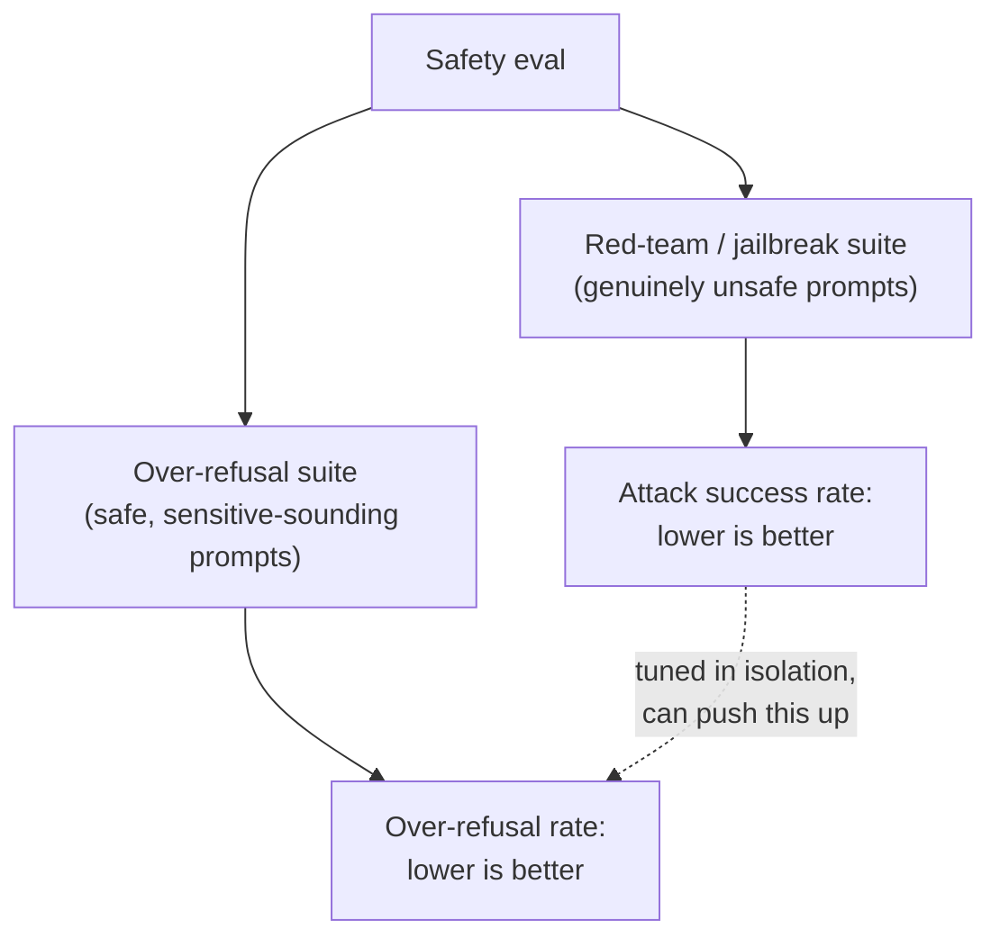

# Lição 12. Avaliação de segurança e red-teaming

**Ligação com a missão:** A lição 11 deu a este workspace uma forma precisa de medir a concordância humana em vez de estimá-la a olho. A avaliação de segurança precisa da mesma disciplina, mas os dois números que ela precisa manter em tensão, pegar pedidos genuinamente inseguros e não pegar por engano os seguros, não são o tipo de coisa que um único número de acurácia consiga capturar.
**Fonte principal:** [Artigo científico: "HarmBench: A Standardized Evaluation Framework for Automated Red Teaming and Robust Refusal", Mazeika et al., 2024](https://arxiv.org/abs/2402.04249)
**Pré-requisitos:** [Lição 6](0006-judge-bias-and-human-agreement.md), [Lição 11](0011-human-evaluation-as-a-method.md)

## Aquecimento

1. ▢ Por que a concordância percentual bruta entre dois avaliadores pode enganar, especialmente com apenas duas ou três categorias de avaliação?

Verificação

A concordância bruta não separa o julgamento genuíno compartilhado da concordância que acontece por acaso, e com poucas categorias a concordância por acaso sozinha pode ser alta; o kappa de Cohen corrige isso comparando a concordância observada com a concordância que o acaso sozinho preveria.

2. ▢ Por que medir a concordância entre avaliadores exige mais de uma avaliação humana por item?

Verificação

A concordância é uma comparação entre avaliadores, então só pode ser medida onde pelo menos dois avaliadores rotularam o mesmo item; uma única avaliação por item não dá base para calculá-la.

## Saiba isto

### Red-teaming: tentar de propósito fazer um modelo falhar

**Red-teaming** é a prática de construir de propósito entradas desenhadas para fazer um modelo produzir uma saída insegura, seja por um testador humano sondando manualmente, seja por um método automatizado que gera prompts adversariais de forma sistemática. O próprio enquadramento do HarmBench é específico sobre a lacuna anterior da área: existiam métodos automatizados de red-teaming, mas não havia uma forma padronizada de avaliá-los e compará-los com rigor, que é exatamente o que um framework padronizado como o HarmBench oferece, uma forma compartilhada de medir o quanto um dado método de ataque tem sucesso contra um dado modelo e suas defesas, entre muitos ataques e muitos alvos ao mesmo tempo, em vez de uma sondagem ad hoc por vez.

### A taxa de sucesso de um jailbreak é só metade do quadro de segurança

Um **jailbreak** é um ataque bem-sucedido: uma entrada que faz um modelo produzir uma saída que seu treinamento de segurança pretendia evitar. A métrica natural é uma **taxa de sucesso de ataque**, com que frequência os prompts de um dado método de red-teaming passam pelas defesas de um modelo, e reduzir esse número (fazer o modelo recusar mais) é a resposta óbvia a um número alto. Mas recusar mais não é de graça: um modelo ajustado de forma agressiva para recusar qualquer coisa que se pareça com um ataque corre o risco de recusar pedidos que nunca foram inseguros, simplesmente porque usam linguagem parecida ou mencionam um assunto sensível. Medir apenas a taxa de sucesso de ataque não consegue pegar isso, já que ela só olha para prompts genuinamente inseguros; um modelo poderia levar esse número perto de zero enquanto recusa em silêncio uma grande fração de pedidos legítimos, e um eval só de red-team reportaria sucesso total.

### A recusa excessiva precisa do seu próprio conjunto de testes, e não de uma extensão do de jailbreak

O **XSTest** existe especificamente para medir esse outro lado: uma suíte de testes com prompts que são seguros mas escritos para se parecer com inseguros (usando formulação parecida, ou tocando um assunto que soa sensível sem de fato ser danoso). A **taxa de recusa excessiva** medida contra uma suíte assim é um número diferente da taxa de sucesso de ataque, verificando um modo de falha genuinamente diferente, recusar algo que deveria ter sido respondido, em vez de responder algo que deveria ter sido recusado. O próprio enquadramento do artigo nomeia diretamente a tensão de fundo: a inocuidade empurra um modelo a recusar, a utilidade o empurra a atender, e um modelo que resolve mal essa tensão pode ser seguro por uma medida e inutilmente cauteloso pela outra.

### Um eval de segurança reporta os dois números, ou não é um eval de segurança

A taxa de recusa em um conjunto genuinamente inseguro e a taxa de recusa excessiva em um conjunto genuinamente seguro mas de som assustador precisam ser reportadas juntas, do mesmo modo que a lição 6 exigiu reportar a taxa de concordância de um juiz contra uma baseline humana em vez de uma porcentagem nua. Um único número de taxa de recusa, sem saber contra qual conjunto foi medido, não pode ser interpretado: uma taxa de recusa baixa em um conjunto inseguro é ruim, mas uma taxa de recusa baixa em prompts no estilo do XSTest é exatamente o que um modelo bem equilibrado deveria ter. Um ajuste de segurança que acompanha apenas um dos dois números pode abrir mão do outro em silêncio, e nada na métrica reportada mostraria isso.

## Prática

1. ▢ Uma equipe faz fine-tuning de um modelo até que sua taxa de sucesso de ataque contra uma suíte de red-team caia para perto de zero, e reporta isso como prova de que o modelo é seguro. O que essa afirmação deixou de verificar?

Dica

Considere que tipo de prompts uma suíte de red-team de fato contém, e portanto sobre o que ela não consegue informar.

Verificação

Ela não verificou a recusa excessiva de forma alguma, já que uma suíte de red-team só contém prompts genuinamente inseguros; um modelo poderia recusar esses de forma consistente e ao mesmo tempo recusar uma grande fração de pedidos seguros e legítimos que apenas se parecem com inseguros, e a métrica de taxa de sucesso de ataque sozinha nunca traria isso à tona.

2. ▢ Qual é o modo de falha específico que o XSTest foi desenhado para pegar, e em que ele difere de um jailbreak?

Verificação

O XSTest pega a recusa excessiva: um modelo recusando um prompt que na verdade é seguro, porque usa linguagem ou assuntos parecidos com os de um prompt inseguro. Um jailbreak é a falha oposta, um prompt genuinamente inseguro passando pelas defesas do modelo e produzindo saída insegura. As duas são modos de falha diferentes que precisam de conjuntos de testes diferentes.

3. ▢ Por que o resumo do HarmBench descreve o estado anterior da área como carente de um "framework de avaliação padronizado", embora já existissem métodos automatizados de red-teaming?

Verificação

Os métodos para gerar ataques existiam, mas sem um framework padronizado não havia uma forma rigorosa e comparável de avaliar e comparar diferentes métodos de red-teaming contra diferentes modelos e defesas; a contribuição do HarmBench é especificamente esse padrão de avaliação compartilhado, e não a ideia de geração automatizada de ataques em si.

4. ▢ Um relatório de segurança afirma apenas "taxa de recusa: 94%", sem mencionar contra qual conjunto de prompts foi medida. Por que esse número é impossível de interpretar sozinho?

Verificação

Porque uma taxa de recusa alta é boa em um conjunto de prompts inseguros (pegando ameaças genuínas), mas ruim em um conjunto seguro de som sensível como o XSTest (recusando pedidos legítimos); sem saber qual conjunto produziu o número, não há como dizer se os 94% refletem segurança forte ou uma má calibração de recusa excessiva.

5. ▢ Qual afirmação descreve corretamente como a taxa de sucesso de ataque e a taxa de recusa excessiva se relacionam?

    - a) Medem o mesmo modo de falha por dois ângulos diferentes, então reportar uma basta
    - b) A taxa de sucesso de ataque mede se prompts inseguros passam pelas defesas de um modelo; a taxa de recusa excessiva mede se prompts seguros de som sensível são recusados desnecessariamente; ajustar para melhorar uma isoladamente pode piorar a outra em silêncio
    - c) Um modelo com taxa de sucesso de ataque de 0% está provado seguro, independentemente de sua taxa de recusa excessiva
    - d) A recusa excessiva é medida com o mesmo conjunto de prompts de red-team da taxa de sucesso de ataque, apenas pontuado de outro modo

Verificação

**b)** Essa é a relação precisa, de dois lados, que esta lição estabelece. (a) é falsa: são modos de falha genuinamente diferentes que exigem conjuntos de testes diferentes. (c) é falsa: uma taxa de sucesso de ataque de 0% não diz nada sobre se o modelo recusa pedidos seguros em excesso. (d) é falsa: o XSTest é uma suíte separada de prompts seguros de som assustador, distinta de um conjunto de red-team genuinamente inseguro.

## Prática no mundo real

- [ ] Para um modelo ou API a que você tenha acesso, verifique se a documentação de segurança dele reporta tanto uma métrica no estilo de taxa de recusa quanto uma métrica no estilo de recusa excessiva, ou apenas uma das duas.
- [ ] Escreva cinco prompts que sejam genuinamente seguros, mas usem uma linguagem que poderia lembrar superficialmente um pedido inseguro (mencionando um assunto sensível sem ser danoso de fato), e verifique como um modelo a que você tenha acesso responde a cada um.
- [ ] Amanhã: leia a seção do artigo do HarmBench sobre quais propriedades ele identifica como "desejáveis" para uma avaliação de red-teaming e anote quais dessas propriedades uma sessão manual de red-team simples e avulsa deixaria de oferecer.

## Para ir além

- [Artigo científico: "HarmBench: A Standardized Evaluation Framework for Automated Red Teaming and Robust Refusal", Mazeika et al., 2024](https://arxiv.org/abs/2402.04249)
- [Artigo científico: "XSTest: A Test Suite for Identifying Exaggerated Safety Behaviours in Large Language Models", Röttger et al., 2023](https://arxiv.org/abs/2308.01263)
- [Recursos](../RESOURCES.md)

---

Não ficou claro? Releia a fonte principal no topo, já que esta lição a comprime e é na compressão que o entendimento escapa. Consulte o [glossário](../GLOSSARY.md) para qualquer termo que pareceu escorregadio.

Se o problema é a lição em si, e não o material, isso é um defeito: [abra uma issue](https://github.com/TokenCemetery/teach/issues).
