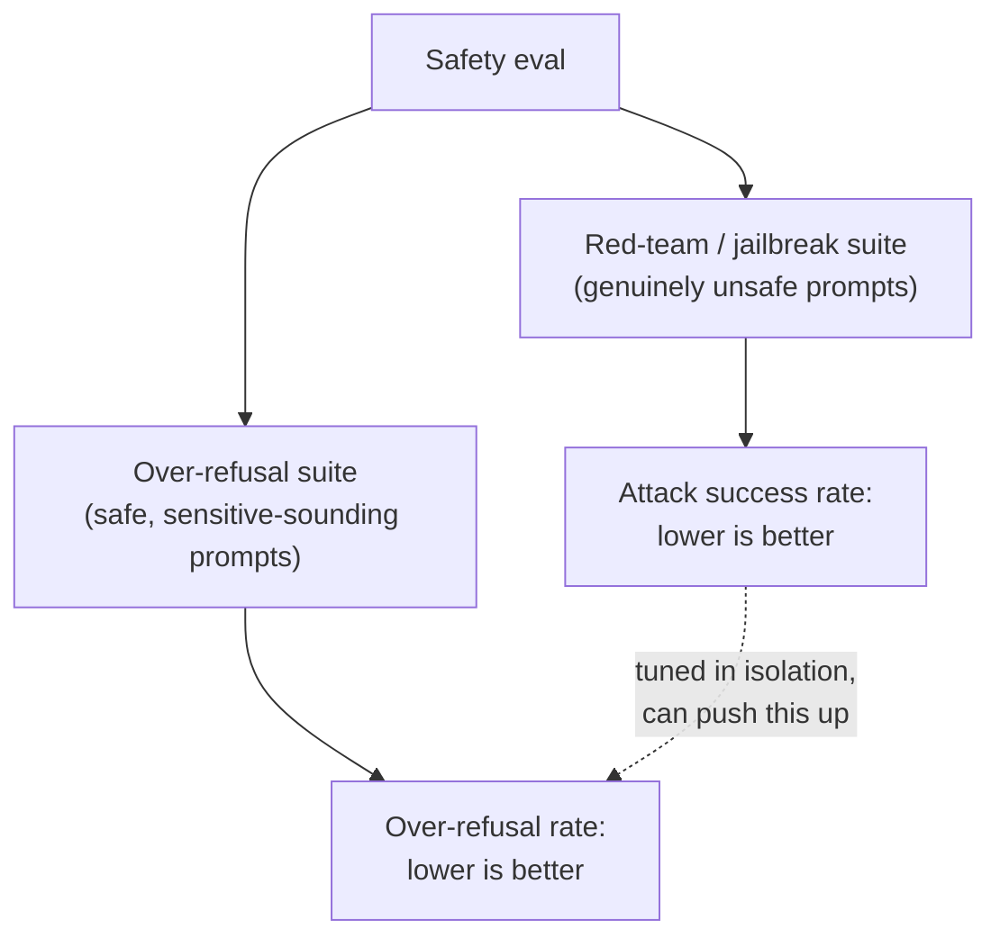

# Урок 12. Оценка безопасности и ред-тиминг

**Связь с целью курса:** Урок 11 дал этой рабочей области точный способ измерять согласие людей вместо оценки на глаз. Оценке безопасности нужна та же дисциплина, но два числа, которые ей приходится держать в напряжении, поимка по-настоящему небезопасных запросов и непоимка безопасных по ошибке, вовсе не такое, что способна передать одна цифра точности.
**Первоисточник:** [Научная статья: "HarmBench: A Standardized Evaluation Framework for Automated Red Teaming and Robust Refusal", Mazeika et al., 2024](https://arxiv.org/abs/2402.04249)
**Предварительные требования:** [Урок 6](0006-judge-bias-and-human-agreement.md), [Урок 11](0011-human-evaluation-as-a-method.md)

## Разминка

1. ▢ Почему сырой процент согласия между двумя асессорами может вводить в заблуждение, особенно при всего двух-трёх категориях оценки?

Проверка

Сырое согласие не отделяет подлинное общее суждение от согласия, возникающего случайно, а при малом числе категорий одно случайное согласие может быть высоким; каппа Коэна поправляет это, сравнивая наблюдаемое согласие с согласием, которое предсказал бы один лишь случай.

2. ▢ Почему для измерения согласия между асессорами нужно более одной человеческой оценки на элемент?

Проверка

Согласие это сравнение между асессорами, поэтому его можно измерить только там, где как минимум два асессора разметили один и тот же элемент; одна оценка на элемент не даёт основы для его вычисления.

## Что нужно знать

### Ред-тиминг: целенаправленные попытки заставить модель дать сбой

**Ред-тиминг** это практика целенаправленного составления входов, призванных заставить модель выдать небезопасный вывод, будь то тестировщик-человек, зондирующий вручную, или автоматический метод, систематически генерирующий состязательные промпты. Формулировка самого HarmBench конкретно называет прежний пробел в области: автоматические методы ред-тиминга существовали, но не было стандартизированного способа строго оценивать и сравнивать их, и именно это даёт стандартизированный фреймворк вроде HarmBench: общий способ измерять, насколько успешен данный метод атаки против данной модели и её защит, сразу по многим атакам и многим целям, а не одно ситуативное зондирование за раз.

### Доля успешных джейлбрейков это лишь половина картины безопасности

**Джейлбрейк** это успешная атака: вход, который заставляет модель выдать то, что обучение безопасности должно было предотвратить. Естественная метрика это **доля успешных атак**: как часто промпты данного метода ред-тиминга проходят мимо защит модели, и снижение этого числа (чтобы модель отказывала чаще) очевидный ответ на высокое значение. Но отказывать больше небесплатно: модель, настроенная агрессивно отказывать на всё, что похоже на атаку, рискует отказывать на запросы, которые никогда не были небезопасными, просто потому, что в них похожий язык или упомянута чувствительная тема. Одной долей успешных атак это не поймать, поскольку она смотрит только на по-настоящему небезопасные промпты; модель может довести это число почти до нуля и при этом тихо отказывать на большую долю законных запросов, а эвал только с ред-тимингом сообщит о полном успехе.

### Для избыточного отказа нужен собственный тестовый набор, а не расширение набора джейлбрейков

**XSTest** создан именно чтобы измерять эту другую сторону: тестовый набор промптов, которые безопасны, но написаны так, чтобы походить на небезопасные (с похожей формулировкой или касаясь чувствительно звучащей темы, не неся при этом вреда). **Доля избыточных отказов**, измеренная на таком наборе, это другое число, чем доля успешных атак, и проверяет принципиально другой вид сбоя: отказ там, где следовало ответить, а не ответ там, где следовало отказать. Формулировка самой статьи прямо называет лежащее в основе напряжение: безвредность подталкивает модель отказывать, полезность подталкивает её выполнять, и модель, плохо разрешающая это напряжение, может быть безопасной по одной мере и бесполезно осторожной по другой.

### Эвал безопасности сообщает оба числа, иначе это не эвал безопасности

Долю отказов на по-настоящему небезопасном наборе и долю избыточных отказов на по-настоящему безопасном, но звучащем пугающе наборе нужно сообщать вместе, так же как урок 6 требовал сообщать долю согласия судьи относительно человеческой базовой линии, а не голый процент. Единственное число доли отказов, без знания того, на каком наборе оно измерено, интерпретировать нельзя: низкая доля отказов на небезопасном наборе плоха, а низкая доля отказов на промптах в стиле XSTest ровно то, что должно быть у хорошо сбалансированной модели. Настройка безопасности, отслеживающая лишь одно из двух чисел, может тихо отдать другое, и ничто в сообщаемой метрике этого не покажет.

## Практика

1. ▢ Команда дообучает модель, пока её доля успешных атак против набора ред-тиминга не падает почти до нуля, и сообщает это как доказательство безопасности модели. Что это утверждение не проверило?

Подсказка

Подумайте, какие промпты на самом деле содержит набор ред-тиминга и о чём он поэтому ничего не может сказать.

Проверка

Оно вообще не проверило избыточный отказ, поскольку набор ред-тиминга содержит только по-настоящему небезопасные промпты; модель может последовательно отказывать на них и при этом отказывать на большую долю безопасных законных запросов, лишь похожих на небезопасные, а одна метрика доли успешных атак этого никогда не покажет.

2. ▢ Какой конкретный вид сбоя призван поймать XSTest и чем он отличается от джейлбрейка?

Проверка

XSTest ловит избыточный отказ: отказ модели на промпт, который на самом деле безопасен, из-за того, что в нём язык или темы, похожие на небезопасный промпт. Джейлбрейк это обратный сбой: по-настоящему небезопасный промпт проходит мимо защит модели и даёт небезопасный вывод. Это разные виды сбоя, которым нужны разные тестовые наборы.

3. ▢ Почему в аннотации HarmBench прежнее состояние области описано как не имеющее «стандартизированного фреймворка оценки», хотя автоматические методы ред-тиминга уже существовали?

Проверка

Методы генерации атак существовали, но без стандартизированного фреймворка не было строгого сопоставимого способа оценивать и сравнивать разные методы ред-тиминга против разных моделей и защит; вклад HarmBench именно в этом общем стандарте оценки, а не в самой идее автоматической генерации атак.

4. ▢ В отчёте по безопасности указано только «доля отказов: 94%» без упоминания того, на каком наборе промптов она измерена. Почему это число невозможно интерпретировать само по себе?

Проверка

Потому что высокая доля отказов хороша на наборе небезопасных промптов (ловит настоящие угрозы), но плоха на безопасном, но чувствительно звучащем наборе вроде XSTest (отказы на законные запросы); не зная, какой набор дал число, нельзя сказать, отражают ли 94% сильную безопасность или плохую калибровку избыточных отказов.

5. ▢ Какое утверждение верно описывает, как связаны доля успешных атак и доля избыточных отказов?

    - a) Они измеряют один и тот же вид сбоя с двух сторон, поэтому достаточно сообщать одну
    - b) Доля успешных атак измеряет, проходят ли небезопасные промпты мимо защит модели; доля избыточных отказов измеряет, отказывают ли без нужды на безопасные, чувствительно звучащие промпты; настройка на улучшение одной в отрыве от другой может тихо ухудшить вторую
    - c) Модель с долей успешных атак 0% доказанно безопасна независимо от доли избыточных отказов
    - d) Избыточный отказ измеряется на том же наборе промптов ред-тиминга, что и доля успешных атак, просто оценивается иначе

Проверка

**b)** Это точная двусторонняя связь, которую устанавливает урок. Вариант (a) неверен: это принципиально разные виды сбоя, которым нужны разные тестовые наборы. Вариант (c) неверен: доля успешных атак 0% ничего не говорит о том, отказывает ли модель без нужды на безопасные запросы. Вариант (d) неверен: XSTest это отдельный набор безопасных, но пугающе звучащих промптов, отличный от по-настоящему небезопасного набора ред-тиминга.

## Практика в реальной работе

- [ ] Для модели или API, к которым у вас есть доступ, проверьте, сообщает ли их документация по безопасности и метрику вида доли отказов, и метрику вида избыточного отказа или только одну из двух.
- [ ] Напишите пять промптов, по-настоящему безопасных, но использующих язык, который мог бы поверхностно походить на небезопасный запрос (упоминание чувствительной темы без реального вреда), и проверьте, как на каждый отвечает доступная вам модель.
- [ ] Завтра: прочитайте в статье HarmBench раздел о том, какие свойства она называет «желательными» для оценки ред-тиминга, и отметьте, какие из этих свойств простая разовая ручная сессия ред-тиминга не обеспечила бы.

## Что почитать дальше

- [Научная статья: "HarmBench: A Standardized Evaluation Framework for Automated Red Teaming and Robust Refusal", Mazeika et al., 2024](https://arxiv.org/abs/2402.04249)
- [Научная статья: "XSTest: A Test Suite for Identifying Exaggerated Safety Behaviours in Large Language Models", Röttger et al., 2023](https://arxiv.org/abs/2308.01263)
- [Ресурсы](../RESOURCES.md)

---

Не доходит? Перечитайте первоисточник в начале: этот урок его сжимает, а при сжатии понимание как раз и теряется. Загляните в [глоссарий](../GLOSSARY.md), если какой-то термин показался скользким.

Если неясен сам урок, а не материал, это дефект: [откройте issue](https://github.com/TokenCemetery/teach/issues).
