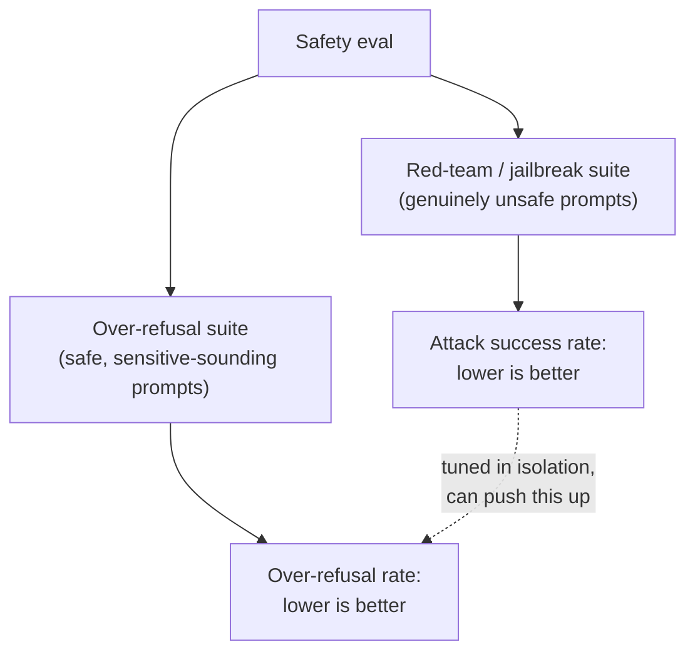

# 第 12 课：安全与红队评测

**使命关联:** 第 11 课给了本工作区一种精确度量人类一致性的办法，而不是目测。安全评测需要同样的纪律，但它必须同时顾及的两个数字，既要抓住真正不安全的请求，又不能错抓安全的请求，根本不是单个准确率数字所能涵盖的。
**主要来源:** [论文：“HarmBench: A Standardized Evaluation Framework for Automated Red Teaming and Robust Refusal”，Mazeika 等，2024](https://arxiv.org/abs/2402.04249)
**前置知识:** [第 6 课](0006-judge-bias-and-human-agreement.md)、[第 11 课](0011-human-evaluation-as-a-method.md)

## 热身

1. ▢ 为什么两位评分员之间的原始百分比一致率可能产生误导，尤其是只有两三个评分类别时？

检查

原始一致率分不清真正共有的判断，与偶然发生的一致，而类别很少时，仅凭偶然的一致率就可能很高；科恩 kappa 通过把观察到的一致率，与仅凭偶然所预测的一致率作比较，校正了这一点。

2. ▢ 为什么度量评分员间的一致性，每一项需要不止一条人类评分？

检查

一致性是评分员之间的比较，所以只有在至少两位评分员给同一项做了标注时，才能度量；每项只有一条评分，就没有计算它的依据。

## 要点

### 红队测试：有意地尝试让模型失败

**红队测试**是有意构造旨在让模型产出不安全输出的输入的做法，无论是由人工测试员手动探测，还是由系统地生成对抗性提示词的自动化方法来完成。HarmBench 自己的表述，明确指出了这个领域此前的缺口：自动化红队方法已经存在，却没有标准化的办法，来严格地评估并比较它们，而 HarmBench 这样的标准化框架提供的正是这个：一种共同的度量办法，度量某种攻击方法对给定模型及其防御的成功程度，同时涵盖许多种攻击和许多个目标，而不是一次一个临时的探测。

### 越狱的成功率，只是安全画面的一半

**越狱**是一次成功的攻击：一个让模型产出其安全训练本该阻止的输出的输入。顺理成章的指标是**攻击成功率**，也就是某种红队方法的提示词，有多常突破模型的防御，而对于较高的攻击成功率，显而易见的回应是把这个数字压下去（让模型拒绝得更多）。但拒绝得更多并不是免费的：被调得极力拒绝任何看起来像攻击的东西的模型，有可能拒绝那些本来就不危险的请求，仅仅因为它们用了相似的语言，或提到了敏感的话题。只度量攻击成功率，抓不住这一点，因为它只看真正不安全的提示词；模型可以把这个数字压到接近零，同时悄悄拒绝很大一部分合法的请求，而只做红队的评测，会报告完全成功。

### 过度拒答需要它自己的测试集，而不是越狱测试集的延伸

**XSTest** 就是专门为度量另一侧而存在的：它是一套提示词的测试集，这些提示词是安全的，却被写得像不安全的提示词（用了相似的措辞，或涉及听起来敏感、实际上并无危害的话题）。对照这样一套测试集度量出的**过度拒答率**，与攻击成功率是不同的数字，检查的是真正不同的失败模式，即拒绝了本该回答的东西，而不是回答了本该拒绝的东西。论文自己的表述直接点出了底层的张力：无害性促使模型拒绝，有用性促使它顺从，而处理不好这一张力的模型，可能按一种度量是安全的，按另一种度量却谨慎得毫无用处。

### 安全评测要同时报告两个数字，否则就不算安全评测

在真正不安全的集合上的拒答率，与在真正安全、却听起来吓人的集合上的过度拒答率，必须一起报告，就像第 6 课要求，要对照人类基准报告裁判的一致率，而不是一个光秃秃的百分比一样。单独一个拒答率的数字，如果不知道它是对照哪个集合度量的，就无法解读：在不安全的集合上拒答率低是不好的，但在 XSTest 式的提示词上拒答率低，恰恰是一个平衡良好的模型应有的表现。只跟踪两个数字之一的安全调优，可能悄悄地以另一个为代价，而报告出的指标里，没有任何东西会显示出来。

## 练习

1. ▢ 某团队微调了一个模型，直到它在红队测试集上的攻击成功率降到接近零，并把这个结果作为模型安全的证明。这个说法没有检查什么？

提示

想一想红队测试集里实际包含的是哪一类提示词，因此它说明不了什么。

检查

它根本没有检查过度拒答，因为红队测试集只包含真正不安全的提示词；模型可以始终如一地拒绝这些，同时也拒绝很大一部分只是看起来像不安全请求的、安全而合法的请求，而光靠攻击成功率这个指标，永远不会发现这一点。

2. ▢ XSTest 专门要抓的失败模式是什么，它与越狱有何不同？

检查

XSTest 抓的是过度拒答：模型拒绝了一个实际上安全的提示词，因为它用了与不安全的提示词相似的语言或话题。越狱是相反的失败：一个真正不安全的提示词突破了模型的防御，产出了不安全的输出。这是两种不同的失败模式，需要不同的测试集。

3. ▢ 为什么 HarmBench 的摘要把这个领域此前的状态描述为缺少“标准化的评估框架”，尽管自动化红队方法已经存在？

检查

生成攻击的方法已经存在，但没有标准化的框架，就没有严格的、可比较的办法，来对照不同的模型和防御，评估并比较不同的红队方法；HarmBench 的贡献，专门就是这个共同的评估标准，而不是自动生成攻击这一想法本身。

4. ▢ 某份安全报告只写着“拒答率：94%”，没有提到是对照哪个提示词集度量的。为什么单看这个数字，无法解读？

检查

因为高拒答率在不安全提示词的集合上是好的（抓住了真正的威胁），而在像 XSTest 这样安全、却听起来敏感的集合上是不好的（拒绝了合法的请求）；不知道是哪个集合产生了这个数字，就没有办法判断 94% 反映的是很强的安全性，还是糟糕的过度拒答校准。

5. ▢ 下列哪项说法正确地描述了攻击成功率与过度拒答率之间的关系？

    - a) 它们从两个不同的角度度量同一种失败模式，所以报告其中一个就够了
    - b) 攻击成功率度量不安全的提示词是否突破了模型的防御；过度拒答率度量安全而听起来敏感的提示词是否被不必要地拒绝；孤立地调优以改进其中一个，可能悄悄地让另一个变差
    - c) 攻击成功率为 0% 的模型，不管过度拒答率如何，都被证明是安全的
    - d) 过度拒答用与攻击成功率相同的红队提示词集来度量，只是评分方式不同

检查

**b)** 这正是本课所确立的、精确的双面关系。（a）错误：它们是真正不同的失败模式，需要不同的测试集。（c）错误：0% 的攻击成功率，说明不了模型是否会过度拒绝安全的请求。（d）错误：XSTest 是另一套安全、却听起来吓人的提示词，与真正不安全的红队测试集不同。

## 实战练习

- [ ] 对于你能用到的某个模型或 API，检查它的安全文档，是同时报告了拒答率式的指标和过度拒答式的指标，还是只报告了两者之一。
- [ ] 写五个真正安全、但所用语言可能在表面上像不安全请求的提示词（提到敏感的话题，而实际并无危害），并检查你能用到的某个模型对每个的回应。
- [ ] 明天：读 HarmBench 论文中，它认定红队评测应当具备哪些“理想”性质的那一节，并记下一次简单的、一次性的手动红队测试，会在哪些性质上做不到。

## 延伸阅读

- [论文：“HarmBench: A Standardized Evaluation Framework for Automated Red Teaming and Robust Refusal”，Mazeika 等，2024](https://arxiv.org/abs/2402.04249)
- [论文：“XSTest: A Test Suite for Identifying Exaggerated Safety Behaviours in Large Language Models”，Röttger 等，2023](https://arxiv.org/abs/2308.01263)
- [资源](../RESOURCES.md)

---

没学明白？请重读顶部的主要来源，因为本课是对它的压缩，而理解正是在压缩中流失的。如果有哪个术语觉得含糊，可以查看[术语表](../GLOSSARY.md)。

如果问题出在课程本身，而不是学习材料，那就是一个缺陷：[提交 issue](https://github.com/TokenCemetery/teach/issues)。
