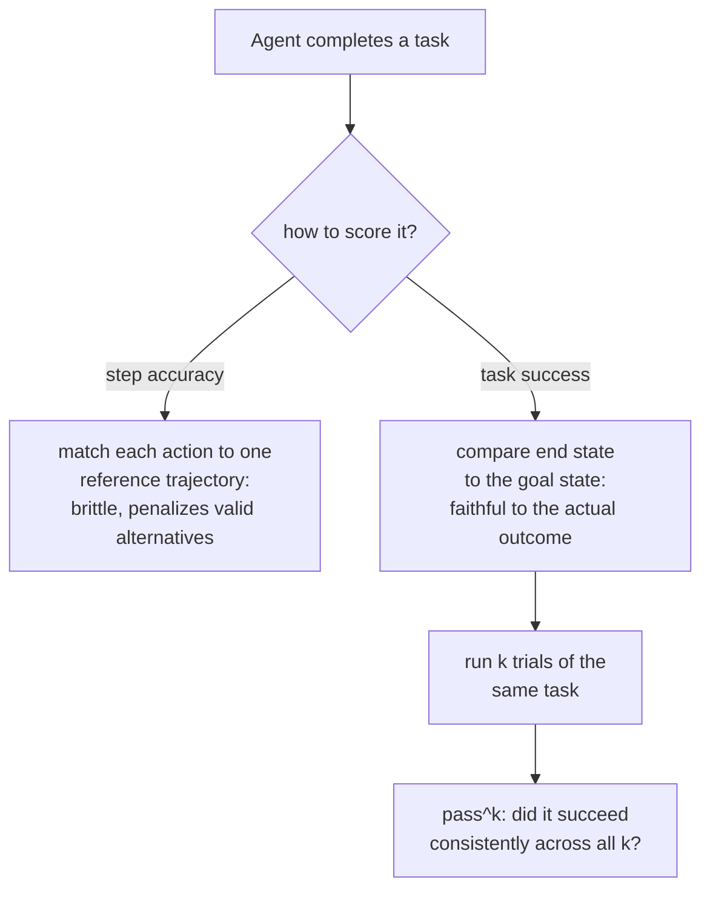

# Lección 13. Evaluar agentes y el uso de herramientas

**Vínculo con la misión:** La lección 4 estableció `pass@k` para el código: ejecutar el programa generado y comprobar su comportamiento, no su texto, porque un programa puede formularse de muchas maneras correctas distintas. Una tarea de agente plantea el mismo problema un nivel más arriba: no es una salida que comprobar, es una secuencia de llamadas a herramientas y decisiones a lo largo de varios turnos, y el mismo problema de "muchos caminos válidos, un resultado correcto" se aplica a toda la trayectoria, no solo a la respuesta final.
**Fuente principal:** [Paper: "τ-bench: A Benchmark for Tool-Agent-User Interaction in Real-World Domains", Yao et al., 2024](https://arxiv.org/abs/2406.12045)
**Requisitos previos:** [Lección 4](0004-code-execution-metrics.md), [Datos held-out](../GLOSSARY.md)

## Calentamiento

1. ▢ ¿Por qué la corrección funcional (ejecutar el código generado contra casos de prueba) evita el problema que tiene la comparación de texto por coincidencia exacta para evaluar código?

Comprobación

Dos programas pueden ser textualmente completamente distintos, con nombres de variables, flujo de control o algoritmos diferentes, y aun así ser igual de correctos; ejecutar el código y comprobar su comportamiento contra casos de prueba juzga lo que el programa realmente hace, no cuánto coincide su texto con una solución de referencia.

2. ▢ ¿Qué mide `pass@k`, y por qué volver a muestrear directamente k completaciones y comprobar si hay un acierto lo vuelve de alta varianza?

Comprobación

Si al menos una de k completaciones muestreadas pasa. Volver a muestrear y comprobar directamente es de alta varianza porque que esa muestra concreta de k incluya o no un acierto es en sí aleatorio; la fórmula del estimador insesgado evita esto agregando de forma matemática sobre un conjunto mayor de muestras en lugar de depender de una extracción concreta de k.

## Qué debes saber

### Una tarea de agente se juzga por una trayectoria, no por una respuesta

Una eval de un solo turno puntúa una salida. Una tarea **agéntica**, en cambio, produce una **trayectoria**: una secuencia de llamadas a herramientas, decisiones intermedias y turnos (a menudo a lo largo de una conversación de varios turnos con un usuario simulado) que en conjunto deben lograr algún objetivo final real, gestionar una devolución, actualizar un registro de una base de datos, resolver una solicitud de soporte bajo una política. Una métrica pensada para puntuar una respuesta, una coincidencia exacta, una puntuación BLEU, incluso una llamada de LLM-as-judge de un solo turno, no tiene aquí a qué aferrarse: no hay una única salida que comparar, solo una secuencia de acciones cuyo efecto global es lo que realmente importaba.

### El éxito de la tarea pregunta por el resultado, no por el camino que llevó a él

La forma más fiel de comprobar una trayectoria no es compararla, paso a paso, con una única secuencia de referencia de acciones, sino comprobar si la tarea realmente terminó en el estado correcto. El propio enfoque de evaluación de τ-bench toma exactamente esta decisión: compara el estado de la base de datos al final de una conversación con un estado objetivo anotado, en lugar de puntuar si cada llamada individual a una herramienta coincidió con una trayectoria de referencia predeterminada. Es deliberado, y es la versión a nivel de trayectoria del principio de corrección funcional de la lección 4: puede haber más de una secuencia válida de llamadas a herramientas que llegue al mismo resultado correcto, igual que puede haber más de un programa correcto, y puntuar contra una única trayectoria de referencia fija penalizaría por error un camino distinto e igual de válido hacia la misma respuesta correcta.

### La precisión por paso es una pregunta más estrecha y frágil que el éxito de la tarea

La **precisión por paso**, comprobar si cada acción de una trayectoria coincide con una acción de referencia concreta, es una medición más estricta y más frágil que el éxito de la tarea justo por esta razón: solo puede acreditar el único camino que se le dio como referencia, lo que repite el error original de la coincidencia exacta (lección 3) a escala de una trayectoria completa en lugar de una sola salida. La precisión por paso sigue teniendo sus usos, aislar exactamente qué paso de una trayectoria larga salió mal es valioso para depurar, pero no sustituye a la pregunta más importante que responde una métrica de éxito de la tarea: si el agente realmente cumplió el trabajo.

### Un éxito no significa que se pueda confiar en que el agente lo repita

Incluso una métrica de éxito de la tarea bien diseñada, medida una vez, esconde algo de lo que una eval de un solo turno nunca tuvo que preocuparse: si el mismo agente, ante exactamente la misma tarea de nuevo, vuelve a tener éxito. Los propios hallazgos de τ-bench lo concretan: en su benchmark, incluso un modelo sólido de llamadas a funciones tuvo éxito en menos de la mitad de las tareas en un solo intento, y su fiabilidad a lo largo de intentos repetidos de la *misma* tarea era sustancialmente peor aún, muy por debajo de una cuarta parte en un dominio. Por eso τ-bench introduce `pass^k` (léase "pass hat k"), una métrica de con qué fiabilidad tiene éxito un agente a lo largo de k intentos repetidos de una tarea, deliberadamente distinta del `pass@k` de la lección 4, que pregunta si *al menos una* de k muestras independientes tiene éxito. `pass^k` hace la pregunta más dura, de inclinación opuesta: si el agente sigue teniendo éxito, intento tras intento, en la misma tarea, en lugar de si puede tener éxito una vez con suficientes intentos.

### Por qué una eval por respuesta de etapas anteriores no se traslada aquí

Un modelo puede puntuar bien en un benchmark de un solo turno, por respuesta, y aun así rendir de forma muy distinta una vez que se coloca en un entorno de agente interactivo y de varios turnos, porque la toma de decisiones sostenida y de varios pasos bajo restricciones de herramientas y reglas de política ejercita una capacidad que una métrica de una sola respuesta nunca toca. Esta es exactamente la brecha que existen para cerrar los benchmarks creados a propósito para agentes (τ-bench y suites de varios entornos como AgentBench): no se limitan a reescalar una métrica por respuesta existente, miden algo que una eval por respuesta estructuralmente no puede medir.

## Práctica

1. ▢ Una eval de agentes puntúa una trayectoria comprobando si cada llamada a una herramienta coincide exactamente con una única secuencia de referencia de llamadas, y penaliza a un agente que llegó al resultado final correcto mediante una secuencia de llamadas distinta e igual de válida. ¿Qué error de una lección anterior repite esto?

Pista

Considera qué penaliza la puntuación de texto por coincidencia exacta que la corrección funcional no penaliza.

Comprobación

Repite el error de la coincidencia exacta (lección 3/4) a nivel de trayectoria: penalizar un resultado genuinamente correcto simplemente porque no coincidía con una forma de referencia concreta, aquí una secuencia específica de acciones en lugar de una cadena de texto específica.

2. ▢ ¿Por qué τ-bench compara el estado final de la base de datos con un estado objetivo anotado, en lugar de puntuar cada paso de la conversación contra una trayectoria de referencia?

Comprobación

Porque puede haber más de una secuencia válida de llamadas a herramientas que llegue al mismo resultado correcto; comparar solo el estado final acredita cualquier camino que llegue correctamente, mientras que puntuar contra una única trayectoria de referencia fija penalizaría por error un camino distinto e igual de válido.

3. ▢ Un modelo tiene éxito en una tarea el 45% de las veces en un solo intento. ¿Te dice esto con qué frecuencia tendría éxito en esa misma tarea si se le pidiera intentarla 8 veces seguidas?

Comprobación

No directamente. Una tasa de éxito de un solo intento no mide la consistencia a lo largo de intentos repetidos de la misma tarea; la métrica `pass^k` de τ-bench mide exactamente esa pregunta distinta, y sus hallazgos muestran que la fiabilidad a lo largo de intentos repetidos puede ser sustancialmente peor de lo que sugeriría por sí sola la tasa de éxito de un solo intento.

4. ▢ ¿En qué se diferencia `pass^k` del `pass@k` de la lección 4, pese al nombre y la notación parecidos?

Comprobación

`pass@k` pregunta si al menos una de k completaciones muestreadas de forma independiente tiene éxito, una pregunta de mejor de k. `pass^k` pregunta si un agente tiene éxito de forma consistente a lo largo de k intentos repetidos de la misma tarea, una pregunta de fiabilidad, más cercana al opuesto de "¿tuvo éxito al menos una vez?" que a un replanteamiento de ella.

5. ▢ ¿Qué afirmación describe correctamente en qué se diferencia la evaluación de agentes de una eval por respuesta?

    - a) La trayectoria de un agente debería puntuarse siempre por coincidencia exacta contra una única secuencia de referencia de llamadas a herramientas, ya que es la medición más fiel
    - b) Una métrica por respuesta no tiene una única salida a la que aferrarse en una trayectoria de agente de varios turnos; el éxito de la tarea (comparar el estado final con un estado objetivo) es más fiel que la precisión por paso, que repite la fragilidad de la coincidencia exacta, y el éxito en un solo intento no mide la pregunta distinta de la fiabilidad en intentos repetidos
    - c) El buen rendimiento de un modelo en benchmarks de un solo turno predice de forma fiable su rendimiento como agente de varios turnos
    - d) `pass^k` y `pass@k` miden lo mismo y pueden usarse indistintamente

Comprobación

**b)** Ese es el cuadro completo que establece esta lección. (a) es falsa: la comparación del estado final al estilo del éxito de la tarea se prefiere específicamente sobre la coincidencia rígida por pasos, por la misma razón por la que la corrección funcional supera a la coincidencia exacta. (c) es falsa: la toma de decisiones agéntica y de varios turnos ejercita capacidades que un benchmark de una sola respuesta nunca toca, que es justo la razón de que existan benchmarks dedicados a agentes. (d) es falsa: `pass@k` es una pregunta de capacidad de mejor de k; `pass^k` es una pregunta de consistencia a lo largo de intentos repetidos.

## Prácticas en el mundo real

- [ ] Para un agente o un sistema que use herramientas al que tengas acceso, comprueba si su evaluación (si la hay) puntúa el éxito de la tarea (estado final), la precisión por paso (coincidencia con una trayectoria de referencia) o ninguna de las dos.
- [ ] Si puedes ejecutar la misma tarea contra un agente varias veces, pruébala de 3 a 5 veces y anota si tiene éxito de forma consistente o solo en algunos de los intentos.
- [ ] Mañana: lee la descripción que hace la fuente primaria de su configuración de guías de política y anota cómo evalúa si un agente siguió una regla específica del dominio, no solo si llegó al estado final correcto de la base de datos.

## Para profundizar

- [Paper: "τ-bench: A Benchmark for Tool-Agent-User Interaction in Real-World Domains", Yao et al., 2024](https://arxiv.org/abs/2406.12045)
- [Paper: "AgentBench: Evaluating LLMs as Agents", Liu et al., 2023](https://arxiv.org/abs/2308.03688)
- [Recursos](../RESOURCES.md)

---

¿No termina de quedar claro? Vuelve a leer la fuente primaria de arriba, ya que esta lección la comprime y en la compresión es donde se escapa la comprensión. Consulta el [glosario](../GLOSSARY.md) por si algún término te resultó resbaladizo.

Si lo poco claro es la propia lección y no el material, eso es un defecto: [abre un issue](https://github.com/TokenCemetery/teach/issues).
