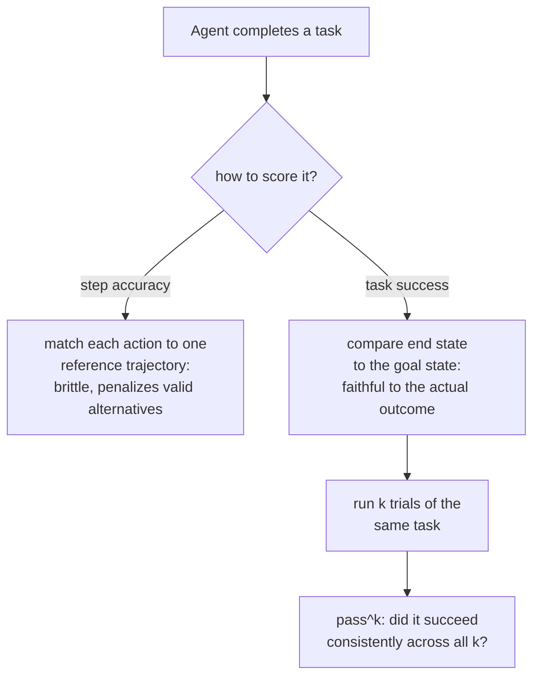

# Leçon 13. Évaluer les agents et l'usage d'outils

**Lien avec la mission :** La leçon 4 a établi `pass@k` pour le code : exécuter le programme généré et vérifier son comportement, pas son texte, parce qu'un programme peut s'écrire de nombreuses manières correctes différentes. Une tâche d'agent pose le même problème un niveau plus haut : ce n'est pas une sortie à vérifier, c'est une séquence d'appels d'outils et de décisions sur plusieurs tours, et le même problème « de nombreux chemins valables, un seul bon résultat » s'applique à toute la trajectoire, pas seulement à la réponse finale.
**Source primaire :** [Article : "τ-bench: A Benchmark for Tool-Agent-User Interaction in Real-World Domains", Yao et al., 2024](https://arxiv.org/abs/2406.12045)
**Prérequis :** [Leçon 4](0004-code-execution-metrics.md), [Données held-out](../GLOSSARY.md)

## Échauffement

1. ▢ Pourquoi la correction fonctionnelle (exécuter du code généré sur des cas de test) évite-t-elle le problème que pose la comparaison de texte par exact match pour évaluer du code ?

Vérifier

Deux programmes peuvent être textuellement complètement différents, avec d'autres noms de variables, un autre flot de contrôle ou d'autres algorithmes, et être pourtant tout aussi corrects ; exécuter le code et vérifier son comportement sur des cas de test juge ce que le programme fait réellement, pas la ressemblance de son texte avec une solution de référence.

2. ▢ Que mesure `pass@k`, et pourquoi rééchantillonner directement k complétions et chercher un succès le rend-il à forte variance ?

Vérifier

Si au moins une de k complétions échantillonnées passe. Rééchantillonner et vérifier directement est à forte variance parce que le fait que ce tirage précis de k inclue ou non un succès est lui-même aléatoire ; la formule de l'estimateur non biaisé évite cela en agrégeant mathématiquement sur un plus grand pool d'échantillons plutôt qu'en s'appuyant sur un tirage particulier de k.

## À savoir

### Une tâche d'agent se juge sur une trajectoire, pas sur une réponse

Une eval à un seul tour note une sortie. Une tâche **agentique** produit au contraire une **trajectoire** : une séquence d'appels d'outils, de décisions intermédiaires et de tours (souvent au fil d'une conversation à plusieurs tours avec un utilisateur simulé) qui doivent ensemble accomplir un vrai but final, enregistrer un retour, mettre à jour une fiche en base, résoudre une demande de support selon une politique. Une métrique conçue pour noter une réponse, un exact match, un score BLEU, même un appel de LLM-as-judge à un seul tour, n'a ici rien à quoi se rattacher : il n'y a pas de sortie unique à comparer, seulement une séquence d'actions dont l'effet global est ce qui comptait réellement.

### La réussite de la tâche interroge le résultat, pas le chemin emprunté

La façon la plus fidèle de vérifier une trajectoire n'est pas de la comparer, étape par étape, à une seule séquence d'actions de référence, c'est de vérifier si la tâche s'est réellement terminée dans le bon état. L'approche d'évaluation de τ-bench fait exactement ce choix : elle compare l'état de la base de données à la fin d'une conversation à un état cible annoté, au lieu de vérifier si chaque appel d'outil individuel correspondait à une trajectoire de référence prédéterminée. C'est délibéré, et c'est la version au niveau de la trajectoire du principe de correction fonctionnelle de la leçon 4 : il peut y avoir plus d'une séquence valable d'appels d'outils qui atteint le même bon résultat, comme il peut y avoir plus d'un programme correct, et noter face à une seule trajectoire de référence fixe pénaliserait à tort un chemin différent, tout aussi valable, vers la même bonne réponse.

### La précision par étape est une question plus étroite et plus fragile que la réussite de la tâche

La **précision par étape**, qui vérifie si chaque action d'une trajectoire correspond à une action de référence précise, est une mesure plus stricte et plus fragile que la réussite de la tâche précisément pour cette raison : elle ne peut créditer que l'unique chemin qu'on lui a donné comme référence, ce qui répète l'erreur d'origine de l'exact match (leçon 3) à l'échelle d'une trajectoire entière au lieu d'une seule sortie. La précision par étape garde ses usages, isoler exactement quelle étape d'une longue trajectoire a mal tourné est précieux pour le débogage, mais elle ne remplace pas la question plus importante à laquelle répond une métrique de réussite de la tâche : l'agent a-t-il réellement fait le travail.

### Un succès ne signifie pas qu'on peut compter sur l'agent pour le répéter

Même une métrique de réussite de la tâche bien conçue, mesurée une fois, cache quelque chose dont une eval à un seul tour n'avait pas à se soucier : le même agent, face à la même tâche, réussit-il de nouveau. Les constats de τ-bench lui-même le rendent concret : sur leur benchmark, même un modèle performant en appel de fonctions réussissait moins de la moitié des tâches en un seul essai, et sa fiabilité sur des essais répétés de la *même* tâche était nettement pire encore, bien en dessous d'un quart dans un domaine. C'est précisément pourquoi τ-bench introduit `pass^k` (lire « pass hat k »), une métrique de la fiabilité avec laquelle un agent réussit sur k essais répétés d'une même tâche, délibérément distincte du `pass@k` de la leçon 4, qui demande si *au moins un* de k échantillons indépendants réussit. `pass^k` pose la question plus dure, de sens opposé : l'agent continue-t-il de réussir, essai après essai, la même tâche, plutôt que de savoir s'il peut réussir une fois avec assez d'essais.

### Pourquoi une eval par réponse des étapes précédentes ne se transpose pas ici

Un modèle peut bien réussir un benchmark à un seul tour, par réponse, et se comporter pourtant très différemment une fois placé dans un cadre d'agent interactif à plusieurs tours, parce que la prise de décision soutenue, en plusieurs étapes, sous contraintes d'outils et règles de politique, sollicite une capacité qu'une métrique par réponse ne touche jamais. C'est exactement l'écart que comblent les benchmarks conçus pour les agents (τ-bench, et des suites multi-environnements comme AgentBench) : ils ne se contentent pas de remettre à l'échelle une métrique par réponse existante, ils mesurent quelque chose qu'une eval par réponse ne peut structurellement pas mesurer.

## Pratique

1. ▢ Une eval d'agent note une trajectoire en vérifiant si chaque appel d'outil correspond exactement à une seule séquence d'appels de référence, et pénalise un agent qui a atteint le bon résultat final par une séquence d'appels différente, tout aussi valable. Quelle erreur d'une leçon précédente cela répète-t-il ?

Indice

Demandez-vous ce que la notation de texte par exact match pénalise et que la correction fonctionnelle ne pénalise pas.

Vérifier

Cela répète l'erreur de l'exact match (leçons 3 et 4) au niveau de la trajectoire : pénaliser un résultat réellement correct simplement parce qu'il ne correspondait pas à une forme de référence précise, ici une séquence d'actions précise plutôt qu'une chaîne de texte précise.

2. ▢ Pourquoi τ-bench compare-t-il l'état final de la base de données à un état cible annoté, plutôt que de noter chaque étape de la conversation face à une trajectoire de référence ?

Vérifier

Parce qu'il peut y avoir plus d'une séquence valable d'appels d'outils qui atteint le même bon résultat ; comparer seulement l'état final crédite tout chemin qui y arrive correctement, alors que noter face à une seule trajectoire de référence fixe pénaliserait à tort un chemin différent, tout aussi valable.

3. ▢ Un modèle réussit une tâche 45 % du temps en un seul essai. Cela vous dit-il à quelle fréquence il réussirait cette même tâche si on lui demandait de la tenter 8 fois de suite ?

Vérifier

Pas directement. Un taux de réussite sur un seul essai ne mesure pas la constance sur des tentatives répétées de la même tâche ; la métrique `pass^k` de τ-bench mesure précisément cette question distincte, et leurs constats montrent que la fiabilité sur des essais répétés peut être nettement pire que ce que le seul taux de réussite sur un essai suggérerait.

4. ▢ En quoi `pass^k` diffère-t-il du `pass@k` de la leçon 4, malgré la ressemblance du nom et de la notation ?

Vérifier

`pass@k` demande si au moins une de k complétions échantillonnées indépendamment réussit, une question de meilleur-de-k. `pass^k` demande si un agent réussit de façon constante sur k essais répétés de la même tâche, une question de fiabilité, plus proche de l'opposé de « a-t-il réussi au moins une fois » que d'une reformulation.

5. ▢ Laquelle de ces affirmations décrit correctement en quoi l'évaluation d'agents diffère d'une eval par réponse ?

    - a) La trajectoire d'un agent devrait toujours être notée par exact match face à une seule séquence d'appels d'outils de référence, puisque c'est la mesure la plus fidèle
    - b) Une métrique par réponse n'a pas de sortie unique à laquelle se rattacher dans une trajectoire d'agent à plusieurs tours ; la réussite de la tâche (comparer l'état final à un état cible) est plus fidèle que la précision par étape, qui répète la fragilité de l'exact match, et la réussite sur un seul essai ne mesure pas la question distincte de la fiabilité sur essais répétés
    - c) La bonne performance d'un modèle sur des benchmarks à un seul tour prédit de façon fiable sa performance comme agent à plusieurs tours
    - d) `pass^k` et `pass@k` mesurent la même chose et sont interchangeables

Vérifier

**b)** C'est le tableau complet qu'établit cette leçon. (a) est faux : une comparaison d'état final de type réussite de la tâche est préférée spécifiquement à une correspondance rigide étape par étape, pour la même raison que la correction fonctionnelle l'emporte sur l'exact match. (c) est faux : la prise de décision agentique à plusieurs tours sollicite des capacités qu'un benchmark par réponse ne touche jamais, ce qui explique précisément l'existence de benchmarks d'agents dédiés. (d) est faux : `pass@k` est une question de capacité en meilleur-de-k ; `pass^k` est une question de constance sur essais répétés.

## Exercices en situation réelle

- [ ] Pour un agent ou un système qui utilise des outils auquel vous avez accès, vérifiez si son évaluation (s'il y en a une) note la réussite de la tâche (état final), la précision par étape (correspondance à une trajectoire de référence), ou aucune des deux.
- [ ] Si vous pouvez exécuter la même tâche plusieurs fois sur un agent, essayez 3 à 5 fois et notez s'il réussit de façon constante ou seulement une partie des tentatives.
- [ ] Demain : lisez dans la source primaire la description de son dispositif de directives de politique, et notez comment elle évalue si un agent a suivi une règle propre au domaine, et pas seulement s'il a atteint le bon état final de la base de données.

## Pour aller plus loin

- [Article : "τ-bench: A Benchmark for Tool-Agent-User Interaction in Real-World Domains", Yao et al., 2024](https://arxiv.org/abs/2406.12045)
- [Article : "AgentBench: Evaluating LLMs as Agents", Liu et al., 2023](https://arxiv.org/abs/2308.03688)
- [Ressources](../RESOURCES.md)

---

Ça ne passe pas ? Relisez la source primaire en haut de page, car cette leçon la condense et c'est dans la condensation que la compréhension s'échappe. Consultez le [glossaire](../GLOSSARY.md) pour tout terme qui vous a paru glissant.

Si c'est la leçon elle-même qui n'est pas claire plutôt que la matière, c'est un défaut : [ouvrez une issue](https://github.com/TokenCemetery/teach/issues).
