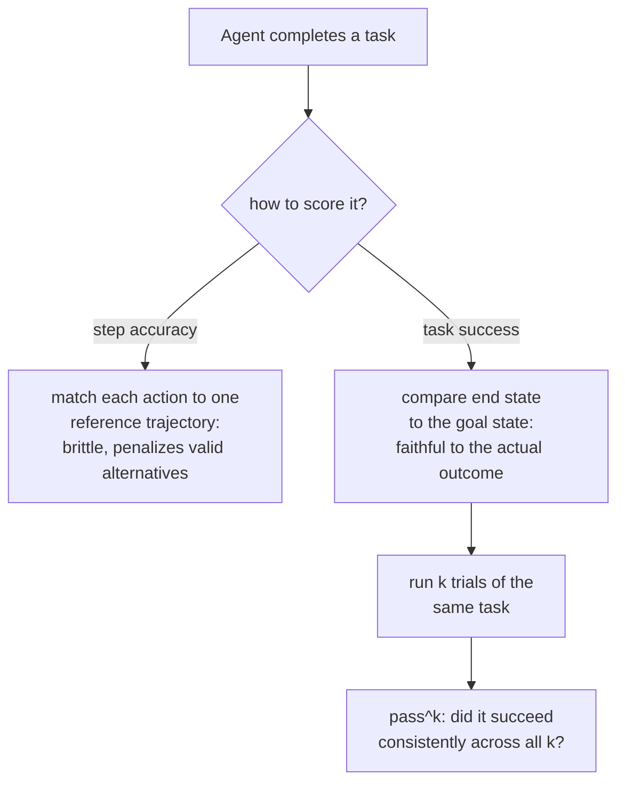

# पाठ 13. Agents और Tool Use का Evaluation

**मिशन से संबंध:** पाठ 4 ने code के लिए `pass@k` स्थापित किया: generate किए program को चलाएँ और उसका व्यवहार जाँचें, उसका text नहीं, क्योंकि program कई अलग-अलग सही ढंग से लिखा जा सकता है। Agent का task वही समस्या एक स्तर ऊपर उठाता है: वह जाँचने के लिए एक output नहीं, कई turns में tool calls और फ़ैसलों की शृंखला है, और "कई वैध रास्ते, एक सही नतीजा" की वही समस्या पूरी trajectory पर लागू होती है, सिर्फ़ अंतिम response पर नहीं।
**मुख्य स्रोत:** [पेपर: "τ-bench: A Benchmark for Tool-Agent-User Interaction in Real-World Domains", Yao et al., 2024](https://arxiv.org/abs/2406.12045)
**पूर्व-आवश्यकताएँ:** [पाठ 4](0004-code-execution-metrics.md), [Held-out data](../GLOSSARY.md)

## वार्म-अप

1. ▢ Functional correctness (generate किए code को test cases पर चलाना) उस समस्या से क्यों बच जाती है जो code के evaluation में exact-match text तुलना को होती है?

जाँचें

दो programs text के स्तर पर बिल्कुल अलग हो सकते हैं, अलग variable नामों, control flow या algorithms के साथ, और फिर भी बराबर सही हो सकते हैं; code को चलाना और test cases के विरुद्ध उसका व्यवहार जाँचना यह परखता है कि program असल में क्या करता है, यह नहीं कि उसका text किसी एक reference हल से कितना मिलता है।

2. ▢ `pass@k` क्या मापता है, और k completions को सीधे दोबारा sample करके सफलता जाँचना उसे उच्च-variance क्यों बनाता है?

जाँचें

यह कि k sample की गई completions में से कम से कम एक पास होती है या नहीं। सीधे दोबारा sample करके जाँचना उच्च-variance है क्योंकि k का वह ख़ास sample सफलता शामिल करता है या नहीं, यह ख़ुद यादृच्छिक है; unbiased estimator का सूत्र इससे बचता है, k के किसी एक ख़ास चुनाव पर निर्भर रहने के बजाय samples के बड़े पूल पर गणितीय रूप से aggregate करके।

## यह जानें

### Agent के task को trajectory पर परखा जाता है, response पर नहीं

Single-turn eval एक output score करता है। **Agentic** task इसके बजाय **trajectory** पैदा करता है: tool calls, बीच के फ़ैसलों और turns की शृंखला (अक्सर किसी simulated उपयोगकर्ता के साथ बहु-turn बातचीत में) जो मिलकर किसी असली अंतिम लक्ष्य को पूरा करने वाली होती है, जैसे return book करना, database record अपडेट करना, किसी policy के तहत support अनुरोध सुलझाना। एक response को score करने के लिए बनी metric, चाहे exact match हो, BLEU score हो, या single-turn LLM-as-judge call भी, यहाँ जुड़ने के लिए कुछ नहीं पाती: तुलना करने के लिए कोई एक output नहीं है, सिर्फ़ क्रियाओं की शृंखला है जिसका कुल असर ही असल में मायने रखता था।

### Task success नतीजे के बारे में पूछता है, उस तक पहुँचने के रास्ते के बारे में नहीं

Trajectory को जाँचने का सबसे भरोसेमंद तरीक़ा उसकी क्रियाओं की एक reference शृंखला से क़दम-दर-क़दम तुलना करना नहीं है, बल्कि यह जाँचना है कि task सही अवस्था में ख़त्म हुआ या नहीं। τ-bench का अपना evaluation तरीक़ा ठीक यही चुनाव करता है: वह बातचीत के अंत में database की अवस्था की तुलना annotate की गई लक्ष्य-अवस्था से करता है, यह score करने के बजाय कि हर अलग tool call पूर्व-निर्धारित reference trajectory से मेल खाया या नहीं। यह जानबूझकर है, और यह पाठ 4 के functional-correctness सिद्धांत का trajectory-स्तर का रूप है: tool calls की एक से ज़्यादा वैध शृंखलाएँ उसी सही नतीजे तक पहुँच सकती हैं, ठीक वैसे ही जैसे एक से ज़्यादा सही program हो सकते हैं, और एक तय reference trajectory के सामने score करना उसी सही उत्तर तक पहुँचने वाले दूसरे, उतने ही वैध रास्ते को ग़लत तरीक़े से दंडित करेगा।

### Step accuracy, task success से ज़्यादा संकरा, भुरभुरा सवाल है

**Step accuracy**, यानी यह जाँचना कि trajectory की हर क्रिया किसी ख़ास reference क्रिया से मेल खाती है या नहीं, ठीक इसी कारण task success से ज़्यादा सख़्त और ज़्यादा नाज़ुक माप है: वह सिर्फ़ उसी एक रास्ते को श्रेय दे सकता है जो उसे reference के रूप में दिया गया, जो exact match की मूल ग़लती (पाठ 3) को एक अकेले output के बजाय पूरी trajectory के पैमाने पर दोहराता है। Step accuracy के अपने उपयोग हैं, लंबी trajectory में ठीक किस क़दम पर गड़बड़ हुई यह अलग करना debugging के लिए मूल्यवान है, पर वह उस ज़्यादा ज़रूरी सवाल का विकल्प नहीं जिसका जवाब task-success metric देती है: क्या agent ने असल में काम पूरा किया।

### एक सफलता का मतलब यह नहीं कि agent पर उसे दोहराने का भरोसा किया जा सकता है

अच्छी तरह डिज़ाइन की गई task-success metric भी, एक बार मापी जाए तो, वह चीज़ छिपा देती है जिसकी चिंता single-turn eval को कभी करनी नहीं पड़ी: क्या वही agent, वही task दोबारा मिलने पर, फिर सफल होता है। τ-bench के अपने निष्कर्ष इसे ठोस बनाते हैं: उनके benchmark पर, मज़बूत function-calling model भी एक trial में आधे से कम tasks पर सफल रहा, और *उसी* task के दोहराए गए trials में उसकी विश्वसनीयता और भी काफ़ी बुरी थी, एक domain में चौथाई से काफ़ी कम। यही कारण है कि τ-bench `pass^k` ("pass hat k" पढ़ें) लाता है, यह मापने की metric कि agent एक task के k दोहराए गए trials में कितनी भरोसेमंदी से सफल होता है, जो जानबूझकर पाठ 4 के `pass@k` से अलग है, जो पूछता है कि k स्वतंत्र samples में से *कम से कम एक* सफल होता है या नहीं। `pass^k` कठिन, उलटी ओर झुका सवाल पूछता है: क्या agent उसी task पर trial-दर-trial सफल होता रहता है, न कि यह कि पर्याप्त कोशिशें मिलने पर वह एक बार सफल हो सकता है या नहीं।

### पहले चरणों का per-response eval यहाँ क्यों नहीं चलता

Model single-turn, per-response benchmark पर अच्छा score कर सकता है और फिर भी बहु-turn, interactive agent setting में रखे जाने पर बहुत अलग प्रदर्शन कर सकता है, क्योंकि tool की बाध्यताओं और policy नियमों के तहत लगातार, बहु-चरणीय निर्णय लेना ऐसी क्षमता को परखता है जिसे single-response metric छूती ही नहीं। यही वह ख़ाली जगह है जिसे agents के लिए ख़ास तौर पर बने benchmarks (τ-bench, और AgentBench जैसे बहु-environment suites) भरने के लिए हैं: वे मौजूदा per-response metric का पैमाना भर नहीं बदलते, वे कुछ ऐसा मापते हैं जो per-response eval संरचनात्मक रूप से माप नहीं सकता।

## अभ्यास

1. ▢ एक agent eval trajectory को यह जाँचकर score करता है कि क्या हर tool call calls की एक अकेली reference शृंखला से बिल्कुल मेल खाता है, और ऐसे agent को दंडित करता है जो अलग, उतनी ही वैध calls की शृंखला से सही अंतिम नतीजे तक पहुँचा। यह पिछले पाठ की कौन-सी ग़लती दोहराता है?

संकेत

सोचें कि exact-match text scoring किसे दंडित करती है जिसे functional correctness नहीं करती।

जाँचें

यह exact match की ग़लती (पाठ 3/4) को trajectory के स्तर पर दोहराता है: सचमुच सही नतीजे को सिर्फ़ इसलिए दंडित करना कि वह किसी एक ख़ास reference रूप से मेल नहीं खाया, यहाँ text की किसी ख़ास string के बजाय क्रियाओं की किसी ख़ास शृंखला से।

2. ▢ τ-bench हर बातचीत-चरण को reference trajectory के सामने score करने के बजाय database की अंतिम अवस्था की तुलना annotate की गई लक्ष्य-अवस्था से क्यों करता है?

जाँचें

क्योंकि tool calls की एक से ज़्यादा वैध शृंखलाएँ उसी सही नतीजे तक पहुँच सकती हैं; सिर्फ़ अंतिम अवस्था की तुलना हर उस रास्ते को श्रेय देती है जो सही तरह वहाँ पहुँचे, जबकि एक तय reference trajectory के सामने score करना दूसरे, उतने ही वैध रास्ते को ग़लत तरीक़े से दंडित करेगा।

3. ▢ एक model किसी task पर एक trial में 45% बार सफल होता है। क्या इससे पता चलता है कि उसी task को लगातार 8 बार आज़माने को कहा जाए तो वह कितनी बार सफल होगा?

जाँचें

सीधे तौर पर नहीं। एक trial की सफलता दर उसी task पर दोहराई गई कोशिशों में एकरूपता नहीं मापती; τ-bench की `pass^k` metric ठीक वही अलग सवाल मापती है, और उनके निष्कर्ष दिखाते हैं कि दोहराए गए trials में विश्वसनीयता अकेली एक-trial सफलता दर के सुझाव से काफ़ी बुरी हो सकती है।

4. ▢ मिलते-जुलते नाम और संकेतन के बावजूद `pass^k` पाठ 4 के `pass@k` से कैसे अलग है?

जाँचें

`pass@k` पूछता है कि k स्वतंत्र रूप से sample की गई completions में से कम से कम एक सफल होती है या नहीं, यानी best-of-k का सवाल। `pass^k` पूछता है कि agent एक ही task के k दोहराए गए trials में लगातार सफल होता है या नहीं, यानी विश्वसनीयता का सवाल, जो "क्या वह कम से कम एक बार सफल हुआ" का दोहराव कम और उसके उलट के ज़्यादा क़रीब है।

5. ▢ Agent evaluation per-response eval से कैसे अलग है, इसका सही वर्णन कौन-सा दावा करता है?

    - a) Agent की trajectory को हमेशा tool calls की एक reference शृंखला के विरुद्ध exact match से score करना चाहिए, क्योंकि यह सबसे भरोसेमंद माप है
    - b) बहु-turn agent trajectory में per-response metric के पास जुड़ने के लिए कोई एक output नहीं होता; task success (अंतिम अवस्था की लक्ष्य-अवस्था से तुलना) step accuracy से ज़्यादा भरोसेमंद है, जो exact match की भुरभुराहट दोहराती है, और एक-trial की सफलता दोहराए गए trials की विश्वसनीयता के अलग सवाल को नहीं मापती
    - c) Single-turn benchmarks पर model का मज़बूत प्रदर्शन बहु-turn agent के रूप में उसके प्रदर्शन की भरोसेमंद भविष्यवाणी करता है
    - d) `pass^k` और `pass@k` एक ही चीज़ मापते हैं और एक-दूसरे की जगह इस्तेमाल हो सकते हैं

जाँचें

**b)** यही वह पूरी तस्वीर है जो यह पाठ स्थापित करता है। (a) ग़लत है: task-success-शैली की अंतिम-अवस्था तुलना को कठोर step matching पर ख़ास तौर पर तरजीह दी जाती है, उसी कारण से जिससे functional correctness exact match से बेहतर है। (c) ग़लत है: agentic, बहु-turn निर्णय लेना ऐसी क्षमताओं को परखता है जिन्हें single-response benchmark छूता ही नहीं, और ठीक इसीलिए समर्पित agent benchmarks मौजूद हैं। (d) ग़लत है: `pass@k` best-of-k क्षमता का सवाल है; `pass^k` दोहराए गए trials में एकरूपता का सवाल है।

## असली दुनिया का अभ्यास

- [ ] जिस agent या tool-इस्तेमाल करने वाले system तक आपकी पहुँच है, उसके लिए जाँचें कि उसका evaluation (अगर कोई है) task success (अंतिम अवस्था), step accuracy (reference trajectory से मिलान), या दोनों में से कोई नहीं, किसे score करता है।
- [ ] अगर आप वही task किसी agent पर कई बार चला सकते हैं, तो उसे 3 से 5 बार आज़माएँ और लिखें कि वह लगातार सफल होता है या सिर्फ़ कुछ कोशिशों में।
- [ ] कल: मुख्य स्रोत में उसकी policy-guideline setup का वर्णन पढ़ें, और लिखें कि वह यह कैसे परखता है कि agent ने किसी domain-विशिष्ट नियम का पालन किया, सिर्फ़ यह नहीं कि वह सही database अंतिम अवस्था तक पहुँचा।

## आगे बढ़ने के लिए

- [पेपर: "τ-bench: A Benchmark for Tool-Agent-User Interaction in Real-World Domains", Yao et al., 2024](https://arxiv.org/abs/2406.12045)
- [पेपर: "AgentBench: Evaluating LLMs as Agents", Liu et al., 2023](https://arxiv.org/abs/2308.03688)
- [संसाधन](../RESOURCES.md)

---

बात नहीं बन रही? ऊपर दिए primary source को दोबारा पढ़ें, क्योंकि यह पाठ उसे संक्षिप्त करता है और समझ संक्षेप में ही रिसती है। जो शब्द फिसलन भरा लगे, उसके लिए [शब्दावली](../GLOSSARY.md) देखें।

अगर दिक़्क़त सामग्री की नहीं बल्कि पाठ की ही है, तो वह एक खोट है: [issue खोलें](https://github.com/TokenCemetery/teach/issues)।
