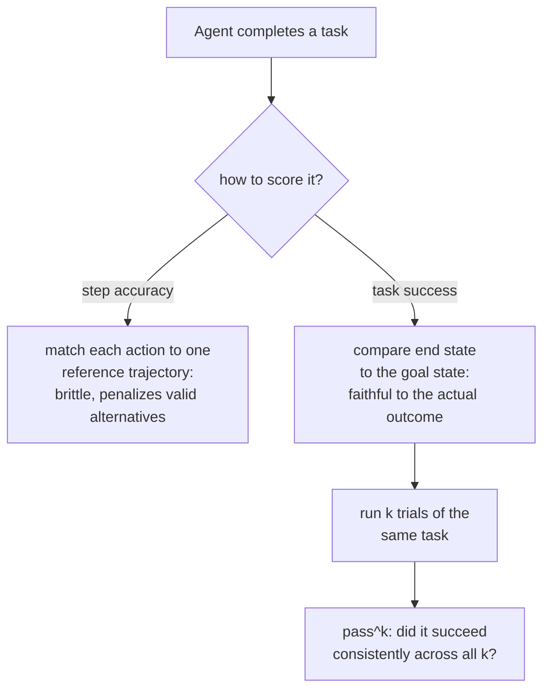

# Lição 13. Avaliando agentes e uso de ferramentas

**Ligação com a missão:** A lição 4 estabeleceu o `pass@k` para código: executar o programa gerado e verificar seu comportamento, e não seu texto, porque um programa pode ser formulado de muitas maneiras corretas diferentes. Uma tarefa de agente levanta o mesmo problema um nível acima: não é uma saída a verificar, é uma sequência de chamadas de ferramenta e decisões ao longo de vários turnos, e o mesmo problema de "muitos caminhos válidos, um resultado correto" se aplica à trajetória inteira, e não apenas à resposta final.
**Fonte principal:** [Artigo científico: "τ-bench: A Benchmark for Tool-Agent-User Interaction in Real-World Domains", Yao et al., 2024](https://arxiv.org/abs/2406.12045)
**Pré-requisitos:** [Lição 4](0004-code-execution-metrics.md), [Dados held-out](../GLOSSARY.md)

## Aquecimento

1. ▢ Por que a correção funcional (executar o código gerado contra casos de teste) evita o problema que a comparação de texto por exact match tem ao avaliar código?

Verificação

Dois programas podem ser textualmente muito diferentes, usando nomes de variáveis, fluxo de controle ou algoritmos diferentes, e ainda assim estar igualmente corretos; executar o código e verificar seu comportamento contra casos de teste julga o que o programa de fato faz, e não o quanto seu texto se parece com uma solução de referência.

2. ▢ O que o `pass@k` mede, e por que reamostrar diretamente k completions e verificar se há um sucesso o torna de alta variância?

Verificação

Se pelo menos uma de k completions amostradas passa. Reamostrar e verificar diretamente tem alta variância porque o fato de aquela amostra específica de k incluir um sucesso é ele próprio aleatório; a fórmula do estimador não enviesado evita isso agregando matematicamente sobre um conjunto maior de amostras, em vez de depender de uma retirada específica de k.

## Saiba isto

### Uma tarefa de agente é julgada sobre uma trajetória, não sobre uma resposta

Um eval de turno único pontua uma saída. Uma tarefa **agêntica**, em vez disso, produz uma **trajetória**: uma sequência de chamadas de ferramenta, decisões intermediárias e turnos (muitas vezes ao longo de uma conversa de vários turnos com um usuário simulado) que juntos devem cumprir algum objetivo final real, agendar uma devolução, atualizar um registro de banco de dados, resolver uma solicitação de suporte sob uma política. Uma métrica feita para pontuar uma resposta, um exact match, uma pontuação BLEU, até uma única chamada de LLM-as-judge de turno único, não tem onde se apoiar aqui: não há uma única saída para comparar, apenas uma sequência de ações cujo efeito geral é o que de fato importou.

### O sucesso na tarefa pergunta pelo resultado, não pelo caminho percorrido até ele

A forma mais fiel de verificar uma trajetória não é compará-la, passo a passo, com uma única sequência de ações de referência, e sim verificar se a tarefa de fato terminou no estado certo. A própria abordagem de avaliação do τ-bench faz exatamente essa escolha: compara o estado do banco de dados ao fim de uma conversa com um estado-alvo anotado, em vez de pontuar se cada chamada de ferramenta individual coincidiu com uma trajetória de referência predeterminada. Isso é deliberado, e é a versão em nível de trajetória do princípio de correção funcional da lição 4: pode haver mais de uma sequência válida de chamadas de ferramenta que chega ao mesmo resultado correto, assim como pode haver mais de um programa correto, e pontuar contra uma única trajetória de referência fixa penalizaria indevidamente um caminho diferente e igualmente válido para a mesma resposta certa.

### A acurácia por passo é uma pergunta mais estreita e frágil que o sucesso na tarefa

A **acurácia por passo**, verificar se cada ação de uma trajetória coincide com uma ação de referência específica, é uma medição mais rígida e frágil que o sucesso na tarefa exatamente por esse motivo: ela só consegue creditar o único caminho que recebeu como referência, o que repete o erro original do exact match (lição 3) na escala de uma trajetória inteira em vez de uma única saída. A acurácia por passo ainda tem seus usos, isolar exatamente qual passo de uma trajetória longa deu errado é valioso para depuração, mas não substitui a pergunta mais importante que uma métrica de sucesso na tarefa responde: o agente de fato fez o trabalho.

### Um sucesso não significa que se pode confiar no agente para repeti-lo

Mesmo uma métrica de sucesso na tarefa bem projetada, medida uma vez, esconde algo com que um eval de turno único nunca precisou se preocupar: se o mesmo agente, recebendo exatamente a mesma tarefa de novo, tem sucesso de novo. Os próprios resultados do τ-bench tornam isso concreto: no benchmark deles, até um modelo forte de function calling teve sucesso em menos da metade das tarefas em uma única tentativa, e sua confiabilidade em tentativas repetidas da *mesma* tarefa foi substancialmente pior ainda, bem abaixo de um quarto em um domínio. É exatamente por isso que o τ-bench introduz o `pass^k` (leia-se "pass hat k"), uma métrica de com que confiabilidade um agente tem sucesso ao longo de k tentativas repetidas de uma tarefa, deliberadamente distinta do `pass@k` da lição 4, que pergunta se *pelo menos uma* de k amostras independentes tem sucesso. O `pass^k` faz a pergunta mais difícil, de inclinação oposta: o agente continua tendo sucesso, tentativa após tentativa, na mesma tarefa, e não se ele consegue ter sucesso uma vez, dadas tentativas suficientes.

### Por que um eval por resposta das etapas anteriores não se transfere para cá

Um modelo pode pontuar bem em um benchmark de turno único, por resposta, e ainda assim se comportar de modo muito diferente quando colocado em um cenário de agente interativo, de vários turnos, porque a tomada de decisão sustentada, em vários passos, sob restrições de ferramentas e regras de política, exercita uma capacidade que uma métrica de resposta única nunca toca. Essa é exatamente a lacuna que os benchmarks feitos sob medida para agentes (o τ-bench e suítes de vários ambientes como o AgentBench) existem para fechar: eles não apenas reescalam uma métrica por resposta existente, medem algo que um eval por resposta estruturalmente não consegue.

## Prática

1. ▢ Um eval de agente pontua uma trajetória verificando se cada chamada de ferramenta coincide exatamente com uma única sequência de chamadas de referência, e penaliza um agente que chegou ao resultado final correto por uma sequência de chamadas diferente e igualmente válida. Que erro de uma lição anterior isso repete?

Dica

Considere o que a pontuação de texto por exact match penaliza e a correção funcional não.

Verificação

Repete o erro do exact match (lição 3/4) em nível de trajetória: penalizar um resultado genuinamente correto simplesmente porque não coincidiu com uma forma de referência específica, aqui uma sequência específica de ações em vez de uma string específica de texto.

2. ▢ Por que o τ-bench compara o estado final do banco de dados com um estado-alvo anotado, em vez de pontuar cada passo da conversa contra uma trajetória de referência?

Verificação

Porque pode haver mais de uma sequência válida de chamadas de ferramenta que chega ao mesmo resultado correto; comparar apenas o estado final credita qualquer caminho que chegue lá corretamente, enquanto pontuar contra uma única trajetória de referência fixa penalizaria indevidamente um caminho diferente e igualmente válido.

3. ▢ Um modelo tem sucesso em uma tarefa 45% das vezes em uma única tentativa. Isso diz com que frequência ele teria sucesso nessa mesma tarefa se lhe pedissem para tentar 8 vezes seguidas?

Verificação

Não diretamente. Uma taxa de sucesso de tentativa única não mede a consistência em tentativas repetidas da mesma tarefa; a métrica `pass^k` do τ-bench mede exatamente essa pergunta separada, e os resultados deles mostram que a confiabilidade em tentativas repetidas pode ser substancialmente pior do que a taxa de sucesso de uma única tentativa sugeriria.

4. ▢ Como o `pass^k` difere do `pass@k` da lição 4, apesar do nome e da notação parecidos?

Verificação

O `pass@k` pergunta se pelo menos uma de k completions amostradas de forma independente tem sucesso, uma pergunta de melhor entre k. O `pass^k` pergunta se um agente tem sucesso de forma consistente ao longo de k tentativas repetidas da mesma tarefa, uma pergunta de confiabilidade, mais próxima do oposto de "teve sucesso pelo menos uma vez" do que uma reformulação dela.

5. ▢ Qual afirmação descreve corretamente como a avaliação de agentes difere de um eval por resposta?

    - a) A trajetória de um agente deve sempre ser pontuada por exact match contra uma única sequência de chamadas de ferramenta de referência, já que essa é a medição mais fiel
    - b) Uma métrica por resposta não tem uma única saída onde se apoiar em uma trajetória de agente de vários turnos; o sucesso na tarefa (comparar o estado final com um estado-alvo) é mais fiel que a acurácia por passo, que repete a fragilidade do exact match, e o sucesso em uma única tentativa não mede a pergunta separada da confiabilidade em tentativas repetidas
    - c) O forte desempenho de um modelo em benchmarks de turno único prevê com confiabilidade seu desempenho como agente de vários turnos
    - d) `pass^k` e `pass@k` medem a mesma coisa e podem ser usados de forma intercambiável

Verificação

**b)** Esse é o quadro completo que esta lição estabelece. (a) é falsa: a comparação de estado final no estilo de sucesso na tarefa é especificamente preferida à comparação rígida de passos, pelo mesmo motivo de a correção funcional vencer o exact match. (c) é falsa: a tomada de decisão agêntica, de vários turnos, exercita capacidades que um benchmark de resposta única nunca toca, que é exatamente o motivo de existirem benchmarks dedicados a agentes. (d) é falsa: `pass@k` é uma pergunta de capacidade de melhor entre k; `pass^k` é uma pergunta de consistência em tentativas repetidas.

## Prática no mundo real

- [ ] Para um agente ou sistema que usa ferramentas a que você tenha acesso, verifique se a avaliação dele (se houver) pontua o sucesso na tarefa (estado final), a acurácia por passo (comparação com uma trajetória de referência) ou nenhum dos dois.
- [ ] Se você puder executar a mesma tarefa contra um agente várias vezes, tente de 3 a 5 vezes e anote se ele tem sucesso de forma consistente ou só em algumas das tentativas.
- [ ] Amanhã: leia a descrição que a fonte principal faz de sua configuração de diretrizes de política e anote como ela avalia se um agente seguiu uma regra específica do domínio, e não apenas se chegou ao estado final correto do banco de dados.

## Para ir além

- [Artigo científico: "τ-bench: A Benchmark for Tool-Agent-User Interaction in Real-World Domains", Yao et al., 2024](https://arxiv.org/abs/2406.12045)
- [Artigo científico: "AgentBench: Evaluating LLMs as Agents", Liu et al., 2023](https://arxiv.org/abs/2308.03688)
- [Recursos](../RESOURCES.md)

---

Não ficou claro? Releia a fonte principal no topo, já que esta lição a comprime e é na compressão que o entendimento escapa. Consulte o [glossário](../GLOSSARY.md) para qualquer termo que pareceu escorregadio.

Se o problema é a lição em si, e não o material, isso é um defeito: [abra uma issue](https://github.com/TokenCemetery/teach/issues).
