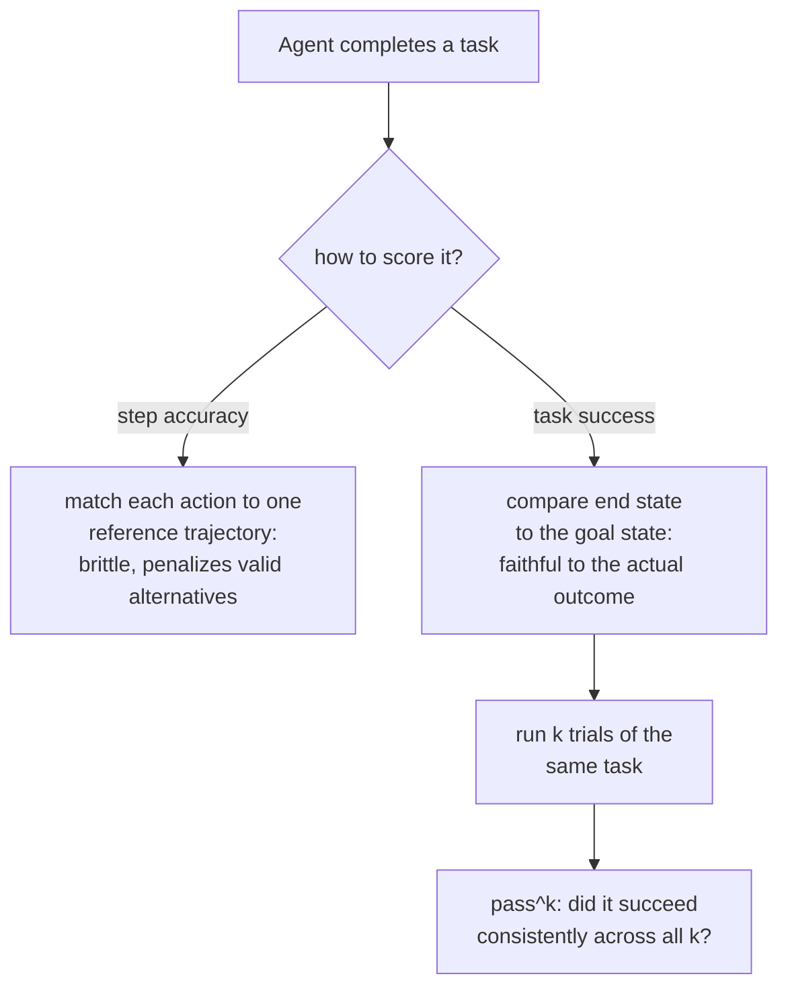

# Урок 13. Оценка агентов и использование инструментов

**Связь с целью курса:** Урок 4 установил `pass@k` для кода: исполнить сгенерированную программу и проверить её поведение, а не текст, потому что программу можно выразить многими разными верными способами. Задача агента поднимает ту же проблему на уровень выше: это не один вывод для проверки, а последовательность вызовов инструментов и решений на нескольких ходах, и та же проблема «много верных путей, один верный исход» относится ко всей траектории, а не только к итоговому ответу.
**Первоисточник:** [Научная статья: "τ-bench: A Benchmark for Tool-Agent-User Interaction in Real-World Domains", Yao et al., 2024](https://arxiv.org/abs/2406.12045)
**Предварительные требования:** [Урок 4](0004-code-execution-metrics.md), [Отложенные данные](../GLOSSARY.md)

## Разминка

1. ▢ Почему функциональная корректность (исполнение сгенерированного кода на тестах) избегает проблемы, которая есть у сравнения текстов точным совпадением при оценке кода?

Проверка

Две программы могут быть текстуально совершенно разными, с разными именами переменных, потоком управления или алгоритмами, и всё равно быть одинаково верными; исполнение кода и проверка его поведения на тестах судит о том, что программа действительно делает, а не о том, насколько её текст совпадает с одним эталонным решением.

2. ▢ Что измеряет `pass@k` и почему прямая повторная выборка k завершений и проверка успеха даёт высокую дисперсию?

Проверка

Проходит ли хотя бы одно из k сэмплированных завершений. Прямая повторная выборка и проверка даёт высокую дисперсию, потому что то, окажется ли в именно этой выборке из k успех, само случайно; формула несмещённой оценки избегает этого, математически агрегируя по большему пулу образцов, а не полагаясь на одну конкретную выборку k.

## Что нужно знать

### Задачу агента судят по траектории, а не по ответу

Одношаговый эвал оценивает один вывод. **Агентная** задача же порождает **траекторию**: последовательность вызовов инструментов, промежуточных решений и ходов (нередко в многоходовом разговоре с имитируемым пользователем), которые вместе должны достичь настоящей конечной цели: оформить возврат, обновить запись в базе данных, закрыть обращение в поддержку по правилам. Метрике, созданной для оценки одного ответа, будь то точное совпадение, оценка BLEU или даже одношаговый вызов LLM-судьи, здесь не за что зацепиться: нет одного вывода для сравнения, есть лишь последовательность действий, важным оказывается их общий эффект.

### Успех задачи спрашивает об исходе, а не о пройденном пути

Самый точный способ проверить траекторию не в том, чтобы шаг за шагом сравнивать её с одной эталонной последовательностью действий, а в том, чтобы проверить, закончилась ли задача в верном состоянии. Подход к оценке самого τ-bench делает именно этот выбор: он сравнивает состояние базы данных в конце разговора с размеченным целевым состоянием, а не оценивает, совпал ли каждый отдельный вызов инструмента с заранее заданной эталонной траекторией. Это сделано намеренно и это версия принципа функциональной корректности из урока 4 на уровне траектории: может существовать более одной верной последовательности вызовов инструментов, приводящей к тому же верному исходу, так же как может существовать более одной верной программы, а оценка по одной фиксированной эталонной траектории ошибочно штрафовала бы другой, не менее верный путь к тому же верному ответу.

### Точность шагов это более узкий и хрупкий вопрос, чем успех задачи

**Точность шагов**, то есть проверка того, совпадает ли каждое действие траектории с конкретным эталонным действием, это более строгое и хрупкое измерение, чем успех задачи, именно по этой причине: она может засчитать лишь тот единственный путь, который ей дали в качестве эталона, а это повторяет исходную ошибку точного совпадения (урок 3) в масштабе целой траектории, а не одного вывода. У точности шагов есть свои применения: выделить, какой именно шаг в длинной траектории пошёл не так, полезно для отладки, но она не замена более важному вопросу, на который отвечает метрика успеха задачи: справился ли агент с работой на самом деле.

### Один успех не значит, что агенту можно доверять повторение

Даже хорошо продуманная метрика успеха задачи, измеренная один раз, скрывает то, о чём одношаговому эвалу никогда не нужно было заботиться: добьётся ли тот же агент успеха снова, получив ту же самую задачу ещё раз. Собственные находки τ-bench делают это конкретным: на их бенчмарке даже сильная модель с вызовом функций справлялась менее чем с половиной задач за одну попытку, а её надёжность при повторных попытках *той же* задачи была ещё существенно хуже, заметно ниже четверти в одной из областей. Именно поэтому τ-bench вводит `pass^k` (читается «pass hat k»), метрику того, как надёжно агент добивается успеха при k повторных попытках одной задачи, намеренно отличную от `pass@k` из урока 4, который спрашивает, удаётся ли *хотя бы одному* из k независимых образцов. `pass^k` задаёт более трудный, противоположный по духу вопрос: продолжает ли агент добиваться успеха попытку за попыткой на одной и той же задаче, а не может ли он добиться успеха один раз при достаточном числе попыток.

### Почему оценка по каждому ответу с прежних этапов здесь не переносится

Модель может хорошо набирать очки на одношаговом бенчмарке с оценкой по каждому ответу и всё же вести себя совсем по-другому, оказавшись в многоходовой интерактивной агентной среде, потому что устойчивое многошаговое принятие решений в условиях ограничений инструментов и правил использует способность, которой метрика одного ответа не касается вообще. Именно этот пробел призваны закрыть бенчмарки, созданные специально для агентов (τ-bench и многосредовые наборы вроде AgentBench): они не просто масштабируют существующую метрику по каждому ответу, они измеряют то, чего эвал по каждому ответу структурно измерить не может.

## Практика

1. ▢ Эвал агента оценивает траекторию, проверяя, совпадает ли каждый вызов инструмента в точности с одной эталонной последовательностью вызовов, и штрафует агента, который пришёл к верному конечному исходу другой, не менее верной последовательностью вызовов. Какую ошибку из прежнего урока это повторяет?

Подсказка

Подумайте, что штрафует точное совпадение текстов и чего не штрафует функциональная корректность.

Проверка

Это повторяет ошибку точного совпадения (уроки 3 и 4) на уровне траектории: штраф за по-настоящему верный результат лишь за то, что он не совпал с одной конкретной эталонной формой, здесь с конкретной последовательностью действий, а не с конкретной строкой текста.

2. ▢ Почему τ-bench сравнивает конечное состояние базы данных с размеченным целевым состоянием, а не оценивает каждый шаг разговора относительно эталонной траектории?

Проверка

Потому что может существовать более одной верной последовательности вызовов инструментов, ведущей к тому же верному исходу; сравнение только конечного состояния засчитывает любой путь, верно приводящий туда, а оценка по одной фиксированной эталонной траектории ошибочно штрафовала бы другой, не менее верный путь.

3. ▢ Модель справляется с задачей в 45% случаев за одну попытку. Говорит ли это, как часто она справилась бы с этой же задачей, если попросить попробовать 8 раз подряд?

Проверка

Напрямую нет. Доля успехов одной попытки не измеряет последовательность при повторных попытках одной и той же задачи; метрика `pass^k` из τ-bench измеряет именно этот отдельный вопрос, и их находки показывают, что надёжность при повторных попытках может быть существенно хуже, чем подсказывала бы одна лишь доля успехов одной попытки.

4. ▢ Чем `pass^k` отличается от `pass@k` из урока 4, несмотря на схожее название и обозначение?

Проверка

`pass@k` спрашивает, удаётся ли хотя бы одному из k независимо сэмплированных завершений, вопрос «лучшее из k». `pass^k` спрашивает, добивается ли агент успеха последовательно при k повторных попытках одной и той же задачи, вопрос надёжности, ближе к противоположности вопросу «удалось ли хотя бы раз», чем к его пересказу.

5. ▢ Какое утверждение верно описывает, чем оценка агента отличается от эвала по каждому ответу?

    - a) Траекторию агента всегда следует оценивать точным совпадением с одной эталонной последовательностью вызовов инструментов, поскольку это самое точное измерение
    - b) Метрике по каждому ответу не за что зацепиться в многоходовой траектории агента; успех задачи (сравнение конечного состояния с целевым) точнее точности шагов, которая повторяет хрупкость точного совпадения, а успех одной попытки не измеряет отдельный вопрос надёжности при повторных попытках
    - c) Сильные результаты модели на одношаговых бенчмарках надёжно предсказывают её результаты в роли многоходового агента
    - d) `pass^k` и `pass@k` измеряют одно и то же и взаимозаменяемы

Проверка

**b)** Это полная картина, которую устанавливает урок. Вариант (a) неверен: сравнение конечного состояния в духе успеха задачи предпочтительнее жёсткого сопоставления шагов по той же причине, по которой функциональная корректность лучше точного совпадения. Вариант (c) неверен: агентное многоходовое принятие решений использует способности, которых одношаговый бенчмарк не касается, именно поэтому и существуют специальные бенчмарки для агентов. Вариант (d) неверен: `pass@k` это вопрос способности «лучшее из k», а `pass^k` это вопрос последовательности при повторных попытках.

## Практика в реальной работе

- [ ] Для агента или системы с инструментами, к которым у вас есть доступ, проверьте, оценивает ли их эвал (если он есть) успех задачи (конечное состояние), точность шагов (сопоставление с эталонной траекторией) или ни то ни другое.
- [ ] Если вы можете прогнать одну и ту же задачу через агента несколько раз, попробуйте 3-5 раз и отметьте, успешен ли он последовательно или лишь в части попыток.
- [ ] Завтра: прочитайте в первоисточнике описание настройки руководства по правилам и отметьте, как он оценивает, следовал ли агент правилу конкретной предметной области, а не только достиг ли верного конечного состояния базы данных.

## Что почитать дальше

- [Научная статья: "τ-bench: A Benchmark for Tool-Agent-User Interaction in Real-World Domains", Yao et al., 2024](https://arxiv.org/abs/2406.12045)
- [Научная статья: "AgentBench: Evaluating LLMs as Agents", Liu et al., 2023](https://arxiv.org/abs/2308.03688)
- [Ресурсы](../RESOURCES.md)

---

Не доходит? Перечитайте первоисточник в начале: этот урок его сжимает, а при сжатии понимание как раз и теряется. Загляните в [глоссарий](../GLOSSARY.md), если какой-то термин показался скользким.

Если неясен сам урок, а не материал, это дефект: [откройте issue](https://github.com/TokenCemetery/teach/issues).
