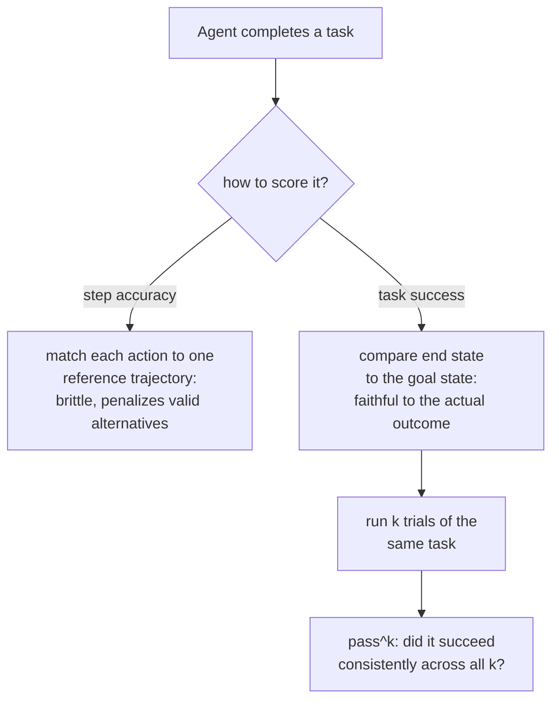

# 第 13 课：评测智能体与工具使用

**使命关联:** 第 4 课为代码确立了 `pass@k`：执行生成的程序，检查它的行为而不是文本，因为一个程序可以有许多种不同的正确写法。智能体的任务把同样的问题提升了一个层次：它要检查的不是一个输出，而是跨越多个轮次的一连串工具调用和决策，“有许多条有效路径，通向同一个正确结果”这个问题，适用于整条轨迹，而不只是最终的回应。
**主要来源:** [论文：“τ-bench: A Benchmark for Tool-Agent-User Interaction in Real-World Domains”，Yao 等，2024](https://arxiv.org/abs/2406.12045)
**前置知识:** [第 4 课](0004-code-execution-metrics.md)、[留出数据](../GLOSSARY.md)

## 热身

1. ▢ 为什么功能正确性（让生成的代码对测试用例执行），能避开精确匹配的文本比较在评测代码时的问题？

检查

两个程序在文本上可以完全不同，用了不同的变量名、控制流或算法，却同样正确；执行代码并对照测试用例检查它的行为，评判的是程序实际做了什么，而不是它的文本与某个参考解答有多吻合。

2. ▢ `pass@k` 度量什么？为什么直接重新采样 k 个补全再检查有没有成功的，会带来高方差？

检查

度量的是 k 个采样补全中，是否至少有一个通过。直接重新采样并检查之所以方差高，是因为这具体的 k 个样本里碰巧有没有成功的，本身就是随机的；无偏估计量的公式，通过在更大的样本池上做数学上的汇总，而不是依赖某一次抽取的 k 个，避开了这一点。

## 要点

### 智能体的任务评判的是轨迹，而不是一个回应

单轮评测给一个输出打分。**智能体式**的任务产生的则是一条**轨迹**：一连串的工具调用、中间决策和轮次（往往是与模拟用户之间的多轮对话），合在一起要完成某个真实的最终目标，比如办理退货、更新数据库记录、按照政策处理一个支持请求。为给单个回应打分而建的指标，无论是精确匹配、BLEU 分数，还是单轮的 LLM-as-judge 调用，在这里都无从着手：没有单一的输出可供比较，只有一连串的动作，真正重要的是它们的整体效果。

### 任务成功率问的是结果，而不是通向结果的路径

检查轨迹最忠实的办法，不是把它逐步与某一条参考动作序列比较，而是检查任务实际上是否结束在了正确的状态。τ-bench 自己的评测方法做出的正是这个选择：它把对话结束时数据库的状态，与标注的目标状态作比较，而不是给每一次单独的工具调用是否与预先设定的参考轨迹匹配来打分。这是有意为之，也是第 4 课功能正确性原则在轨迹层面的版本：可以有不止一种有效的工具调用序列，通向同一个正确的结果，就像可以有不止一个正确的程序一样，而拿一条固定的参考轨迹来评分，会错误地惩罚另一条同样有效、通向同一个正确答案的路径。

### 步骤准确率问的问题，比任务成功率更窄也更脆弱

**步骤准确率**，即检查轨迹中的每个动作是否与某个具体的参考动作匹配，恰恰因为这个原因，是比任务成功率更严格也更脆弱的度量：它只能给作为参考的那一条路径记分，这是在整条轨迹的尺度上，重复了精确匹配最初的错误（第 3 课），而不是在单个输出上。步骤准确率仍有它的用处，在一条很长的轨迹中，把究竟是哪一步出了错隔离出来，对调试很有价值，但它不能代替任务成功率指标所回答的那个更重要的问题：智能体到底有没有把事情做成。

### 一次成功，并不意味着可以信任智能体能再次做到

即使是设计良好的任务成功率指标，只度量一次，也掩盖了单轮评测从来不必担心的事情：同一个智能体，再次面对完全相同的任务，是否会再次成功。τ-bench 自己的发现使这一点具体可见：在它的基准上，即使是很强的函数调用模型，在单次试验中也只成功了不到一半的任务，而它在对*同一个*任务的重复试验中的可靠性，还要差得多，在一个领域里远低于四分之一。这正是 τ-bench 引入 `pass^k`（读作 “pass hat k”）的原因，这个指标度量智能体在同一任务的 k 次重复试验中，成功得有多可靠，它有意区别于第 4 课的 `pass@k`，后者问的是 k 个独立样本中*至少有一个*是否成功。`pass^k` 问的是更难的、倾向于相反方向的问题：智能体是否在同一个任务上，一次又一次地持续成功，而不是给足够多的尝试机会，它能否成功一次。

### 为什么前面阶段的逐条响应评测，在这里不能照搬

模型在单轮、逐条响应的基准上得分很高，放到多轮、交互式的智能体场景中，表现仍可能大不相同，因为在工具约束和政策规则之下，持续的多步决策，用到的是单条响应的指标根本触及不到的能力。这正是专为智能体设计的基准（τ-bench，以及 AgentBench 这样的多环境套件）要弥补的缺口：它们不只是把现有的逐条响应指标重新缩放，而是度量逐条响应的评测在结构上无法度量的东西。

## 练习

1. ▢ 某个智能体评测给轨迹打分的办法，是检查每次工具调用是否与单一的参考调用序列完全匹配，并惩罚那个通过另一条同样有效的调用序列，得到了正确最终结果的智能体。这重复了前面某一课的什么错误？

提示

想一想，精确匹配的文本评分惩罚了功能正确性所不惩罚的什么。

检查

它在轨迹层面重复了精确匹配的错误（第 3、4 课）：仅仅因为一个真正正确的结果，不符合某个特定的参考形式，就惩罚它，这里是一个特定的动作序列，而不是一个特定的文本字符串。

2. ▢ 为什么 τ-bench 把数据库的最终状态与标注的目标状态作比较，而不是对照参考轨迹，给对话的每一步打分？

检查

因为可以有不止一种有效的工具调用序列，通向同一个正确的结果；只比较最终状态，就能给任何正确到达那里的路径记分，而对照一条固定的参考轨迹评分，会错误地惩罚另一条同样有效的路径。

3. ▢ 某个模型在单次试验中，有 45% 的概率成功完成一个任务。这能告诉你，如果让它对同一个任务连续尝试 8 次，它会有多常成功吗？

检查

不能直接告诉。单次试验的成功率，度量不了对同一任务重复尝试时的一致性；τ-bench 的 `pass^k` 指标度量的正是这个独立的问题，而它们的发现表明，重复试验中的可靠性，可能比单次试验的成功率单独所暗示的要差得多。

4. ▢ 尽管名称和记号相似，`pass^k` 与第 4 课的 `pass@k` 有何不同？

检查

`pass@k` 问的是 k 个独立采样的补全中，是否至少有一个成功，这是 k 中取最佳的问题。`pass^k` 问的是智能体在同一任务的 k 次重复试验中，是否持续成功，这是可靠性的问题，更接近于“是否至少成功一次”的反面，而不是对它的重述。

5. ▢ 下列哪项说法正确地描述了智能体评测与逐条响应评测的区别？

    - a) 智能体的轨迹应当始终用对照单一参考工具调用序列的精确匹配来评分，因为这是最忠实的度量
    - b) 在多轮的智能体轨迹中，逐条响应的指标没有单一的输出可供着手；任务成功率（把最终状态与目标状态作比较）比步骤准确率更忠实，后者重复了精确匹配的脆弱，而单次试验的成功率度量不了重复试验可靠性这个独立的问题
    - c) 模型在单轮基准上的强劲表现，可靠地预示了它作为多轮智能体的表现
    - d) `pass^k` 和 `pass@k` 度量的是同一件事，可以互换使用

检查

**b)** 这就是本课确立的完整图景。（a）错误：任务成功率式的最终状态比较，明确优于僵硬的步骤匹配，原因与功能正确性胜过精确匹配相同。（c）错误：智能体式的多轮决策，用到的是单条响应的基准从未触及的能力，这正是存在专门的智能体基准的原因。（d）错误：`pass@k` 是 k 中取最佳的能力问题；`pass^k` 是跨重复试验的一致性问题。

## 实战练习

- [ ] 对于你能用到的某个智能体或使用工具的系统，检查它的评测（如果有的话）给任务成功率（最终状态）、步骤准确率（匹配参考轨迹）打分，还是两者都没有。
- [ ] 如果你能让智能体对同一个任务运行多次，就试 3 到 5 次，记下它是持续成功，还是只有部分尝试成功。
- [ ] 明天：读主要来源中对其政策指南设置的描述，并记下它是如何评估智能体有没有遵守某条特定领域的规则的，而不只是它有没有达到正确的数据库最终状态。

## 延伸阅读

- [论文：“τ-bench: A Benchmark for Tool-Agent-User Interaction in Real-World Domains”，Yao 等，2024](https://arxiv.org/abs/2406.12045)
- [论文：“AgentBench: Evaluating LLMs as Agents”，Liu 等，2023](https://arxiv.org/abs/2308.03688)
- [资源](../RESOURCES.md)

---

没学明白？请重读顶部的主要来源，因为本课是对它的压缩，而理解正是在压缩中流失的。如果有哪个术语觉得含糊，可以查看[术语表](../GLOSSARY.md)。

如果问题出在课程本身，而不是学习材料，那就是一个缺陷：[提交 issue](https://github.com/TokenCemetery/teach/issues)。
