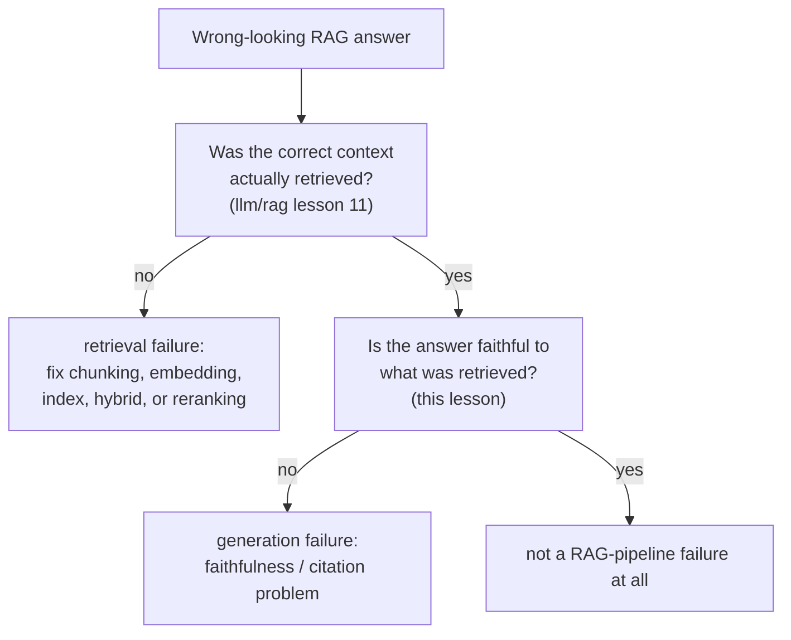

# Lección 14. Evaluación específica de RAG

**Vínculo con la misión:** La lección 11 de `llm/rag` enseñó a diagnosticar un pipeline de recuperación etapa por etapa. Su lección 13 fue un paso más allá y estableció que ni siquiera una recuperación perfecta garantiza una respuesta fiel, y entonces aplazó de forma explícita la construcción de esa comprobación de fidelidad a este espacio de trabajo. Esta lección la entrega, y muestra que "fiel al contexto recuperado" y "correctamente atribuido a una cita concreta" son dos preguntas distintas, no una.
**Fuente principal:** [Paper: "Ragas: Automated Evaluation of Retrieval Augmented Generation", Es et al., 2023](https://arxiv.org/abs/2309.15217)
**Requisitos previos:** [`llm/rag` Lección 11](../../rag/lessons/0011-diagnosing-the-pipeline.md), [`llm/rag` Lección 13](../../rag/lessons/0013-what-generation-still-gets-wrong.md)

## Calentamiento

1. ▢ La trayectoria de un agente se puntúa comparando su estado final con un estado objetivo en lugar de hacer coincidir cada acción con una única secuencia de referencia. ¿Por qué es esta la opción más fiel?

Comprobación

Puede haber más de una secuencia válida de acciones que llegue al mismo resultado correcto; comparar solo el estado final acredita cualquier camino que llegue correctamente, mientras que puntuar contra una única trayectoria de referencia fija penalizaría por error un camino distinto e igual de válido.

2. ▢ ¿Por qué el muestreo repetido al estilo de `pass@k` no puede decirte si un agente es *fiable*, en lugar de meramente *capaz*?

Comprobación

`pass@k` solo pregunta si al menos una de k muestras tiene éxito, una pregunta de capacidad de mejor de k; no dice nada sobre si el mismo agente, al que se le pide repetir la tarea idéntica, seguiría teniendo éxito intento tras intento, que es la pregunta distinta de fiabilidad a la que apuntan en cambio las métricas al estilo de `pass^k`.

## Qué debes saber

### La calidad de la recuperación y la calidad de la generación son dimensiones separadas, y RAGAS está hecho para mantenerlas separadas

El propio planteamiento de RAGAS enuncia el reto de forma directa: evaluar un sistema RAG significa considerar la capacidad del sistema de recuperación para sacar a la superficie un contexto relevante y focalizado, por separado de la capacidad del modelo de generación para usar ese contexto con fidelidad, y por separado otra vez de la calidad del propio texto generado. Colapsar esto en una única puntuación de extremo a extremo (¿se veía bien la respuesta final?) esconde qué mitad del sistema, si alguna, necesita realmente arreglo, exactamente el mismo problema de diagnóstico que la lección 11 de `llm/rag` resolvió solo del lado de la recuperación. RAGAS es explícitamente **sin referencia**: ninguna de sus métricas requiere una respuesta correcta escrita por una persona con la que comparar, lo que las hace lo bastante baratas para ejecutarse en cada cambio y no solo cuando casualmente existe un conjunto etiquetado por humanos.

### La fidelidad (groundedness) pregunta si una afirmación se sigue de lo recuperado

La **fidelidad**, también llamada **groundedness**, comprueba si cada afirmación de una respuesta generada está realmente respaldada por el contexto recuperado en el que se suponía que debía basarse, en lugar de inventada, contradicha o adornada con un detalle de apariencia plausible que el contexto nunca contuvo. Es una comprobación a nivel de afirmación, no de la respuesta entera: una respuesta puede acertar la mayoría de sus afirmaciones y aun así colar un detalle sin respaldo, y una métrica de fidelidad que puntúa solo la respuesta en su conjunto pasa por alto justo el tipo de invención parcial que es más fácil de ignorar en una lectura casual.

### La corrección de las citas es una pregunta más estricta y separada de la fidelidad

La **corrección de las citas** pregunta algo que la fidelidad no pregunta: no solo "¿está esta afirmación respaldada por algo del contexto recuperado?", sino "¿respalda realmente la afirmación el pasaje concreto citado para ella?". Los propios resultados del benchmark de ALCE concretan la brecha: incluso los mejores sistemas que probó carecían de respaldo completo de citas para cerca de la mitad de sus afirmaciones en uno de sus conjuntos de prueba, lo que significa que una afirmación puede ser verdadera y estar fundamentada en algún lugar del corpus recuperado y aun así atribuirse al pasaje equivocado, o a ninguno. Un sistema puede puntuar razonablemente en fidelidad (las afirmaciones son verdaderas, dado todo el conjunto recuperado) y aun así puntuar mal en corrección de las citas (las citas individuales adjuntas a esas afirmaciones no se sostienen), porque las dos comprueban cosas distintas: si una respuesta está fundamentada en absoluto, frente a si sus atribuciones concretas y comprobables son correctas.

### Separar un fallo de recuperación de un fallo de generación significa calcular ambos números, no adivinar a partir de la salida

La lección 11 de `llm/rag` diagnosticó un síntoma de recuperación errónea revisando cada etapa del pipeline en orden. El lado de la generación necesita su propia comprobación calculada de forma independiente, no inferida de cómo se lee una mala respuesta: medir si el contexto correcto se recuperó realmente (las métricas de calidad de la recuperación de la lección 11) y medir la fidelidad al contexto que realmente se recuperó (la métrica de esta lección), como dos números separados sobre el mismo caso fallido. Una respuesta construida sobre un contexto mal recuperado y una respuesta infiel construida sobre un contexto perfectamente recuperado pueden verse idénticas desde fuera, erróneas, pero exigen correcciones completamente distintas, y solo calcular ambos números te dice cuál tienes delante.

## Práctica

1. ▢ La respuesta de un sistema RAG contiene una afirmación que no está respaldada en ningún lugar del contexto recuperado, pero todas las demás afirmaciones de la respuesta están bien respaldadas. ¿Lo detecta puntuar la respuesta en su conjunto ("mayormente buena")?

Pista

Considera qué elimina por agregación una puntuación de la respuesta completa.

Comprobación

No de forma fiable. La fidelidad es una propiedad a nivel de afirmación; una sola afirmación sin respaldo o inventada puede esconderse dentro de una respuesta por lo demás bien respaldada, y una puntuación de la respuesta completa que promedia entre afirmaciones puede pasar por alto justo este tipo de invención parcial.

2. ▢ La respuesta de un sistema está completamente respaldada por el corpus recuperado en su conjunto, pero el pasaje concreto que cita para una afirmación no contiene realmente esa afirmación, la contiene otro pasaje recuperado. ¿Es esto un fallo de fidelidad, un fallo de corrección de las citas, o ambos?

Comprobación

Un fallo de corrección de las citas, no necesariamente de fidelidad: la afirmación en sí está fundamentada en algún lugar del contexto recuperado, así que no está inventada, pero la cita concreta adjunta a ella es errónea. Esta es exactamente la brecha entre las dos comprobaciones: la fidelidad pregunta si una afirmación está respaldada por el conjunto recuperado en absoluto, la corrección de las citas pregunta si el pasaje concreto citado es el que realmente la respalda.

3. ▢ ¿Por qué el diseño sin referencia de RAGAS es especialmente útil para ejecutar una eval en cada cambio, y no solo de vez en cuando?

Comprobación

Porque no requiere una respuesta correcta escrita por una persona con la que comparar, evita el costo que describió la lección 11 para la evaluación humana (encontrar, formar y pagar a evaluadores); una métrica sin referencia puede calcularse de forma automática y barata en cada cambio, y no solo cuando casualmente existe un conjunto de comparación etiquetado por humanos.

4. ▢ Dos respuestas RAG son erróneas. Una se construyó a partir de un contexto mal recuperado; la otra se construyó a partir de un contexto perfectamente recuperado pero generó una afirmación infiel. ¿Puedes distinguir estos dos casos solo leyendo las respuestas finales?

Comprobación

No de forma fiable. Ambas pueden verse igual de erróneas desde fuera; separarlas requiere medir la calidad de la recuperación (si el contexto correcto se recuperó realmente, según la lección 11 de `llm/rag`) y la fidelidad de la generación (si la respuesta fue fiel a lo que se recuperó, esta lección) como dos números independientes, en lugar de inferir la causa de la apariencia superficial de la respuesta.

5. ▢ ¿Qué afirmación describe correctamente la relación entre la calidad de la recuperación, la fidelidad y la corrección de las citas?

    - a) Una única puntuación de calidad de la respuesta de extremo a extremo basta para diagnosticar si un fallo de RAG es un problema de recuperación o de generación
    - b) La calidad de la recuperación, la fidelidad y la corrección de las citas son tres comprobaciones separables; un sistema puede puntuar bien en una mientras falla en otra, así que diagnosticar un fallo de RAG exige medirlas de forma independiente en lugar de inferir a partir de la respuesta final
    - c) Una afirmación que es fiel al contexto recuperado está automáticamente bien citada
    - d) RAGAS requiere una respuesta correcta escrita por una persona para cada consulta que evalúa

Comprobación

**b)** Esa es la estructura precisa y separable que establece esta lección. (a) es falsa: una puntuación de extremo a extremo no puede distinguir un fallo de recuperación de un fallo de generación, que es justo la razón por la que la lección 11 de `llm/rag` y esta lección comprueban cada una su propio lado de forma independiente. (c) es falsa: los propios hallazgos de ALCE muestran que las afirmaciones pueden estar fundamentadas en conjunto mientras sus citas concretas siguen siendo erróneas, aproximadamente la mitad de las veces en uno de sus conjuntos de prueba. (d) es falsa: RAGAS es explícitamente sin referencia y no requiere respuestas correctas escritas por personas.

## Prácticas en el mundo real

- [ ] Para un sistema RAG al que tengas acceso, elige una respuesta y compárala con ambas dimensiones por separado: si el contexto recuperado era realmente el correcto (según el diagnóstico de la lección 11 de `llm/rag`) y si cada afirmación de la respuesta es fiel a ese contexto.
- [ ] Si el sistema adjunta citas a sus afirmaciones, revisa por muestreo un puñado: ¿contiene realmente el pasaje citado el respaldo de la afirmación a la que está adjunto, o solo algo relacionado temáticamente?
- [ ] Mañana: lee completa la fuente primaria y anota cómo se calcula realmente su métrica de fidelidad (qué hace con un LLM para contrastar una afirmación con el contexto recuperado) sin requerir una respuesta de referencia escrita por una persona.

## Para profundizar

- [Paper: "Ragas: Automated Evaluation of Retrieval Augmented Generation", Es et al., 2023](https://arxiv.org/abs/2309.15217)
- [Paper: "Enabling Large Language Models to Generate Text with Citations" (ALCE), Gao et al., 2023](https://arxiv.org/abs/2305.14627)
- [Recursos](../RESOURCES.md)

---

¿No termina de quedar claro? Vuelve a leer la fuente primaria de arriba, ya que esta lección la comprime y en la compresión es donde se escapa la comprensión. Consulta el [glosario](../GLOSSARY.md) por si algún término te resultó resbaladizo.

Si lo poco claro es la propia lección y no el material, eso es un defecto: [abre un issue](https://github.com/TokenCemetery/teach/issues).
