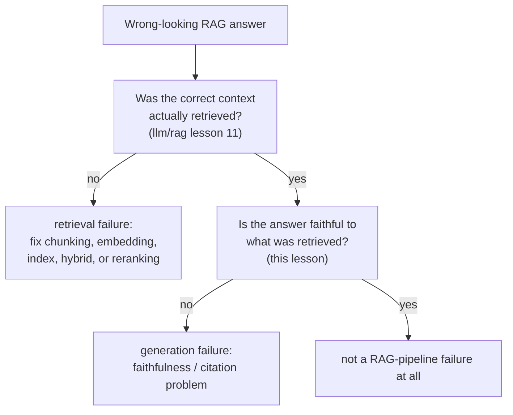

# Leçon 14. Évaluation propre au RAG

**Lien avec la mission :** La leçon 11 de `llm/rag` a enseigné à diagnostiquer un pipeline de récupération étape par étape. Sa leçon 13 est allée un cran plus loin et a établi que même une récupération parfaite ne garantit pas une réponse fidèle, puis a explicitement renvoyé à cet espace de travail la construction de ce contrôle de fidélité. Cette leçon le livre, et montre que « fidèle au contexte récupéré » et « correctement attribué à une citation précise » sont deux questions différentes, pas une seule.
**Source primaire :** [Article : "Ragas: Automated Evaluation of Retrieval Augmented Generation", Es et al., 2023](https://arxiv.org/abs/2309.15217)
**Prérequis :** [`llm/rag` Leçon 11](../../rag/lessons/0011-diagnosing-the-pipeline.md), [`llm/rag` Leçon 13](../../rag/lessons/0013-what-generation-still-gets-wrong.md)

## Échauffement

1. ▢ La trajectoire d'un agent est notée en comparant son état final à un état cible plutôt qu'en faisant correspondre chaque action à une séquence de référence unique. Pourquoi est-ce le choix le plus fidèle ?

Vérifier

Il peut y avoir plus d'une séquence valable d'actions qui atteint le même bon résultat ; comparer seulement l'état final crédite tout chemin qui y arrive correctement, alors que noter face à une seule trajectoire de référence fixe pénaliserait à tort un chemin différent, tout aussi valable.

2. ▢ Pourquoi un échantillonnage répété de type `pass@k` ne peut-il pas dire si un agent est *fiable*, par opposition à simplement *capable* ?

Vérifier

`pass@k` demande seulement si au moins un de k échantillons réussit, une question de capacité en meilleur-de-k ; il ne dit rien sur le fait que le même agent, à qui l'on demande de répéter la tâche identique, continuerait de réussir essai après essai, ce qui est la question distincte de fiabilité que ciblent plutôt les métriques de type `pass^k`.

## À savoir

### Qualité de la récupération et qualité de la génération sont des dimensions séparées, et RAGAS est conçu pour les garder séparées

Le cadrage de RAGAS énonce directement le défi : évaluer un système RAG, c'est considérer la capacité du système de récupération à faire remonter un contexte pertinent et ciblé, séparément de la capacité du modèle de génération à utiliser fidèlement ce contexte, séparément encore de la qualité du texte généré lui-même. Les fondre en un seul score de bout en bout (la réponse finale avait-elle l'air bonne) cache laquelle des deux moitiés du système, si c'en est une, a réellement besoin d'être réparée, exactement le même problème de diagnostic que la leçon 11 de `llm/rag` a résolu pour le seul côté récupération. RAGAS est explicitement **sans référence** : aucune de ses métriques n'exige de réponse de référence rédigée par un humain à laquelle comparer, ce qui les rend assez peu coûteuses pour être exécutées à chaque changement au lieu de seulement quand un jeu étiqueté par des humains existe par hasard.

### La fidélité (groundedness) demande si une affirmation découle de ce qui a été récupéré

La **fidélité**, aussi appelée **groundedness**, vérifie si chaque affirmation d'une réponse générée est réellement soutenue par le contexte récupéré sur lequel elle devait reposer, par opposition à être inventée, contredite ou enjolivée d'un détail plausible que le contexte ne contenait jamais. C'est un contrôle au niveau de l'affirmation, pas de la réponse entière : une réponse peut avoir juste la plupart de ses affirmations tout en glissant un détail non soutenu, et une métrique de fidélité qui ne note que la réponse dans son ensemble rate exactement le genre d'invention partielle le plus facile à négliger à une lecture rapide.

### L'exactitude des citations est une question plus stricte et distincte de la fidélité

L'**exactitude des citations** demande ce que la fidélité ne demande pas : non seulement « cette affirmation est-elle soutenue par quelque chose dans le contexte récupéré », mais « le passage précis cité pour cette affirmation la soutient-il réellement ». Les résultats du benchmark d'ALCE lui-même rendent l'écart concret : même les meilleurs systèmes testés n'apportaient pas un soutien complet par les citations pour environ la moitié de leurs affirmations sur l'un de ses jeux de test, ce qui signifie qu'une affirmation peut être vraie et fondée quelque part dans le corpus récupéré tout en étant attribuée au mauvais passage, ou à aucun passage. Un système peut obtenir un score correct en fidélité (les affirmations sont vraies, compte tenu de tout l'ensemble récupéré) tout en obtenant un mauvais score en exactitude des citations (les citations individuelles attachées à ces affirmations ne tiennent pas), parce que les deux vérifient des choses différentes : si une réponse est fondée tout court, par opposition à si ses attributions précises et vérifiables sont correctes.

### Séparer un échec de récupération d'un échec de génération, c'est calculer les deux chiffres, pas deviner d'après la sortie

La leçon 11 de `llm/rag` a diagnostiqué un symptôme de mauvaise récupération en vérifiant chaque étape du pipeline dans l'ordre. Le côté génération a besoin de son propre contrôle, calculé indépendamment, et non déduit de la façon dont se lit une mauvaise réponse : mesurer si le bon contexte a réellement été récupéré (les métriques de qualité de la récupération de la leçon 11) et mesurer la fidélité à tout contexte qui a réellement été récupéré (la métrique de cette leçon), comme deux chiffres distincts sur le même cas en échec. Une réponse bâtie sur un contexte mal récupéré et une réponse infidèle bâtie sur un contexte parfaitement récupéré peuvent avoir exactement la même allure de l'extérieur, fausses, mais elles appellent des remèdes complètement différents, et seul le calcul des deux chiffres dit lequel des deux cas on a sous les yeux.

## Pratique

1. ▢ La réponse d'un système RAG contient une affirmation qui n'est soutenue nulle part dans le contexte récupéré, mais toutes les autres affirmations de la réponse sont bien soutenues. Noter la réponse dans son ensemble (« plutôt bonne ») détecte-t-il cela ?

Indice

Demandez-vous ce qu'un score de réponse entière agrège sans le montrer.

Vérifier

Pas de façon fiable. La fidélité est une propriété au niveau de l'affirmation ; une seule affirmation non soutenue ou inventée peut se cacher dans une réponse par ailleurs bien soutenue, et un score de réponse entière qui fait la moyenne des affirmations peut rater exactement ce genre d'invention partielle.

2. ▢ La réponse d'un système est entièrement soutenue dans l'ensemble par le corpus récupéré, mais le passage précis qu'il cite pour une affirmation ne contient pas réellement cette affirmation, un autre passage récupéré la contient. Est-ce une défaillance de fidélité, une défaillance d'exactitude des citations, ou les deux ?

Vérifier

Une défaillance d'exactitude des citations, pas nécessairement de fidélité : l'affirmation elle-même est fondée quelque part dans le contexte récupéré, donc elle n'est pas inventée, mais la citation précise qui lui est attachée est fausse. C'est exactement l'écart entre les deux contrôles : la fidélité demande si une affirmation est soutenue par l'ensemble récupéré tout court, l'exactitude des citations demande si le passage cité précis est bien celui qui la soutient.

3. ▢ Pourquoi la conception sans référence de RAGAS est-elle particulièrement utile pour exécuter une eval à chaque changement, plutôt qu'occasionnellement ?

Vérifier

Parce qu'elle n'exige pas de réponse de référence rédigée par un humain à laquelle comparer, elle évite le coût que la leçon 11 a décrit pour l'évaluation humaine (trouver, former et payer des annotateurs) ; une métrique sans référence peut être calculée automatiquement et à peu de frais à chaque changement, plutôt que seulement quand un jeu de comparaison étiqueté par des humains existe par hasard.

4. ▢ Deux réponses RAG sont toutes deux fausses. L'une a été bâtie sur un contexte mal récupéré ; l'autre a été bâtie sur un contexte parfaitement récupéré mais a généré une affirmation infidèle. Pouvez-vous distinguer ces deux cas simplement en lisant les réponses finales ?

Vérifier

Pas de façon fiable. Les deux peuvent avoir l'air identiquement fausses de l'extérieur ; les séparer exige de mesurer la qualité de la récupération (le bon contexte a-t-il réellement été récupéré, selon la leçon 11 de `llm/rag`) et la fidélité de la génération (la réponse était-elle fidèle à tout ce qui a été récupéré, cette leçon) comme deux chiffres indépendants, plutôt que de déduire la cause de l'apparence de surface de la réponse.

5. ▢ Laquelle de ces affirmations décrit correctement le lien entre qualité de la récupération, fidélité et exactitude des citations ?

    - a) Un seul score de qualité de réponse de bout en bout suffit à diagnostiquer si un échec RAG est un problème de récupération ou de génération
    - b) Qualité de la récupération, fidélité et exactitude des citations sont trois contrôles séparables ; un système peut bien réussir l'un en échouant un autre, donc diagnostiquer un échec RAG exige de les mesurer indépendamment plutôt que de déduire d'après la réponse finale
    - c) Une affirmation fidèle au contexte récupéré est automatiquement correctement citée
    - d) RAGAS exige une réponse de référence rédigée par un humain pour chaque requête qu'il évalue

Vérifier

**b)** C'est la structure précise et séparable qu'établit cette leçon. (a) est faux : un score de bout en bout ne peut pas distinguer un échec de récupération d'un échec de génération, ce qui explique précisément pourquoi la leçon 11 de `llm/rag` et cette leçon vérifient chacune leur propre côté indépendamment. (c) est faux : les constats d'ALCE montrent que des affirmations peuvent être fondées dans l'ensemble alors que leurs citations précises restent fausses, environ une fois sur deux sur l'un de ses jeux de test. (d) est faux : RAGAS est explicitement sans référence, et n'exige pas de réponses de référence rédigées par des humains.

## Exercices en situation réelle

- [ ] Pour un système RAG auquel vous avez accès, choisissez une réponse et vérifiez-la sur les deux dimensions séparément : le contexte récupéré était-il réellement correct (selon le diagnostic de la leçon 11 de `llm/rag`), et chaque affirmation de la réponse est-elle fidèle à ce contexte.
- [ ] Si le système attache des citations à ses affirmations, vérifiez-en une poignée par sondage : le passage cité contient-il réellement le soutien de l'affirmation à laquelle il est attaché, ou seulement quelque chose de thématiquement voisin ?
- [ ] Demain : lisez la source primaire en entier, et notez comment sa métrique de fidélité est réellement calculée (ce qu'elle fait d'un LLM pour vérifier une affirmation face au contexte récupéré) sans exiger de réponse de référence rédigée par un humain.

## Pour aller plus loin

- [Article : "Ragas: Automated Evaluation of Retrieval Augmented Generation", Es et al., 2023](https://arxiv.org/abs/2309.15217)
- [Article : "Enabling Large Language Models to Generate Text with Citations" (ALCE), Gao et al., 2023](https://arxiv.org/abs/2305.14627)
- [Ressources](../RESOURCES.md)

---

Ça ne passe pas ? Relisez la source primaire en haut de page, car cette leçon la condense et c'est dans la condensation que la compréhension s'échappe. Consultez le [glossaire](../GLOSSARY.md) pour tout terme qui vous a paru glissant.

Si c'est la leçon elle-même qui n'est pas claire plutôt que la matière, c'est un défaut : [ouvrez une issue](https://github.com/TokenCemetery/teach/issues).
