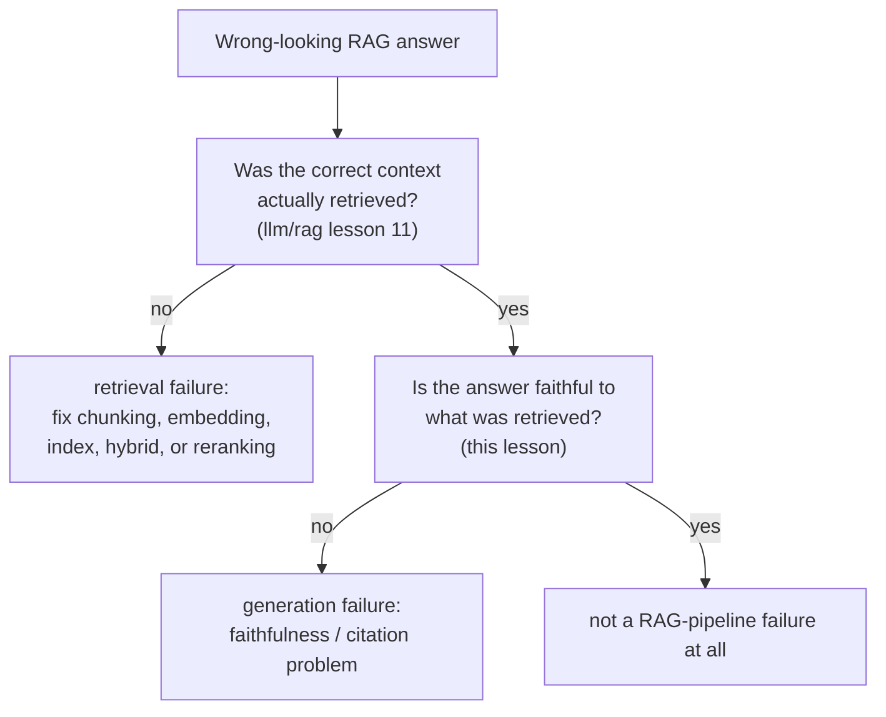

# पाठ 14. RAG-Specific Evaluation

**मिशन से संबंध:** `llm/rag` पाठ 11 ने retrieval pipeline को चरण-दर-चरण diagnose करना सिखाया। उसके पाठ 13 ने एक क़दम और आगे जाकर स्थापित किया कि पूरी तरह सही retrieval भी faithful उत्तर की गारंटी नहीं देता, और फिर उस faithfulness जाँच को बनाना साफ़ तौर पर इस workspace पर छोड़ दिया। यह पाठ उसे पूरा करता है, और दिखाता है कि "retrieve किए गए context के प्रति faithful" और "किसी ख़ास citation से सही जुड़ा" एक नहीं बल्कि दो अलग सवाल हैं।
**मुख्य स्रोत:** [पेपर: "Ragas: Automated Evaluation of Retrieval Augmented Generation", Es et al., 2023](https://arxiv.org/abs/2309.15217)
**पूर्व-आवश्यकताएँ:** [`llm/rag` पाठ 11](../../rag/lessons/0011-diagnosing-the-pipeline.md), [`llm/rag` पाठ 13](../../rag/lessons/0013-what-generation-still-gets-wrong.md)

## वार्म-अप

1. ▢ किसी agent की trajectory को हर क्रिया को एक reference शृंखला से मिलाने के बजाय उसकी अंतिम अवस्था की लक्ष्य-अवस्था से तुलना करके score किया जाता है। यह ज़्यादा भरोसेमंद चुनाव क्यों है?

जाँचें

क्रियाओं की एक से ज़्यादा वैध शृंखलाएँ उसी सही नतीजे तक पहुँच सकती हैं; सिर्फ़ अंतिम अवस्था की तुलना हर उस रास्ते को श्रेय देती है जो सही तरह वहाँ पहुँचे, जबकि एक तय reference trajectory के सामने score करना दूसरे, उतने ही वैध रास्ते को ग़लत तरीक़े से दंडित करेगा।

2. ▢ `pass@k`-शैली की दोहराई गई sampling यह क्यों नहीं बता सकती कि agent *भरोसेमंद* है, सिर्फ़ *सक्षम* होने के उलट?

जाँचें

`pass@k` सिर्फ़ यह पूछता है कि k samples में से कम से कम एक सफल होता है या नहीं, यानी best-of-k क्षमता का सवाल; वह कुछ नहीं बताता कि वही agent, वही task दोहराने को कहे जाने पर, trial-दर-trial सफल होता रहता या नहीं, जो विश्वसनीयता का अलग सवाल है जिसे `pass^k`-शैली की metrics निशाना बनाती हैं।

## यह जानें

### Retrieval की गुणवत्ता और generation की गुणवत्ता अलग आयाम हैं, और RAGAS उन्हें अलग रखने के लिए बना है

RAGAS की अपनी बात चुनौती को सीधे कहती है: RAG system का evaluation करने का मतलब है retrieval system की प्रासंगिक, केंद्रित context सामने लाने की क्षमता को, generation model की उस context को faithfully इस्तेमाल करने की क्षमता से अलग, और फिर generate किए text की गुणवत्ता से भी अलग, देखना। इन्हें एक end-to-end score में समेटना (क्या अंतिम उत्तर अच्छा दिखा) यह छिपा देता है कि system के किस आधे हिस्से को, अगर किसी को, असल में ठीक करना है, ठीक वही निदान की समस्या जिसे `llm/rag` पाठ 11 ने अकेले retrieval की ओर से सुलझाया था। RAGAS साफ़ तौर पर **reference-free** है: उसकी किसी metric को तुलना के लिए मानव-लिखित gold उत्तर नहीं चाहिए, जो उन्हें इतना सस्ता बनाता है कि हर बदलाव पर चलाई जा सकें, सिर्फ़ तब नहीं जब मानव-label किया सेट संयोग से मौजूद हो।

### Faithfulness (groundedness) पूछती है कि क्या दावा उससे निकलता है जो retrieve हुआ

**Faithfulness**, जिसे **groundedness** भी कहते हैं, जाँचती है कि generate किए उत्तर का हर दावा उस retrieve किए गए context से सचमुच समर्थित है जिस पर उसे आधारित होना चाहिए था, बजाय इसके कि वह गढ़ा गया हो, उसके विपरीत हो, या ऐसे विश्वसनीय-से-लगने वाले ब्योरे से सजाया गया हो जो context में कभी था ही नहीं। यह दावे के स्तर की जाँच है, पूरे उत्तर की नहीं: उत्तर अपने ज़्यादातर दावे सही रख सकता है और फिर भी एक असमर्थित ब्योरा घुसा सकता है, और जो faithfulness metric उत्तर को सिर्फ़ समग्र रूप में score करती है, वह ठीक उसी तरह की आंशिक गढ़ंत चूक जाती है जिसे सरसरी पढ़ाई में अनदेखा करना सबसे आसान है।

### Citation correctness, faithfulness से ज़्यादा सख़्त, अलग सवाल है

**Citation correctness** वह पूछती है जो faithfulness नहीं पूछती: सिर्फ़ यह नहीं कि "क्या यह दावा retrieve किए गए context में किसी चीज़ से समर्थित है," बल्कि यह कि "क्या इस दावे के लिए cite किया गया ख़ास अंश सचमुच इसका समर्थन करता है।" ALCE के अपने benchmark नतीजे इस फ़ासले को ठोस बनाते हैं: परखे गए सबसे अच्छे systems भी अपने एक test सेट पर लगभग आधे दावों के लिए पूरा citation समर्थन नहीं दे पाए, यानी कोई दावा सच और retrieve किए गए corpus में कहीं आधारित हो सकता है और फिर भी ग़लत अंश से, या किसी भी अंश से नहीं, जोड़ा गया हो सकता है। System faithfulness पर ठीक-ठाक score कर सकता है (पूरे retrieve किए सेट को देखते हुए दावे सच हैं) और फिर भी citation correctness पर ख़राब (उन दावों से जुड़े अलग-अलग citations टिकते नहीं), क्योंकि दोनों अलग चीज़ें जाँचती हैं: उत्तर बिल्कुल भी आधारित है या नहीं, बनाम उसके ख़ास, जाँचे जा सकने वाले संदर्भ सही हैं या नहीं।

### Retrieval की विफलता को generation की विफलता से अलग करने का मतलब दोनों संख्याएँ निकालना है, output से अंदाज़ा लगाना नहीं

`llm/rag` पाठ 11 ने ग़लत-retrieval के लक्षण को pipeline के हर चरण को क्रम से जाँचकर diagnose किया। Generation पक्ष को अपनी जाँच चाहिए जो स्वतंत्र रूप से निकाली जाए, इस आधार पर अनुमानित नहीं कि ख़राब उत्तर कैसा पढ़ता है: मापें कि सही context असल में retrieve हुआ या नहीं (पाठ 11 की retrieval-गुणवत्ता की metrics) और जो context असल में retrieve हुआ उसके प्रति faithfulness मापें (इस पाठ की metric), एक ही विफल मामले पर दो अलग संख्याओं के रूप में। ख़राब retrieve किए context पर बना उत्तर और पूरी तरह सही retrieve किए context पर बना unfaithful उत्तर बाहर से एक जैसे दिख सकते हैं, यानी ग़लत, पर उन्हें बिल्कुल अलग सुधार चाहिए, और सिर्फ़ दोनों संख्याएँ निकालना ही बताता है कि आप किसे देख रहे हैं।

## अभ्यास

1. ▢ किसी RAG system के उत्तर में एक दावा ऐसा है जो retrieve किए गए context में कहीं समर्थित नहीं है, पर उत्तर का हर दूसरा दावा अच्छी तरह समर्थित है। क्या उत्तर को समग्र रूप में score करना ("ज़्यादातर अच्छा") इसे पकड़ लेता है?

संकेत

सोचें कि समग्र score किस चीज़ को औसत में खो देता है।

जाँचें

भरोसे के साथ नहीं। Faithfulness दावे के स्तर की ख़ूबी है; एक अकेला असमर्थित या गढ़ा हुआ दावा वरना अच्छी तरह समर्थित उत्तर के भीतर छिप सकता है, और दावों पर औसत निकालने वाला समग्र score ठीक इसी तरह की आंशिक गढ़ंत चूक सकता है।

2. ▢ किसी system का उत्तर कुल मिलाकर retrieve किए गए corpus से पूरी तरह समर्थित है, पर एक दावे के लिए जो ख़ास अंश वह cite करता है उसमें वह दावा असल में नहीं है, कोई दूसरा retrieve किया गया अंश उसमें है। क्या यह faithfulness की विफलता है, citation-correctness की विफलता है, या दोनों?

जाँचें

यह citation-correctness की विफलता है, ज़रूरी नहीं कि faithfulness की: दावा ख़ुद retrieve किए गए context में कहीं आधारित है, इसलिए गढ़ा हुआ नहीं है, पर उससे जुड़ा ख़ास citation ग़लत है। दोनों जाँचों के बीच का यही फ़ासला है: faithfulness पूछती है कि दावा retrieve किए गए सेट से बिल्कुल भी समर्थित है या नहीं, citation correctness पूछती है कि cite किया गया ख़ास अंश वही है या नहीं जो सचमुच उसका समर्थन करता है।

3. ▢ RAGAS की reference-free डिज़ाइन हर बदलाव पर eval चलाने के लिए ख़ास तौर पर उपयोगी क्यों है, कभी-कभार चलाने के बजाय?

जाँचें

क्योंकि उसे तुलना के लिए मानव-लिखित gold उत्तर नहीं चाहिए, वह उस क़ीमत से बचती है जो पाठ 11 ने human evaluation के लिए बताई थी (raters खोजना, सिखाना और भुगतान करना); reference-free metric स्वचालित रूप से और सस्ते में हर बदलाव पर निकाली जा सकती है, सिर्फ़ तब नहीं जब मानव-label की तुलना वाला सेट संयोग से मौजूद हो।

4. ▢ दो RAG उत्तर दोनों ग़लत हैं। एक ख़राब retrieve किए context से बना था; दूसरा पूरी तरह सही retrieve किए context से बना था पर उसने unfaithful दावा generate किया। क्या आप सिर्फ़ अंतिम उत्तर पढ़कर इन दोनों मामलों को अलग पहचान सकते हैं?

जाँचें

भरोसे के साथ नहीं। दोनों बाहर से एक जैसे ग़लत दिख सकते हैं; उन्हें अलग करने के लिए retrieval की गुणवत्ता (क्या सही context असल में retrieve हुआ, `llm/rag` पाठ 11 के अनुसार) और generation की faithfulness (क्या उत्तर उसके प्रति faithful था जो भी retrieve हुआ, यह पाठ) को दो स्वतंत्र संख्याओं के रूप में मापना पड़ता है, उत्तर की ऊपरी शक्ल से कारण का अंदाज़ा लगाने के बजाय।

5. ▢ Retrieval की गुणवत्ता, faithfulness और citation correctness के संबंध का सही वर्णन कौन-सा दावा करता है?

    - a) एक अकेला end-to-end उत्तर-गुणवत्ता score यह diagnose करने के लिए काफ़ी है कि RAG की विफलता retrieval की समस्या है या generation की
    - b) Retrieval की गुणवत्ता, faithfulness और citation correctness तीन अलग की जा सकने वाली जाँचें हैं; system एक पर अच्छा score कर सकता है और दूसरी पर विफल, इसलिए RAG की विफलता को diagnose करने के लिए उन्हें अंतिम उत्तर से अंदाज़ा लगाने के बजाय स्वतंत्र रूप से मापना पड़ता है
    - c) जो दावा retrieve किए गए context के प्रति faithful है वह अपने-आप सही cite किया गया है
    - d) RAGAS को जिस भी query का evaluation करना हो उसके लिए मानव-लिखित gold उत्तर चाहिए

जाँचें

**b)** यही वह सटीक, अलग की जा सकने वाली संरचना है जो यह पाठ स्थापित करता है। (a) ग़लत है: end-to-end score retrieval की विफलता को generation की विफलता से अलग नहीं कर सकता, और ठीक इसीलिए `llm/rag` पाठ 11 और यह पाठ अपनी-अपनी ओर को स्वतंत्र रूप से जाँचते हैं। (c) ग़लत है: ALCE के अपने निष्कर्ष दिखाते हैं कि दावे कुल मिलाकर आधारित होते हुए भी उनके ख़ास citations ग़लत हो सकते हैं, उसके एक test सेट में लगभग आधी बार। (d) ग़लत है: RAGAS साफ़ तौर पर reference-free है, उसे मानव-लिखित gold उत्तर नहीं चाहिए।

## असली दुनिया का अभ्यास

- [ ] जिस RAG system तक आपकी पहुँच है, उसका कोई एक उत्तर चुनें और उसे दोनों आयामों पर अलग-अलग जाँचें: क्या retrieve किया गया context असल में सही था (`llm/rag` पाठ 11 के निदान के अनुसार), और क्या उत्तर का हर दावा उस context के प्रति faithful है।
- [ ] अगर system अपने दावों के साथ citations जोड़ता है, तो मुट्ठी-भर की जाँच करें: क्या cite किए गए अंश में सचमुच उस दावे का समर्थन है जिससे वह जुड़ा है, या बस कुछ विषय से मिलता-जुलता है?
- [ ] कल: मुख्य स्रोत पूरा पढ़ें, और लिखें कि उसकी faithfulness metric असल में कैसे निकाली जाती है (retrieve किए context के सामने दावा जाँचने के लिए वह LLM के साथ क्या करती है), मानव-लिखित reference उत्तर के बिना।

## आगे बढ़ने के लिए

- [पेपर: "Ragas: Automated Evaluation of Retrieval Augmented Generation", Es et al., 2023](https://arxiv.org/abs/2309.15217)
- [पेपर: "Enabling Large Language Models to Generate Text with Citations" (ALCE), Gao et al., 2023](https://arxiv.org/abs/2305.14627)
- [संसाधन](../RESOURCES.md)

---

बात नहीं बन रही? ऊपर दिए primary source को दोबारा पढ़ें, क्योंकि यह पाठ उसे संक्षिप्त करता है और समझ संक्षेप में ही रिसती है। जो शब्द फिसलन भरा लगे, उसके लिए [शब्दावली](../GLOSSARY.md) देखें।

अगर दिक़्क़त सामग्री की नहीं बल्कि पाठ की ही है, तो वह एक खोट है: [issue खोलें](https://github.com/TokenCemetery/teach/issues)।
