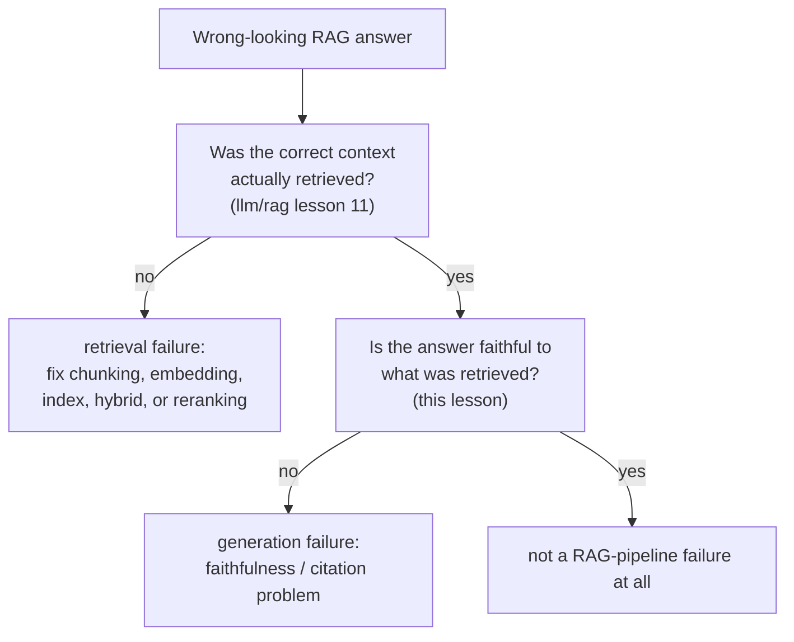

# Lição 14. Avaliação específica de RAG

**Ligação com a missão:** A lição 11 do `llm/rag` ensinou a diagnosticar um pipeline de recuperação etapa por etapa. A lição 13 dele foi um passo além e estabeleceu que nem a recuperação perfeita garante uma resposta fiel, e então adiou explicitamente a construção dessa verificação de fidelidade para este workspace. Esta lição a entrega, e mostra que "fiel ao contexto recuperado" e "corretamente atribuída a uma citação específica" são duas perguntas diferentes, e não uma.
**Fonte principal:** [Artigo científico: "Ragas: Automated Evaluation of Retrieval Augmented Generation", Es et al., 2023](https://arxiv.org/abs/2309.15217)
**Pré-requisitos:** [`llm/rag` Lição 11](../../rag/lessons/0011-diagnosing-the-pipeline.md), [`llm/rag` Lição 13](../../rag/lessons/0013-what-generation-still-gets-wrong.md)

## Aquecimento

1. ▢ A trajetória de um agente é pontuada comparando seu estado final com um estado-alvo, e não casando cada ação com uma única sequência de referência. Por que essa é a escolha mais fiel?

Verificação

Pode haver mais de uma sequência válida de ações que chega ao mesmo resultado correto; comparar apenas o estado final credita qualquer caminho que chegue lá corretamente, enquanto pontuar contra uma única trajetória de referência fixa penalizaria indevidamente um caminho diferente e igualmente válido.

2. ▢ Por que a amostragem repetida no estilo `pass@k` não consegue dizer se um agente é *confiável*, em oposição a meramente *capaz*?

Verificação

O `pass@k` só pergunta se pelo menos uma de k amostras tem sucesso, uma pergunta de capacidade de melhor entre k; não diz nada sobre se o mesmo agente, ao repetir a tarefa idêntica, continuaria tendo sucesso tentativa após tentativa, que é a pergunta separada de confiabilidade que métricas no estilo `pass^k` miram.

## Saiba isto

### Qualidade da recuperação e qualidade da geração são dimensões separadas, e o RAGAS é feito para mantê-las separadas

O próprio enquadramento do RAGAS declara o desafio diretamente: avaliar um sistema RAG significa considerar a capacidade do sistema de recuperação de trazer um contexto relevante e focado, separadamente da capacidade do modelo de geração de usar esse contexto com fidelidade, e separadamente de novo da qualidade do próprio texto gerado. Colapsar isso em uma única pontuação de ponta a ponta (a resposta final parecia boa) esconde qual metade do sistema, se alguma, de fato precisa de conserto, exatamente o mesmo problema de diagnóstico que a lição 11 do `llm/rag` resolveu apenas no lado da recuperação. O RAGAS é explicitamente **sem referência**: nenhuma de suas métricas exige uma resposta correta escrita por humanos para comparar, o que as torna baratas o bastante para executar a cada mudança e não apenas quando um conjunto rotulado por humanos por acaso existe.

### Fidelidade (groundedness) pergunta se uma afirmação decorre do que foi recuperado

A **fidelidade**, também chamada de **groundedness**, verifica se cada afirmação de uma resposta gerada é de fato sustentada pelo contexto recuperado em que deveria se basear, em oposição a ser inventada, contradita ou enfeitada com um detalhe de som plausível que o contexto nunca continha. É uma verificação no nível da afirmação, e não da resposta inteira: uma resposta pode acertar a maior parte de suas afirmações e ainda assim deixar passar um detalhe sem sustentação, e uma métrica de fidelidade que só pontua a resposta como um todo perde exatamente o tipo de fabricação parcial mais fácil de passar despercebido em uma leitura casual.

### A correção de citações é uma pergunta mais rigorosa e separada da fidelidade

A **correção de citações** pergunta algo que a fidelidade não pergunta: não apenas "esta afirmação é sustentada por algo no contexto recuperado", mas "a passagem específica citada para esta afirmação de fato a sustenta". Os próprios resultados do benchmark do ALCE tornam a lacuna concreta: até os melhores sistemas que ele testou careciam de sustentação completa por citação em cerca de metade de suas afirmações em um de seus conjuntos de teste, o que significa que uma afirmação pode ser verdadeira e fundamentada em algum ponto do corpus recuperado e ainda assim ser atribuída à passagem errada, ou a nenhuma passagem. Um sistema pode pontuar razoavelmente em fidelidade (as afirmações são verdadeiras, dado o conjunto recuperado inteiro) e ainda pontuar mal em correção de citações (as citações individuais ligadas a essas afirmações não se sustentam), porque as duas verificam coisas diferentes: se uma resposta está fundamentada de algum modo, contra se suas atribuições específicas e verificáveis estão corretas.

### Separar uma falha de recuperação de uma falha de geração significa calcular os dois números, e não adivinhar pela saída

A lição 11 do `llm/rag` diagnosticou um sintoma de recuperação errada verificando cada etapa do pipeline em ordem. O lado da geração precisa de sua própria verificação, calculada de forma independente, e não inferida de como uma resposta ruim se lê: meça se o contexto correto foi de fato recuperado (as métricas de qualidade de recuperação da lição 11) e meça a fidelidade ao contexto que de fato foi recuperado (a métrica desta lição), como dois números separados no mesmo caso que falha. Uma resposta construída sobre um contexto mal recuperado e uma resposta infiel construída sobre um contexto perfeitamente recuperado podem parecer idênticas por fora, erradas, mas pedem correções completamente diferentes, e só calcular os dois números diz qual das duas você está olhando.

## Prática

1. ▢ A resposta de um sistema RAG contém uma afirmação que não é sustentada em lugar nenhum do contexto recuperado, mas todas as outras afirmações da resposta são bem sustentadas. Pontuar a resposta como um todo ("em geral boa") pega isso?

Dica

Considere o que uma pontuação da resposta inteira agrega e apaga.

Verificação

Não com confiabilidade. A fidelidade é uma propriedade no nível da afirmação; uma única afirmação sem sustentação ou inventada pode se esconder dentro de uma resposta de resto bem sustentada, e uma pontuação da resposta inteira que faz a média entre as afirmações pode perder exatamente esse tipo de fabricação parcial.

2. ▢ A resposta de um sistema é totalmente sustentada pelo corpus recuperado no geral, mas a passagem específica que ela cita para uma afirmação não contém de fato essa afirmação; outra passagem recuperada contém. Isso é uma falha de fidelidade, uma falha de correção de citações ou as duas?

Verificação

Uma falha de correção de citações, não necessariamente de fidelidade: a afirmação em si está fundamentada em algum ponto do contexto recuperado, então não é inventada, mas a citação específica ligada a ela está errada. Essa é exatamente a lacuna entre as duas verificações: a fidelidade pergunta se uma afirmação é sustentada pelo conjunto recuperado de algum modo, e a correção de citações pergunta se a passagem específica citada é a que de fato a sustenta.

3. ▢ Por que o design sem referência do RAGAS é especificamente útil para executar um eval a cada mudança, e não apenas de vez em quando?

Verificação

Porque ele não exige uma resposta correta escrita por humanos para comparar, evita o custo que a lição 11 descreveu para a avaliação humana (encontrar, treinar e pagar avaliadores); uma métrica sem referência pode ser calculada de forma automática e barata a cada mudança, e não apenas quando um conjunto de comparação rotulado por humanos por acaso existe.

4. ▢ Duas respostas de RAG estão ambas erradas. Uma foi construída a partir de um contexto mal recuperado; a outra, a partir de um contexto perfeitamente recuperado, mas gerou uma afirmação infiel. Dá para distinguir os dois casos apenas lendo as respostas finais?

Verificação

Não com confiabilidade. Os dois podem parecer igualmente errados por fora; separá-los exige medir a qualidade da recuperação (o contexto correto foi de fato recuperado, segundo a lição 11 do `llm/rag`) e a fidelidade da geração (a resposta foi fiel ao que quer que tenha sido recuperado, esta lição) como dois números independentes, em vez de inferir a causa da aparência superficial da resposta.

5. ▢ Qual afirmação descreve corretamente a relação entre qualidade da recuperação, fidelidade e correção de citações?

    - a) Uma única pontuação de qualidade de resposta de ponta a ponta basta para diagnosticar se uma falha de RAG é um problema de recuperação ou de geração
    - b) Qualidade da recuperação, fidelidade e correção de citações são três verificações separáveis; um sistema pode pontuar bem em uma e falhar em outra, então diagnosticar uma falha de RAG exige medi-las de forma independente, e não inferir pela resposta final
    - c) Uma afirmação que é fiel ao contexto recuperado é automaticamente citada corretamente
    - d) O RAGAS exige uma resposta correta escrita por humanos para cada consulta que avalia

Verificação

**b)** Essa é a estrutura separável e precisa que esta lição estabelece. (a) é falsa: uma pontuação de ponta a ponta não distingue uma falha de recuperação de uma falha de geração, que é exatamente o motivo de a lição 11 do `llm/rag` e esta lição verificarem cada uma o seu lado de forma independente. (c) é falsa: os próprios resultados do ALCE mostram que afirmações podem estar fundamentadas no geral enquanto suas citações específicas continuam erradas, cerca de metade das vezes em um de seus conjuntos de teste. (d) é falsa: o RAGAS é explicitamente sem referência, e não exige respostas corretas escritas por humanos.

## Prática no mundo real

- [ ] Para um sistema RAG a que você tenha acesso, escolha uma resposta e confira-a contra as duas dimensões separadamente: o contexto recuperado estava de fato correto (segundo o diagnóstico da lição 11 do `llm/rag`), e toda afirmação da resposta é fiel a esse contexto.
- [ ] Se o sistema anexa citações às suas afirmações, confira por amostragem algumas: a passagem citada de fato contém a sustentação da afirmação a que está ligada, ou apenas algo relacionado ao assunto?
- [ ] Amanhã: leia a fonte principal por inteiro e anote como sua métrica de fidelidade é de fato calculada (o que ela faz com um LLM para conferir uma afirmação contra o contexto recuperado) sem exigir uma resposta de referência escrita por humanos.

## Para ir além

- [Artigo científico: "Ragas: Automated Evaluation of Retrieval Augmented Generation", Es et al., 2023](https://arxiv.org/abs/2309.15217)
- [Artigo científico: "Enabling Large Language Models to Generate Text with Citations" (ALCE), Gao et al., 2023](https://arxiv.org/abs/2305.14627)
- [Recursos](../RESOURCES.md)

---

Não ficou claro? Releia a fonte principal no topo, já que esta lição a comprime e é na compressão que o entendimento escapa. Consulte o [glossário](../GLOSSARY.md) para qualquer termo que pareceu escorregadio.

Se o problema é a lição em si, e não o material, isso é um defeito: [abra uma issue](https://github.com/TokenCemetery/teach/issues).
