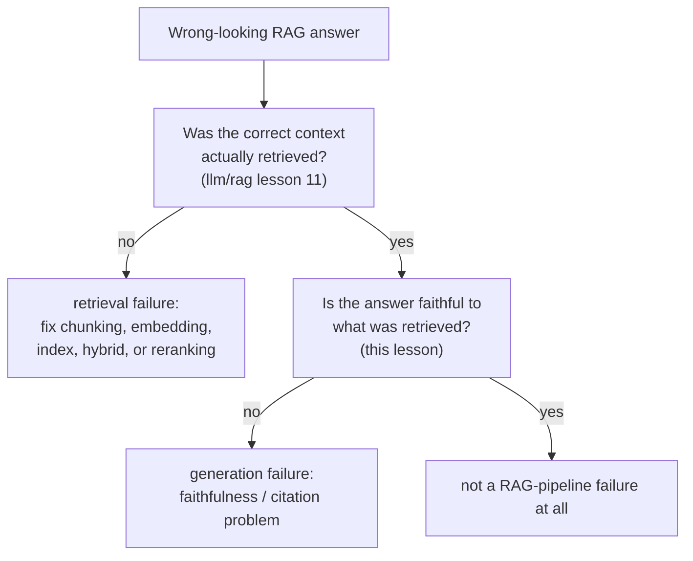

# Урок 14. Оценка RAG

**Связь с целью курса:** Урок 11 курса `llm/rag` учил диагностировать конвейер поиска этап за этапом. Его урок 13 пошёл на шаг дальше и установил, что даже безупречный поиск не гарантирует достоверного ответа, а затем прямо отложил построение этой проверки достоверности до этой рабочей области. Этот урок её даёт и показывает, что «достоверно относительно найденного контекста» и «корректно приписано конкретной цитате» это два разных вопроса, а не один.
**Первоисточник:** [Научная статья: "Ragas: Automated Evaluation of Retrieval Augmented Generation", Es et al., 2023](https://arxiv.org/abs/2309.15217)
**Предварительные требования:** [`llm/rag`, урок 11: Диагностика конвейера](../../rag/lessons/0011-diagnosing-the-pipeline.md), [`llm/rag`, урок 13: Что генерация всё ещё делает неверно](../../rag/lessons/0013-what-generation-still-gets-wrong.md)

## Разминка

1. ▢ Траекторию агента оценивают, сравнивая её конечное состояние с целевым, а не сопоставляя каждое действие с одной эталонной последовательностью. Почему это более точный выбор?

Проверка

Может существовать более одной верной последовательности действий, ведущей к тому же верному исходу; сравнение только конечного состояния засчитывает любой путь, верно приводящий туда, а оценка по одной фиксированной эталонной траектории ошибочно штрафовала бы другой, не менее верный путь.

2. ▢ Почему повторное сэмплирование в духе `pass@k` не может сказать, *надёжен* ли агент, в отличие от того, просто *способен* ли он?

Проверка

`pass@k` спрашивает лишь, удаётся ли хотя бы одному из k образцов, вопрос способности «лучшее из k»; он ничего не говорит о том, продолжал бы ли тот же агент, которого просят повторить в точности ту же задачу, добиваться успеха попытку за попыткой, а это отдельный вопрос надёжности, на который нацелены метрики в духе `pass^k`.

## Что нужно знать

### Качество поиска и качество генерации это отдельные измерения, и RAGAS создан, чтобы их разделять

Формулировка самого RAGAS прямо называет задачу: оценка системы RAG означает рассматривать способность системы поиска находить релевантный, сфокусированный контекст отдельно от способности модели генерации достоверно им пользоваться, и опять отдельно от качества самого сгенерированного текста. Если свернуть это в одну сквозную оценку (хорошо ли выглядел итоговый ответ), скрывается, какая половина системы, если вообще какая-то, на самом деле требует исправления, а это та же диагностическая проблема, которую урок 11 курса `llm/rag` решил только на стороне поиска. RAGAS явно **без эталона**: ни одна его метрика не требует написанного людьми эталонного ответа для сравнения, и именно поэтому их достаточно дёшево запускать при каждом изменении, а не только когда случайно существует размеченный людьми набор.

### Достоверность (обоснованность) спрашивает, следует ли утверждение из найденного

**Достоверность**, она же **обоснованность**, проверяет, поддерживается ли каждое утверждение сгенерированного ответа найденным контекстом, на который он должен опираться, а не выдумано, не противоречит ему и не приукрашено правдоподобно звучащей деталью, которой в контексте не было. Это проверка на уровне утверждений, а не всего ответа: ответ может верно передать большинство утверждений и всё же протащить одну неподтверждённую деталь, а метрика достоверности, оценивающая только ответ целиком, пропустит как раз такую частичную выдумку, которую легче всего не заметить при беглом чтении.

### Корректность цитирования это более строгий и отдельный вопрос, чем достоверность

**Корректность цитирования** спрашивает то, чего не спрашивает достоверность: не просто «поддерживается ли это утверждение чем-то в найденном контексте», а «поддерживает ли его конкретный фрагмент, процитированный для него». Результаты бенчмарка самого ALCE делают этот разрыв конкретным: даже лучшие протестированные им системы на одном из его тестовых наборов не имели полной поддержки цитатами для примерно половины своих утверждений, то есть утверждение может быть верным и где-то обоснованным найденным корпусом и при этом приписанным не тому фрагменту или вовсе без фрагмента. Система может получать разумную оценку достоверности (утверждения верны, если смотреть на весь найденный набор) и при этом плохую оценку корректности цитирования (отдельные цитаты, прикреплённые к этим утверждениям, не выдерживают проверки), потому что они проверяют разное: обоснован ли ответ вообще или верны ли его конкретные, поддающиеся проверке приписывания.

### Отделить сбой поиска от сбоя генерации значит вычислить оба числа, а не гадать по выводу

Урок 11 курса `llm/rag` диагностировал симптом неверного поиска, проверяя каждый этап конвейера по порядку. Стороне генерации нужна собственная проверка, вычисляемая независимо, а не выводимая из того, как читается плохой ответ: измерьте, был ли верный контекст на самом деле найден (метрики качества поиска из урока 11), и измерьте достоверность относительно того контекста, который на самом деле найден (метрика этого урока), как два отдельных числа на одном и том же сбойном случае. Ответ, построенный на плохо найденном контексте, и недостоверный ответ, построенный на идеально найденном, снаружи могут выглядеть одинаково, как неверные, но требуют совершенно разных исправлений, и только вычисление обоих чисел подскажет, с каким из них вы имеете дело.

## Практика

1. ▢ В ответе системы RAG одно утверждение нигде не поддержано найденным контекстом, а все остальные утверждения ответа хорошо поддержаны. Ловит ли это оценка ответа целиком («в основном хорошо»)?

Подсказка

Подумайте, что оценка всего ответа сворачивает и теряет.

Проверка

Ненадёжно. Достоверность это свойство уровня утверждений; единственное неподтверждённое или выдуманное утверждение может спрятаться внутри в остальном хорошо поддержанного ответа, а оценка всего ответа, усредняющая по утверждениям, может пропустить именно такую частичную выдумку.

2. ▢ Ответ системы целиком поддержан найденным корпусом, но конкретный фрагмент, который он цитирует для одного утверждения, на самом деле это утверждение не содержит, а содержит другой найденный фрагмент. Это сбой достоверности, сбой корректности цитирования или оба?

Проверка

Сбой корректности цитирования, не обязательно достоверности: само утверждение где-то обосновано найденным контекстом, так что не выдумано, но конкретная цитата, прикреплённая к нему, неверна. Это в точности разрыв между двумя проверками: достоверность спрашивает, поддерживается ли утверждение найденным набором вообще, корректность цитирования спрашивает, тот ли конкретный процитированный фрагмент его действительно поддерживает.

3. ▢ Почему дизайн RAGAS без эталона особенно полезен для запуска эвала при каждом изменении, а не только время от времени?

Проверка

Поскольку для сравнения не требуется написанный людьми эталонный ответ, избегается цена, описанная в уроке 11 для оценки людьми (поиск, обучение и оплата асессоров); метрику без эталона можно вычислять автоматически и дёшево при каждом изменении, а не только когда случайно существует набор сравнений, размеченный людьми.

4. ▢ Два ответа RAG оба неверны. Один построен на плохо найденном контексте; другой построен на идеально найденном контексте, но сгенерировал недостоверное утверждение. Можно ли отличить эти два случая, просто читая итоговые ответы?

Проверка

Ненадёжно. Оба могут выглядеть снаружи одинаково неверными; чтобы их разделить, нужно измерить качество поиска (был ли верный контекст на самом деле найден, по уроку 11 курса `llm/rag`) и достоверность генерации (достоверен ли ответ относительно найденного, этот урок) как два независимых числа, а не выводить причину из внешнего вида ответа.

5. ▢ Какое утверждение верно описывает связь между качеством поиска, достоверностью и корректностью цитирования?

    - a) Одной сквозной оценки качества ответа достаточно, чтобы диагностировать, проблема сбоя RAG в поиске или в генерации
    - b) Качество поиска, достоверность и корректность цитирования это три разделимые проверки; система может хорошо получать оценку по одной и проваливать другую, поэтому диагностика сбоя RAG требует измерять их независимо, а не выводить из итогового ответа
    - c) Утверждение, достоверное относительно найденного контекста, автоматически корректно процитировано
    - d) RAGAS требует написанного людьми эталонного ответа для каждого оцениваемого запроса

Проверка

**b)** Это точная разделимая структура, которую устанавливает урок. Вариант (a) неверен: сквозная оценка не отличает сбой поиска от сбоя генерации, именно поэтому урок 11 курса `llm/rag` и этот урок проверяют каждый свою сторону независимо. Вариант (c) неверен: собственные находки ALCE показывают, что утверждения могут быть обоснованы в целом, а их конкретные цитаты всё равно неверны, примерно в половине случаев на одном из его тестовых наборов. Вариант (d) неверен: RAGAS явно без эталона и написанных людьми эталонных ответов не требует.

## Практика в реальной работе

- [ ] Для системы RAG, к которой у вас есть доступ, выберите один ответ и проверьте его по обоим измерениям отдельно: был ли найденный контекст на самом деле верным (по диагностике урока 11 курса `llm/rag`) и достоверно ли каждое утверждение ответа относительно этого контекста.
- [ ] Если система прикрепляет цитаты к утверждениям, проверьте выборочно несколько: действительно ли процитированный фрагмент содержит поддержку для утверждения, к которому прикреплён, или лишь что-то близкое по теме?
- [ ] Завтра: прочитайте первоисточник целиком и отметьте, как на самом деле вычисляется его метрика достоверности (что она делает с LLM, чтобы сверить утверждение с найденным контекстом) без написанного людьми эталонного ответа.

## Что почитать дальше

- [Научная статья: "Ragas: Automated Evaluation of Retrieval Augmented Generation", Es et al., 2023](https://arxiv.org/abs/2309.15217)
- [Научная статья: "Enabling Large Language Models to Generate Text with Citations" (ALCE), Gao et al., 2023](https://arxiv.org/abs/2305.14627)
- [Ресурсы](../RESOURCES.md)

---

Не доходит? Перечитайте первоисточник в начале: этот урок его сжимает, а при сжатии понимание как раз и теряется. Загляните в [глоссарий](../GLOSSARY.md), если какой-то термин показался скользким.

Если неясен сам урок, а не материал, это дефект: [откройте issue](https://github.com/TokenCemetery/teach/issues).
