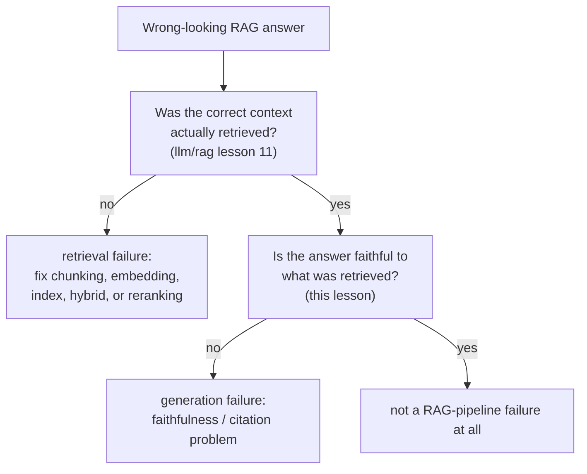

# 第 14 课：针对 RAG 的评测

**使命关联:** `llm/rag` 第 11 课教的是逐阶段诊断检索流水线。它的第 13 课又往前走了一步，确立了即使检索完美，也不能保证答案忠实，然后明确把构建这项忠实性检查的工作，推迟给了本工作区。本课交付的就是它，并说明“忠实于检索到的上下文”和“正确地归到某个具体的引用”是两个不同的问题，而不是一个。
**主要来源:** [论文：“Ragas: Automated Evaluation of Retrieval Augmented Generation”，Es 等，2023](https://arxiv.org/abs/2309.15217)
**前置知识:** [RAG 系列第 11 课：诊断流水线](../../rag/lessons/0011-diagnosing-the-pipeline.md)、[RAG 系列第 13 课：生成环节仍会出的错](../../rag/lessons/0013-what-generation-still-gets-wrong.md)

## 热身

1. ▢ 给智能体的轨迹评分，是把它的最终状态与目标状态作比较，而不是把每个动作与一条参考序列匹配。为什么这是更忠实的选择？

检查

可以有不止一种有效的动作序列，通向同一个正确的结果；只比较最终状态，就能给任何正确到达那里的路径记分，而对照一条固定的参考轨迹评分，会错误地惩罚另一条同样有效的路径。

2. ▢ 为什么 `pass@k` 式的重复采样，说不清智能体是否*可靠*，而只能说明它是否*有能力*？

检查

`pass@k` 只问 k 个样本中是否至少有一个成功，这是 k 中取最佳的能力问题；它说明不了同一个智能体，被要求重复完成同一个任务时，是否会一次又一次地持续成功，而这是 `pass^k` 式的指标所针对的、另一个独立的可靠性问题。

## 要点

### 检索质量和生成质量是相互独立的维度，RAGAS 就是为了把它们分开而建的

RAGAS 自己的表述，直接点出了这个难题：评估 RAG 系统，意味着要考虑检索系统呈现相关、聚焦的上下文的能力，与生成模型忠实地使用该上下文的能力，以及生成文本本身的质量，这三者要分别考虑。把它们压成一个端到端的分数（最终的答案看起来好不好），就掩盖了系统的哪一半（如果有的话）真正需要修，这正是 `llm/rag` 第 11 课仅在检索一侧所解决的同一个诊断问题。RAGAS 明确是**无参照的**：它的任何指标都不需要人工撰写的标准答案来对照，这使得它们便宜到可以对每次改动都运行，而不只是在碰巧有人工标注集的时候。

### 忠实性（接地性）问的是论断是否源自检索到的内容

**忠实性**，也叫**接地性**，检查生成的答案中的每个论断，是否真的有它本应依据的检索上下文支持，而不是凭空编造、与之矛盾，或夹带了一个听起来合理、而上下文从未包含的细节。这是论断层面的检查，而不是整个答案层面的检查：一个答案可以让它的大部分论断都是对的，同时仍混进一个没有依据的细节，而只给整个答案打分的忠实性指标，恰恰会漏掉这种最容易在随手一读时被忽略的部分捏造。

### 引用正确性是比忠实性更严格、独立的问题

**引用正确性**问的是忠实性不问的东西：不只是“这个论断是否有检索到的上下文中的某处支持”，而是“为这个论断所引用的那一段具体文字，是否真的支持它”。ALCE 自己的基准结果使这个差距具体可见：在它的一个测试集上，即使是它测试的最好的系统，也有大约一半的论断缺乏完整的引用支持，这意味着一个论断可以是真的、在检索到的语料中某处有依据，却仍然被归到错误的段落，或者根本没有归到任何段落。一个系统可以在忠实性上得分尚可（就整个检索到的集合而言，论断是真的），同时在引用正确性上得分很差（附在这些论断上的各条引用站不住脚），因为二者检查的是不同的东西：一个答案是否有依据，对比它具体的、可以核对的归属是否正确。

### 把检索失败与生成失败分开，意味着两个数字都要算，而不是凭输出去猜

`llm/rag` 第 11 课，是通过按顺序检查流水线的每个阶段，来诊断错误检索的症状。生成一侧需要它自己的检查，要独立地算出来，而不是从糟糕的答案读起来怎么样去推断：度量正确的上下文是否真的被检索到了（第 11 课的检索质量指标），并度量对实际检索到的上下文的忠实性（本课的指标），在同一个失败的案例上，作为两个独立的数字。基于糟糕检索的上下文构建的答案，与基于完美检索的上下文、却不忠实的答案，从外面看可能一模一样，都是错的，但它们需要完全不同的修复，只有把两个数字都算出来，才能知道你面对的是哪一种。

## 练习

1. ▢ 某个 RAG 系统的答案中，有一个论断在检索到的上下文中无处可寻，但答案中其他每个论断都有充分的依据。给整个答案打分（“大体不错”），能抓住这一点吗？

提示

想一想，整个答案的分数把什么汇总掉了。

检查

不一定。忠实性是论断层面的性质；单个没有依据或捏造的论断，可以藏在一个其他方面依据充分的答案里，而在各论断之间取平均的整个答案的分数，恰恰可能漏掉这种部分捏造。

2. ▢ 某个系统的答案整体上完全得到检索到的语料支持，但它为某个论断所引用的那一段具体文字，并不真的包含这个论断，包含它的是另一段检索到的文字。这是忠实性的失败、引用正确性的失败，还是两者都是？

检查

是引用正确性的失败，不一定是忠实性的失败：论断本身在检索到的上下文中某处是有依据的，所以不是捏造的，但附在它上面的那条具体引用是错的。这正是两项检查之间的差距：忠实性问的是论断是否有检索到的集合支持，引用正确性问的是所引用的那一段具体文字，是否就是真正支持它的那一段。

3. ▢ 为什么 RAGAS 的无参照设计，对于在每次改动时都运行评测，而不只是偶尔运行，特别有用？

检查

因为它不需要人工撰写的标准答案来对照，就避开了第 11 课所说的人工评测的成本（寻找、培训并付费请评分员）；无参照的指标可以对每次改动自动、廉价地计算，而不只是在碰巧有人工标注的比较集时才能算。

4. ▢ 两个 RAG 答案都是错的。一个是基于糟糕检索的上下文构建的；另一个是基于完美检索的上下文，却生成了一个不忠实的论断。只读最终的答案，能分辨这两种情况吗？

检查

不一定。两者从外面看都可能同样地错；要把它们分开，需要把检索质量（正确的上下文是否真的被检索到了，依据 `llm/rag` 第 11 课）和生成的忠实性（答案是否忠实于实际检索到的内容，本课），作为两个独立的数字来度量，而不是从答案的表面样子去推断原因。

5. ▢ 下列哪项说法正确地描述了检索质量、忠实性和引用正确性之间的关系？

    - a) 单一的端到端答案质量分数，就足以诊断 RAG 的失败是检索问题还是生成问题
    - b) 检索质量、忠实性和引用正确性是三项可以分开的检查；一个系统可以在其中一项上得分很好，而在另一项上失败，所以诊断 RAG 的失败，需要分别度量它们，而不是从最终答案去推断
    - c) 忠实于检索到的上下文的论断，自动就是引用正确的
    - d) RAGAS 对它评估的每个查询，都需要人工撰写的标准答案

检查

**b)** 这就是本课所确立的、可以分开的精确结构。（a）错误：端到端的分数分不清检索失败和生成失败，这正是 `llm/rag` 第 11 课与本课，各自独立检查自己那一侧的原因。（c）错误：ALCE 自己的发现表明，论断可以整体上有依据，而它们具体的引用仍然是错的，在它的一个测试集上，大约有一半如此。（d）错误：RAGAS 明确是无参照的，不需要人工撰写的标准答案。

## 实战练习

- [ ] 对于你能用到的某个 RAG 系统，挑一个答案，分别对照两个维度检查它：检索到的上下文是否真的正确（依据 `llm/rag` 第 11 课的诊断），以及答案中的每个论断是否忠实于这个上下文。
- [ ] 如果系统给它的论断附上了引用，就抽查几条：所引用的那一段文字，是否真的包含它所附论断的依据，还是只是话题上相关？
- [ ] 明天：完整阅读主要来源，并记下它的忠实性指标究竟是怎样算出来的（它让 LLM 对照检索到的上下文，核对一个论断时做了什么），而不需要人工撰写的参考答案。

## 延伸阅读

- [论文：“Ragas: Automated Evaluation of Retrieval Augmented Generation”，Es 等，2023](https://arxiv.org/abs/2309.15217)
- [论文：“Enabling Large Language Models to Generate Text with Citations”（ALCE），Gao 等，2023](https://arxiv.org/abs/2305.14627)
- [资源](../RESOURCES.md)

---

没学明白？请重读顶部的主要来源，因为本课是对它的压缩，而理解正是在压缩中流失的。如果有哪个术语觉得含糊，可以查看[术语表](../GLOSSARY.md)。

如果问题出在课程本身，而不是学习材料，那就是一个缺陷：[提交 issue](https://github.com/TokenCemetery/teach/issues)。
