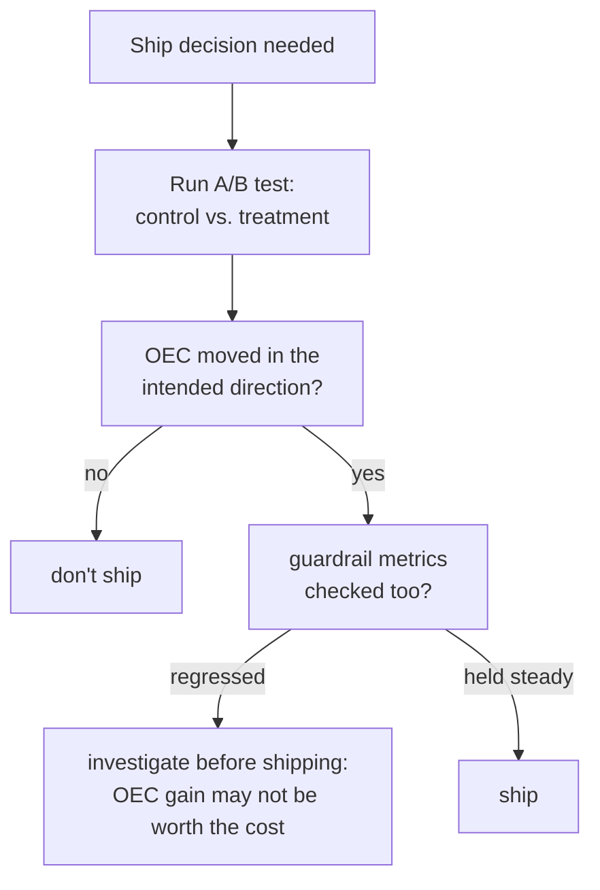

# Lección 15. A/B tests y métricas guardrail

**Vínculo con la misión:** La lección 9 enseñó a distinguir una diferencia real de puntuación offline del ruido. Todo hasta la lección 14 ha sido todavía offline: un conjunto de eval fijo, ejecutado una vez, puntuado una vez. Lanzar un cambio a usuarios reales necesita una contrapartida en vivo de esa disciplina, y resulta necesitar la misma lección que este espacio de trabajo ha repetido en cada etapa desde la seguridad: la métrica que optimizas y la métrica que te dice si rompiste otra cosa tienen que seguirse como dos números separados, no uno.
**Fuente principal:** [Paper: "Seven Rules of Thumb for Web Site Experimenters", Kohavi et al., 2014](https://exp-platform.com/Documents/2014%20experimentersRulesOfThumb.pdf)
**Requisitos previos:** [Lección 9](0009-statistical-significance-vs-noise.md), [Lección 12](0012-safety-and-red-teaming-evaluation.md)

## Calentamiento

1. ▢ Un informe de seguridad indica solo "tasa de rechazo: 94%" sin mencionar contra qué conjunto de prompts se midió. ¿Por qué es imposible interpretar este número por sí solo?

Comprobación

Una tasa de rechazo alta es buena en un conjunto de prompts genuinamente inseguros (detectar amenazas reales) pero mala en un conjunto seguro pero de apariencia sensible (sobrerrechazo); sin saber qué conjunto produjo el número, no hay manera de saber cuál de estas dos situaciones tan distintas refleja.

2. ▢ ¿Por qué una diferencia de puntuación entre dos ejecuciones de eval offline hay que contrastarla con el ruido antes de tratarla como real?

Comprobación

Dos ejecuciones pueden diferir solo por azar, por la variación de muestreo en qué ejemplos se incluyeron o en cómo respondió el modelo; una diferencia hay que medirla frente a cuánta variación podría surgir de forma plausible por azar antes de fiarse de ella como un efecto genuino del cambio que se prueba.

## Qué debes saber

### Un A/B test mide un resultado en vivo, no una puntuación de eval estática

Un **A/B test** (un experimento controlado online) divide al azar el tráfico real entre un **control** (el sistema actual) y un **tratamiento** (el cambio que se prueba), y mide un resultado en vivo, comportamiento real de usuarios, métricas reales de producción, en lugar de una puntuación calculada una vez contra un conjunto de eval offline fijo. La aleatorización es lo que lo hace fiable: es lo que permite atribuir cualquier diferencia medida en el resultado al propio cambio, y no a alguna otra diferencia entre los dos grupos de usuarios.

### El OEC es la métrica (o pequeña combinación) que el experimento realmente intenta mover

Un experimento necesita un **Overall Evaluation Criterion (OEC)**: la métrica concreta, o una pequeña combinación ponderada, que el cambio pretende realmente mejorar. La propia guía de Kohavi es específica sobre qué hace bueno a un candidato a OEC: tiene que ser **movible**, lo bastante sensible para que un cambio real la desplace dentro de un experimento factible, y tiene que estar **conectada causalmente** con el resultado que de verdad importa, no solo correlacionada con él. Su propio ejemplo concreta la trampa: el "número de fotos vistas" es fácil de mover con un cambio de interfaz pero tiene poco efecto causal real sobre los ingresos; una métrica como la tasa de conversión de reservas está más cerca de lo que de verdad le importa al negocio, aunque se mueva de forma menos dramática.

### Una métrica guardrail es lo que sigues sin intentar moverlo

Una **métrica guardrail** es una métrica que el experimento no intenta optimizar en absoluto, pero que vigila específicamente para asegurarse de que el cambio no la dañe en silencio mientras persigue el OEC. Es la versión online de exactamente lo que la lección 12 exigió para la seguridad (la tasa de rechazo y la tasa de sobrerrechazo, seguidas como dos números separados) y la lección 14 exigió para RAG (fidelidad y corrección de las citas, seguidas como dos números separados): un experimento que reporta solo la mejora de su OEC, sin una métrica guardrail revisada junto a él, puede lanzar un cambio que mejoró aquello para lo que optimizaba y a la vez empeoró en silencio otra cosa, la latencia, los incidentes de seguridad, la tasa de quejas, sin que nada del resultado reportado saque a la luz ese compromiso.

### Optimizar el OEC de forma aislada es justo como se rompe un guardrail sin que nadie lo note

El modo de fallo no es hipotético ni raro: un cambio diseñado para mover un OEC tiene todos los incentivos para hacer exactamente eso, y nada de mejorar el OEC garantiza nada sobre una métrica que nadie optimizaba ni vigilaba. Un equipo que lanza basándose solo en la mejora del OEC, sin comprobar que sus métricas guardrail se movieron de forma aceptable (o no se movieron en absoluto), comete el mismo error que reportar solo la tasa de éxito de ataque como "la eval de seguridad", o solo la fidelidad sin comprobar la corrección de las citas: declarar el éxito en el único número que se vigilaba, mientras se acumula un costo real en otro que nadie revisó.

## Práctica

1. ▢ Un equipo elige como OEC de una nueva funcionalidad el "número de veces que se hace clic en el botón de sugerencias de un chatbot", ya que se mueve de forma dramática en las primeras pruebas. ¿Qué pregunta de esta lección deberían hacerse antes de fiarse de esto como un buen OEC?

Pista

Considera las dos propiedades que nombra la guía de Kohavi para un buen OEC, no solo una de ellas.

Comprobación

Si la métrica es solo movible, o si además está conectada causalmente con el resultado que de verdad importa (satisfacción del usuario, finalización de la tarea, ingresos); una métrica fácil de mover pero con poco efecto causal real sobre aquello que le importa al negocio es exactamente la trampa de la que advierte el ejemplo de las "fotos vistas" de Kohavi.

2. ▢ Los resultados de un A/B test reportan un aumento del 12% en el OEC y nada más. ¿Qué falta antes de tratar esto como una decisión de lanzamiento limpia?

Comprobación

Si se comprobó alguna métrica guardrail y si se mantuvieron estables en lugar de retroceder. Una mejora del OEC reportada sola no puede descartar que el cambio haya dañado en silencio otra cosa que el equipo no optimizaba pero que aún necesita proteger.

3. ▢ ¿Por qué esta lección describe optimizar un OEC de forma aislada, sin seguir ninguna métrica guardrail, como "justo como se rompe un guardrail sin que nadie lo note"?

Comprobación

Porque un cambio diseñado para mover el OEC tiene todos los incentivos para lograrlo, pero nada de tener éxito en eso garantiza nada sobre una métrica que nadie vigilaba; sin una métrica guardrail seguida junto al OEC, una regresión real en otro lugar puede lanzarse sin ser detectada, ya que el único número reportado parece un éxito inequívoco.

4. ▢ ¿Cómo se parece el emparejamiento de OEC y métrica guardrail de esta lección al emparejamiento de tasa de rechazo y tasa de sobrerrechazo de la lección 12?

Comprobación

Ambos exigen reportar dos números separados y no uno: la lección 12 exigió la tasa de rechazo y la tasa de sobrerrechazo juntas, ya que optimizar una de forma aislada (ajustar con más fuerza hacia el rechazo) puede empeorar la otra en silencio. El OEC y la métrica guardrail de esta lección siguen la misma estructura, una métrica optimizada y una métrica protegida, seguidas y reportadas de forma independiente en lugar de colapsadas en una única señal de éxito.

5. ▢ ¿Qué afirmación describe correctamente la relación entre un OEC y una métrica guardrail?

    - a) Una métrica guardrail es solo otro nombre para el OEC, y se usan indistintamente
    - b) El OEC es la métrica (o pequeña combinación) que el experimento realmente intenta mover, elegida para ser a la vez movible y conectada causalmente con el resultado real; una métrica guardrail se sigue para detectar el daño no intencionado de optimizar el OEC, y reportar solo la mejora del OEC puede esconder una regresión real en otro lugar
    - c) A una métrica le basta con ser movible para ser un buen candidato a OEC, sin importar su conexión causal con el resultado real
    - d) La aleatorización en un A/B test es opcional siempre que el OEC muestre mejora

Comprobación

**b)** Esa es la relación precisa que establece esta lección. (a) es falsa: un OEC es lo que se optimiza, una métrica guardrail es lo que se protege; confundirlos anula el sentido de seguir cualquiera de las dos. (c) es falsa: la propia guía de Kohavi exige tanto la capacidad de moverse como una conexión causal real, no solo la primera. (d) es falsa: la aleatorización es exactamente lo que permite atribuir una diferencia medida al propio cambio y no a alguna otra diferencia entre grupos.

## Prácticas en el mundo real

- [ ] Para un A/B test al que tengas acceso (o uno descrito en un caso de estudio), identifica su OEC y comprueba si nombra alguna métrica guardrail seguida junto a él.
- [ ] Elige una métrica que tu equipo optimice hoy y hazle las dos preguntas de Kohavi: ¿es movible, y está conectada causalmente con lo que de verdad te importa, o solo correlacionada con ello?
- [ ] Mañana: lee completas las demás reglas prácticas de la fuente primaria y anota cuáles abordan ejecutar bien los experimentos frente a interpretar sus resultados con honestidad.

## Para profundizar

- [Paper: "Seven Rules of Thumb for Web Site Experimenters", Kohavi et al., 2014](https://exp-platform.com/Documents/2014%20experimentersRulesOfThumb.pdf)
- [Recursos](../RESOURCES.md)

---

¿No termina de quedar claro? Vuelve a leer la fuente primaria de arriba, ya que esta lección la comprime y en la compresión es donde se escapa la comprensión. Consulta el [glosario](../GLOSSARY.md) por si algún término te resultó resbaladizo.

Si lo poco claro es la propia lección y no el material, eso es un defecto: [abre un issue](https://github.com/TokenCemetery/teach/issues).
