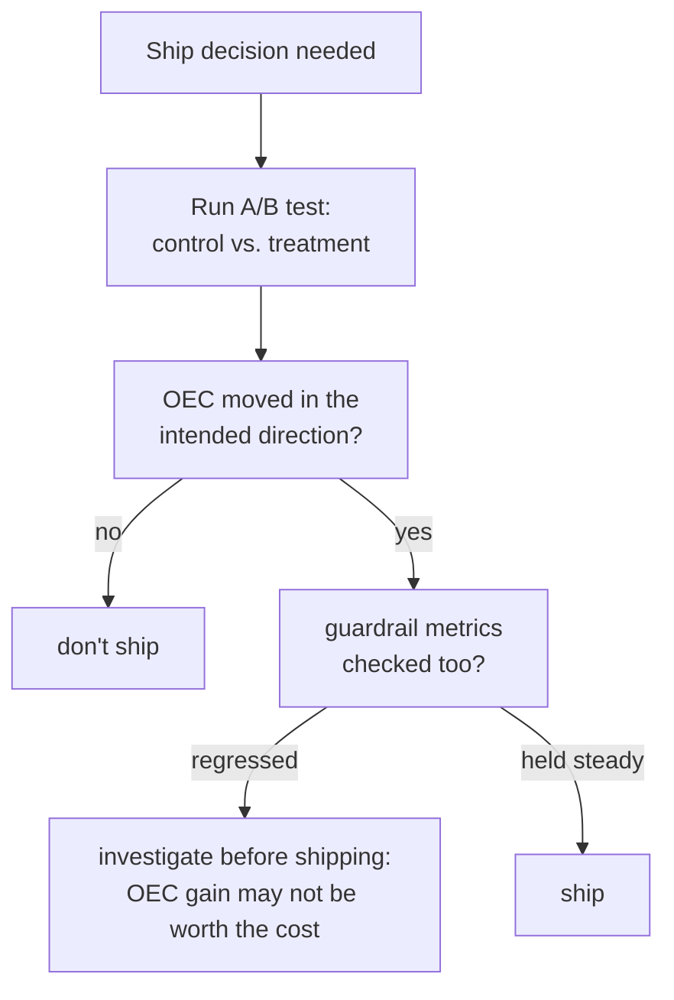

# Leçon 15. A/B tests et métriques garde-fous

**Lien avec la mission :** La leçon 9 a enseigné à distinguer un vrai écart de score hors ligne du bruit. Tout ce qui précède, jusqu'à la leçon 14, est resté hors ligne : un jeu d'eval fixe, exécuté une fois, noté une fois. Livrer un changement à de vrais utilisateurs demande un équivalent en production de cette discipline, et il s'avère qu'il demande la même leçon que cet espace de travail répète à chaque étape depuis la sécurité : la métrique que vous optimisez et la métrique qui vous dit si vous avez cassé autre chose doivent être suivies comme deux chiffres distincts, pas un seul.
**Source primaire :** [Article : "Seven Rules of Thumb for Web Site Experimenters", Kohavi et al., 2014](https://exp-platform.com/Documents/2014%20experimentersRulesOfThumb.pdf)
**Prérequis :** [Leçon 9](0009-statistical-significance-vs-noise.md), [Leçon 12](0012-safety-and-red-teaming-evaluation.md)

## Échauffement

1. ▢ Un rapport de sécurité n'indique que « taux de refus : 94 % » sans mentionner sur quel jeu de prompts il a été mesuré. Pourquoi ce chiffre est-il impossible à interpréter seul ?

Vérifier

Un taux de refus élevé est bon sur un jeu de prompts réellement dangereux (il attrape de vraies menaces) mais mauvais sur un jeu sûr mais à la tonalité sensible (sur-refus) ; sans savoir quel jeu a produit le chiffre, il n'y a aucun moyen de dire laquelle de ces deux situations très différentes il reflète.

2. ▢ Pourquoi un écart de score entre deux exécutions d'eval hors ligne doit-il être confronté au bruit avant d'être traité comme réel ?

Vérifier

Deux exécutions peuvent différer par le seul hasard, à cause de la variation d'échantillonnage sur les exemples inclus ou sur la façon dont le modèle a répondu ; un écart doit être mesuré face à la variation qui pourrait plausiblement survenir par hasard avant qu'on le croie être un vrai effet du changement testé.

## À savoir

### Un A/B test mesure un résultat en production, pas un score d'eval statique

Un **A/B test** (une expérience contrôlée en ligne) répartit aléatoirement le trafic réel entre un **contrôle** (le système actuel) et un **traitement** (le changement testé), et mesure un résultat en production, le comportement réel des utilisateurs, les métriques réelles de production, plutôt qu'un score calculé une fois sur un jeu d'eval hors ligne fixe. La randomisation est ce qui rend cela digne de confiance : c'est elle qui permet d'attribuer toute différence mesurée de résultat au changement lui-même, plutôt qu'à une autre différence entre les deux groupes d'utilisateurs.

### L'OEC est la métrique (ou la petite combinaison) que l'expérience cherche réellement à faire bouger

Une expérience a besoin d'un **Overall Evaluation Criterion (OEC)** : la métrique précise, ou la petite combinaison pondérée, que le changement est réellement censé améliorer. Les conseils de Kohavi lui-même sont précis sur ce qui fait un bon candidat d'OEC : il doit être **mobile**, assez sensible pour qu'un vrai changement le fasse réellement bouger dans une expérience réalisable, et il doit être **lié causalement** au résultat qui compte vraiment, pas seulement corrélé à lui. Son propre exemple rend le piège concret : « number of photos viewed » est facile à faire bouger par un changement d'interface mais a peu d'effet causal réel sur le chiffre d'affaires ; une métrique comme le taux de conversion en réservation se situe plus près de ce qui importe vraiment à l'entreprise, même si elle bouge moins spectaculairement.

### Une métrique garde-fou est ce qu'on suit sans chercher à la faire bouger

Une **métrique garde-fou** est une métrique que l'expérience ne cherche pas du tout à optimiser, mais qu'elle surveille précisément pour s'assurer que le changement ne l'abîme pas en silence pendant la poursuite de l'OEC. C'est la version en ligne de ce que la leçon 12 exigeait pour la sécurité (taux de refus et taux de sur-refus, suivis comme deux chiffres distincts) et que la leçon 14 exigeait pour le RAG (fidélité et exactitude des citations, suivies comme deux chiffres distincts) : une expérience qui ne rapporte que l'amélioration de son OEC, sans métrique garde-fou vérifiée à côté, peut livrer un changement qui a amélioré ce qu'il optimisait tout en dégradant silencieusement autre chose, la latence, les incidents de sécurité, le taux de réclamations, sans que rien dans le résultat rapporté fasse apparaître ce compromis.

### Optimiser l'OEC isolément, c'est exactement ainsi qu'un garde-fou se casse sans que personne le remarque

Ce mode de défaillance n'est ni hypothétique ni rare : un changement conçu pour faire bouger un OEC a tout intérêt à le faire, et rien dans l'amélioration de l'OEC ne garantit quoi que ce soit sur une métrique que personne n'optimisait ni ne surveillait. Une équipe qui livre sur la seule base de l'amélioration de l'OEC, sans vérifier que ses métriques garde-fous ont évolué de façon acceptable (ou n'ont pas bougé), commet la même erreur que de ne rapporter que le taux de réussite des attaques comme « l'eval de sécurité », ou que la seule fidélité sans vérifier l'exactitude des citations : proclamer le succès sur le seul chiffre surveillé pendant qu'un coût réel s'accumule sur un autre que personne n'a vérifié.

## Pratique

1. ▢ Une équipe choisit « nombre de clics sur le bouton de suggestion d'un chatbot » comme OEC d'une nouvelle fonctionnalité, puisqu'il bouge fortement dans les premiers tests. Quelle question de cette leçon doit-elle poser avant de faire confiance à cela comme bon OEC ?

Indice

Considérez les deux propriétés que les conseils de Kohavi nomment pour un bon OEC, pas seulement l'une d'elles.

Vérifier

Si la métrique est seulement mobile, ou si elle est aussi liée causalement au résultat qui compte vraiment (satisfaction des utilisateurs, achèvement de la tâche, chiffre d'affaires) ; une métrique facile à faire bouger mais sans effet causal réel sur ce qui importe à l'entreprise est exactement le piège contre lequel met en garde l'exemple « photos viewed » de Kohavi.

2. ▢ Les résultats d'un A/B test rapportent une hausse de 12 % de l'OEC et rien d'autre. Que manque-t-il avant de traiter cela comme une décision de livraison nette ?

Vérifier

Si des métriques garde-fous ont été vérifiées, et si elles sont restées stables plutôt que de régresser. Une amélioration de l'OEC rapportée seule ne peut pas exclure que le changement ait abîmé en silence autre chose que l'équipe n'optimisait pas mais doit pourtant protéger.

3. ▢ Pourquoi optimiser un OEC isolément, sans métrique garde-fou suivie, est-il décrit dans cette leçon comme « exactement ainsi qu'un garde-fou se casse sans que personne le remarque » ?

Vérifier

Parce qu'un changement conçu pour faire bouger l'OEC a tout intérêt à le faire, mais réussir cela ne garantit rien sur une métrique que personne ne surveillait ; sans métrique garde-fou suivie à côté de l'OEC, une vraie régression ailleurs peut être livrée sans être détectée, puisque l'unique chiffre rapporté ressemble à un succès sans ambiguïté.

4. ▢ En quoi l'appariement OEC/métrique garde-fou de cette leçon est-il parallèle à l'appariement taux de refus/taux de sur-refus de la leçon 12 ?

Vérifier

Les deux exigent de rapporter deux chiffres distincts plutôt qu'un : la leçon 12 exigeait le taux de refus et le taux de sur-refus ensemble, puisqu'optimiser l'un isolément (régler plus fort vers le refus) peut dégrader silencieusement l'autre. L'OEC et la métrique garde-fou de cette leçon suivent la même structure, une métrique optimisée et une métrique protégée, suivies et rapportées indépendamment plutôt que fondues en un seul signal de succès.

5. ▢ Laquelle de ces affirmations décrit correctement le lien entre un OEC et une métrique garde-fou ?

    - a) Une métrique garde-fou n'est qu'un autre nom de l'OEC, employé de façon interchangeable
    - b) L'OEC est la métrique (ou petite combinaison) que l'expérience cherche réellement à faire bouger, choisie pour être à la fois mobile et liée causalement au vrai résultat ; une métrique garde-fou est suivie pour détecter un tort involontaire causé par l'optimisation de l'OEC, et ne rapporter que l'amélioration de l'OEC peut cacher une vraie régression ailleurs
    - c) Une métrique n'a besoin d'être que mobile pour être un bon candidat d'OEC, quel que soit son lien causal avec le vrai résultat
    - d) La randomisation dans un A/B test est facultative tant que l'OEC montre une amélioration

Vérifier

**b)** C'est le lien précis qu'établit cette leçon. (a) est faux : un OEC est ce qui est optimisé, une métrique garde-fou est ce qui est protégé ; les confondre annule l'intérêt de suivre l'une ou l'autre. (c) est faux : les conseils de Kohavi lui-même exigent à la fois la mobilité et un vrai lien causal, pas la mobilité seule. (d) est faux : la randomisation est exactement ce qui permet d'attribuer une différence mesurée au changement lui-même plutôt qu'à une autre différence entre groupes.

## Exercices en situation réelle

- [ ] Pour un A/B test auquel vous avez accès (ou un test décrit dans une étude de cas), identifiez son OEC et vérifiez s'il nomme des métriques garde-fous suivies à côté.
- [ ] Choisissez une métrique que votre équipe optimise aujourd'hui et posez-lui les deux questions de Kohavi : est-elle mobile, et est-elle liée causalement à ce qui vous importe vraiment, ou seulement corrélée à lui ?
- [ ] Demain : lisez en entier les autres règles empiriques de la source primaire, et notez lesquelles portent sur bien conduire des expériences et lesquelles sur interpréter honnêtement leurs résultats.

## Pour aller plus loin

- [Article : "Seven Rules of Thumb for Web Site Experimenters", Kohavi et al., 2014](https://exp-platform.com/Documents/2014%20experimentersRulesOfThumb.pdf)
- [Ressources](../RESOURCES.md)

---

Ça ne passe pas ? Relisez la source primaire en haut de page, car cette leçon la condense et c'est dans la condensation que la compréhension s'échappe. Consultez le [glossaire](../GLOSSARY.md) pour tout terme qui vous a paru glissant.

Si c'est la leçon elle-même qui n'est pas claire plutôt que la matière, c'est un défaut : [ouvrez une issue](https://github.com/TokenCemetery/teach/issues).
