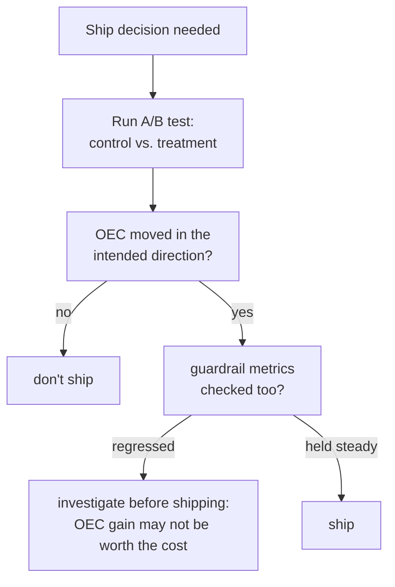

# पाठ 15. A/B Tests और Guardrail Metrics

**मिशन से संबंध:** पाठ 9 ने सिखाया कि offline score के असली फ़र्क़ को noise से कैसे अलग करें। पाठ 14 तक सब कुछ अब भी offline रहा है: तय eval सेट, एक बार चलाया हुआ, एक बार score किया हुआ। असली उपयोगकर्ताओं तक बदलाव ship करने के लिए उस अनुशासन का live जोड़ीदार चाहिए, और उसे वही सबक़ चाहिए जो यह workspace safety के बाद से हर चरण पर दोहराता आया है: जिस metric को आप optimize कर रहे हैं और जो metric बताती है कि आपने कुछ और तो नहीं तोड़ा, उन्हें एक नहीं बल्कि दो अलग संख्याओं के रूप में ट्रैक करना पड़ता है।
**मुख्य स्रोत:** [पेपर: "Seven Rules of Thumb for Web Site Experimenters", Kohavi et al., 2014](https://exp-platform.com/Documents/2014%20experimentersRulesOfThumb.pdf)
**पूर्व-आवश्यकताएँ:** [पाठ 9](0009-statistical-significance-vs-noise.md), [पाठ 12](0012-safety-and-red-teaming-evaluation.md)

## वार्म-अप

1. ▢ एक safety रिपोर्ट सिर्फ़ "refusal rate: 94%" बताती है, यह ज़िक्र किए बिना कि वह किस prompt सेट पर मापी गई। यह संख्या अकेली पढ़ी क्यों नहीं जा सकती?

जाँचें

ऊँची refusal दर सचमुच असुरक्षित prompt सेट पर अच्छी है (असली ख़तरे पकड़ना) पर सुरक्षित-पर-संवेदनशील-लगने वाले सेट पर बुरी है (over-refusal); यह जाने बिना कि संख्या किस सेट से आई, बताने का कोई तरीक़ा नहीं कि वह इन दो बहुत अलग स्थितियों में से किसे दर्शाती है।

2. ▢ दो offline eval runs के बीच score के फ़र्क़ को असली मानने से पहले noise के सामने क्यों जाँचना पड़ता है?

जाँचें

दो runs अकेले संयोग से अलग हो सकते हैं, इस sampling भिन्नता से कि कौन-से examples शामिल थे या model ने संयोग से कैसे जवाब दिया; फ़र्क़ को परखे जा रहे बदलाव का असली असर मानने से पहले यह मापना होता है कि संयोग से कितनी भिन्नता संभव थी।

## यह जानें

### A/B test live नतीजा मापता है, स्थिर eval score नहीं

**A/B test** (online controlled experiment) असली traffic को **control** (मौजूदा system) और **treatment** (परखा जा रहा बदलाव) के बीच यादृच्छिक रूप से बाँटता है, और live नतीजा मापता है, असली उपयोगकर्ता का व्यवहार, असली production metrics, तय offline eval सेट के विरुद्ध एक बार निकाले गए score के बजाय। यादृच्छिकीकरण ही इसे भरोसेमंद बनाता है: वही नतीजे में किसी भी मापे गए फ़र्क़ को बदलाव से जोड़ने देता है, उपयोगकर्ताओं के दोनों समूहों के बीच किसी और फ़र्क़ से नहीं।

### OEC वह अकेली metric (या छोटा मिश्रण) है जिसे experiment सचमुच हिलाने की कोशिश कर रहा है

Experiment को **Overall Evaluation Criterion (OEC)** चाहिए: वह ख़ास metric, या छोटा भारित मिश्रण, जिसे बदलाव को असल में सुधारना है। अच्छे OEC उम्मीदवार के बारे में Kohavi का अपना मार्गदर्शन ख़ास है: वह **हिलाने लायक** होना चाहिए, इतना संवेदनशील कि असली बदलाव व्यावहारिक experiment में उसे खिसका दे, और वह उस नतीजे से **कारण के रूप में जुड़ा** होना चाहिए जो सचमुच मायने रखता है, सिर्फ़ उससे correlated नहीं। उनका अपना उदाहरण जाल को ठोस बनाता है: "देखी गई तस्वीरों की संख्या" UI बदलाव से आसानी से हिल जाती है पर revenue पर उसका असली कारणात्मक असर बहुत कम है; booking conversion rate जैसी metric उस चीज़ के ज़्यादा क़रीब बैठती है जिसकी business को असल में परवाह है, भले वह कम नाटकीय रूप से हिले।

### Guardrail metric वह है जिसे आप हिलाने की कोशिश के बिना ट्रैक करते हैं

**Guardrail metric** वह metric है जिसे experiment optimize करने की कोशिश बिल्कुल नहीं कर रहा, पर ख़ास तौर पर यह पक्का करने के लिए देख रहा है कि OEC का पीछा करते हुए बदलाव उसे चुपचाप नुक़सान न पहुँचाए। यह ठीक उसका online रूप है जो पाठ 12 ने safety के लिए माँगा था (refusal rate और over-refusal rate, दो अलग संख्याओं के रूप में ट्रैक) और पाठ 14 ने RAG के लिए (faithfulness और citation correctness, दो अलग संख्याओं के रूप में ट्रैक): जो experiment सिर्फ़ अपने OEC का सुधार बताए, साथ में कोई guardrail metric जाँचे बिना, वह ऐसा बदलाव ship कर सकता है जिसने उस चीज़ को सुधारा जिसके लिए वह optimize हो रहा था, और चुपचाप कुछ और बिगाड़ दिया, latency, safety घटनाएँ, शिकायत दर, और बताए गए नतीजे में कुछ नहीं दिखेगा जो उस trade-off को सामने लाए।

### OEC को अकेले optimize करना ठीक वही तरीक़ा है जिससे guardrail बिना किसी के ध्यान में आए टूट जाता है

विफलता का यह तरीक़ा काल्पनिक या दुर्लभ नहीं है: OEC हिलाने के लिए गढ़े गए बदलाव के पास ठीक वही करने का हर प्रोत्साहन होता है, और OEC सुधरने से ऐसी metric के बारे में कुछ तय नहीं होता जिसे कोई optimize नहीं कर रहा था या देख नहीं रहा था। जो टीम सिर्फ़ OEC सुधार के आधार पर ship करती है, यह जाँचे बिना कि उसकी guardrail metrics स्वीकार्य ढंग से हिलीं (या बिल्कुल नहीं हिलीं), वह वही ग़लती कर रही है जो सिर्फ़ attack success rate को "safety eval" बताने, या citation correctness जाँचे बिना सिर्फ़ faithfulness बताने में है: उस एक संख्या पर सफलता घोषित करना जिसे देखा जा रहा था, जबकि किसी दूसरी पर, जिसे किसी ने नहीं जाँचा, असली क़ीमत जमा हो रही है।

## अभ्यास

1. ▢ एक टीम नए feature के OEC के रूप में "chatbot के सुझाव वाले बटन पर कितनी बार click हुआ" चुनती है, क्योंकि शुरुआती परीक्षण में वह नाटकीय रूप से हिलती है। इसे अच्छा OEC मानने से पहले उन्हें इस पाठ का कौन-सा सवाल पूछना चाहिए?

संकेत

अच्छे OEC के लिए Kohavi का मार्गदर्शन जो दोनों गुण बताता है, उन पर सोचें, सिर्फ़ एक पर नहीं।

जाँचें

क्या metric सिर्फ़ हिलने लायक है, या वह उस नतीजे से कारण के रूप में भी जुड़ी है जो सचमुच मायने रखता है (उपयोगकर्ता की संतुष्टि, task पूरा होना, revenue); जो metric आसानी से हिलती है पर उस चीज़ पर जिसकी business को परवाह है, उसका असली कारणात्मक असर बहुत कम है, ठीक वही जाल है जिसके बारे में Kohavi का "देखी गई तस्वीरें" वाला उदाहरण चेताता है।

2. ▢ A/B test के नतीजे OEC में 12% की बढ़त बताते हैं और कुछ नहीं। इसे साफ़ ship फ़ैसला मानने से पहले क्या छूटा है?

जाँचें

क्या कोई guardrail metrics जाँची गईं, और क्या वे बिगड़ने के बजाय स्थिर रहीं। अकेले बताया गया OEC सुधार इस संभावना को ख़ारिज नहीं कर सकता कि बदलाव ने चुपचाप कुछ और नुक़सान पहुँचाया जिसे टीम optimize नहीं कर रही थी पर जिसकी उसे फिर भी रक्षा करनी है।

3. ▢ किसी guardrail metric को ट्रैक किए बिना OEC को अकेले optimize करने को इस पाठ में "ठीक वही तरीक़ा जिससे guardrail बिना किसी के ध्यान में आए टूट जाता है" क्यों कहा गया है?

जाँचें

क्योंकि OEC हिलाने के लिए गढ़े गए बदलाव के पास वैसा करने का हर प्रोत्साहन होता है, पर उसमें सफल होने से ऐसी metric के बारे में कुछ तय नहीं होता जिसे कोई देख नहीं रहा था; OEC के साथ guardrail metric ट्रैक किए बिना, कहीं और की असली regression बिना पकड़े ship हो सकती है, क्योंकि जो अकेली संख्या बताई जा रही है वह साफ़ सफलता जैसी दिखती है।

4. ▢ इस पाठ की OEC/guardrail-metric जोड़ी पाठ 12 की refusal-rate/over-refusal-rate जोड़ी के समानांतर कैसे है?

जाँचें

दोनों में एक नहीं बल्कि दो अलग संख्याएँ बतानी पड़ती हैं: पाठ 12 ने refusal rate और over-refusal rate साथ-साथ माँगे, क्योंकि एक को अकेले optimize करना (refusal की ओर ज़्यादा कसकर tune करना) चुपचाप दूसरे को बिगाड़ सकता है। इस पाठ का OEC और guardrail metric उसी संरचना पर चलते हैं, एक optimize की जाने वाली metric और एक बचाई जाने वाली metric, जो एक अकेले सफलता-संकेत में समेटने के बजाय स्वतंत्र रूप से ट्रैक और रिपोर्ट की जाती हैं।

5. ▢ OEC और guardrail metric के संबंध का सही वर्णन कौन-सा दावा करता है?

    - a) Guardrail metric बस OEC का दूसरा नाम है, जिसे बदल-बदलकर इस्तेमाल किया जाता है
    - b) OEC वह metric (या छोटा मिश्रण) है जिसे experiment असल में हिलाने की कोशिश कर रहा है, जो हिलने लायक और असली नतीजे से कारण के रूप में जुड़ी, दोनों होने के लिए चुनी गई है; guardrail metric OEC को optimize करने से होने वाले अनचाहे नुक़सान को पकड़ने के लिए ट्रैक की जाती है, और सिर्फ़ OEC का सुधार बताना कहीं और की असली regression छिपा सकता है
    - c) अच्छे OEC उम्मीदवार के लिए metric का सिर्फ़ हिलने लायक होना काफ़ी है, असली नतीजे से उसके कारणात्मक संबंध की परवाह किए बिना
    - d) A/B test में यादृच्छिकीकरण वैकल्पिक है, जब तक OEC में सुधार दिखे

जाँचें

**b)** यही वह सटीक संबंध है जो यह पाठ स्थापित करता है। (a) ग़लत है: OEC वह है जो optimize होता है, guardrail metric वह है जिसकी रक्षा होती है; दोनों को एक मान लेना उन्हें अलग-अलग ट्रैक करने का मक़सद ही ख़त्म कर देता है। (c) ग़लत है: Kohavi का अपना मार्गदर्शन हिलने की क्षमता और असली कारणात्मक संबंध, दोनों माँगता है, अकेली हिलने की क्षमता नहीं। (d) ग़लत है: यादृच्छिकीकरण ही मापे गए फ़र्क़ को उपयोगकर्ताओं के समूहों के बीच किसी और फ़र्क़ के बजाय बदलाव से जोड़ने देता है।

## असली दुनिया का अभ्यास

- [ ] जिस A/B test तक आपकी पहुँच है (या जो किसी case study में बताया गया है), उसका OEC पहचानें और जाँचें कि क्या वह उसके साथ ट्रैक की गई किसी guardrail metric का नाम लेता है।
- [ ] कोई एक metric चुनें जिसे आपकी टीम अभी optimize करती है और उससे Kohavi के दो सवाल पूछें: क्या वह हिलने लायक है, और क्या वह उस चीज़ से कारण के रूप में जुड़ी है जिसकी आपको असल में परवाह है, या बस उसके साथ correlated है?
- [ ] कल: मुख्य स्रोत के बाक़ी rules of thumb पूरे पढ़ें, और लिखें कि इनमें से कौन-से experiments को अच्छी तरह चलाने के बारे में हैं और कौन-से उनके नतीजे ईमानदारी से पढ़ने के बारे में।

## आगे बढ़ने के लिए

- [पेपर: "Seven Rules of Thumb for Web Site Experimenters", Kohavi et al., 2014](https://exp-platform.com/Documents/2014%20experimentersRulesOfThumb.pdf)
- [संसाधन](../RESOURCES.md)

---

बात नहीं बन रही? ऊपर दिए primary source को दोबारा पढ़ें, क्योंकि यह पाठ उसे संक्षिप्त करता है और समझ संक्षेप में ही रिसती है। जो शब्द फिसलन भरा लगे, उसके लिए [शब्दावली](../GLOSSARY.md) देखें।

अगर दिक़्क़त सामग्री की नहीं बल्कि पाठ की ही है, तो वह एक खोट है: [issue खोलें](https://github.com/TokenCemetery/teach/issues)।
