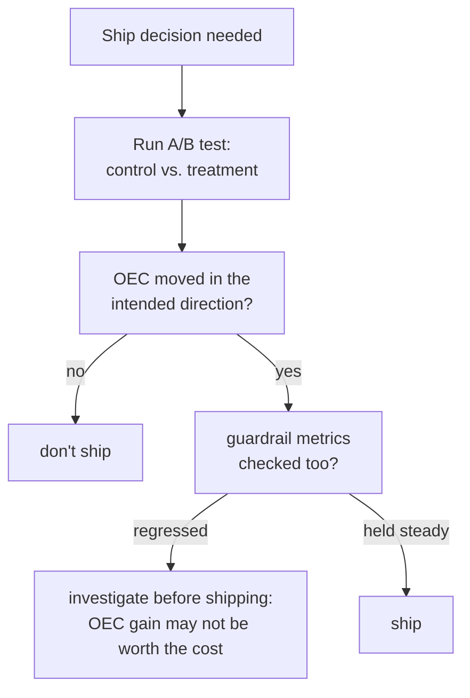

# Lição 15. Testes A/B e métricas guardrail

**Ligação com a missão:** A lição 9 ensinou a distinguir uma diferença real de pontuação offline do ruído. Tudo até a lição 14 ainda foi offline: um conjunto de eval fixo, executado uma vez, pontuado uma vez. Lançar uma mudança para usuários reais exige uma contrapartida ao vivo dessa disciplina, e ela acaba precisando da mesma lição que este workspace repete em toda etapa desde a segurança: a métrica que você está otimizando e a métrica que diz se você quebrou outra coisa precisam ser acompanhadas como dois números separados, e não um.
**Fonte principal:** [Artigo científico: "Seven Rules of Thumb for Web Site Experimenters", Kohavi et al., 2014](https://exp-platform.com/Documents/2014%20experimentersRulesOfThumb.pdf)
**Pré-requisitos:** [Lição 9](0009-statistical-significance-vs-noise.md), [Lição 12](0012-safety-and-red-teaming-evaluation.md)

## Aquecimento

1. ▢ Um relatório de segurança afirma apenas "taxa de recusa: 94%", sem mencionar contra qual conjunto de prompts foi medida. Por que esse número é impossível de interpretar sozinho?

Verificação

Uma taxa de recusa alta é boa em um conjunto de prompts genuinamente inseguros (pegando ameaças reais), mas ruim em um conjunto seguro de som sensível (recusa excessiva); sem saber qual conjunto produziu o número, não há como dizer qual dessas duas situações muito diferentes ele reflete.

2. ▢ Por que uma diferença de pontuação entre duas execuções offline de eval precisa ser conferida contra o ruído antes de ser tratada como real?

Verificação

Duas execuções podem diferir só por acaso, pela variação de amostragem de quais exemplos foram incluídos ou de como o modelo por acaso respondeu; uma diferença precisa ser medida contra quanta variação poderia plausivelmente surgir por acaso antes de ser aceita como efeito genuíno da mudança testada.

## Saiba isto

### Um teste A/B mede um resultado ao vivo, não uma pontuação de eval estática

Um **teste A/B** (um experimento controlado online) divide aleatoriamente o tráfego real entre um **controle** (o sistema atual) e um **tratamento** (a mudança testada), e mede um resultado ao vivo, comportamento real de usuários, métricas reais de produção, em vez de uma pontuação calculada uma vez contra um conjunto de eval offline fixo. A aleatorização é o que torna isso confiável: é o que permite atribuir qualquer diferença medida de resultado à própria mudança, e não a alguma outra diferença entre os dois grupos de usuários.

### O OEC é a métrica (ou pequena combinação) que o experimento realmente tenta mover

Um experimento precisa de um **Overall Evaluation Criterion (OEC)**: a métrica específica, ou pequena combinação ponderada, que a mudança de fato deve melhorar. A orientação do próprio Kohavi é específica sobre o que faz um bom candidato a OEC: ele precisa ser **movível**, sensível o bastante para que uma mudança real o desloque dentro de um experimento viável, e precisa ser **causalmente ligado** ao resultado que de fato importa, e não apenas correlacionado com ele. O exemplo dele torna a armadilha concreta: "número de fotos visualizadas" é fácil de mover com uma mudança de interface, mas tem pouco efeito causal real sobre a receita; uma métrica como a taxa de conversão de reservas fica mais perto do que o negócio de fato importa, embora possa se mover de modo menos dramático.

### Uma métrica guardrail é o que você acompanha sem tentar movê-la

Uma **métrica guardrail** é uma métrica que o experimento não está tentando otimizar de modo algum, mas vigia especificamente para garantir que a mudança não a danifique em silêncio enquanto persegue o OEC. Esta é a versão online do que a lição 12 exigiu para a segurança (taxa de recusa e taxa de recusa excessiva, acompanhadas como dois números separados) e a lição 14 exigiu para o RAG (fidelidade e correção de citações, acompanhadas como dois números separados): um experimento que reporta apenas a melhoria do seu OEC, sem uma métrica guardrail verificada ao lado, pode lançar uma mudança que melhorou aquilo para que foi otimizada enquanto piora em silêncio outra coisa, latência, incidentes de segurança, taxa de reclamações, sem que nada no resultado reportado revele esse trade-off.

### Otimizar o OEC isoladamente é exatamente como um guardrail é quebrado sem que ninguém perceba

O modo de falha não é hipotético nem raro: uma mudança projetada para mover um OEC tem todo incentivo para fazer exatamente isso, e nada em melhorar o OEC garante coisa alguma sobre uma métrica que ninguém estava otimizando nem vigiando. Uma equipe que lança com base apenas na melhoria do OEC, sem verificar se suas métricas guardrail se moveram de forma aceitável (ou não se moveram), está cometendo o mesmo erro de reportar apenas a taxa de sucesso de ataque como "o eval de segurança", ou apenas a fidelidade sem verificar a correção de citações: declarar sucesso no único número que estava sendo vigiado, enquanto um custo real se acumula em outro que ninguém verificou.

## Prática

1. ▢ Uma equipe escolhe "número de cliques no botão de sugestão de um chatbot" como seu OEC para uma nova funcionalidade, já que ele se move dramaticamente nos testes iniciais. Que pergunta desta lição ela deve fazer antes de confiar nisso como um bom OEC?

Dica

Considere as duas propriedades que a orientação de Kohavi nomeia para um bom OEC, e não apenas uma delas.

Verificação

Se a métrica é apenas movível, ou se também é causalmente ligada ao resultado que de fato importa (satisfação do usuário, conclusão de tarefa, receita); uma métrica fácil de mover mas com pouco efeito causal real sobre aquilo que o negócio valoriza é exatamente a armadilha contra a qual o exemplo das "fotos visualizadas" de Kohavi alerta.

2. ▢ Os resultados de um teste A/B reportam um aumento de 12% no OEC e nada mais. O que falta antes de isso ser tratado como uma decisão limpa de lançamento?

Verificação

Se alguma métrica guardrail foi verificada, e se ficou estável em vez de regredir. Uma melhoria de OEC reportada sozinha não consegue descartar que a mudança tenha danificado em silêncio algo que a equipe não estava otimizando mas ainda precisa proteger.

3. ▢ Por que otimizar um OEC isoladamente, sem nenhuma métrica guardrail acompanhada, é descrito nesta lição como "exatamente como um guardrail é quebrado sem que ninguém perceba"?

Verificação

Porque uma mudança projetada para mover o OEC tem todo incentivo para fazê-lo, mas nada em ter sucesso nisso garante coisa alguma sobre uma métrica que ninguém estava vigiando; sem uma métrica guardrail acompanhada ao lado do OEC, uma regressão real em outro ponto pode ser lançada sem ser detectada, já que o único número reportado parece sucesso inequívoco.

4. ▢ Como o par OEC/métrica guardrail desta lição é paralelo ao par taxa de recusa/taxa de recusa excessiva da lição 12?

Verificação

Os dois exigem reportar dois números separados em vez de um: a lição 12 exigiu taxa de recusa e taxa de recusa excessiva juntas, já que otimizar uma isoladamente (ajustando com mais força para a recusa) pode piorar a outra em silêncio. O OEC e a métrica guardrail desta lição seguem a mesma estrutura, uma métrica otimizada e uma métrica protegida, acompanhadas e reportadas de forma independente, em vez de reduzidas a um único sinal de sucesso.

5. ▢ Qual afirmação descreve corretamente a relação entre um OEC e uma métrica guardrail?

    - a) Uma métrica guardrail é só outro nome para o OEC, usados de forma intercambiável
    - b) O OEC é a métrica (ou pequena combinação) que o experimento realmente tenta mover, escolhida para ser ao mesmo tempo movível e causalmente ligada ao resultado real; uma métrica guardrail é acompanhada para pegar dano não intencional causado pela otimização do OEC, e reportar apenas a melhoria do OEC pode esconder uma regressão real em outro ponto
    - c) Uma métrica só precisa ser movível para ser um bom candidato a OEC, independentemente de sua ligação causal com o resultado real
    - d) A aleatorização em um teste A/B é opcional, desde que o OEC mostre melhoria

Verificação

**b)** Essa é a relação precisa que esta lição estabelece. (a) é falsa: um OEC é o que se otimiza, uma métrica guardrail é o que se protege; misturá-los anula o propósito de acompanhar qualquer um dos dois. (c) é falsa: a orientação do próprio Kohavi exige tanto a capacidade de se mover quanto uma ligação causal real, e não apenas a primeira. (d) é falsa: a aleatorização é exatamente o que permite atribuir uma diferença medida à própria mudança, e não a alguma outra diferença entre os grupos.

## Prática no mundo real

- [ ] Para um teste A/B a que você tenha acesso (ou um descrito em um estudo de caso), identifique seu OEC e verifique se ele nomeia alguma métrica guardrail acompanhada ao lado.
- [ ] Escolha uma métrica que sua equipe otimiza hoje e faça a ela as duas perguntas de Kohavi: ela é movível, e é causalmente ligada ao que você de fato valoriza, ou apenas correlacionada com isso?
- [ ] Amanhã: leia por inteiro as outras regras práticas da fonte principal e anote quais tratam de executar bem os experimentos e quais tratam de interpretar seus resultados com honestidade.

## Para ir além

- [Artigo científico: "Seven Rules of Thumb for Web Site Experimenters", Kohavi et al., 2014](https://exp-platform.com/Documents/2014%20experimentersRulesOfThumb.pdf)
- [Recursos](../RESOURCES.md)

---

Não ficou claro? Releia a fonte principal no topo, já que esta lição a comprime e é na compressão que o entendimento escapa. Consulte o [glossário](../GLOSSARY.md) para qualquer termo que pareceu escorregadio.

Se o problema é a lição em si, e não o material, isso é um defeito: [abra uma issue](https://github.com/TokenCemetery/teach/issues).
