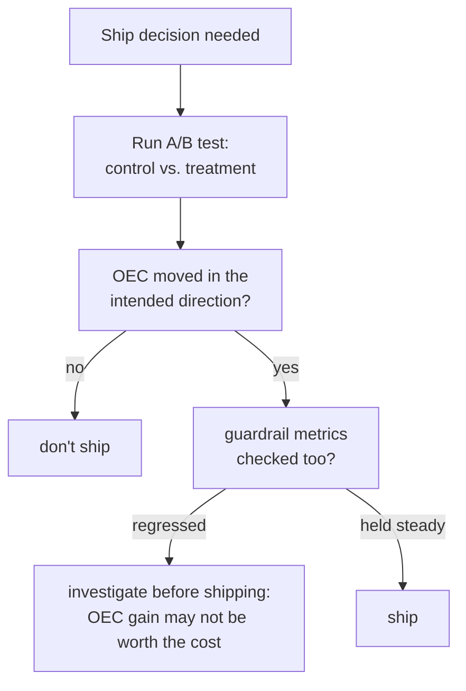

# Урок 15. A/B-тесты и защитные метрики

**Связь с целью курса:** Урок 9 учил отличать настоящую офлайн-разницу оценок от шума. Всё до урока 14 включительно по-прежнему было офлайн: фиксированный набор для эвала, один запуск, одна оценка. Выпуск изменения для реальных пользователей требует живого аналога этой дисциплины, и ему оказывается нужен тот же урок, который эта рабочая область повторяет на каждом этапе со времён безопасности: метрику, которую вы оптимизируете, и метрику, сообщающую, не сломали ли вы что-то другое, нужно отслеживать как два отдельных числа, а не одно.
**Первоисточник:** [Научная статья: "Seven Rules of Thumb for Web Site Experimenters", Kohavi et al., 2014](https://exp-platform.com/Documents/2014%20experimentersRulesOfThumb.pdf)
**Предварительные требования:** [Урок 9](0009-statistical-significance-vs-noise.md), [Урок 12](0012-safety-and-red-teaming-evaluation.md)

## Разминка

1. ▢ В отчёте по безопасности указано только «доля отказов: 94%» без упоминания того, на каком наборе промптов она измерена. Почему это число невозможно интерпретировать само по себе?

Проверка

Высокая доля отказов хороша на по-настоящему небезопасном наборе промптов (ловит настоящие угрозы), но плоха на безопасном, но чувствительно звучащем наборе (избыточный отказ); не зная, какой набор дал число, нельзя сказать, какую из этих двух очень разных ситуаций оно отражает.

2. ▢ Почему разницу оценок между двумя офлайн-запусками эвала нужно сверить с шумом, прежде чем считать её настоящей?

Проверка

Два запуска могут отличаться одной случайностью, из-за вариации выборки того, какие примеры вошли, или того, как модель случайно ответила; разницу нужно измерить относительно того, сколько вариации могло правдоподобно возникнуть случайно, прежде чем доверять ей как настоящему эффекту проверяемого изменения.

## Что нужно знать

### A/B-тест измеряет живой исход, а не статичную оценку эвала

**A/B-тест** (онлайн-контролируемый эксперимент) случайно делит реальный трафик между **контрольной группой** (текущая система) и **тестовой группой** (проверяемое изменение) и измеряет живой исход: фактическое поведение пользователей, фактические метрики продакшена, а не оценку, вычисленную один раз на фиксированном офлайн-наборе для эвала. Рандомизация делает его заслуживающим доверия: она позволяет приписать любую измеренную разницу в исходе самому изменению, а не какому-то другому отличию между двумя группами пользователей.

### OEC это единственная метрика (или небольшая комбинация), которую эксперимент на самом деле пытается сдвинуть

Эксперименту нужен **общий критерий оценки (Overall Evaluation Criterion, OEC)**: конкретная метрика или небольшая взвешенная комбинация, которую изменение призвано улучшить. Собственные рекомендации Кохави конкретны насчёт того, что делает хорошего кандидата в OEC: он должен быть **подвижным**, достаточно чувствительным, чтобы настоящее изменение сдвинуло его в реалистичном эксперименте, и должен быть **причинно связан** с исходом, который действительно важен, а не просто коррелировать с ним. Его собственный пример делает ловушку конкретной: «число просмотренных фотографий» легко сдвигается изменением интерфейса, но почти не влияет причинно на выручку; метрика вроде конверсии в бронирование ближе к тому, что бизнесу действительно важно, хотя двигается, возможно, не так резко.

### Защитная метрика это то, что отслеживают, не пытаясь сдвинуть

**Защитная метрика** это метрика, которую эксперимент вообще не пытается оптимизировать, но наблюдает именно затем, чтобы изменение не портило её незаметно в погоне за OEC. Это онлайн-версия того, чего урок 12 требовал для безопасности (доля отказов и доля избыточных отказов как два отдельных числа) и урок 14 для RAG (достоверность и корректность цитирования как два отдельных числа): эксперимент, сообщающий только об улучшении OEC без проверки защитной метрики рядом, может выпустить изменение, улучшившее то, что оптимизировалось, и тихо ухудшившее что-то другое: задержку, инциденты безопасности, долю жалоб, и ничто в сообщённом результате этот компромисс не покажет.

### Оптимизация OEC в отрыве от остального это ровно то, как защитная метрика ломается, и никто не замечает

Этот вид сбоя не гипотетический и не редкий: изменение, сконструированное, чтобы сдвинуть OEC, имеет все стимулы именно это и делать, и ничто в улучшении OEC ничего не гарантирует для метрики, которую никто не оптимизировал и за которой никто не следил. Команда, выпускающая по одному лишь улучшению OEC, не проверив, что защитные метрики сдвинулись приемлемо (или не сдвинулись вовсе), делает ту же ошибку, что и сообщение только доли успешных атак как «эвала безопасности» или только достоверности без проверки корректности цитирования: объявляет успех по единственному числу, за которым следили, пока на другом, которое никто не проверил, копится реальная цена.

## Практика

1. ▢ Команда выбирает «число нажатий на кнопку подсказки чат-бота» как OEC для новой функции, поскольку на ранних тестах оно резко растёт. Какой вопрос из этого урока им стоит задать, прежде чем доверять этому как хорошему OEC?

Подсказка

Подумайте об обоих свойствах, которые называют рекомендации Кохави для хорошего OEC, а не только об одном из них.

Проверка

Только ли подвижна метрика или она ещё и причинно связана с исходом, который действительно важен (удовлетворённость пользователей, выполнение задачи, выручка); метрика, которую легко сдвинуть, но которая почти не влияет причинно на то, что нужно бизнесу, ровно та ловушка, о которой предупреждает пример Кохави с «просмотренными фотографиями».

2. ▢ Результаты A/B-теста сообщают о приросте OEC на 12% и больше ничего. Чего не хватает, прежде чем считать это чистым решением о выпуске?

Проверка

Проверялись ли какие-нибудь защитные метрики и остались ли они на месте, а не просели. Улучшение OEC, сообщённое в одиночку, не исключает, что изменение тихо испортило что-то другое, что команда не оптимизировала, но всё же должна защищать.

3. ▢ Почему оптимизацию OEC в отрыве от остального, без отслеживания защитной метрики, этот урок описывает как «ровно то, как защитная метрика ломается, и никто не замечает»?

Проверка

Потому что изменение, сконструированное, чтобы сдвинуть OEC, имеет все стимулы это делать, но успех в этом ничего не гарантирует для метрики, за которой никто не следил; без защитной метрики рядом с OEC настоящая регрессия в другом месте может выйти незамеченной, поскольку единственное сообщаемое число выглядит как однозначный успех.

4. ▢ Как пара OEC и защитная метрика из этого урока параллельна паре доли отказов и доли избыточных отказов из урока 12?

Проверка

Обе требуют сообщать два отдельных числа, а не одно: урок 12 требовал сообщать долю отказов и долю избыточных отказов вместе, поскольку оптимизация одной в отрыве (настройка сильнее в сторону отказа) может тихо ухудшить другую. OEC и защитная метрика этого урока устроены так же: оптимизируемая метрика и защищаемая метрика, отслеживаемые и сообщаемые независимо, а не свёрнутые в один сигнал успеха.

5. ▢ Какое утверждение верно описывает связь между OEC и защитной метрикой?

    - a) Защитная метрика это просто другое название OEC, используемое взаимозаменяемо
    - b) OEC это метрика (или небольшая комбинация), которую эксперимент на самом деле пытается сдвинуть, выбранная и подвижной, и причинно связанной с реальным исходом; защитная метрика отслеживается, чтобы поймать непреднамеренный вред от оптимизации OEC, а сообщение только об улучшении OEC может скрыть настоящую регрессию в другом месте
    - c) Чтобы быть хорошим кандидатом в OEC, метрике достаточно быть подвижной, независимо от причинной связи с фактическим исходом
    - d) Рандомизация в A/B-тесте необязательна, пока OEC показывает улучшение

Проверка

**b)** Это точная связь, которую устанавливает урок. Вариант (a) неверен: OEC это то, что оптимизируется, защитная метрика это то, что защищается; если их смешивать, пропадает смысл отслеживать каждую. Вариант (c) неверен: рекомендации Кохави требуют и подвижности, и настоящей причинной связи, а не одной подвижности. Вариант (d) неверен: рандомизация как раз и позволяет приписать измеренную разницу самому изменению, а не какому-то другому отличию между группами.

## Практика в реальной работе

- [ ] Для A/B-теста, к которому у вас есть доступ (или описанного в разборе случая), определите его OEC и проверьте, названы ли какие-либо защитные метрики, отслеживаемые рядом.
- [ ] Выберите одну метрику, которую ваша команда сейчас оптимизирует, и задайте ей два вопроса Кохави: подвижна ли она и причинно ли она связана с тем, что вам действительно важно, или лишь коррелирует с этим?
- [ ] Завтра: прочитайте целиком остальные эмпирические правила первоисточника и отметьте, какие из них касаются того, как хорошо проводить эксперименты, а какие того, как честно интерпретировать их результаты.

## Что почитать дальше

- [Научная статья: "Seven Rules of Thumb for Web Site Experimenters", Kohavi et al., 2014](https://exp-platform.com/Documents/2014%20experimentersRulesOfThumb.pdf)
- [Ресурсы](../RESOURCES.md)

---

Не доходит? Перечитайте первоисточник в начале: этот урок его сжимает, а при сжатии понимание как раз и теряется. Загляните в [глоссарий](../GLOSSARY.md), если какой-то термин показался скользким.

Если неясен сам урок, а не материал, это дефект: [откройте issue](https://github.com/TokenCemetery/teach/issues).
