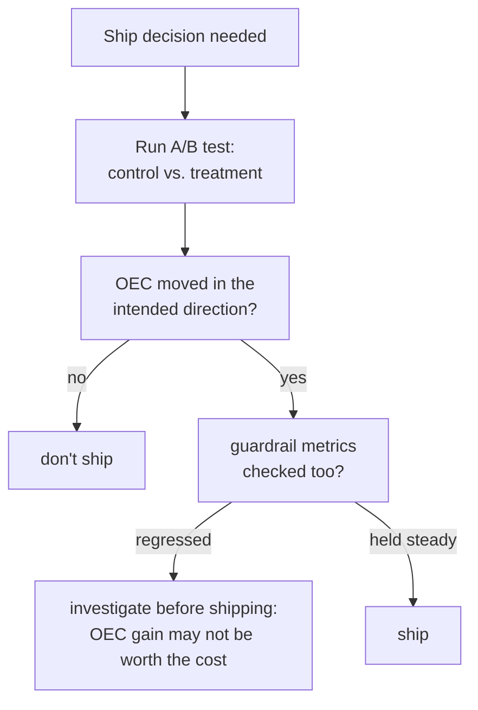

# 第 15 课：A/B 测试与护栏指标

**使命关联:** 第 9 课教的是分辨真实的离线分数差异与噪声。到第 14 课为止的一切仍然是离线的：一个固定的评测集，运行一次，评一次分。把改动上线给真实用户，需要这套纪律在线上的对应物，而它需要的，恰恰是本工作区自安全那一课以来，在每个阶段都重复过的那个教训：你要优化的指标，和告诉你有没有弄坏别的东西的指标，必须作为两个独立的数字来跟踪，而不是一个。
**主要来源:** [论文：“Seven Rules of Thumb for Web Site Experimenters”，Kohavi 等，2014](https://exp-platform.com/Documents/2014%20experimentersRulesOfThumb.pdf)
**前置知识:** [第 9 课](0009-statistical-significance-vs-noise.md)、[第 12 课](0012-safety-and-red-teaming-evaluation.md)

## 热身

1. ▢ 某份安全报告只写着“拒答率：94%”，没有提到是对照哪个提示词集度量的。为什么单看这个数字，无法解读？

检查

高拒答率在真正不安全的提示词集上是好的（抓住了真正的威胁），而在安全却听起来敏感的集合上是不好的（过度拒答）；不知道是哪个集合产生了这个数字，就没有办法判断它反映的是这两种截然不同的情形中的哪一种。

2. ▢ 为什么两次离线评测运行之间的分数差异，在被当作真实的差异之前，需要先对照噪声来检查？

检查

两次运行可能仅凭偶然就有差异，源于所包含的样本不同，或模型碰巧的回应不同而产生的采样波动；一个差异要先对照仅凭偶然就可能出现的波动幅度来度量，才能被信任为所测试改动产生的真实效果。

## 要点

### A/B 测试度量的是线上的结果，而不是静态的评测分数

**A/B 测试**（一种在线对照实验）把真实流量随机地分给**对照组**（当前的系统）和**实验组**（被测试的改动），度量的是线上的结果，也就是实际的用户行为、实际的生产指标，而不是针对一个固定的离线评测集，一次性算出的分数。随机化是让它可信的关键：正是它使得测得的任何结果差异，都能归因于改动本身，而不是两组用户之间的其他某种差异。

### OEC 是实验真正想要推动的那一个指标（或一个小的组合）

实验需要一个**总体评估标准（OEC）**：改动真正要改善的那个具体指标，或由少数几个指标加权组成的组合。Kohavi 自己的指导，对什么才是好的 OEC 候选，说得很具体：它必须是**可移动的**，也就是足够灵敏，真正的改变在可行的实验中确实能让它产生变化；还必须与真正重要的结果有**因果联系**，而不只是相关。他自己的例子使这个陷阱具体可见：“浏览的照片数”很容易被一次界面改动推动，但对收入几乎没有真正的因果影响；像预订转化率这样的指标，离业务真正关心的东西更近，尽管它的变化可能没有那么显著。

### 护栏指标是你跟踪、却并不试图推动的指标

**护栏指标**是实验根本不试图优化的指标，而是专门盯着它，确保改动在追逐 OEC 的同时，不会悄悄地损害它。这是第 12 课对安全所要求的（拒答率和过度拒答率，作为两个独立的数字来跟踪）以及第 14 课对 RAG 所要求的（忠实性和引用正确性，作为两个独立的数字来跟踪）的线上版本：实验只报告它的 OEC 的提升，而不同时检查任何护栏指标，就可能上线一个改进了它所优化的东西、同时悄悄让别的东西变差的改动，比如延迟、安全事件、投诉率，而报告出的结果里没有任何东西会暴露这种权衡。

### 孤立地优化 OEC，恰恰是护栏在没人察觉的情况下被破坏的方式

这种失败模式既不是假设的，也不罕见：为推动 OEC 而设计的改动，完全有动机去做这件事，而改进 OEC，对一个没人优化、也没人盯着的指标，什么都保证不了。只凭 OEC 的提升就上线、而不检查它的护栏指标变化是否可以接受（或者根本没变）的团队，犯的错与以下做法相同：只报告攻击成功率并称之为“安全评测”，或者只报告忠实性而不检查引用正确性。这都是在被盯着的那一个数字上宣布成功，而在没有人检查的另一个数字上，真实的代价正在累积。

## 练习

1. ▢ 某团队为一个新功能，选“聊天机器人的建议按钮被点击的次数”作为 OEC，因为它在早期测试中变化显著。在相信这是个好的 OEC 之前，他们应该问本课的哪个问题？

提示

要考虑 Kohavi 的指导为好的 OEC 点出的两个性质，而不只是其中一个。

检查

要问这个指标是只是可移动的，还是同时与真正重要的结果（用户满意度、任务完成、收入）有因果联系；一个容易推动、却对业务关心的东西几乎没有真正的因果影响的指标，恰恰是 Kohavi 的“浏览的照片数”这个例子所警告的陷阱。

2. ▢ A/B 测试的结果只报告了 OEC 提升 12%，别的什么都没有。在把它当作一个干净利落的上线决定之前，还缺什么？

检查

缺的是有没有检查任何护栏指标，以及它们是保持稳定，还是出现了退步。单独报告的 OEC 提升，排除不了改动悄悄损害了团队并未优化、却仍需保护的其他东西。

3. ▢ 为什么本课把孤立地优化 OEC、不跟踪任何护栏指标，描述为“护栏在没人察觉的情况下被破坏的方式”？

检查

因为为推动 OEC 而设计的改动，完全有动机这样做，但成功做到这一点，对一个没人盯着的指标什么也保证不了；没有与 OEC 一起跟踪的护栏指标，别处的真实退步就可能在未被发现的情况下上线，因为被报告出来的那一个数字，看起来是毫不含糊的成功。

4. ▢ 本课的 OEC 与护栏指标这一对，与第 12 课的拒答率与过度拒答率这一对，有什么相似之处？

检查

两者都要求报告两个独立的数字，而不是一个：第 12 课要求同时报告拒答率和过度拒答率，因为孤立地优化其中一个（更用力地朝拒答的方向调优），可能悄悄地让另一个变差。本课的 OEC 和护栏指标遵循同样的结构：一个被优化的指标和一个被保护的指标，独立地跟踪和报告，而不是合并成一个成功信号。

5. ▢ 下列哪项说法正确地描述了 OEC 与护栏指标之间的关系？

    - a) 护栏指标只是 OEC 的另一个名字，可以互换使用
    - b) OEC 是实验真正想要推动的指标（或小的组合），选择时要使它既可移动、又与真实结果有因果联系；护栏指标的跟踪是为了抓住优化 OEC 带来的意外损害，而只报告 OEC 的提升，可能掩盖别处真实的退步
    - c) 一个指标只要是可移动的，就足以成为好的 OEC 候选，不管它与实际结果有没有因果联系
    - d) 只要 OEC 显示出提升，A/B 测试中的随机化就是可选的

检查

**b)** 这正是本课所确立的精确关系。（a）错误：OEC 是被优化的东西，护栏指标是被保护的东西；把二者混为一谈，就失去了分别跟踪它们的意义。（c）错误：Kohavi 自己的指导要求同时具备可移动性和真实的因果联系，而不只是可移动性。（d）错误：随机化正是让测得的差异能归因于改动本身，而不是两组之间其他某种差异的关键。

## 实战练习

- [ ] 对于你能接触到的一次 A/B 测试（或某个案例研究中描述的一次），找出它的 OEC，并检查它有没有指明与之一起跟踪的护栏指标。
- [ ] 挑一个你的团队目前正在优化的指标，对它问 Kohavi 的两个问题：它是可移动的吗，它与你真正关心的东西有因果联系，还是只是相关？
- [ ] 明天：完整阅读主要来源中的其他经验法则，并记下哪些是讲如何把实验做好，哪些是讲如何诚实地解读它们的结果。

## 延伸阅读

- [论文：“Seven Rules of Thumb for Web Site Experimenters”，Kohavi 等，2014](https://exp-platform.com/Documents/2014%20experimentersRulesOfThumb.pdf)
- [资源](../RESOURCES.md)

---

没学明白？请重读顶部的主要来源，因为本课是对它的压缩，而理解正是在压缩中流失的。如果有哪个术语觉得含糊，可以查看[术语表](../GLOSSARY.md)。

如果问题出在课程本身，而不是学习材料，那就是一个缺陷：[提交 issue](https://github.com/TokenCemetery/teach/issues)。
